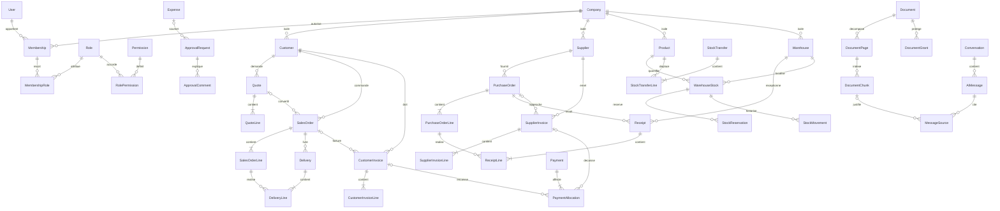

# SmartERP AI — types réels et modèle relationnel candidat

Audit du 27 septembre 2026. **IMPLEMENTED** désigne les types TypeScript ; **DERIVED FROM FRONTEND** désigne les concepts qu'ils impliquent ; **BACKEND RECOMMENDATION / PROPOSED** désigne la normalisation Django à construire. Aucun modèle Django n'existe dans ce dépôt.

Le dictionnaire exhaustif ci-dessous reprend les interfaces et alias des 27 fichiers `*.types.ts`, y compris types de formulaire, projections et enums. Un type TS n'est pas nécessairement une table. Les types auxiliaires déclarés dans les fichiers API et `MoneyLine/MoneyTotals` sont également recensés. Les listes de consommateurs sont des références lexicales au nom du type (pas une preuve de lecture de chaque propriété). Les champs imbriqués et héritages sont conservés dans leurs signatures ; une propriété facultative TS n'impose pas à elle seule `NULL` en SQL.

## Relations conceptuelles



Les liens Quote→SalesOrder/Invoice existent sous forme de cible de conversion dans l'API ; la démo ne les réalise pas. `StockReservation`, `PaymentAllocation` multi-lignes, `DocumentChunk/Grant`, `MembershipRole` sont **PROPOSED**, nécessaires à la normalisation et à la sécurité, non des interfaces identiques déjà présentes. Toutes les entités métier ci-dessus sont isolées par société directement, ou via un parent immuable. Les FKs doivent appartenir à la même société ; l'absence de `companyId` dans les DTO n'autorise pas un modèle global.

## Champs stockés et projections

| Famille | Persisté recommandé | Calculé/DTO seulement |
|---|---|---|
| Clients | identité, contacts, commercial, statut, tags, limite crédit | CA, créance, risque documenté, répartition, activité issue des événements |
| Fournisseurs | identité, acheteur, catégorie, conditions, statut | volume achats, solde ouvert, délai moyen observé ; score IA avec provenance/version/date |
| Documents commerciaux | lignes/prix/remises/taxes figés, dates, auteur, référence | libellés des partenaires ; totaux recalculés puis figés au posting ; capabilities |
| Factures | workflow et version, échéance, lignes | paid/remaining, overdue, aging, présentation du kanban |
| Paiements | direction, montant positif, mode, date, statut, affectations | partenaire affiché, canCancel, délai moyen calculable seulement avec dates |
| Produits | type, SKU, catégorie, unité, prix catalogue, seuils, fournisseur | marge %, disponible, valeur du stock, santé ; moyenne des coûts issue des écritures |
| Stock | on_hand/reserved matérialisés et journal immutable | available = on_hand - reserved ; incoming et in_transit séparés |
| Reports/IA | paramètres, snapshot horodaté, provenance, version, résultat | tableaux/KPI/formats d'affichage ; confiance nullable, jamais une garantie |
| Utilisateurs | compte et préférences ; rôle sur membership | roleName, permissions effectives, capabilities, currentUserId |
| Settings | version et valeurs validées par domaine | options, champs verrouillés, droits de section dérivés du contexte |

## Divergences à conserver dans les adaptateurs

`SalesOrderDetail.deliveryStatus` vaut `none/partial/delivered`, `invoiceStatus` vaut `none/partial/invoiced`, `paymentStatus` vaut `unpaid/partial/paid`. Les factures utilisent `unpaid/partially_paid/paid`. Les paiements canoniques utilisent `completed` mais `SalesPayment` utilise `confirmed`. Le dashboard possède son enum condensé `paid/partial/sent/overdue`. Ne pas remplacer ces valeurs silencieusement dans une réponse consommée sans mapper.

Les `Receipt.warehouse`, `SalesDelivery.warehouse`, `PurchaseInput.warehouse`, acheteurs et commerciaux sont souvent des chaînes de présentation. **PROPOSED** : FKs côté DB et adaptateurs DTO conservant les libellés actuels ; faire évoluer les saisies vers des identifiants avant d'autoriser des noms de dépôt ambigus. `PurchaseLine` n'expose pas de `productId`, contrairement aux lignes stock : l'intégration réception→stock nécessite un contrat supplémentaire explicite.

Les références des mocks incluent notamment QT, SO, INV, PO, BILL, PAY, MOV et des références propres aux réceptions/transferts. Le préfixe exact est une configuration d'affichage, pas une FK ni un algorithme d'identifiant fiable. Voir les occurrences extraites dans l'architecture et le service de numérotation proposé dans le blueprint.

## Contraintes et index transversaux proposés

Clé technique interne, `company_id`, `created_at/updated_at` UTC et `version` pour les agrégats modifiables ; date seule pour échéance et date de pièce. `Decimal` pour quantités fractionnables, prix, remises/taxes et montants. Unique `(company, reference)` sur chaque famille de pièces ; SKU unique insensible à la casse par société ; stock unique `(company, warehouse, product)` ; protections `PROTECT` sur partenaires/produits déjà utilisés. Les détails modèle par modèle sont dans [BACKEND_BLUEPRINT](BACKEND_BLUEPRINT.md).

Index proposés sur les parcours réels : `(company, workflow_status, due_date)` factures ouvertes ; `(company, date, id)` journaux ; `(company, partner_id, date)` paiements ; `(company, product_id, warehouse_id, occurred_at)` mouvements ; `(company, status, created_at)` demandes/jobs ; index de recherche nom/SKU après mesure. Éviter de dupliquer systématiquement l'index automatique d'une FK. Les agrégats et capacités ne deviennent pas des colonnes par défaut.

<!-- GENERATED_TYPES -->

## Dictionnaire exhaustif des declarations

263 interfaces/alias dans 27 fichiers de types. Declarations auxiliaires de transport et de monnaie incluses ensuite.

### features/admin/types/admin.types.ts — AdminUser

Source : [features/admin/types/admin.types.ts](../src/features/admin/types/admin.types.ts) ligne 1. Candidat : User + Membership.

Used where (references lexicales au type) : [features/admin/api/admin.api.ts](../src/features/admin/api/admin.api.ts), [features/admin/components/UserEditor.tsx](../src/features/admin/components/UserEditor.tsx), [features/admin/data/admin.mock.ts](../src/features/admin/data/admin.mock.ts), [features/admin/pages/UsersAdminPage.tsx](../src/features/admin/pages/UsersAdminPage.tsx).

| Field | TS type | Nullable | Used where | Backend model candidate |
|---|---|---|---|---|
| `id` | `number` | non-null | Consommateurs ci-dessus | User + Membership |
| `name` | `string` | non-null | Consommateurs ci-dessus | User + Membership |
| `email` | `string` | non-null | Consommateurs ci-dessus | User + Membership |
| `department` | `string` | non-null | Consommateurs ci-dessus | User + Membership |
| `roleId` | `number` | non-null | Consommateurs ci-dessus | User + Membership |
| `roleName` | `string` | non-null | Consommateurs ci-dessus | User + Membership |
| `status` | `"active" &#124; "invited" &#124; "suspended" &#124; "disabled"` | non-null | Consommateurs ci-dessus | User + Membership |
| `twoFactorEnabled` | `boolean` | non-null | Consommateurs ci-dessus | User + Membership |
| `passwordResetRequired` | `boolean` | non-null | Consommateurs ci-dessus | User + Membership |
| `lastLogin` | `string &#124; null` | null autorise | Consommateurs ci-dessus | User + Membership |
| `createdAt` | `string` | non-null | Consommateurs ci-dessus | User + Membership |
| `capabilities` | `{ canEdit: boolean; canAssignRole: boolean; canSuspend: boolean; canReactivate: boolean; }` | non-null | Consommateurs ci-dessus | User + Membership |

<details><summary>Declaration exacte (variantes, champs imbriques et heritage)</summary>

```ts
export interface AdminUser { id: number; name: string; email: string; department: string; roleId: number; roleName: string; status: 'active' | 'invited' | 'suspended' | 'disabled'; twoFactorEnabled: boolean; passwordResetRequired: boolean; lastLogin: string | null; createdAt: string; capabilities: { canEdit: boolean; canAssignRole: boolean; canSuspend: boolean; canReactivate: boolean } }
```

</details>

### features/admin/types/admin.types.ts — UserInput

Source : [features/admin/types/admin.types.ts](../src/features/admin/types/admin.types.ts) ligne 2. Candidat : DTO / enum / validation (pas de table autonome).

Used where (references lexicales au type) : [features/admin/api/admin.api.ts](../src/features/admin/api/admin.api.ts), [features/admin/components/UserEditor.tsx](../src/features/admin/components/UserEditor.tsx), [features/admin/data/admin.mock.ts](../src/features/admin/data/admin.mock.ts), [features/admin/hooks/useAdmin.ts](../src/features/admin/hooks/useAdmin.ts).

| Field | TS type | Nullable | Used where | Backend model candidate |
|---|---|---|---|---|
| `name` | `string` | non-null | Consommateurs ci-dessus | DTO / enum / validation (pas de table autonome) |
| `email` | `string` | non-null | Consommateurs ci-dessus | DTO / enum / validation (pas de table autonome) |
| `department` | `string` | non-null | Consommateurs ci-dessus | DTO / enum / validation (pas de table autonome) |
| `roleId` | `number &#124; undefined` | non-null ; optionnel | Consommateurs ci-dessus | DTO / enum / validation (pas de table autonome) |
| `status` | `"active" &#124; "invited" &#124; "suspended" &#124; "disabled" &#124; undefined` | non-null ; optionnel | Consommateurs ci-dessus | DTO / enum / validation (pas de table autonome) |

<details><summary>Declaration exacte (variantes, champs imbriques et heritage)</summary>

```ts
export interface UserInput { name: string; email: string; department: string; roleId?: number; status?: AdminUser['status'] }
```

</details>

### features/admin/types/admin.types.ts — Permission

Source : [features/admin/types/admin.types.ts](../src/features/admin/types/admin.types.ts) ligne 3. Candidat : Permission ; grantable calcule.

Used where (references lexicales au type) : [features/admin/api/admin.api.ts](../src/features/admin/api/admin.api.ts), [features/admin/components/RoleEditor.tsx](../src/features/admin/components/RoleEditor.tsx), [features/admin/data/admin.mock.ts](../src/features/admin/data/admin.mock.ts), [features/invoices/data/invoices.mock.ts](../src/features/invoices/data/invoices.mock.ts).

| Field | TS type | Nullable | Used where | Backend model candidate |
|---|---|---|---|---|
| `code` | `string` | non-null | Consommateurs ci-dessus | Permission ; grantable calcule |
| `label` | `string` | non-null | Consommateurs ci-dessus | Permission ; grantable calcule |
| `module` | `string` | non-null | Consommateurs ci-dessus | Permission ; grantable calcule |
| `action` | `"view" &#124; "create" &#124; "edit" &#124; "delete" &#124; "export" &#124; "approve" &#124; "ai" &#124; "sensitive"` | non-null | Consommateurs ci-dessus | Permission ; grantable calcule |
| `grantable` | `boolean` | non-null | Consommateurs ci-dessus | Permission ; grantable calcule |

<details><summary>Declaration exacte (variantes, champs imbriques et heritage)</summary>

```ts
export interface Permission { code: string; label: string; module: string; action: 'view' | 'create' | 'edit' | 'delete' | 'export' | 'approve' | 'ai' | 'sensitive'; grantable: boolean }
```

</details>

### features/admin/types/admin.types.ts — Role

Source : [features/admin/types/admin.types.ts](../src/features/admin/types/admin.types.ts) ligne 4. Candidat : Role / RolePermission ; capabilities calculees.

Used where (references lexicales au type) : [features/admin/api/admin.api.ts](../src/features/admin/api/admin.api.ts), [features/admin/components/RoleEditor.tsx](../src/features/admin/components/RoleEditor.tsx), [features/admin/data/admin.mock.ts](../src/features/admin/data/admin.mock.ts), [features/admin/pages/RolesPermissionsPage.tsx](../src/features/admin/pages/RolesPermissionsPage.tsx).

| Field | TS type | Nullable | Used where | Backend model candidate |
|---|---|---|---|---|
| `id` | `number` | non-null | Consommateurs ci-dessus | Role / RolePermission ; capabilities calculees |
| `name` | `string` | non-null | Consommateurs ci-dessus | Role / RolePermission ; capabilities calculees |
| `description` | `string` | non-null | Consommateurs ci-dessus | Role / RolePermission ; capabilities calculees |
| `system` | `boolean` | non-null | Consommateurs ci-dessus | Role / RolePermission ; capabilities calculees |
| `permissionCodes` | `string[]` | non-null | Consommateurs ci-dessus | Role / RolePermission ; capabilities calculees |
| `version` | `number` | non-null | Consommateurs ci-dessus | Role / RolePermission ; capabilities calculees |
| `userIds` | `number[]` | non-null | Consommateurs ci-dessus | Role / RolePermission ; capabilities calculees |
| `capabilities` | `{ canEdit: boolean; canDuplicate: boolean; canAssign: boolean; }` | non-null | Consommateurs ci-dessus | Role / RolePermission ; capabilities calculees |

<details><summary>Declaration exacte (variantes, champs imbriques et heritage)</summary>

```ts
export interface Role { id: number; name: string; description: string; system: boolean; permissionCodes: string[]; version: number; userIds: number[]; capabilities: { canEdit: boolean; canDuplicate: boolean; canAssign: boolean } }
```

</details>

### features/admin/types/admin.types.ts — RoleInput

Source : [features/admin/types/admin.types.ts](../src/features/admin/types/admin.types.ts) ligne 5. Candidat : DTO de validation Role.

Used where (references lexicales au type) : [features/admin/api/admin.api.ts](../src/features/admin/api/admin.api.ts), [features/admin/components/RoleEditor.tsx](../src/features/admin/components/RoleEditor.tsx), [features/admin/data/admin.mock.ts](../src/features/admin/data/admin.mock.ts), [features/admin/hooks/useAdmin.ts](../src/features/admin/hooks/useAdmin.ts).

| Field | TS type | Nullable | Used where | Backend model candidate |
|---|---|---|---|---|
| `name` | `string` | non-null | Consommateurs ci-dessus | DTO de validation Role |
| `description` | `string` | non-null | Consommateurs ci-dessus | DTO de validation Role |
| `permissionCodes` | `string[]` | non-null | Consommateurs ci-dessus | DTO de validation Role |
| `version` | `number &#124; undefined` | non-null ; optionnel | Consommateurs ci-dessus | DTO de validation Role |

<details><summary>Declaration exacte (variantes, champs imbriques et heritage)</summary>

```ts
export interface RoleInput { name: string; description: string; permissionCodes: string[]; version?: number }
```

</details>

### features/admin/types/admin.types.ts — UsersData

Source : [features/admin/types/admin.types.ts](../src/features/admin/types/admin.types.ts) ligne 6. Candidat : Projection/serializer de User / Membership / Role / AuditLog.

Used where (references lexicales au type) : [features/admin/api/admin.api.ts](../src/features/admin/api/admin.api.ts), [features/admin/components/UserEditor.tsx](../src/features/admin/components/UserEditor.tsx).

| Field | TS type | Nullable | Used where | Backend model candidate |
|---|---|---|---|---|
| `users` | `AdminUser[]` | non-null | Consommateurs ci-dessus | Projection/serializer de User / Membership / Role / AuditLog |
| `permissions` | `string[]` | non-null | Consommateurs ci-dessus | Projection/serializer de User / Membership / Role / AuditLog |
| `asOf` | `string` | non-null | Consommateurs ci-dessus | Projection/serializer de User / Membership / Role / AuditLog |
| `roles` | `{ id: number; name: string; }[]` | non-null | Consommateurs ci-dessus | Projection/serializer de User / Membership / Role / AuditLog |
| `departments` | `string[]` | non-null | Consommateurs ci-dessus | Projection/serializer de User / Membership / Role / AuditLog |
| `currentUserId` | `number` | non-null | Consommateurs ci-dessus | Projection/serializer de User / Membership / Role / AuditLog |
| `assignableRoleIds` | `number[]` | non-null | Consommateurs ci-dessus | Projection/serializer de User / Membership / Role / AuditLog |
| `canCreateDirectly` | `boolean` | non-null | Consommateurs ci-dessus | Projection/serializer de User / Membership / Role / AuditLog |

<details><summary>Declaration exacte (variantes, champs imbriques et heritage)</summary>

```ts
export interface UsersData { users: AdminUser[]; permissions: string[]; asOf: string; roles: { id: number; name: string }[]; departments: string[]; currentUserId: number; assignableRoleIds: number[]; canCreateDirectly: boolean }
```

</details>

### features/admin/types/admin.types.ts — RolesData

Source : [features/admin/types/admin.types.ts](../src/features/admin/types/admin.types.ts) ligne 7. Candidat : Projection/serializer de User / Membership / Role / AuditLog.

Used where (references lexicales au type) : [features/admin/api/admin.api.ts](../src/features/admin/api/admin.api.ts).

| Field | TS type | Nullable | Used where | Backend model candidate |
|---|---|---|---|---|
| `roles` | `Role[]` | non-null | Consommateurs ci-dessus | Projection/serializer de User / Membership / Role / AuditLog |
| `users` | `Pick<AdminUser, "id" &#124; "name" &#124; "roleId">[]` | non-null | Consommateurs ci-dessus | Projection/serializer de User / Membership / Role / AuditLog |
| `permissions` | `string[]` | non-null | Consommateurs ci-dessus | Projection/serializer de User / Membership / Role / AuditLog |
| `asOf` | `string` | non-null | Consommateurs ci-dessus | Projection/serializer de User / Membership / Role / AuditLog |

<details><summary>Declaration exacte (variantes, champs imbriques et heritage)</summary>

```ts
export interface RolesData { roles: Role[]; users: Pick<AdminUser, 'id' | 'name' | 'roleId'>[]; permissions: string[]; asOf: string }
```

</details>

### features/admin/types/admin.types.ts — AuditLog

Source : [features/admin/types/admin.types.ts](../src/features/admin/types/admin.types.ts) ligne 8. Candidat : User / Membership / Role / AuditLog.

Used where (references lexicales au type) : [features/admin/admin.utils.ts](../src/features/admin/admin.utils.ts), [features/admin/api/admin.api.ts](../src/features/admin/api/admin.api.ts), [features/admin/data/admin.mock.ts](../src/features/admin/data/admin.mock.ts), [features/admin/pages/AuditLogsPage.tsx](../src/features/admin/pages/AuditLogsPage.tsx).

| Field | TS type | Nullable | Used where | Backend model candidate |
|---|---|---|---|---|
| `id` | `number` | non-null | Consommateurs ci-dessus | User / Membership / Role / AuditLog |
| `timestamp` | `string` | non-null | Consommateurs ci-dessus | User / Membership / Role / AuditLog |
| `actor` | `string` | non-null | Consommateurs ci-dessus | User / Membership / Role / AuditLog |
| `module` | `string` | non-null | Consommateurs ci-dessus | User / Membership / Role / AuditLog |
| `action` | `string` | non-null | Consommateurs ci-dessus | User / Membership / Role / AuditLog |
| `entityType` | `string` | non-null | Consommateurs ci-dessus | User / Membership / Role / AuditLog |
| `recordId` | `number &#124; null` | null autorise | Consommateurs ci-dessus | User / Membership / Role / AuditLog |
| `reference` | `string` | non-null | Consommateurs ci-dessus | User / Membership / Role / AuditLog |
| `result` | `"success" &#124; "failure" &#124; "denied"` | non-null | Consommateurs ci-dessus | User / Membership / Role / AuditLog |
| `ip` | `string &#124; null` | null autorise | Consommateurs ci-dessus | User / Membership / Role / AuditLog |
| `device` | `string &#124; null` | null autorise | Consommateurs ci-dessus | User / Membership / Role / AuditLog |
| `requestId` | `string &#124; null` | null autorise | Consommateurs ci-dessus | User / Membership / Role / AuditLog |
| `before` | `Record<string, unknown>` | non-null | Consommateurs ci-dessus | User / Membership / Role / AuditLog |
| `after` | `Record<string, unknown>` | non-null | Consommateurs ci-dessus | User / Membership / Role / AuditLog |
| `restricted` | `boolean` | non-null | Consommateurs ci-dessus | User / Membership / Role / AuditLog |
| `canOpenRecord` | `boolean` | non-null | Consommateurs ci-dessus | User / Membership / Role / AuditLog |

<details><summary>Declaration exacte (variantes, champs imbriques et heritage)</summary>

```ts
export interface AuditLog { id: number; timestamp: string; actor: string; module: string; action: string; entityType: string; recordId: number | null; reference: string; result: 'success' | 'failure' | 'denied'; ip: string | null; device: string | null; requestId: string | null; before: Record<string, unknown>; after: Record<string, unknown>; restricted: boolean; canOpenRecord: boolean }
```

</details>

### features/admin/types/admin.types.ts — AuditData

Source : [features/admin/types/admin.types.ts](../src/features/admin/types/admin.types.ts) ligne 9. Candidat : Projection/serializer de User / Membership / Role / AuditLog.

Used where (references lexicales au type) : [features/admin/api/admin.api.ts](../src/features/admin/api/admin.api.ts).

| Field | TS type | Nullable | Used where | Backend model candidate |
|---|---|---|---|---|
| `logs` | `AuditLog[]` | non-null | Consommateurs ci-dessus | Projection/serializer de User / Membership / Role / AuditLog |
| `permissions` | `string[]` | non-null | Consommateurs ci-dessus | Projection/serializer de User / Membership / Role / AuditLog |
| `asOf` | `string` | non-null | Consommateurs ci-dessus | Projection/serializer de User / Membership / Role / AuditLog |
| `canViewNetwork` | `boolean` | non-null | Consommateurs ci-dessus | Projection/serializer de User / Membership / Role / AuditLog |
| `exportFormats` | `("csv" &#124; "pdf" &#124; "xlsx")[]` | non-null | Consommateurs ci-dessus | Projection/serializer de User / Membership / Role / AuditLog |

<details><summary>Declaration exacte (variantes, champs imbriques et heritage)</summary>

```ts
export interface AuditData { logs: AuditLog[]; permissions: string[]; asOf: string; canViewNetwork: boolean; exportFormats: ('csv' | 'pdf' | 'xlsx')[] }
```

</details>

### features/admin/types/admin.types.ts — AuditFilters

Source : [features/admin/types/admin.types.ts](../src/features/admin/types/admin.types.ts) ligne 10. Candidat : DTO / enum / validation (pas de table autonome).

Used where (references lexicales au type) : [features/admin/admin.utils.ts](../src/features/admin/admin.utils.ts), [features/admin/api/admin.api.ts](../src/features/admin/api/admin.api.ts), [features/admin/hooks/useAdmin.ts](../src/features/admin/hooks/useAdmin.ts), [features/admin/pages/AuditLogsPage.tsx](../src/features/admin/pages/AuditLogsPage.tsx).

| Field | TS type | Nullable | Used where | Backend model candidate |
|---|---|---|---|---|
| `search` | `string` | non-null | Consommateurs ci-dessus | DTO / enum / validation (pas de table autonome) |
| `dateFrom` | `string` | non-null | Consommateurs ci-dessus | DTO / enum / validation (pas de table autonome) |
| `dateTo` | `string` | non-null | Consommateurs ci-dessus | DTO / enum / validation (pas de table autonome) |
| `actor` | `string` | non-null | Consommateurs ci-dessus | DTO / enum / validation (pas de table autonome) |
| `module` | `string` | non-null | Consommateurs ci-dessus | DTO / enum / validation (pas de table autonome) |
| `action` | `string` | non-null | Consommateurs ci-dessus | DTO / enum / validation (pas de table autonome) |
| `entityType` | `string` | non-null | Consommateurs ci-dessus | DTO / enum / validation (pas de table autonome) |
| `result` | `string` | non-null | Consommateurs ci-dessus | DTO / enum / validation (pas de table autonome) |
| `ip` | `string` | non-null | Consommateurs ci-dessus | DTO / enum / validation (pas de table autonome) |

<details><summary>Declaration exacte (variantes, champs imbriques et heritage)</summary>

```ts
export interface AuditFilters { search: string; dateFrom: string; dateTo: string; actor: string; module: string; action: string; entityType: string; result: string; ip: string }
```

</details>

### features/ai/types/ai.types.ts — AICategory

Source : [features/ai/types/ai.types.ts](../src/features/ai/types/ai.types.ts) ligne 2. Candidat : Conversation / ForecastRun / Opportunity.

Used where (references lexicales au type) : declaration locale / aucun autre fichier ne cite ce nom.

| Field | TS type | Nullable | Used where | Backend model candidate |
|---|---|---|---|---|
| (valeur / alias) | `'FACT' &#124; 'AI ANALYSIS' &#124; 'FORECAST' &#124; 'RECOMMENDATION'` | selon union exacte | Consommateurs ci-dessus | Conversation / ForecastRun / Opportunity |

<details><summary>Declaration exacte (variantes, champs imbriques et heritage)</summary>

```ts
export type AICategory = 'FACT' | 'AI ANALYSIS' | 'FORECAST' | 'RECOMMENDATION'
```

</details>

### features/ai/types/ai.types.ts — AIResponseBlock

Source : [features/ai/types/ai.types.ts](../src/features/ai/types/ai.types.ts) ligne 3. Candidat : Conversation / ForecastRun / Opportunity.

Used where (references lexicales au type) : [features/ai/components/AIResponse.tsx](../src/features/ai/components/AIResponse.tsx), [features/ai/hooks/useAIWorkspace.ts](../src/features/ai/hooks/useAIWorkspace.ts).

| Field | TS type | Nullable | Used where | Backend model candidate |
|---|---|---|---|---|
| `id` | `string` | non-null ; selon variante (declaration exacte ci-dessous) | Consommateurs ci-dessus | Conversation / ForecastRun / Opportunity |
| `category` | `AICategory` | non-null ; selon variante (declaration exacte ci-dessous) | Consommateurs ci-dessus | Conversation / ForecastRun / Opportunity |
| `type` | `"text" &#124; "risk"` | non-null ; selon variante (declaration exacte ci-dessous) | Consommateurs ci-dessus | Conversation / ForecastRun / Opportunity |
| `text` | `string` | non-null ; selon variante (declaration exacte ci-dessous) | Consommateurs ci-dessus | Conversation / ForecastRun / Opportunity |
| `items` | `string[]` | non-null ; selon variante (declaration exacte ci-dessous) | Consommateurs ci-dessus | Conversation / ForecastRun / Opportunity |
| `columns` | `string[]` | non-null ; selon variante (declaration exacte ci-dessous) | Consommateurs ci-dessus | Conversation / ForecastRun / Opportunity |
| `rows` | `(string &#124; number)[][]` | non-null ; selon variante (declaration exacte ci-dessous) | Consommateurs ci-dessus | Conversation / ForecastRun / Opportunity |
| `title` | `string` | non-null ; selon variante (declaration exacte ci-dessous) | Consommateurs ci-dessus | Conversation / ForecastRun / Opportunity |
| `data` | `{ name: string; value: number; }[]` | non-null ; selon variante (declaration exacte ci-dessous) | Consommateurs ci-dessus | Conversation / ForecastRun / Opportunity |
| `impact` | `string` | non-null ; selon variante (declaration exacte ci-dessous) | Consommateurs ci-dessus | Conversation / ForecastRun / Opportunity |
| `dataUsed` | `string[]` | non-null ; selon variante (declaration exacte ci-dessous) | Consommateurs ci-dessus | Conversation / ForecastRun / Opportunity |
| `approvalId` | `number &#124; null` | null autorise ; selon variante (declaration exacte ci-dessous) | Consommateurs ci-dessus | Conversation / ForecastRun / Opportunity |
| `status` | `"awaiting_approval"` | non-null ; selon variante (declaration exacte ci-dessous) | Consommateurs ci-dessus | Conversation / ForecastRun / Opportunity |
| `canOpenApproval` | `boolean` | non-null ; selon variante (declaration exacte ci-dessous) | Consommateurs ci-dessus | Conversation / ForecastRun / Opportunity |

<details><summary>Declaration exacte (variantes, champs imbriques et heritage)</summary>

```ts
export type AIResponseBlock =
  | { id: string; category: AICategory; type: 'text' | 'risk'; text: string }
  | { id: string; category: AICategory; type: 'list'; items: string[] }
  | { id: string; category: AICategory; type: 'kpi'; items: { label: string; value: number; unit: 'money' | 'number' }[] }
  | { id: string; category: AICategory; type: 'table'; columns: string[]; rows: (string | number)[][] }
  | { id: string; category: AICategory; type: 'chart'; title: string; data: { name: string; value: number }[] }
  | { id: string; category: 'RECOMMENDATION'; type: 'action'; title: string; impact: string; dataUsed: string[]; approvalId: number | null; status: 'awaiting_approval'; canOpenApproval: boolean }
```

</details>

### features/ai/types/ai.types.ts — AIMessage

Source : [features/ai/types/ai.types.ts](../src/features/ai/types/ai.types.ts) ligne 10. Candidat : AIMessage.

Used where (references lexicales au type) : [features/ai/api/ai.api.ts](../src/features/ai/api/ai.api.ts), [features/ai/data/ai.mock.ts](../src/features/ai/data/ai.mock.ts), [features/ai/stream.ts](../src/features/ai/stream.ts).

| Field | TS type | Nullable | Used where | Backend model candidate |
|---|---|---|---|---|
| `id` | `string` | non-null | Consommateurs ci-dessus | AIMessage |
| `role` | `"user" &#124; "assistant"` | non-null | Consommateurs ci-dessus | AIMessage |
| `text` | `string` | non-null | Consommateurs ci-dessus | AIMessage |
| `blocks` | `AIResponseBlock[]` | non-null | Consommateurs ci-dessus | AIMessage |
| `sources` | `DocumentSource[]` | non-null | Consommateurs ci-dessus | AIMessage |
| `createdAt` | `string` | non-null | Consommateurs ci-dessus | AIMessage |
| `tools` | `string[]` | non-null | Consommateurs ci-dessus | AIMessage |
| `period` | `string &#124; null` | null autorise | Consommateurs ci-dessus | AIMessage |
| `simulated` | `boolean` | non-null | Consommateurs ci-dessus | AIMessage |

<details><summary>Declaration exacte (variantes, champs imbriques et heritage)</summary>

```ts
export interface AIMessage { id: string; role: 'user' | 'assistant'; text: string; blocks: AIResponseBlock[]; sources: DocumentSource[]; createdAt: string; tools: string[]; period: string | null; simulated: boolean }
```

</details>

### features/ai/types/ai.types.ts — Conversation

Source : [features/ai/types/ai.types.ts](../src/features/ai/types/ai.types.ts) ligne 11. Candidat : Conversation.

Used where (references lexicales au type) : [features/ai/api/ai.api.ts](../src/features/ai/api/ai.api.ts), [features/ai/data/ai.mock.ts](../src/features/ai/data/ai.mock.ts), [features/ai/pages/AIAssistantPage.tsx](../src/features/ai/pages/AIAssistantPage.tsx).

| Field | TS type | Nullable | Used where | Backend model candidate |
|---|---|---|---|---|
| `id` | `string` | non-null | Consommateurs ci-dessus | Conversation |
| `title` | `string` | non-null | Consommateurs ci-dessus | Conversation |
| `createdAt` | `string` | non-null | Consommateurs ci-dessus | Conversation |
| `messages` | `AIMessage[]` | non-null | Consommateurs ci-dessus | Conversation |

<details><summary>Declaration exacte (variantes, champs imbriques et heritage)</summary>

```ts
export interface Conversation { id: string; title: string; createdAt: string; messages: AIMessage[] }
```

</details>

### features/ai/types/ai.types.ts — ConversationsData

Source : [features/ai/types/ai.types.ts](../src/features/ai/types/ai.types.ts) ligne 12. Candidat : Projection/serializer de Conversation / ForecastRun / Opportunity.

Used where (references lexicales au type) : [features/ai/api/ai.api.ts](../src/features/ai/api/ai.api.ts).

| Field | TS type | Nullable | Used where | Backend model candidate |
|---|---|---|---|---|
| `canChat` | `boolean &#124; undefined` | non-null ; optionnel | Consommateurs ci-dessus | Projection/serializer de Conversation / ForecastRun / Opportunity |
| `policyReason` | `string &#124; null &#124; undefined` | null autorise ; optionnel | Consommateurs ci-dessus | Projection/serializer de Conversation / ForecastRun / Opportunity |
| `conversations` | `Conversation[]` | non-null | Consommateurs ci-dessus | Projection/serializer de Conversation / ForecastRun / Opportunity |
| `permissions` | `string[]` | non-null | Consommateurs ci-dessus | Projection/serializer de Conversation / ForecastRun / Opportunity |
| `asOf` | `string` | non-null | Consommateurs ci-dessus | Projection/serializer de Conversation / ForecastRun / Opportunity |
| `availableTools` | `{ id: string; label: string; }[]` | non-null | Consommateurs ci-dessus | Projection/serializer de Conversation / ForecastRun / Opportunity |

<details><summary>Declaration exacte (variantes, champs imbriques et heritage)</summary>

```ts
export interface ConversationsData { canChat?: boolean; policyReason?: string | null; conversations: Conversation[]; permissions: string[]; asOf: string; availableTools: { id: string; label: string }[] }
```

</details>

### features/ai/types/ai.types.ts — ChatEvent

Source : [features/ai/types/ai.types.ts](../src/features/ai/types/ai.types.ts) ligne 13. Candidat : Conversation / ForecastRun / Opportunity.

Used where (references lexicales au type) : [features/ai/api/ai.api.ts](../src/features/ai/api/ai.api.ts), [features/ai/data/ai.mock.ts](../src/features/ai/data/ai.mock.ts), [features/ai/stream.ts](../src/features/ai/stream.ts).

| Field | TS type | Nullable | Used where | Backend model candidate |
|---|---|---|---|---|
| `type` | `"status"` | non-null ; selon variante (declaration exacte ci-dessous) | Consommateurs ci-dessus | Conversation / ForecastRun / Opportunity |
| `status` | `"streaming" &#124; "tool_running"` | non-null ; selon variante (declaration exacte ci-dessous) | Consommateurs ci-dessus | Conversation / ForecastRun / Opportunity |
| `tool` | `string &#124; undefined` | non-null ; optionnel ; selon variante (declaration exacte ci-dessous) | Consommateurs ci-dessus | Conversation / ForecastRun / Opportunity |
| `block` | `AIResponseBlock` | non-null ; selon variante (declaration exacte ci-dessous) | Consommateurs ci-dessus | Conversation / ForecastRun / Opportunity |
| `message` | `AIMessage` | non-null ; selon variante (declaration exacte ci-dessous) | Consommateurs ci-dessus | Conversation / ForecastRun / Opportunity |

<details><summary>Declaration exacte (variantes, champs imbriques et heritage)</summary>

```ts
export type ChatEvent = { type: 'status'; status: 'streaming' | 'tool_running'; tool?: string } | { type: 'block'; block: AIResponseBlock } | { type: 'done'; message: AIMessage } | { type: 'error'; message: string }
```

</details>

### features/ai/types/ai.types.ts — ForecastDomain

Source : [features/ai/types/ai.types.ts](../src/features/ai/types/ai.types.ts) ligne 15. Candidat : Conversation / ForecastRun / Opportunity.

Used where (references lexicales au type) : [features/ai/api/ai.api.ts](../src/features/ai/api/ai.api.ts), [features/ai/data/ai.mock.ts](../src/features/ai/data/ai.mock.ts), [features/ai/hooks/useAIWorkspace.ts](../src/features/ai/hooks/useAIWorkspace.ts), [features/ai/pages/AIForecastingPage.tsx](../src/features/ai/pages/AIForecastingPage.tsx).

| Field | TS type | Nullable | Used where | Backend model candidate |
|---|---|---|---|---|
| (valeur / alias) | `typeof forecastDomains[number]` | selon union exacte | Consommateurs ci-dessus | Conversation / ForecastRun / Opportunity |

<details><summary>Declaration exacte (variantes, champs imbriques et heritage)</summary>

```ts
export type ForecastDomain = typeof forecastDomains[number]
```

</details>

### features/ai/types/ai.types.ts — ForecastResult

Source : [features/ai/types/ai.types.ts](../src/features/ai/types/ai.types.ts) ligne 16. Candidat : ForecastRun + projection.

Used where (references lexicales au type) : [features/ai/api/ai.api.ts](../src/features/ai/api/ai.api.ts), [features/ai/data/ai.mock.ts](../src/features/ai/data/ai.mock.ts).

| Field | TS type | Nullable | Used where | Backend model candidate |
|---|---|---|---|---|
| `domain` | `"revenue" &#124; "sales" &#124; "demand" &#124; "inventory" &#124; "cash-flow" &#124; "payments"` | non-null | Consommateurs ci-dessus | ForecastRun + projection |
| `permissions` | `string[]` | non-null | Consommateurs ci-dessus | ForecastRun + projection |
| `asOf` | `string` | non-null | Consommateurs ci-dessus | ForecastRun + projection |
| `status` | `"disabled" &#124; "ready" &#124; "low_confidence" &#124; "insufficient_data"` | non-null | Consommateurs ci-dessus | ForecastRun + projection |
| `horizon` | `number` | non-null | Consommateurs ci-dessus | ForecastRun + projection |
| `confidence` | `number &#124; null` | null autorise | Consommateurs ci-dessus | ForecastRun + projection |
| `dataQuality` | `string` | non-null | Consommateurs ci-dessus | ForecastRun + projection |
| `generatedAt` | `string` | non-null | Consommateurs ci-dessus | ForecastRun + projection |
| `historyFrom` | `string &#124; null` | null autorise | Consommateurs ci-dessus | ForecastRun + projection |
| `historyTo` | `string &#124; null` | null autorise | Consommateurs ci-dessus | ForecastRun + projection |
| `projected` | `number &#124; null` | null autorise | Consommateurs ci-dessus | ForecastRun + projection |
| `unit` | `"number" &#124; "money"` | non-null | Consommateurs ci-dessus | ForecastRun + projection |
| `series` | `{ date: string; historical: number &#124; null; forecast: number &#124; null; lower: number &#124; null; upper: number &#124; null; }[]` | non-null | Consommateurs ci-dessus | ForecastRun + projection |
| `risks` | `string[]` | non-null | Consommateurs ci-dessus | ForecastRun + projection |
| `source` | `string` | non-null | Consommateurs ci-dessus | ForecastRun + projection |

<details><summary>Declaration exacte (variantes, champs imbriques et heritage)</summary>

```ts
export interface ForecastResult { domain: ForecastDomain; permissions: string[]; asOf: string; status: 'ready' | 'low_confidence' | 'insufficient_data' | 'disabled'; horizon: number; confidence: number | null; dataQuality: string; generatedAt: string; historyFrom: string | null; historyTo: string | null; projected: number | null; unit: 'money' | 'number'; series: { date: string; historical: number | null; forecast: number | null; lower: number | null; upper: number | null }[]; risks: string[]; source: string }
```

</details>

### features/ai/types/ai.types.ts — ForecastDriver

Source : [features/ai/types/ai.types.ts](../src/features/ai/types/ai.types.ts) ligne 17. Candidat : Conversation / ForecastRun / Opportunity.

Used where (references lexicales au type) : [features/ai/api/ai.api.ts](../src/features/ai/api/ai.api.ts), [features/ai/data/ai.mock.ts](../src/features/ai/data/ai.mock.ts).

| Field | TS type | Nullable | Used where | Backend model candidate |
|---|---|---|---|---|
| `label` | `string` | non-null | Consommateurs ci-dessus | Conversation / ForecastRun / Opportunity |
| `explanation` | `string` | non-null | Consommateurs ci-dessus | Conversation / ForecastRun / Opportunity |
| `relationship` | `"observed" &#124; "correlation" &#124; "assumption"` | non-null | Consommateurs ci-dessus | Conversation / ForecastRun / Opportunity |

<details><summary>Declaration exacte (variantes, champs imbriques et heritage)</summary>

```ts
export interface ForecastDriver { label: string; explanation: string; relationship: 'observed' | 'correlation' | 'assumption' }
```

</details>

### features/ai/types/ai.types.ts — AIOpportunity

Source : [features/ai/types/ai.types.ts](../src/features/ai/types/ai.types.ts) ligne 18. Candidat : Opportunity.

Used where (references lexicales au type) : [features/ai/api/ai.api.ts](../src/features/ai/api/ai.api.ts), [features/ai/data/ai.mock.ts](../src/features/ai/data/ai.mock.ts), [features/ai/pages/AIOpportunitiesPage.tsx](../src/features/ai/pages/AIOpportunitiesPage.tsx).

| Field | TS type | Nullable | Used where | Backend model candidate |
|---|---|---|---|---|
| `id` | `number` | non-null | Consommateurs ci-dessus | Opportunity |
| `type` | `"inventory" &#124; "upsell" &#124; "growth" &#124; "margin" &#124; "supplier"` | non-null | Consommateurs ci-dessus | Opportunity |
| `title` | `string` | non-null | Consommateurs ci-dessus | Opportunity |
| `potentialValue` | `number &#124; null` | null autorise | Consommateurs ci-dessus | Opportunity |
| `confidence` | `number &#124; null` | null autorise | Consommateurs ci-dessus | Opportunity |
| `confidenceLevel` | `"high" &#124; "medium" &#124; "low" &#124; null` | null autorise | Consommateurs ci-dessus | Opportunity |
| `evidence` | `DocumentSource[]` | non-null | Consommateurs ci-dessus | Opportunity |
| `recommendation` | `string` | non-null | Consommateurs ci-dessus | Opportunity |
| `status` | `"open" &#124; "assigned" &#124; "dismissed"` | non-null | Consommateurs ci-dessus | Opportunity |
| `assignedTo` | `{ id: number; name: string; } &#124; null` | null autorise | Consommateurs ci-dessus | Opportunity |
| `canAssign` | `boolean` | non-null | Consommateurs ci-dessus | Opportunity |
| `source` | `string` | non-null | Consommateurs ci-dessus | Opportunity |

<details><summary>Declaration exacte (variantes, champs imbriques et heritage)</summary>

```ts
export interface AIOpportunity { id: number; type: 'upsell' | 'growth' | 'margin' | 'supplier' | 'inventory'; title: string; potentialValue: number | null; confidence: number | null; confidenceLevel: 'high' | 'medium' | 'low' | null; evidence: DocumentSource[]; recommendation: string; status: 'open' | 'assigned' | 'dismissed'; assignedTo: { id: number; name: string } | null; canAssign: boolean; source: string }
```

</details>

### features/ai/types/ai.types.ts — OpportunitiesData

Source : [features/ai/types/ai.types.ts](../src/features/ai/types/ai.types.ts) ligne 19. Candidat : Projection/serializer de Conversation / ForecastRun / Opportunity.

Used where (references lexicales au type) : [features/ai/api/ai.api.ts](../src/features/ai/api/ai.api.ts).

| Field | TS type | Nullable | Used where | Backend model candidate |
|---|---|---|---|---|
| `opportunities` | `AIOpportunity[]` | non-null | Consommateurs ci-dessus | Projection/serializer de Conversation / ForecastRun / Opportunity |
| `permissions` | `string[]` | non-null | Consommateurs ci-dessus | Projection/serializer de Conversation / ForecastRun / Opportunity |
| `asOf` | `string` | non-null | Consommateurs ci-dessus | Projection/serializer de Conversation / ForecastRun / Opportunity |
| `assignees` | `{ id: number; name: string; role: string; }[]` | non-null | Consommateurs ci-dessus | Projection/serializer de Conversation / ForecastRun / Opportunity |

<details><summary>Declaration exacte (variantes, champs imbriques et heritage)</summary>

```ts
export interface OpportunitiesData { opportunities: AIOpportunity[]; permissions: string[]; asOf: string; assignees: { id: number; name: string; role: string }[] }
```

</details>

### features/ai-control-center/types/aiControlCenter.types.ts — Severity

Source : [features/ai-control-center/types/aiControlCenter.types.ts](../src/features/ai-control-center/types/aiControlCenter.types.ts) ligne 1. Candidat : Alert / projection de pilotage.

Used where (references lexicales au type) : [features/ai-control-center/pages/AIControlCenterPage.tsx](../src/features/ai-control-center/pages/AIControlCenterPage.tsx).

| Field | TS type | Nullable | Used where | Backend model candidate |
|---|---|---|---|---|
| (valeur / alias) | `'critical' &#124; 'high' &#124; 'medium' &#124; 'low' &#124; 'opportunity'` | selon union exacte | Consommateurs ci-dessus | Alert / projection de pilotage |

<details><summary>Declaration exacte (variantes, champs imbriques et heritage)</summary>

```ts
export type Severity = 'critical' | 'high' | 'medium' | 'low' | 'opportunity'
```

</details>

### features/ai-control-center/types/aiControlCenter.types.ts — IntelligenceType

Source : [features/ai-control-center/types/aiControlCenter.types.ts](../src/features/ai-control-center/types/aiControlCenter.types.ts) ligne 2. Candidat : DTO / enum / validation (pas de table autonome).

Used where (references lexicales au type) : declaration locale / aucun autre fichier ne cite ce nom.

| Field | TS type | Nullable | Used where | Backend model candidate |
|---|---|---|---|---|
| (valeur / alias) | `&#124; 'fact' &#124; 'analysis' &#124; 'forecast' &#124; 'recommendation'` | selon union exacte | Consommateurs ci-dessus | DTO / enum / validation (pas de table autonome) |

<details><summary>Declaration exacte (variantes, champs imbriques et heritage)</summary>

```ts
export type IntelligenceType =
  | 'fact'
  | 'analysis'
  | 'forecast'
  | 'recommendation'
```

</details>

### features/ai-control-center/types/aiControlCenter.types.ts — AlertStatus

Source : [features/ai-control-center/types/aiControlCenter.types.ts](../src/features/ai-control-center/types/aiControlCenter.types.ts) ligne 7. Candidat : DTO / enum / validation (pas de table autonome).

Used where (references lexicales au type) : declaration locale / aucun autre fichier ne cite ce nom.

| Field | TS type | Nullable | Used where | Backend model candidate |
|---|---|---|---|---|
| (valeur / alias) | `'open' &#124; 'investigating' &#124; 'resolved'` | selon union exacte | Consommateurs ci-dessus | DTO / enum / validation (pas de table autonome) |

<details><summary>Declaration exacte (variantes, champs imbriques et heritage)</summary>

```ts
export type AlertStatus = 'open' | 'investigating' | 'resolved'
```

</details>

### features/ai-control-center/types/aiControlCenter.types.ts — Department

Source : [features/ai-control-center/types/aiControlCenter.types.ts](../src/features/ai-control-center/types/aiControlCenter.types.ts) ligne 8. Candidat : Alert / projection de pilotage.

Used where (references lexicales au type) : [features/ai-control-center/components/AlertsTable.tsx](../src/features/ai-control-center/components/AlertsTable.tsx), [features/ai-control-center/components/PageHeader.tsx](../src/features/ai-control-center/components/PageHeader.tsx).

| Field | TS type | Nullable | Used where | Backend model candidate |
|---|---|---|---|---|
| (valeur / alias) | `&#124; 'Finance' &#124; 'Ventes' &#124; 'Stock' &#124; 'Clients' &#124; 'Achats' &#124; 'Opérations'` | selon union exacte | Consommateurs ci-dessus | Alert / projection de pilotage |

<details><summary>Declaration exacte (variantes, champs imbriques et heritage)</summary>

```ts
export type Department =
  | 'Finance'
  | 'Ventes'
  | 'Stock'
  | 'Clients'
  | 'Achats'
  | 'Opérations'
```

</details>

### features/ai-control-center/types/aiControlCenter.types.ts — Evidence

Source : [features/ai-control-center/types/aiControlCenter.types.ts](../src/features/ai-control-center/types/aiControlCenter.types.ts) ligne 16. Candidat : Alert / projection de pilotage.

Used where (references lexicales au type) : [features/ai-control-center/components/AlertDetailDrawer.tsx](../src/features/ai-control-center/components/AlertDetailDrawer.tsx).

| Field | TS type | Nullable | Used where | Backend model candidate |
|---|---|---|---|---|
| `id` | `string` | non-null | Consommateurs ci-dessus | Alert / projection de pilotage |
| `kind` | `"Commande client" &#124; "Commande fournisseur" &#124; "Produit" &#124; "Facture" &#124; "Client"` | non-null | Consommateurs ci-dessus | Alert / projection de pilotage |
| `description` | `string` | non-null | Consommateurs ci-dessus | Alert / projection de pilotage |

<details><summary>Declaration exacte (variantes, champs imbriques et heritage)</summary>

```ts
export interface Evidence {
  id: string
  kind:
    | 'Commande client'
    | 'Commande fournisseur'
    | 'Produit'
    | 'Facture'
    | 'Client'
  description: string
}
```

</details>

### features/ai-control-center/types/aiControlCenter.types.ts — SuggestedAction

Source : [features/ai-control-center/types/aiControlCenter.types.ts](../src/features/ai-control-center/types/aiControlCenter.types.ts) ligne 27. Candidat : DTO / enum / validation (pas de table autonome).

Used where (references lexicales au type) : [features/ai-control-center/components/AlertDetailDrawer.tsx](../src/features/ai-control-center/components/AlertDetailDrawer.tsx), [features/ai-control-center/components/Opportunities.tsx](../src/features/ai-control-center/components/Opportunities.tsx), [features/ai-control-center/components/RecommendedActions.tsx](../src/features/ai-control-center/components/RecommendedActions.tsx), [features/ai-control-center/data/aiControlCenter.mock.ts](../src/features/ai-control-center/data/aiControlCenter.mock.ts), [features/ai-control-center/pages/AIControlCenterPage.tsx](../src/features/ai-control-center/pages/AIControlCenterPage.tsx).

| Field | TS type | Nullable | Used where | Backend model candidate |
|---|---|---|---|---|
| `id` | `string` | non-null | Consommateurs ci-dessus | DTO / enum / validation (pas de table autonome) |
| `title` | `string` | non-null | Consommateurs ci-dessus | DTO / enum / validation (pas de table autonome) |
| `detail` | `string` | non-null | Consommateurs ci-dessus | DTO / enum / validation (pas de table autonome) |
| `button` | `string` | non-null | Consommateurs ci-dessus | DTO / enum / validation (pas de table autonome) |
| `approvalRequired` | `boolean` | non-null | Consommateurs ci-dessus | DTO / enum / validation (pas de table autonome) |
| `draft` | `string[]` | non-null | Consommateurs ci-dessus | DTO / enum / validation (pas de table autonome) |

<details><summary>Declaration exacte (variantes, champs imbriques et heritage)</summary>

```ts
export interface SuggestedAction {
  id: string
  title: string
  detail: string
  button: string
  approvalRequired: boolean
  draft: string[]
}
```

</details>

### features/ai-control-center/types/aiControlCenter.types.ts — AIAlert

Source : [features/ai-control-center/types/aiControlCenter.types.ts](../src/features/ai-control-center/types/aiControlCenter.types.ts) ligne 36. Candidat : Alert / projection de pilotage.

Used where (references lexicales au type) : [features/ai-control-center/components/AlertDetailDrawer.tsx](../src/features/ai-control-center/components/AlertDetailDrawer.tsx), [features/ai-control-center/components/AlertsTable.tsx](../src/features/ai-control-center/components/AlertsTable.tsx), [features/ai-control-center/pages/AIControlCenterPage.tsx](../src/features/ai-control-center/pages/AIControlCenterPage.tsx).

| Field | TS type | Nullable | Used where | Backend model candidate |
|---|---|---|---|---|
| `id` | `string` | non-null | Consommateurs ci-dessus | Alert / projection de pilotage |
| `title` | `string` | non-null | Consommateurs ci-dessus | Alert / projection de pilotage |
| `scope` | `string` | non-null | Consommateurs ci-dessus | Alert / projection de pilotage |
| `department` | `Department` | non-null | Consommateurs ci-dessus | Alert / projection de pilotage |
| `severity` | `Severity` | non-null | Consommateurs ci-dessus | Alert / projection de pilotage |
| `type` | `IntelligenceType` | non-null | Consommateurs ci-dessus | Alert / projection de pilotage |
| `metric` | `string` | non-null | Consommateurs ci-dessus | Alert / projection de pilotage |
| `currentValue` | `string` | non-null | Consommateurs ci-dessus | Alert / projection de pilotage |
| `baseline` | `string` | non-null | Consommateurs ci-dessus | Alert / projection de pilotage |
| `deviation` | `string` | non-null | Consommateurs ci-dessus | Alert / projection de pilotage |
| `impact` | `string` | non-null | Consommateurs ci-dessus | Alert / projection de pilotage |
| `confidence` | `number` | non-null | Consommateurs ci-dessus | Alert / projection de pilotage |
| `detectedAt` | `string` | non-null | Consommateurs ci-dessus | Alert / projection de pilotage |
| `status` | `AlertStatus` | non-null | Consommateurs ci-dessus | Alert / projection de pilotage |
| `assignee` | `string &#124; undefined` | non-null ; optionnel | Consommateurs ci-dessus | Alert / projection de pilotage |
| `facts` | `{ label: string; value: string; note?: string; }[]` | non-null | Consommateurs ci-dessus | Alert / projection de pilotage |
| `analysis` | `string` | non-null | Consommateurs ci-dessus | Alert / projection de pilotage |
| `causes` | `{ title: string; evidence: string; }[]` | non-null | Consommateurs ci-dessus | Alert / projection de pilotage |
| `estimates` | `{ label: string; value: string; }[]` | non-null | Consommateurs ci-dessus | Alert / projection de pilotage |
| `recommendations` | `SuggestedAction[]` | non-null | Consommateurs ci-dessus | Alert / projection de pilotage |
| `evidence` | `Evidence[]` | non-null | Consommateurs ci-dessus | Alert / projection de pilotage |

<details><summary>Declaration exacte (variantes, champs imbriques et heritage)</summary>

```ts
export interface AIAlert {
  id: string
  title: string
  scope: string
  department: Department
  severity: Severity
  type: IntelligenceType
  metric: string
  currentValue: string
  baseline: string
  deviation: string
  impact: string
  confidence: number
  detectedAt: string
  status: AlertStatus
  assignee?: string
  facts: { label: string; value: string; note?: string }[]
  analysis: string
  causes: { title: string; evidence: string }[]
  estimates: { label: string; value: string }[]
  recommendations: SuggestedAction[]
  evidence: Evidence[]
}
```

</details>

### features/ai-control-center/types/aiControlCenter.types.ts — AlertFilters

Source : [features/ai-control-center/types/aiControlCenter.types.ts](../src/features/ai-control-center/types/aiControlCenter.types.ts) ligne 60. Candidat : DTO / enum / validation (pas de table autonome).

Used where (references lexicales au type) : [features/ai-control-center/components/AlertsTable.tsx](../src/features/ai-control-center/components/AlertsTable.tsx), [features/ai-control-center/components/PageHeader.tsx](../src/features/ai-control-center/components/PageHeader.tsx), [features/ai-control-center/pages/AIControlCenterPage.tsx](../src/features/ai-control-center/pages/AIControlCenterPage.tsx).

| Field | TS type | Nullable | Used where | Backend model candidate |
|---|---|---|---|---|
| `search` | `string` | non-null | Consommateurs ci-dessus | DTO / enum / validation (pas de table autonome) |
| `department` | `string` | non-null | Consommateurs ci-dessus | DTO / enum / validation (pas de table autonome) |
| `severity` | `string` | non-null | Consommateurs ci-dessus | DTO / enum / validation (pas de table autonome) |
| `status` | `string` | non-null | Consommateurs ci-dessus | DTO / enum / validation (pas de table autonome) |
| `type` | `string` | non-null | Consommateurs ci-dessus | DTO / enum / validation (pas de table autonome) |
| `days` | `string` | non-null | Consommateurs ci-dessus | DTO / enum / validation (pas de table autonome) |
| `groupBy` | `string` | non-null | Consommateurs ci-dessus | DTO / enum / validation (pas de table autonome) |

<details><summary>Declaration exacte (variantes, champs imbriques et heritage)</summary>

```ts
export interface AlertFilters {
  search: string
  department: string
  severity: string
  status: string
  type: string
  days: string
  groupBy: string
}
```

</details>

### features/ai-control-center/types/aiControlCenter.types.ts — AIControlCenterData

Source : [features/ai-control-center/types/aiControlCenter.types.ts](../src/features/ai-control-center/types/aiControlCenter.types.ts) ligne 70. Candidat : Projection/serializer de Alert / projection de pilotage.

Used where (references lexicales au type) : [features/ai-control-center/api/aiControlCenter.api.ts](../src/features/ai-control-center/api/aiControlCenter.api.ts), [features/ai-control-center/components/AnomalyHistory.tsx](../src/features/ai-control-center/components/AnomalyHistory.tsx), [features/ai-control-center/components/BusinessHealth.tsx](../src/features/ai-control-center/components/BusinessHealth.tsx), [features/ai-control-center/components/ForecastRisks.tsx](../src/features/ai-control-center/components/ForecastRisks.tsx), [features/ai-control-center/components/IntelligenceStats.tsx](../src/features/ai-control-center/components/IntelligenceStats.tsx), [features/ai-control-center/components/IntelligenceSummary.tsx](../src/features/ai-control-center/components/IntelligenceSummary.tsx), [features/ai-control-center/components/Opportunities.tsx](../src/features/ai-control-center/components/Opportunities.tsx), [features/ai-control-center/components/PageHeader.tsx](../src/features/ai-control-center/components/PageHeader.tsx), [features/ai-control-center/components/RiskMatrix.tsx](../src/features/ai-control-center/components/RiskMatrix.tsx), [features/ai-control-center/data/aiControlCenter.mock.ts](../src/features/ai-control-center/data/aiControlCenter.mock.ts).

| Field | TS type | Nullable | Used where | Backend model candidate |
|---|---|---|---|---|
| `period` | `{ label: string; asOf: string; generatedAt: string; }` | non-null | Consommateurs ci-dessus | Projection/serializer de Alert / projection de pilotage |
| `health` | `{ score: number; trend: number; confidence: number; departments: { name: Department; score: number; trend: number; alerts: number; status: string; tone: "positive" &#124; "critical" &#124; "warning" &#124; "indigo"; }[]; }` | non-null | Consommateurs ci-dessus | Projection/serializer de Alert / projection de pilotage |
| `stats` | `{ critical: number; warnings: number; forecasts: number; opportunities: number; resolved: number; }` | non-null | Consommateurs ci-dessus | Projection/serializer de Alert / projection de pilotage |
| `summary` | `{ text: string; confidence: number; priorities: string[]; impacts: string[]; recommendations: string[]; sources: string[]; model: string; }` | non-null | Consommateurs ci-dessus | Projection/serializer de Alert / projection de pilotage |
| `alerts` | `AIAlert[]` | non-null | Consommateurs ci-dessus | Projection/serializer de Alert / projection de pilotage |
| `risks` | `{ id: string; alertId: string; label: string; shortLabel: string; impact: number; probability: number; severity: Severity; }[]` | non-null | Consommateurs ci-dessus | Projection/serializer de Alert / projection de pilotage |
| `forecasts` | `{ id: string; title: string; detail: string; horizon: string; confidence: number; severity: Severity; assumptions: string; }[]` | non-null | Consommateurs ci-dessus | Projection/serializer de Alert / projection de pilotage |
| `opportunities` | `{ id: string; title: string; company: string; detail: string; potential: string; confidence: number; action: SuggestedAction; }[]` | non-null | Consommateurs ci-dessus | Projection/serializer de Alert / projection de pilotage |
| `actions` | `SuggestedAction[]` | non-null | Consommateurs ci-dessus | Projection/serializer de Alert / projection de pilotage |
| `governance` | `SuggestedAction[]` | non-null | Consommateurs ci-dessus | Projection/serializer de Alert / projection de pilotage |
| `anomalyHistory` | `{ day: string; critical: number; high: number; medium: number; resolved: number; }[]` | non-null | Consommateurs ci-dessus | Projection/serializer de Alert / projection de pilotage |
| `resolutionRate` | `number` | non-null | Consommateurs ci-dessus | Projection/serializer de Alert / projection de pilotage |
| `responseMinutes` | `number` | non-null | Consommateurs ci-dessus | Projection/serializer de Alert / projection de pilotage |
| `assignees` | `string[]` | non-null | Consommateurs ci-dessus | Projection/serializer de Alert / projection de pilotage |

<details><summary>Declaration exacte (variantes, champs imbriques et heritage)</summary>

```ts
export interface AIControlCenterData {
  period: { label: string; asOf: string; generatedAt: string }
  health: {
    score: number
    trend: number
    confidence: number
    departments: {
      name: Department
      score: number
      trend: number
      alerts: number
      status: string
      tone: 'positive' | 'critical' | 'warning' | 'indigo'
    }[]
  }
  stats: {
    critical: number
    warnings: number
    forecasts: number
    opportunities: number
    resolved: number
  }
  summary: {
    text: string
    confidence: number
    priorities: string[]
    impacts: string[]
    recommendations: string[]
    sources: string[]
    model: string
  }
  alerts: AIAlert[]
  risks: {
    id: string
    alertId: string
    label: string
    shortLabel: string
    impact: number
    probability: number
    severity: Severity
  }[]
  forecasts: {
    id: string
    title: string
    detail: string
    horizon: string
    confidence: number
    severity: Severity
    assumptions: string
  }[]
  opportunities: {
    id: string
    title: string
    company: string
    detail: string
    potential: string
    confidence: number
    action: SuggestedAction
  }[]
  actions: SuggestedAction[]
  governance: SuggestedAction[]
  anomalyHistory: {
    day: string
    critical: number
    high: number
    medium: number
    resolved: number
  }[]
  resolutionRate: number
  responseMinutes: number
  assignees: string[]
}
```

</details>

### features/approvals/types/approvals.types.ts — ApprovalType

Source : [features/approvals/types/approvals.types.ts](../src/features/approvals/types/approvals.types.ts) ligne 1. Candidat : DTO / enum / validation (pas de table autonome).

Used where (references lexicales au type) : [features/approvals/data/approvals.mock.ts](../src/features/approvals/data/approvals.mock.ts).

| Field | TS type | Nullable | Used where | Backend model candidate |
|---|---|---|---|---|
| (valeur / alias) | `'discount' &#124; 'purchase' &#124; 'expense' &#124; 'payment' &#124; 'inventory' &#124; 'ai_action'` | selon union exacte | Consommateurs ci-dessus | DTO / enum / validation (pas de table autonome) |

<details><summary>Declaration exacte (variantes, champs imbriques et heritage)</summary>

```ts
export type ApprovalType = 'discount' | 'purchase' | 'expense' | 'payment' | 'inventory' | 'ai_action'
```

</details>

### features/approvals/types/approvals.types.ts — ApprovalStatus

Source : [features/approvals/types/approvals.types.ts](../src/features/approvals/types/approvals.types.ts) ligne 2. Candidat : DTO / enum / validation (pas de table autonome).

Used where (references lexicales au type) : [features/approvals/pages/ApprovalCenterPage.tsx](../src/features/approvals/pages/ApprovalCenterPage.tsx).

| Field | TS type | Nullable | Used where | Backend model candidate |
|---|---|---|---|---|
| (valeur / alias) | `'pending' &#124; 'approved' &#124; 'rejected' &#124; 'needs_changes'` | selon union exacte | Consommateurs ci-dessus | DTO / enum / validation (pas de table autonome) |

<details><summary>Declaration exacte (variantes, champs imbriques et heritage)</summary>

```ts
export type ApprovalStatus = 'pending' | 'approved' | 'rejected' | 'needs_changes'
```

</details>

### features/approvals/types/approvals.types.ts — ApprovalRequest

Source : [features/approvals/types/approvals.types.ts](../src/features/approvals/types/approvals.types.ts) ligne 3. Candidat : ApprovalRequest / ApprovalComment.

Used where (references lexicales au type) : [features/approvals/api/approvals.api.ts](../src/features/approvals/api/approvals.api.ts), [features/approvals/data/approvals.mock.ts](../src/features/approvals/data/approvals.mock.ts), [features/approvals/pages/ApprovalCenterPage.tsx](../src/features/approvals/pages/ApprovalCenterPage.tsx).

| Field | TS type | Nullable | Used where | Backend model candidate |
|---|---|---|---|---|
| `id` | `number` | non-null | Consommateurs ci-dessus | ApprovalRequest / ApprovalComment |
| `reference` | `string` | non-null | Consommateurs ci-dessus | ApprovalRequest / ApprovalComment |
| `date` | `string` | non-null | Consommateurs ci-dessus | ApprovalRequest / ApprovalComment |
| `type` | `ApprovalType` | non-null | Consommateurs ci-dessus | ApprovalRequest / ApprovalComment |
| `requester` | `string` | non-null | Consommateurs ci-dessus | ApprovalRequest / ApprovalComment |
| `context` | `string` | non-null | Consommateurs ci-dessus | ApprovalRequest / ApprovalComment |
| `amount` | `number &#124; null` | null autorise | Consommateurs ci-dessus | ApprovalRequest / ApprovalComment |
| `risk` | `"high" &#124; "medium" &#124; "low" &#124; null` | null autorise | Consommateurs ci-dessus | ApprovalRequest / ApprovalComment |
| `status` | `ApprovalStatus` | non-null | Consommateurs ci-dessus | ApprovalRequest / ApprovalComment |
| `approver` | `string &#124; null` | null autorise | Consommateurs ci-dessus | ApprovalRequest / ApprovalComment |
| `recordId` | `number &#124; null` | null autorise | Consommateurs ci-dessus | ApprovalRequest / ApprovalComment |
| `recordPath` | `string &#124; null` | null autorise | Consommateurs ci-dessus | ApprovalRequest / ApprovalComment |
| `canOpenRecord` | `boolean` | non-null | Consommateurs ci-dessus | ApprovalRequest / ApprovalComment |
| `attachments` | `{ id: number; name: string; canOpen: boolean; }[]` | non-null | Consommateurs ci-dessus | ApprovalRequest / ApprovalComment |
| `comments` | `{ id: string; author: string; date: string; text: string; }[]` | non-null | Consommateurs ci-dessus | ApprovalRequest / ApprovalComment |
| `aiRecommendation` | `{ analysis: string; recommendation: string; confidence: number &#124; null; } &#124; null` | null autorise | Consommateurs ci-dessus | ApprovalRequest / ApprovalComment |
| `impact` | `string` | non-null | Consommateurs ci-dessus | ApprovalRequest / ApprovalComment |
| `version` | `number` | non-null | Consommateurs ci-dessus | ApprovalRequest / ApprovalComment |
| `capabilities` | `{ canApprove: boolean; canReject: boolean; }` | non-null | Consommateurs ci-dessus | ApprovalRequest / ApprovalComment |

<details><summary>Declaration exacte (variantes, champs imbriques et heritage)</summary>

```ts
export interface ApprovalRequest { id: number; reference: string; date: string; type: ApprovalType; requester: string; context: string; amount: number | null; risk: 'low' | 'medium' | 'high' | null; status: ApprovalStatus; approver: string | null; recordId: number | null; recordPath: string | null; canOpenRecord: boolean; attachments: { id: number; name: string; canOpen: boolean }[]; comments: { id: string; author: string; date: string; text: string }[]; aiRecommendation: { analysis: string; recommendation: string; confidence: number | null } | null; impact: string; version: number; capabilities: { canApprove: boolean; canReject: boolean } }
```

</details>

### features/approvals/types/approvals.types.ts — ApprovalsData

Source : [features/approvals/types/approvals.types.ts](../src/features/approvals/types/approvals.types.ts) ligne 4. Candidat : Projection/serializer de ApprovalRequest.

Used where (references lexicales au type) : [features/approvals/api/approvals.api.ts](../src/features/approvals/api/approvals.api.ts).

| Field | TS type | Nullable | Used where | Backend model candidate |
|---|---|---|---|---|
| `requests` | `ApprovalRequest[]` | non-null | Consommateurs ci-dessus | Projection/serializer de ApprovalRequest |
| `permissions` | `string[]` | non-null | Consommateurs ci-dessus | Projection/serializer de ApprovalRequest |
| `allowedApprovalTypes` | `ApprovalType[]` | non-null | Consommateurs ci-dessus | Projection/serializer de ApprovalRequest |
| `asOf` | `string` | non-null | Consommateurs ci-dessus | Projection/serializer de ApprovalRequest |

<details><summary>Declaration exacte (variantes, champs imbriques et heritage)</summary>

```ts
export interface ApprovalsData { requests: ApprovalRequest[]; permissions: string[]; allowedApprovalTypes: ApprovalType[]; asOf: string }
```

</details>

### features/approvals/types/approvals.types.ts — ApprovalDecision

Source : [features/approvals/types/approvals.types.ts](../src/features/approvals/types/approvals.types.ts) ligne 5. Candidat : DTO / enum / validation (pas de table autonome).

Used where (references lexicales au type) : [features/approvals/api/approvals.api.ts](../src/features/approvals/api/approvals.api.ts), [features/approvals/data/approvals.mock.ts](../src/features/approvals/data/approvals.mock.ts), [features/approvals/hooks/useApprovals.ts](../src/features/approvals/hooks/useApprovals.ts).

| Field | TS type | Nullable | Used where | Backend model candidate |
|---|---|---|---|---|
| `comment` | `string` | non-null | Consommateurs ci-dessus | DTO / enum / validation (pas de table autonome) |
| `version` | `number` | non-null | Consommateurs ci-dessus | DTO / enum / validation (pas de table autonome) |

<details><summary>Declaration exacte (variantes, champs imbriques et heritage)</summary>

```ts
export interface ApprovalDecision { comment: string; version: number }
```

</details>

### features/auth/types/auth.types.ts — LoginCredentials

Source : [features/auth/types/auth.types.ts](../src/features/auth/types/auth.types.ts) ligne 1. Candidat : User / Company / Membership.

Used where (references lexicales au type) : [features/auth/api/auth.api.ts](../src/features/auth/api/auth.api.ts), [features/auth/hooks/useLogin.ts](../src/features/auth/hooks/useLogin.ts).

| Field | TS type | Nullable | Used where | Backend model candidate |
|---|---|---|---|---|
| `email` | `string` | non-null | Consommateurs ci-dessus | User / Company / Membership |
| `password` | `string` | non-null | Consommateurs ci-dessus | User / Company / Membership |

<details><summary>Declaration exacte (variantes, champs imbriques et heritage)</summary>

```ts
export interface LoginCredentials {
  email: string
  password: string
}
```

</details>

### features/auth/types/auth.types.ts — AuthUser

Source : [features/auth/types/auth.types.ts](../src/features/auth/types/auth.types.ts) ligne 6. Candidat : User + permissions effectives.

Used where (references lexicales au type) : [features/profile/api/profile.api.ts](../src/features/profile/api/profile.api.ts), [features/profile/data/profile.mock.ts](../src/features/profile/data/profile.mock.ts), [store/auth.store.ts](../src/store/auth.store.ts).

| Field | TS type | Nullable | Used where | Backend model candidate |
|---|---|---|---|---|
| `id` | `number` | non-null | Consommateurs ci-dessus | User + permissions effectives |
| `name` | `string` | non-null | Consommateurs ci-dessus | User + permissions effectives |
| `email` | `string` | non-null | Consommateurs ci-dessus | User + permissions effectives |
| `role` | `string` | non-null | Consommateurs ci-dessus | User + permissions effectives |
| `permissions` | `string[] &#124; undefined` | non-null ; optionnel | Consommateurs ci-dessus | User + permissions effectives |
| `preferences` | `{ theme: "system" &#124; "light" &#124; "dark"; language?: string; timezone?: string; dateFormat?: string; numberFormat?: string; } &#124; undefined` | non-null ; optionnel | Consommateurs ci-dessus | User + permissions effectives |

<details><summary>Declaration exacte (variantes, champs imbriques et heritage)</summary>

```ts
export interface AuthUser {
  id: number
  name: string
  email: string
  role: string
  permissions?: string[]
  preferences?: { theme: 'system' | 'light' | 'dark'; language?: string; timezone?: string; dateFormat?: string; numberFormat?: string }
}
```

</details>

### features/auth/types/auth.types.ts — Company

Source : [features/auth/types/auth.types.ts](../src/features/auth/types/auth.types.ts) ligne 15. Candidat : Company.

Used where (references lexicales au type) : [features/auth/hooks/useLogin.ts](../src/features/auth/hooks/useLogin.ts), [features/settings/api/settings.api.ts](../src/features/settings/api/settings.api.ts), [features/settings/data/settings.mock.ts](../src/features/settings/data/settings.mock.ts), [store/auth.store.ts](../src/store/auth.store.ts).

| Field | TS type | Nullable | Used where | Backend model candidate |
|---|---|---|---|---|
| `id` | `number` | non-null | Consommateurs ci-dessus | Company |
| `name` | `string` | non-null | Consommateurs ci-dessus | Company |
| `onboardingCompleted` | `boolean` | non-null | Consommateurs ci-dessus | Company |
| `enabledModules` | `string[] &#124; undefined` | non-null ; optionnel | Consommateurs ci-dessus | Company |

<details><summary>Declaration exacte (variantes, champs imbriques et heritage)</summary>

```ts
export interface Company {
  id: number
  name: string
  onboardingCompleted: boolean
  enabledModules?: string[]
}
```

</details>

### features/auth/types/auth.types.ts — LoginResponse

Source : [features/auth/types/auth.types.ts](../src/features/auth/types/auth.types.ts) ligne 22. Candidat : User / Company / Membership.

Used where (references lexicales au type) : [features/auth/api/auth.api.ts](../src/features/auth/api/auth.api.ts), [features/auth/hooks/useLogin.ts](../src/features/auth/hooks/useLogin.ts), [store/auth.store.ts](../src/store/auth.store.ts).

| Field | TS type | Nullable | Used where | Backend model candidate |
|---|---|---|---|---|
| `user` | `AuthUser` | non-null | Consommateurs ci-dessus | User / Company / Membership |
| `company` | `Company &#124; null` | null autorise | Consommateurs ci-dessus | User / Company / Membership |

<details><summary>Declaration exacte (variantes, champs imbriques et heritage)</summary>

```ts
export interface LoginResponse {
  user: AuthUser
  company: Company | null
}
```

</details>

### features/customers/types/customers.types.ts — CustomerStatus

Source : [features/customers/types/customers.types.ts](../src/features/customers/types/customers.types.ts) ligne 1. Candidat : DTO / enum / validation (pas de table autonome).

Used where (references lexicales au type) : [features/customers/components/CustomersFilters.tsx](../src/features/customers/components/CustomersFilters.tsx).

| Field | TS type | Nullable | Used where | Backend model candidate |
|---|---|---|---|---|
| (valeur / alias) | `&#124; 'active' &#124; 'prospect' &#124; 'inactive' &#124; 'archived' &#124; 'at_risk' &#124; 'vip'` | selon union exacte | Consommateurs ci-dessus | DTO / enum / validation (pas de table autonome) |

<details><summary>Declaration exacte (variantes, champs imbriques et heritage)</summary>

```ts
export type CustomerStatus =
  | 'active'
  | 'prospect'
  | 'inactive'
  | 'archived'
  | 'at_risk'
  | 'vip'
```

</details>

### features/customers/types/customers.types.ts — CustomerPermission

Source : [features/customers/types/customers.types.ts](../src/features/customers/types/customers.types.ts) ligne 8. Candidat : DTO / enum / validation (pas de table autonome).

Used where (references lexicales au type) : [features/customers/components/CustomerActivityTimeline.tsx](../src/features/customers/components/CustomerActivityTimeline.tsx), [features/customers/components/CustomerDocuments.tsx](../src/features/customers/components/CustomerDocuments.tsx).

| Field | TS type | Nullable | Used where | Backend model candidate |
|---|---|---|---|---|
| (valeur / alias) | `&#124; 'customers.view' &#124; 'customers.create' &#124; 'customers.edit' &#124; 'customers.export' &#124; 'sales.view' &#124; 'invoices.view' &#124; 'payments.view' &#124; 'ai.use'` | selon union exacte | Consommateurs ci-dessus | DTO / enum / validation (pas de table autonome) |

<details><summary>Declaration exacte (variantes, champs imbriques et heritage)</summary>

```ts
export type CustomerPermission =
  | 'customers.view'
  | 'customers.create'
  | 'customers.edit'
  | 'customers.export'
  | 'sales.view'
  | 'invoices.view'
  | 'payments.view'
  | 'ai.use'
```

</details>

### features/customers/types/customers.types.ts — CustomerView

Source : [features/customers/types/customers.types.ts](../src/features/customers/types/customers.types.ts) ligne 17. Candidat : DTO / enum / validation (pas de table autonome).

Used where (references lexicales au type) : [features/customers/components/CustomersToolbar.tsx](../src/features/customers/components/CustomersToolbar.tsx), [features/customers/pages/CustomersPage.tsx](../src/features/customers/pages/CustomersPage.tsx).

| Field | TS type | Nullable | Used where | Backend model candidate |
|---|---|---|---|---|
| (valeur / alias) | `'list' &#124; 'kanban'` | selon union exacte | Consommateurs ci-dessus | DTO / enum / validation (pas de table autonome) |

<details><summary>Declaration exacte (variantes, champs imbriques et heritage)</summary>

```ts
export type CustomerView = 'list' | 'kanban'
```

</details>

### features/customers/types/customers.types.ts — CustomerGroup

Source : [features/customers/types/customers.types.ts](../src/features/customers/types/customers.types.ts) ligne 18. Candidat : DTO / enum / validation (pas de table autonome).

Used where (references lexicales au type) : [features/customers/components/CustomerKanban.tsx](../src/features/customers/components/CustomerKanban.tsx), [features/customers/components/CustomersFilters.tsx](../src/features/customers/components/CustomersFilters.tsx), [features/customers/components/CustomerTable.tsx](../src/features/customers/components/CustomerTable.tsx).

| Field | TS type | Nullable | Used where | Backend model candidate |
|---|---|---|---|---|
| (valeur / alias) | `'none' &#124; 'salesperson' &#124; 'city' &#124; 'status' &#124; 'type'` | selon union exacte | Consommateurs ci-dessus | DTO / enum / validation (pas de table autonome) |

<details><summary>Declaration exacte (variantes, champs imbriques et heritage)</summary>

```ts
export type CustomerGroup = 'none' | 'salesperson' | 'city' | 'status' | 'type'
```

</details>

### features/customers/types/customers.types.ts — Customer

Source : [features/customers/types/customers.types.ts](../src/features/customers/types/customers.types.ts) ligne 20. Candidat : Customer.

Used where (references lexicales au type) : [features/customers/api/customers.api.ts](../src/features/customers/api/customers.api.ts), [features/customers/components/CustomerDialog.tsx](../src/features/customers/components/CustomerDialog.tsx), [features/customers/components/CustomerKanban.tsx](../src/features/customers/components/CustomerKanban.tsx), [features/customers/components/CustomerSelectionBar.tsx](../src/features/customers/components/CustomerSelectionBar.tsx), [features/customers/components/CustomersSummary.tsx](../src/features/customers/components/CustomersSummary.tsx), [features/customers/components/CustomerTable.tsx](../src/features/customers/components/CustomerTable.tsx), [features/customers/data/customers.mock.ts](../src/features/customers/data/customers.mock.ts), [features/customers/pages/CustomersPage.tsx](../src/features/customers/pages/CustomersPage.tsx).

| Field | TS type | Nullable | Used where | Backend model candidate |
|---|---|---|---|---|
| `id` | `number` | non-null | Consommateurs ci-dessus | Customer |
| `reference` | `string` | non-null | Consommateurs ci-dessus | Customer |
| `name` | `string` | non-null | Consommateurs ci-dessus | Customer |
| `type` | `"company" &#124; "individual"` | non-null | Consommateurs ci-dessus | Customer |
| `phone` | `string` | non-null | Consommateurs ci-dessus | Customer |
| `email` | `string` | non-null | Consommateurs ci-dessus | Customer |
| `city` | `string` | non-null | Consommateurs ci-dessus | Customer |
| `district` | `string` | non-null | Consommateurs ci-dessus | Customer |
| `salesperson` | `string` | non-null | Consommateurs ci-dessus | Customer |
| `revenue` | `number` | non-null | Consommateurs ci-dessus | Customer |
| `outstanding` | `number` | non-null | Consommateurs ci-dessus | Customer |
| `overdue` | `number` | non-null | Consommateurs ci-dessus | Customer |
| `lastActivity` | `string` | non-null | Consommateurs ci-dessus | Customer |
| `activity` | `string` | non-null | Consommateurs ci-dessus | Customer |
| `createdAt` | `string` | non-null | Consommateurs ci-dessus | Customer |
| `status` | `CustomerStatus` | non-null | Consommateurs ci-dessus | Customer |
| `previousStatus` | `"active" &#124; "prospect" &#124; "inactive" &#124; "at_risk" &#124; "vip" &#124; undefined` | non-null ; optionnel | Consommateurs ci-dessus | Customer |
| `tags` | `string[]` | non-null | Consommateurs ci-dessus | Customer |
| `signal` | `{ label: string; tone: "critical" &#124; "indigo" &#124; "positive"; } &#124; undefined` | non-null ; optionnel | Consommateurs ci-dessus | Customer |

<details><summary>Declaration exacte (variantes, champs imbriques et heritage)</summary>

```ts
export interface Customer {
  id: number
  reference: string
  name: string
  type: 'company' | 'individual'
  phone: string
  email: string
  city: string
  district: string
  salesperson: string
  revenue: number
  outstanding: number
  overdue: number
  lastActivity: string
  activity: string
  createdAt: string
  status: CustomerStatus
  previousStatus?: Exclude<CustomerStatus, 'archived'>
  tags: string[]
  signal?: { label: string; tone: 'critical' | 'indigo' | 'positive' }
}
```

</details>

### features/customers/types/customers.types.ts — CustomerInput

Source : [features/customers/types/customers.types.ts](../src/features/customers/types/customers.types.ts) ligne 42. Candidat : DTO / enum / validation (pas de table autonome).

Used where (references lexicales au type) : [features/customers/api/customers.api.ts](../src/features/customers/api/customers.api.ts), [features/customers/components/CustomerDialog.tsx](../src/features/customers/components/CustomerDialog.tsx), [features/customers/pages/CustomersPage.tsx](../src/features/customers/pages/CustomersPage.tsx).

| Field | TS type | Nullable | Used where | Backend model candidate |
|---|---|---|---|---|
| `name` | `string` | non-null | Consommateurs ci-dessus | DTO / enum / validation (pas de table autonome) |
| `salesperson` | `string` | non-null | Consommateurs ci-dessus | DTO / enum / validation (pas de table autonome) |
| `city` | `string` | non-null | Consommateurs ci-dessus | DTO / enum / validation (pas de table autonome) |
| `type` | `"company" &#124; "individual"` | non-null | Consommateurs ci-dessus | DTO / enum / validation (pas de table autonome) |
| `phone` | `string` | non-null | Consommateurs ci-dessus | DTO / enum / validation (pas de table autonome) |
| `email` | `string` | non-null | Consommateurs ci-dessus | DTO / enum / validation (pas de table autonome) |

<details><summary>Declaration exacte (variantes, champs imbriques et heritage)</summary>

```ts
export type CustomerInput = Pick<
  Customer,
  'name' | 'type' | 'phone' | 'email' | 'city' | 'salesperson'
>
```

</details>

### features/customers/types/customers.types.ts — CustomersData

Source : [features/customers/types/customers.types.ts](../src/features/customers/types/customers.types.ts) ligne 47. Candidat : Projection/serializer de Customer.

Used where (references lexicales au type) : [features/customers/api/customers.api.ts](../src/features/customers/api/customers.api.ts), [features/customers/components/CustomersSummary.tsx](../src/features/customers/components/CustomersSummary.tsx), [features/customers/data/customers.mock.ts](../src/features/customers/data/customers.mock.ts).

| Field | TS type | Nullable | Used where | Backend model candidate |
|---|---|---|---|---|
| `customers` | `Customer[]` | non-null | Consommateurs ci-dessus | Projection/serializer de Customer |
| `permissions` | `CustomerPermission[]` | non-null | Consommateurs ci-dessus | Projection/serializer de Customer |
| `salespeople` | `string[]` | non-null | Consommateurs ci-dessus | Projection/serializer de Customer |
| `currentSalesperson` | `string` | non-null | Consommateurs ci-dessus | Projection/serializer de Customer |
| `period` | `{ asOf: string; syncedAt: string; label: string; }` | non-null | Consommateurs ci-dessus | Projection/serializer de Customer |
| `revenueGrowth` | `number` | non-null | Consommateurs ci-dessus | Projection/serializer de Customer |
| `dsoDays` | `number` | non-null | Consommateurs ci-dessus | Projection/serializer de Customer |
| `dsoTarget` | `number` | non-null | Consommateurs ci-dessus | Projection/serializer de Customer |

<details><summary>Declaration exacte (variantes, champs imbriques et heritage)</summary>

```ts
export interface CustomersData {
  customers: Customer[]
  permissions: CustomerPermission[]
  salespeople: string[]
  currentSalesperson: string
  period: { asOf: string; syncedAt: string; label: string }
  revenueGrowth: number
  dsoDays: number
  dsoTarget: number
}
```

</details>

### features/customers/types/customers.types.ts — CustomerFilters

Source : [features/customers/types/customers.types.ts](../src/features/customers/types/customers.types.ts) ligne 58. Candidat : DTO / enum / validation (pas de table autonome).

Used where (references lexicales au type) : [features/customers/components/CustomersFilters.tsx](../src/features/customers/components/CustomersFilters.tsx), [features/customers/pages/CustomersPage.tsx](../src/features/customers/pages/CustomersPage.tsx).

| Field | TS type | Nullable | Used where | Backend model candidate |
|---|---|---|---|---|
| `search` | `string` | non-null | Consommateurs ci-dessus | DTO / enum / validation (pas de table autonome) |
| `status` | `CustomerStatus &#124; "all"` | non-null | Consommateurs ci-dessus | DTO / enum / validation (pas de table autonome) |
| `city` | `string` | non-null | Consommateurs ci-dessus | DTO / enum / validation (pas de table autonome) |
| `outstanding` | `boolean` | non-null | Consommateurs ci-dessus | DTO / enum / validation (pas de table autonome) |
| `overdue` | `boolean` | non-null | Consommateurs ci-dessus | DTO / enum / validation (pas de table autonome) |
| `salesperson` | `string` | non-null | Consommateurs ci-dessus | DTO / enum / validation (pas de table autonome) |
| `groupBy` | `CustomerGroup` | non-null | Consommateurs ci-dessus | DTO / enum / validation (pas de table autonome) |

<details><summary>Declaration exacte (variantes, champs imbriques et heritage)</summary>

```ts
export interface CustomerFilters {
  search: string
  status: 'all' | CustomerStatus
  city: string
  outstanding: boolean
  overdue: boolean
  salesperson: string
  groupBy: CustomerGroup
}
```

</details>

### features/customers/types/customers.types.ts — CustomerAction

Source : [features/customers/types/customers.types.ts](../src/features/customers/types/customers.types.ts) ligne 68. Candidat : DTO / enum / validation (pas de table autonome).

Used where (references lexicales au type) : [features/customers/components/CustomerDialog.tsx](../src/features/customers/components/CustomerDialog.tsx), [features/customers/components/CustomerSelectionBar.tsx](../src/features/customers/components/CustomerSelectionBar.tsx), [features/customers/pages/CustomersPage.tsx](../src/features/customers/pages/CustomersPage.tsx).

| Field | TS type | Nullable | Used where | Backend model candidate |
|---|---|---|---|---|
| (valeur / alias) | `&#124; 'create' &#124; 'edit' &#124; 'import' &#124; 'assign' &#124; 'tag' &#124; 'statement' &#124; 'reminder' &#124; 'quote'` | selon union exacte | Consommateurs ci-dessus | DTO / enum / validation (pas de table autonome) |

<details><summary>Declaration exacte (variantes, champs imbriques et heritage)</summary>

```ts
export type CustomerAction =
  | 'create'
  | 'edit'
  | 'import'
  | 'assign'
  | 'tag'
  | 'statement'
  | 'reminder'
  | 'quote'
```

</details>

### features/customers/types/customers.types.ts — CustomerTab

Source : [features/customers/types/customers.types.ts](../src/features/customers/types/customers.types.ts) ligne 125. Candidat : Customer.

Used where (references lexicales au type) : [features/customers/components/CustomerOverview.tsx](../src/features/customers/components/CustomerOverview.tsx), [features/customers/components/CustomerSmartButtons.tsx](../src/features/customers/components/CustomerSmartButtons.tsx), [features/customers/components/CustomerTabs.tsx](../src/features/customers/components/CustomerTabs.tsx), [features/customers/pages/CustomerDetailPage.tsx](../src/features/customers/pages/CustomerDetailPage.tsx).

| Field | TS type | Nullable | Used where | Backend model candidate |
|---|---|---|---|---|
| (valeur / alias) | `'overview' &#124; 'sales' &#124; 'invoices' &#124; 'payments' &#124; 'documents' &#124; 'notes' &#124; 'activity'` | selon union exacte | Consommateurs ci-dessus | Customer |

<details><summary>Declaration exacte (variantes, champs imbriques et heritage)</summary>

```ts
export type CustomerTab = 'overview' | 'sales' | 'invoices' | 'payments' | 'documents' | 'notes' | 'activity'
```

</details>

### features/customers/types/customers.types.ts — CustomerRecordAction

Source : [features/customers/types/customers.types.ts](../src/features/customers/types/customers.types.ts) ligne 126. Candidat : DTO / enum / validation (pas de table autonome).

Used where (references lexicales au type) : [features/customers/components/CustomerRecordHeader.tsx](../src/features/customers/components/CustomerRecordHeader.tsx), [features/customers/pages/CustomerDetailPage.tsx](../src/features/customers/pages/CustomerDetailPage.tsx).

| Field | TS type | Nullable | Used where | Backend model candidate |
|---|---|---|---|---|
| (valeur / alias) | `'quote' &#124; 'invoice' &#124; 'payment' &#124; 'contact' &#124; 'edit' &#124; 'tag' &#124; 'archive' &#124; 'note' &#124; 'audit'` | selon union exacte | Consommateurs ci-dessus | DTO / enum / validation (pas de table autonome) |

<details><summary>Declaration exacte (variantes, champs imbriques et heritage)</summary>

```ts
export type CustomerRecordAction = 'quote' | 'invoice' | 'payment' | 'contact' | 'edit' | 'tag' | 'archive' | 'note' | 'audit'
```

</details>

### features/customers/types/customers.types.ts — CustomerSale

Source : [features/customers/types/customers.types.ts](../src/features/customers/types/customers.types.ts) ligne 128. Candidat : Customer.

Used where (references lexicales au type) : [features/customers/components/CustomerSalesTable.tsx](../src/features/customers/components/CustomerSalesTable.tsx), [features/customers/data/customers.mock.ts](../src/features/customers/data/customers.mock.ts).

| Field | TS type | Nullable | Used where | Backend model candidate |
|---|---|---|---|---|
| `reference` | `string` | non-null | Consommateurs ci-dessus | Customer |
| `kind` | `"quote" &#124; "order"` | non-null | Consommateurs ci-dessus | Customer |
| `date` | `string` | non-null | Consommateurs ci-dessus | Customer |
| `salesperson` | `string` | non-null | Consommateurs ci-dessus | Customer |
| `amount` | `number` | non-null | Consommateurs ci-dessus | Customer |
| `margin` | `number` | non-null | Consommateurs ci-dessus | Customer |
| `status` | `"Draft" &#124; "Confirmed" &#124; "Processing" &#124; "Delivered" &#124; "Invoiced" &#124; "Cancelled"` | non-null | Consommateurs ci-dessus | Customer |
| `paymentStatus` | `"Unpaid" &#124; "Partial" &#124; "Paid" &#124; "Not due"` | non-null | Consommateurs ci-dessus | Customer |

<details><summary>Declaration exacte (variantes, champs imbriques et heritage)</summary>

```ts
export interface CustomerSale {
  reference: string
  kind: 'order' | 'quote'
  date: string
  salesperson: string
  amount: number
  margin: number
  status: 'Draft' | 'Confirmed' | 'Processing' | 'Delivered' | 'Invoiced' | 'Cancelled'
  paymentStatus: 'Unpaid' | 'Partial' | 'Paid' | 'Not due'
}
```

</details>

### features/customers/types/customers.types.ts — CustomerInvoice

Source : [features/customers/types/customers.types.ts](../src/features/customers/types/customers.types.ts) ligne 138. Candidat : Customer.

Used where (references lexicales au type) : [features/customers/components/CustomerInvoicesTable.tsx](../src/features/customers/components/CustomerInvoicesTable.tsx), [features/customers/data/customers.mock.ts](../src/features/customers/data/customers.mock.ts).

| Field | TS type | Nullable | Used where | Backend model candidate |
|---|---|---|---|---|
| `reference` | `string` | non-null | Consommateurs ci-dessus | Customer |
| `date` | `string` | non-null | Consommateurs ci-dessus | Customer |
| `dueDate` | `string` | non-null | Consommateurs ci-dessus | Customer |
| `amount` | `number` | non-null | Consommateurs ci-dessus | Customer |
| `paid` | `number` | non-null | Consommateurs ci-dessus | Customer |
| `outstanding` | `number` | non-null | Consommateurs ci-dessus | Customer |
| `status` | `"Draft" &#124; "Cancelled" &#124; "Paid" &#124; "Sent" &#124; "Partially Paid" &#124; "Overdue"` | non-null | Consommateurs ci-dessus | Customer |

<details><summary>Declaration exacte (variantes, champs imbriques et heritage)</summary>

```ts
export interface CustomerInvoice {
  reference: string
  date: string
  dueDate: string
  amount: number
  paid: number
  outstanding: number
  status: 'Draft' | 'Sent' | 'Partially Paid' | 'Paid' | 'Overdue' | 'Cancelled'
}
```

</details>

### features/customers/types/customers.types.ts — CustomerPayment

Source : [features/customers/types/customers.types.ts](../src/features/customers/types/customers.types.ts) ligne 147. Candidat : Customer.

Used where (references lexicales au type) : [features/customers/components/CustomerPaymentsTable.tsx](../src/features/customers/components/CustomerPaymentsTable.tsx), [features/customers/data/customers.mock.ts](../src/features/customers/data/customers.mock.ts).

| Field | TS type | Nullable | Used where | Backend model candidate |
|---|---|---|---|---|
| `reference` | `string` | non-null | Consommateurs ci-dessus | Customer |
| `date` | `string` | non-null | Consommateurs ci-dessus | Customer |
| `invoice` | `string` | non-null | Consommateurs ci-dessus | Customer |
| `method` | `"Bank Transfer" &#124; "Cash" &#124; "Card" &#124; "Cheque"` | non-null | Consommateurs ci-dessus | Customer |
| `amount` | `number` | non-null | Consommateurs ci-dessus | Customer |
| `status` | `"Cancelled" &#124; "Received" &#124; "Pending"` | non-null | Consommateurs ci-dessus | Customer |
| `receivedBy` | `string` | non-null | Consommateurs ci-dessus | Customer |

<details><summary>Declaration exacte (variantes, champs imbriques et heritage)</summary>

```ts
export interface CustomerPayment {
  reference: string
  date: string
  invoice: string
  method: 'Bank Transfer' | 'Cash' | 'Card' | 'Cheque'
  amount: number
  status: 'Received' | 'Pending' | 'Cancelled'
  receivedBy: string
}
```

</details>

### features/customers/types/customers.types.ts — CustomerDocument

Source : [features/customers/types/customers.types.ts](../src/features/customers/types/customers.types.ts) ligne 156. Candidat : Customer.

Used where (references lexicales au type) : [features/customers/components/CustomerDocuments.tsx](../src/features/customers/components/CustomerDocuments.tsx).

| Field | TS type | Nullable | Used where | Backend model candidate |
|---|---|---|---|---|
| `id` | `string` | non-null | Consommateurs ci-dessus | Customer |
| `name` | `string` | non-null | Consommateurs ci-dessus | Customer |
| `type` | `string` | non-null | Consommateurs ci-dessus | Customer |
| `uploadedAt` | `string` | non-null | Consommateurs ci-dessus | Customer |
| `uploadedBy` | `string` | non-null | Consommateurs ci-dessus | Customer |
| `aiIndexed` | `boolean` | non-null | Consommateurs ci-dessus | Customer |
| `aiSummary` | `string &#124; undefined` | non-null ; optionnel | Consommateurs ci-dessus | Customer |
| `content` | `string` | non-null | Consommateurs ci-dessus | Customer |
| `downloadUrl` | `string &#124; undefined` | non-null ; optionnel | Consommateurs ci-dessus | Customer |
| `permission` | `CustomerPermission &#124; undefined` | non-null ; optionnel | Consommateurs ci-dessus | Customer |

<details><summary>Declaration exacte (variantes, champs imbriques et heritage)</summary>

```ts
export interface CustomerDocument {
  id: string
  name: string
  type: string
  uploadedAt: string
  uploadedBy: string
  aiIndexed: boolean
  aiSummary?: string
  // La démo fournit un extrait texte. Django pourra fournir une URL de téléchargement.
  content: string
  downloadUrl?: string
  permission?: CustomerPermission
}
```

</details>

### features/customers/types/customers.types.ts — CustomerNote

Source : [features/customers/types/customers.types.ts](../src/features/customers/types/customers.types.ts) ligne 169. Candidat : Customer.

Used where (references lexicales au type) : [features/customers/components/CustomerNotes.tsx](../src/features/customers/components/CustomerNotes.tsx).

| Field | TS type | Nullable | Used where | Backend model candidate |
|---|---|---|---|---|
| `id` | `string` | non-null | Consommateurs ci-dessus | Customer |
| `author` | `string` | non-null | Consommateurs ci-dessus | Customer |
| `createdAt` | `string` | non-null | Consommateurs ci-dessus | Customer |
| `content` | `string` | non-null | Consommateurs ci-dessus | Customer |
| `pinned` | `boolean` | non-null | Consommateurs ci-dessus | Customer |

<details><summary>Declaration exacte (variantes, champs imbriques et heritage)</summary>

```ts
export interface CustomerNote {
  id: string
  author: string
  createdAt: string
  content: string
  pinned: boolean
}
```

</details>

### features/customers/types/customers.types.ts — CustomerActivity

Source : [features/customers/types/customers.types.ts](../src/features/customers/types/customers.types.ts) ligne 176. Candidat : Customer.

Used where (references lexicales au type) : [features/customers/api/customers.api.ts](../src/features/customers/api/customers.api.ts), [features/customers/components/CustomerActivityTimeline.tsx](../src/features/customers/components/CustomerActivityTimeline.tsx), [features/customers/data/customers.mock.ts](../src/features/customers/data/customers.mock.ts), [features/customers/pages/CustomerDetailPage.tsx](../src/features/customers/pages/CustomerDetailPage.tsx).

| Field | TS type | Nullable | Used where | Backend model candidate |
|---|---|---|---|---|
| `id` | `string` | non-null | Consommateurs ci-dessus | Customer |
| `type` | `"ai" &#124; "payment" &#124; "email" &#124; "quote" &#124; "invoice" &#124; "note" &#124; "sale" &#124; "call" &#124; "document"` | non-null | Consommateurs ci-dessus | Customer |
| `title` | `string` | non-null | Consommateurs ci-dessus | Customer |
| `description` | `string` | non-null | Consommateurs ci-dessus | Customer |
| `user` | `string` | non-null | Consommateurs ci-dessus | Customer |
| `createdAt` | `string` | non-null | Consommateurs ci-dessus | Customer |
| `record` | `string` | non-null | Consommateurs ci-dessus | Customer |
| `permissions` | `CustomerPermission[]` | non-null | Consommateurs ci-dessus | Customer |

<details><summary>Declaration exacte (variantes, champs imbriques et heritage)</summary>

```ts
export interface CustomerActivity {
  id: string
  type: 'sale' | 'quote' | 'invoice' | 'payment' | 'call' | 'email' | 'document' | 'note' | 'ai'
  title: string
  description: string
  user: string
  createdAt: string
  record: string
  permissions: CustomerPermission[]
}
```

</details>

### features/customers/types/customers.types.ts — CustomerSummary

Source : [features/customers/types/customers.types.ts](../src/features/customers/types/customers.types.ts) ligne 186. Candidat : Projection/serializer de Customer.

Used where (references lexicales au type) : [features/customers/api/customers.api.ts](../src/features/customers/api/customers.api.ts), [features/customers/components/CustomerAIInsight.tsx](../src/features/customers/components/CustomerAIInsight.tsx), [features/customers/components/CustomerKPIGrid.tsx](../src/features/customers/components/CustomerKPIGrid.tsx), [features/customers/components/CustomerOverview.tsx](../src/features/customers/components/CustomerOverview.tsx), [features/customers/components/CustomerRecordHeader.tsx](../src/features/customers/components/CustomerRecordHeader.tsx), [features/customers/components/CustomerSmartButtons.tsx](../src/features/customers/components/CustomerSmartButtons.tsx), [features/customers/data/customers.mock.ts](../src/features/customers/data/customers.mock.ts).

| Field | TS type | Nullable | Used where | Backend model candidate |
|---|---|---|---|---|
| `asOf` | `string` | non-null | Consommateurs ci-dessus | Projection/serializer de Customer |
| `customerScore` | `number &#124; null` | null autorise | Consommateurs ci-dessus | Projection/serializer de Customer |
| `paymentReliability` | `number &#124; null` | null autorise | Consommateurs ci-dessus | Projection/serializer de Customer |
| `revenue` | `number &#124; null` | null autorise | Consommateurs ci-dessus | Projection/serializer de Customer |
| `revenueGrowth` | `number &#124; null` | null autorise | Consommateurs ci-dessus | Projection/serializer de Customer |
| `averageOrderValue` | `number &#124; null` | null autorise | Consommateurs ci-dessus | Projection/serializer de Customer |
| `outstanding` | `number &#124; null` | null autorise | Consommateurs ci-dessus | Projection/serializer de Customer |
| `overdue` | `number &#124; null` | null autorise | Consommateurs ci-dessus | Projection/serializer de Customer |
| `paymentDelay` | `number &#124; null` | null autorise | Consommateurs ci-dessus | Projection/serializer de Customer |
| `previousPaymentDelay` | `number &#124; null` | null autorise | Consommateurs ci-dessus | Projection/serializer de Customer |
| `profitability` | `number &#124; null` | null autorise | Consommateurs ci-dessus | Projection/serializer de Customer |
| `totalOrders` | `number &#124; null` | null autorise | Consommateurs ci-dessus | Projection/serializer de Customer |
| `creditLimit` | `number &#124; null` | null autorise | Consommateurs ci-dessus | Projection/serializer de Customer |

<details><summary>Declaration exacte (variantes, champs imbriques et heritage)</summary>

```ts
export interface CustomerSummary {
  asOf: string
  customerScore: number | null
  paymentReliability: number | null
  revenue: number | null
  revenueGrowth: number | null
  averageOrderValue: number | null
  outstanding: number | null
  overdue: number | null
  paymentDelay: number | null
  previousPaymentDelay: number | null
  profitability: number | null
  totalOrders: number | null
  creditLimit: number | null
}
```

</details>

### features/customers/types/customers.types.ts — CustomerAIInsight

Source : [features/customers/types/customers.types.ts](../src/features/customers/types/customers.types.ts) ligne 201. Candidat : Projection/serializer de Customer.

Used where (references lexicales au type) : [features/customers/api/customers.api.ts](../src/features/customers/api/customers.api.ts), [features/customers/components/CustomerAIInsight.tsx](../src/features/customers/components/CustomerAIInsight.tsx), [features/customers/data/customers.mock.ts](../src/features/customers/data/customers.mock.ts), [features/customers/pages/CustomerDetailPage.tsx](../src/features/customers/pages/CustomerDetailPage.tsx).

| Field | TS type | Nullable | Used where | Backend model candidate |
|---|---|---|---|---|
| `summary` | `string` | non-null | Consommateurs ci-dessus | Projection/serializer de Customer |
| `analysis` | `string` | non-null | Consommateurs ci-dessus | Projection/serializer de Customer |
| `confidence` | `number` | non-null | Consommateurs ci-dessus | Projection/serializer de Customer |
| `risk` | `{ level: "Low" &#124; "Medium" &#124; "High"; evidence: string[]; }` | non-null | Consommateurs ci-dessus | Projection/serializer de Customer |
| `opportunity` | `{ value: number; evidence: string; }` | non-null | Consommateurs ci-dessus | Projection/serializer de Customer |
| `recommendations` | `string[]` | non-null | Consommateurs ci-dessus | Projection/serializer de Customer |
| `generatedAt` | `string` | non-null | Consommateurs ci-dessus | Projection/serializer de Customer |
| `sources` | `string[]` | non-null | Consommateurs ci-dessus | Projection/serializer de Customer |

<details><summary>Declaration exacte (variantes, champs imbriques et heritage)</summary>

```ts
export interface CustomerAIInsight {
  summary: string
  analysis: string
  confidence: number
  risk: { level: 'Low' | 'Medium' | 'High'; evidence: string[] }
  opportunity: { value: number; evidence: string }
  recommendations: string[]
  generatedAt: string
  sources: string[]
}
```

</details>

### features/customers/types/customers.types.ts — CustomerDetail

Source : [features/customers/types/customers.types.ts](../src/features/customers/types/customers.types.ts) ligne 211. Candidat : Customer.

Used where (references lexicales au type) : [features/customers/api/customers.api.ts](../src/features/customers/api/customers.api.ts), [features/customers/components/CustomerOverview.tsx](../src/features/customers/components/CustomerOverview.tsx), [features/customers/components/CustomerRecordHeader.tsx](../src/features/customers/components/CustomerRecordHeader.tsx), [features/customers/components/CustomerSmartButtons.tsx](../src/features/customers/components/CustomerSmartButtons.tsx), [features/customers/data/customers.mock.ts](../src/features/customers/data/customers.mock.ts), [features/customers/pages/CustomerDetailPage.tsx](../src/features/customers/pages/CustomerDetailPage.tsx).

| Field | TS type | Nullable | Used where | Backend model candidate |
|---|---|---|---|---|
| `country` | `string` | non-null | Consommateurs ci-dessus | Customer |
| `industry` | `string` | non-null | Consommateurs ci-dessus | Customer |
| `taxId` | `string` | non-null | Consommateurs ci-dessus | Customer |
| `website` | `string` | non-null | Consommateurs ci-dessus | Customer |
| `address` | `string` | non-null | Consommateurs ci-dessus | Customer |
| `segment` | `string` | non-null | Consommateurs ci-dessus | Customer |
| `paymentTerms` | `string` | non-null | Consommateurs ci-dessus | Customer |
| `currency` | `string` | non-null | Consommateurs ci-dessus | Customer |
| `preferredContact` | `string` | non-null | Consommateurs ci-dessus | Customer |
| `lastOrder` | `string &#124; null` | null autorise | Consommateurs ci-dessus | Customer |
| `lastPayment` | `string &#124; null` | null autorise | Consommateurs ci-dessus | Customer |
| `primaryContact` | `{ name: string; role: string; phone: string; email: string; } &#124; null` | null autorise | Consommateurs ci-dessus | Customer |
| `sales` | `CustomerSale[]` | non-null | Consommateurs ci-dessus | Customer |
| `invoices` | `CustomerInvoice[]` | non-null | Consommateurs ci-dessus | Customer |
| `payments` | `CustomerPayment[]` | non-null | Consommateurs ci-dessus | Customer |
| `documents` | `CustomerDocument[]` | non-null | Consommateurs ci-dessus | Customer |
| `notes` | `CustomerNote[]` | non-null | Consommateurs ci-dessus | Customer |
| `nextActions` | `{ id: string; title: string; dueDate: string; owner: string; tab: CustomerTab; permission: CustomerPermission; }[]` | non-null | Consommateurs ci-dessus | Customer |
| `permissions` | `CustomerPermission[]` | non-null | Consommateurs ci-dessus | Customer |
| `salespeople` | `string[]` | non-null | Consommateurs ci-dessus | Customer |
| `id` | `number` | non-null | Consommateurs ci-dessus | Customer |
| `reference` | `string` | non-null | Consommateurs ci-dessus | Customer |
| `name` | `string` | non-null | Consommateurs ci-dessus | Customer |
| `type` | `"company" &#124; "individual"` | non-null | Consommateurs ci-dessus | Customer |
| `phone` | `string` | non-null | Consommateurs ci-dessus | Customer |
| `email` | `string` | non-null | Consommateurs ci-dessus | Customer |
| `city` | `string` | non-null | Consommateurs ci-dessus | Customer |
| `district` | `string` | non-null | Consommateurs ci-dessus | Customer |
| `salesperson` | `string` | non-null | Consommateurs ci-dessus | Customer |
| `revenue` | `number` | non-null | Consommateurs ci-dessus | Customer |
| `outstanding` | `number` | non-null | Consommateurs ci-dessus | Customer |
| `overdue` | `number` | non-null | Consommateurs ci-dessus | Customer |
| `lastActivity` | `string` | non-null | Consommateurs ci-dessus | Customer |
| `activity` | `string` | non-null | Consommateurs ci-dessus | Customer |
| `createdAt` | `string` | non-null | Consommateurs ci-dessus | Customer |
| `status` | `CustomerStatus` | non-null | Consommateurs ci-dessus | Customer |
| `previousStatus` | `"active" &#124; "prospect" &#124; "inactive" &#124; "at_risk" &#124; "vip" &#124; undefined` | non-null ; optionnel | Consommateurs ci-dessus | Customer |
| `tags` | `string[]` | non-null | Consommateurs ci-dessus | Customer |
| `signal` | `{ label: string; tone: "critical" &#124; "indigo" &#124; "positive"; } &#124; undefined` | non-null ; optionnel | Consommateurs ci-dessus | Customer |

<details><summary>Declaration exacte (variantes, champs imbriques et heritage)</summary>

```ts
export interface CustomerDetail extends Customer {
  country: string
  industry: string
  taxId: string
  website: string
  address: string
  segment: string
  paymentTerms: string
  currency: string
  preferredContact: string
  lastOrder: string | null
  lastPayment: string | null
  primaryContact: { name: string; role: string; phone: string; email: string } | null
  sales: CustomerSale[]
  invoices: CustomerInvoice[]
  payments: CustomerPayment[]
  documents: CustomerDocument[]
  notes: CustomerNote[]
  nextActions: { id: string; title: string; dueDate: string; owner: string; tab: CustomerTab; permission: CustomerPermission }[]
  permissions: CustomerPermission[]
  salespeople: string[]
}
```

</details>

### features/dashboard/types/dashboard.types.ts — DashboardStatus

Source : [features/dashboard/types/dashboard.types.ts](../src/features/dashboard/types/dashboard.types.ts) ligne 1. Candidat : DTO / enum / validation (pas de table autonome).

Used where (references lexicales au type) : declaration locale / aucun autre fichier ne cite ce nom.

| Field | TS type | Nullable | Used where | Backend model candidate |
|---|---|---|---|---|
| (valeur / alias) | `'positive' &#124; 'warning' &#124; 'critical' &#124; 'neutral'` | selon union exacte | Consommateurs ci-dessus | DTO / enum / validation (pas de table autonome) |

<details><summary>Declaration exacte (variantes, champs imbriques et heritage)</summary>

```ts
export type DashboardStatus = 'positive' | 'warning' | 'critical' | 'neutral'
```

</details>

### features/dashboard/types/dashboard.types.ts — InformationKind

Source : [features/dashboard/types/dashboard.types.ts](../src/features/dashboard/types/dashboard.types.ts) ligne 2. Candidat : DTO / enum / validation (pas de table autonome).

Used where (references lexicales au type) : [features/dashboard/components/AttentionList.tsx](../src/features/dashboard/components/AttentionList.tsx).

| Field | TS type | Nullable | Used where | Backend model candidate |
|---|---|---|---|---|
| (valeur / alias) | `&#124; 'fact' &#124; 'analysis' &#124; 'forecast' &#124; 'recommendation'` | selon union exacte | Consommateurs ci-dessus | DTO / enum / validation (pas de table autonome) |

<details><summary>Declaration exacte (variantes, champs imbriques et heritage)</summary>

```ts
export type InformationKind =
  | 'fact'
  | 'analysis'
  | 'forecast'
  | 'recommendation'
```

</details>

### features/dashboard/types/dashboard.types.ts — DashboardKpi

Source : [features/dashboard/types/dashboard.types.ts](../src/features/dashboard/types/dashboard.types.ts) ligne 8. Candidat : projection Reporting.

Used where (references lexicales au type) : [features/dashboard/components/KpiCard.tsx](../src/features/dashboard/components/KpiCard.tsx), [features/dashboard/components/KpiGrid.tsx](../src/features/dashboard/components/KpiGrid.tsx).

| Field | TS type | Nullable | Used where | Backend model candidate |
|---|---|---|---|---|
| `id` | `"revenue" &#124; "inventory" &#124; "margin" &#124; "profit" &#124; "cash" &#124; "receivables" &#124; "overdue" &#124; "customers"` | non-null | Consommateurs ci-dessus | projection Reporting |
| `title` | `string` | non-null | Consommateurs ci-dessus | projection Reporting |
| `value` | `number` | non-null | Consommateurs ci-dessus | projection Reporting |
| `format` | `"number" &#124; "currency" &#124; "percentage"` | non-null | Consommateurs ci-dessus | projection Reporting |
| `change` | `string` | non-null | Consommateurs ci-dessus | projection Reporting |
| `trend` | `"up" &#124; "down" &#124; "stable"` | non-null | Consommateurs ci-dessus | projection Reporting |
| `status` | `DashboardStatus` | non-null | Consommateurs ci-dessus | projection Reporting |
| `subtitle` | `string` | non-null | Consommateurs ci-dessus | projection Reporting |

<details><summary>Declaration exacte (variantes, champs imbriques et heritage)</summary>

```ts
export interface DashboardKpi {
  id:
    | 'revenue'
    | 'profit'
    | 'margin'
    | 'cash'
    | 'receivables'
    | 'overdue'
    | 'inventory'
    | 'customers'
  title: string
  value: number
  format: 'currency' | 'percentage' | 'number'
  change: string
  trend: 'up' | 'down' | 'stable'
  status: DashboardStatus
  subtitle: string
}
```

</details>

### features/dashboard/types/dashboard.types.ts — RevenuePoint

Source : [features/dashboard/types/dashboard.types.ts](../src/features/dashboard/types/dashboard.types.ts) ligne 27. Candidat : Projection/serializer de projection Reporting.

Used where (references lexicales au type) : [features/dashboard/components/RevenueChart.tsx](../src/features/dashboard/components/RevenueChart.tsx).

| Field | TS type | Nullable | Used where | Backend model candidate |
|---|---|---|---|---|
| `month` | `string` | non-null | Consommateurs ci-dessus | Projection/serializer de projection Reporting |
| `revenue` | `number` | non-null | Consommateurs ci-dessus | Projection/serializer de projection Reporting |
| `previousRevenue` | `number` | non-null | Consommateurs ci-dessus | Projection/serializer de projection Reporting |
| `orders` | `number` | non-null | Consommateurs ci-dessus | Projection/serializer de projection Reporting |
| `previousOrders` | `number` | non-null | Consommateurs ci-dessus | Projection/serializer de projection Reporting |
| `margin` | `number` | non-null | Consommateurs ci-dessus | Projection/serializer de projection Reporting |
| `previousMargin` | `number` | non-null | Consommateurs ci-dessus | Projection/serializer de projection Reporting |

<details><summary>Declaration exacte (variantes, champs imbriques et heritage)</summary>

```ts
export interface RevenuePoint {
  month: string
  revenue: number
  previousRevenue: number
  orders: number
  previousOrders: number
  margin: number
  previousMargin: number
}
```

</details>

### features/dashboard/types/dashboard.types.ts — CashFlowPoint

Source : [features/dashboard/types/dashboard.types.ts](../src/features/dashboard/types/dashboard.types.ts) ligne 37. Candidat : Projection/serializer de projection Reporting.

Used where (references lexicales au type) : declaration locale / aucun autre fichier ne cite ce nom.

| Field | TS type | Nullable | Used where | Backend model candidate |
|---|---|---|---|---|
| `date` | `string` | non-null | Consommateurs ci-dessus | Projection/serializer de projection Reporting |
| `actual` | `number &#124; undefined` | non-null ; optionnel | Consommateurs ci-dessus | Projection/serializer de projection Reporting |
| `forecast` | `number &#124; undefined` | non-null ; optionnel | Consommateurs ci-dessus | Projection/serializer de projection Reporting |

<details><summary>Declaration exacte (variantes, champs imbriques et heritage)</summary>

```ts
export interface CashFlowPoint {
  date: string
  actual?: number
  forecast?: number
}
```

</details>

### features/dashboard/types/dashboard.types.ts — DashboardAlert

Source : [features/dashboard/types/dashboard.types.ts](../src/features/dashboard/types/dashboard.types.ts) ligne 43. Candidat : projection Reporting.

Used where (references lexicales au type) : [features/dashboard/components/AttentionList.tsx](../src/features/dashboard/components/AttentionList.tsx).

| Field | TS type | Nullable | Used where | Backend model candidate |
|---|---|---|---|---|
| `id` | `string` | non-null | Consommateurs ci-dessus | projection Reporting |
| `severity` | `"high" &#124; "critical" &#124; "opportunity" &#124; "warning"` | non-null | Consommateurs ci-dessus | projection Reporting |
| `category` | `string` | non-null | Consommateurs ci-dessus | projection Reporting |
| `title` | `string` | non-null | Consommateurs ci-dessus | projection Reporting |
| `description` | `string` | non-null | Consommateurs ci-dessus | projection Reporting |
| `impact` | `number` | non-null | Consommateurs ci-dessus | projection Reporting |
| `kind` | `InformationKind` | non-null | Consommateurs ci-dessus | projection Reporting |
| `action` | `string` | non-null | Consommateurs ci-dessus | projection Reporting |

<details><summary>Declaration exacte (variantes, champs imbriques et heritage)</summary>

```ts
export interface DashboardAlert {
  id: string
  severity: 'critical' | 'high' | 'warning' | 'opportunity'
  category: string
  title: string
  description: string
  impact: number
  kind: InformationKind
  action: string
}
```

</details>

### features/dashboard/types/dashboard.types.ts — DashboardCustomer

Source : [features/dashboard/types/dashboard.types.ts](../src/features/dashboard/types/dashboard.types.ts) ligne 54. Candidat : projection Reporting.

Used where (references lexicales au type) : declaration locale / aucun autre fichier ne cite ce nom.

| Field | TS type | Nullable | Used where | Backend model candidate |
|---|---|---|---|---|
| `id` | `string` | non-null | Consommateurs ci-dessus | projection Reporting |
| `name` | `string` | non-null | Consommateurs ci-dessus | projection Reporting |
| `revenue` | `number` | non-null | Consommateurs ci-dessus | projection Reporting |
| `orders` | `number` | non-null | Consommateurs ci-dessus | projection Reporting |
| `outstanding` | `number` | non-null | Consommateurs ci-dessus | projection Reporting |
| `trend` | `number` | non-null | Consommateurs ci-dessus | projection Reporting |

<details><summary>Declaration exacte (variantes, champs imbriques et heritage)</summary>

```ts
export interface DashboardCustomer {
  id: string
  name: string
  revenue: number
  orders: number
  outstanding: number
  trend: number
}
```

</details>

### features/dashboard/types/dashboard.types.ts — DashboardProduct

Source : [features/dashboard/types/dashboard.types.ts](../src/features/dashboard/types/dashboard.types.ts) ligne 63. Candidat : projection Reporting.

Used where (references lexicales au type) : declaration locale / aucun autre fichier ne cite ce nom.

| Field | TS type | Nullable | Used where | Backend model candidate |
|---|---|---|---|---|
| `id` | `string` | non-null | Consommateurs ci-dessus | projection Reporting |
| `name` | `string` | non-null | Consommateurs ci-dessus | projection Reporting |
| `revenue` | `number` | non-null | Consommateurs ci-dessus | projection Reporting |
| `units` | `number` | non-null | Consommateurs ci-dessus | projection Reporting |
| `margin` | `number` | non-null | Consommateurs ci-dessus | projection Reporting |
| `stock` | `number` | non-null | Consommateurs ci-dessus | projection Reporting |
| `stockLabel` | `string` | non-null | Consommateurs ci-dessus | projection Reporting |
| `status` | `DashboardStatus` | non-null | Consommateurs ci-dessus | projection Reporting |
| `trend` | `number` | non-null | Consommateurs ci-dessus | projection Reporting |

<details><summary>Declaration exacte (variantes, champs imbriques et heritage)</summary>

```ts
export interface DashboardProduct {
  id: string
  name: string
  revenue: number
  units: number
  margin: number
  stock: number
  stockLabel: string
  status: DashboardStatus
  trend: number
}
```

</details>

### features/dashboard/types/dashboard.types.ts — DashboardInvoice

Source : [features/dashboard/types/dashboard.types.ts](../src/features/dashboard/types/dashboard.types.ts) ligne 75. Candidat : projection Reporting.

Used where (references lexicales au type) : [features/dashboard/components/DashboardTables.tsx](../src/features/dashboard/components/DashboardTables.tsx).

| Field | TS type | Nullable | Used where | Backend model candidate |
|---|---|---|---|---|
| `id` | `string` | non-null | Consommateurs ci-dessus | projection Reporting |
| `customer` | `string` | non-null | Consommateurs ci-dessus | projection Reporting |
| `date` | `string` | non-null | Consommateurs ci-dessus | projection Reporting |
| `dueDate` | `string` | non-null | Consommateurs ci-dessus | projection Reporting |
| `amount` | `number` | non-null | Consommateurs ci-dessus | projection Reporting |
| `status` | `"overdue" &#124; "paid" &#124; "partial" &#124; "sent"` | non-null | Consommateurs ci-dessus | projection Reporting |
| `overdueDays` | `number &#124; undefined` | non-null ; optionnel | Consommateurs ci-dessus | projection Reporting |

<details><summary>Declaration exacte (variantes, champs imbriques et heritage)</summary>

```ts
export interface DashboardInvoice {
  id: string
  customer: string
  date: string
  dueDate: string
  amount: number
  status: 'paid' | 'partial' | 'sent' | 'overdue'
  overdueDays?: number
}
```

</details>

### features/dashboard/types/dashboard.types.ts — DashboardData

Source : [features/dashboard/types/dashboard.types.ts](../src/features/dashboard/types/dashboard.types.ts) ligne 85. Candidat : Projection/serializer de projection Reporting.

Used where (references lexicales au type) : [features/dashboard/api/dashboard.api.ts](../src/features/dashboard/api/dashboard.api.ts), [features/dashboard/components/CashFlowChart.tsx](../src/features/dashboard/components/CashFlowChart.tsx), [features/dashboard/components/DashboardTables.tsx](../src/features/dashboard/components/DashboardTables.tsx), [features/dashboard/components/ExecutiveSummary.tsx](../src/features/dashboard/components/ExecutiveSummary.tsx), [features/dashboard/components/InventoryHealth.tsx](../src/features/dashboard/components/InventoryHealth.tsx), [features/dashboard/components/RevenueChart.tsx](../src/features/dashboard/components/RevenueChart.tsx), [features/dashboard/data/dashboard.mock.ts](../src/features/dashboard/data/dashboard.mock.ts).

| Field | TS type | Nullable | Used where | Backend model candidate |
|---|---|---|---|---|
| `currency` | `string` | non-null | Consommateurs ci-dessus | Projection/serializer de projection Reporting |
| `period` | `{ label: string; quarter: string; currentYear: number; previousYear: number; asOf: string; }` | non-null | Consommateurs ci-dessus | Projection/serializer de projection Reporting |
| `branch` | `string` | non-null | Consommateurs ci-dessus | Projection/serializer de projection Reporting |
| `kpis` | `DashboardKpi[]` | non-null | Consommateurs ci-dessus | Projection/serializer de projection Reporting |
| `summary` | `{ score: number; status: string; confidence: number; generatedAt: string; text: string; risks: string[]; opportunities: string[]; recommendations: string[]; }` | non-null | Consommateurs ci-dessus | Projection/serializer de projection Reporting |
| `revenue` | `RevenuePoint[]` | non-null | Consommateurs ci-dessus | Projection/serializer de projection Reporting |
| `revenueBreakdown` | `{ revenue: number; expenses: number; grossProfit: number; margin: number; suggestion: string; }` | non-null | Consommateurs ci-dessus | Projection/serializer de projection Reporting |
| `cashFlow` | `{ current: number; inflows: number; outflows: number; projected: number; points: CashFlowPoint[]; status: string; }` | non-null | Consommateurs ci-dessus | Projection/serializer de projection Reporting |
| `receivables` | `{ total: number; dso: number; overdueCount: number; buckets: { label: string; amount: number; color: string; }[]; }` | non-null | Consommateurs ci-dessus | Projection/serializer de projection Reporting |
| `inventory` | `{ value: number; turnover: number; dormantValue: number; segments: { label: string; count: number; color: string; }[]; }` | non-null | Consommateurs ci-dessus | Projection/serializer de projection Reporting |
| `alerts` | `DashboardAlert[]` | non-null | Consommateurs ci-dessus | Projection/serializer de projection Reporting |
| `topCustomers` | `DashboardCustomer[]` | non-null | Consommateurs ci-dessus | Projection/serializer de projection Reporting |
| `topCustomersShare` | `number` | non-null | Consommateurs ci-dessus | Projection/serializer de projection Reporting |
| `topProducts` | `DashboardProduct[]` | non-null | Consommateurs ci-dessus | Projection/serializer de projection Reporting |
| `recentInvoices` | `DashboardInvoice[]` | non-null | Consommateurs ci-dessus | Projection/serializer de projection Reporting |

<details><summary>Declaration exacte (variantes, champs imbriques et heritage)</summary>

```ts
export interface DashboardData {
  currency: string
  period: {
    label: string
    quarter: string
    currentYear: number
    previousYear: number
    asOf: string
  }
  branch: string
  kpis: DashboardKpi[]
  summary: {
    score: number
    status: string
    confidence: number
    generatedAt: string
    text: string
    risks: string[]
    opportunities: string[]
    recommendations: string[]
  }
  revenue: RevenuePoint[]
  revenueBreakdown: {
    revenue: number
    expenses: number
    grossProfit: number
    margin: number
    suggestion: string
  }
  cashFlow: {
    current: number
    inflows: number
    outflows: number
    projected: number
    points: CashFlowPoint[]
    status: string
  }
  receivables: {
    total: number
    dso: number
    overdueCount: number
    buckets: { label: string; amount: number; color: string }[]
  }
  inventory: {
    value: number
    turnover: number
    dormantValue: number
    segments: { label: string; count: number; color: string }[]
  }
  alerts: DashboardAlert[]
  topCustomers: DashboardCustomer[]
  topCustomersShare: number
  topProducts: DashboardProduct[]
  recentInvoices: DashboardInvoice[]
}
```

</details>

### features/documents/types/documents.types.ts — IndexStatus

Source : [features/documents/types/documents.types.ts](../src/features/documents/types/documents.types.ts) ligne 1. Candidat : DTO / enum / validation (pas de table autonome).

Used where (references lexicales au type) : [features/documents/components/DocumentComponents.tsx](../src/features/documents/components/DocumentComponents.tsx).

| Field | TS type | Nullable | Used where | Backend model candidate |
|---|---|---|---|---|
| (valeur / alias) | `'uploading' &#124; 'processing' &#124; 'indexed' &#124; 'index_error'` | selon union exacte | Consommateurs ci-dessus | DTO / enum / validation (pas de table autonome) |

<details><summary>Declaration exacte (variantes, champs imbriques et heritage)</summary>

```ts
export type IndexStatus = 'uploading' | 'processing' | 'indexed' | 'index_error'
```

</details>

### features/documents/types/documents.types.ts — DocumentSource

Source : [features/documents/types/documents.types.ts](../src/features/documents/types/documents.types.ts) ligne 2. Candidat : Document / DocumentPage.

Used where (references lexicales au type) : [features/ai/api/ai.api.ts](../src/features/ai/api/ai.api.ts), [features/ai/data/ai.mock.ts](../src/features/ai/data/ai.mock.ts), [features/ai/types/ai.types.ts](../src/features/ai/types/ai.types.ts), [features/documents/components/DocumentComponents.tsx](../src/features/documents/components/DocumentComponents.tsx), [features/documents/data/documents.mock.ts](../src/features/documents/data/documents.mock.ts).

| Field | TS type | Nullable | Used where | Backend model candidate |
|---|---|---|---|---|
| `id` | `string` | non-null | Consommateurs ci-dessus | Document / DocumentPage |
| `documentId` | `number &#124; null` | null autorise | Consommateurs ci-dessus | Document / DocumentPage |
| `documentName` | `string` | non-null | Consommateurs ci-dessus | Document / DocumentPage |
| `page` | `number &#124; null` | null autorise | Consommateurs ci-dessus | Document / DocumentPage |
| `section` | `string &#124; null` | null autorise | Consommateurs ci-dessus | Document / DocumentPage |
| `excerpt` | `string` | non-null | Consommateurs ci-dessus | Document / DocumentPage |
| `recordPath` | `string &#124; null` | null autorise | Consommateurs ci-dessus | Document / DocumentPage |
| `period` | `string &#124; null` | null autorise | Consommateurs ci-dessus | Document / DocumentPage |
| `authorized` | `boolean` | non-null | Consommateurs ci-dessus | Document / DocumentPage |

<details><summary>Declaration exacte (variantes, champs imbriques et heritage)</summary>

```ts
export interface DocumentSource { id: string; documentId: number | null; documentName: string; page: number | null; section: string | null; excerpt: string; recordPath: string | null; period: string | null; authorized: boolean }
```

</details>

### features/documents/types/documents.types.ts — DocumentRecord

Source : [features/documents/types/documents.types.ts](../src/features/documents/types/documents.types.ts) ligne 3. Candidat : Document.

Used where (references lexicales au type) : [features/documents/api/documents.api.ts](../src/features/documents/api/documents.api.ts), [features/documents/data/documents.mock.ts](../src/features/documents/data/documents.mock.ts), [features/documents/pages/DocumentsPage.tsx](../src/features/documents/pages/DocumentsPage.tsx).

| Field | TS type | Nullable | Used where | Backend model candidate |
|---|---|---|---|---|
| `id` | `number` | non-null | Consommateurs ci-dessus | Document |
| `name` | `string` | non-null | Consommateurs ci-dessus | Document |
| `mime` | `string` | non-null | Consommateurs ci-dessus | Document |
| `category` | `string` | non-null | Consommateurs ci-dessus | Document |
| `department` | `string` | non-null | Consommateurs ci-dessus | Document |
| `author` | `string` | non-null | Consommateurs ci-dessus | Document |
| `size` | `number` | non-null | Consommateurs ci-dessus | Document |
| `createdAt` | `string` | non-null | Consommateurs ci-dessus | Document |
| `status` | `IndexStatus` | non-null | Consommateurs ci-dessus | Document |
| `visibility` | `string` | non-null | Consommateurs ci-dessus | Document |
| `url` | `string &#124; null` | null autorise | Consommateurs ci-dessus | Document |
| `pageCount` | `number` | non-null | Consommateurs ci-dessus | Document |
| `canView` | `boolean` | non-null | Consommateurs ci-dessus | Document |
| `capabilities` | `{ canDelete: boolean; canIndex: boolean; canDownload: boolean; canAnalyze: boolean; }` | non-null | Consommateurs ci-dessus | Document |
| `indexError` | `string &#124; null` | null autorise | Consommateurs ci-dessus | Document |

<details><summary>Declaration exacte (variantes, champs imbriques et heritage)</summary>

```ts
export interface DocumentRecord { id: number; name: string; mime: string; category: string; department: string; author: string; size: number; createdAt: string; status: IndexStatus; visibility: string; url: string | null; pageCount: number; canView: boolean; capabilities: { canDelete: boolean; canIndex: boolean; canDownload: boolean; canAnalyze: boolean }; indexError: string | null }
```

</details>

### features/documents/types/documents.types.ts — DocumentPage

Source : [features/documents/types/documents.types.ts](../src/features/documents/types/documents.types.ts) ligne 4. Candidat : DocumentPage.

Used where (references lexicales au type) : [features/documents/api/documents.api.ts](../src/features/documents/api/documents.api.ts), [features/documents/data/documents.mock.ts](../src/features/documents/data/documents.mock.ts).

| Field | TS type | Nullable | Used where | Backend model candidate |
|---|---|---|---|---|
| `number` | `number` | non-null | Consommateurs ci-dessus | DocumentPage |
| `title` | `string` | non-null | Consommateurs ci-dessus | DocumentPage |
| `text` | `string &#124; null` | null autorise | Consommateurs ci-dessus | DocumentPage |
| `imageUrl` | `string &#124; null` | null autorise | Consommateurs ci-dessus | DocumentPage |
| `thumbnailUrl` | `string &#124; null` | null autorise | Consommateurs ci-dessus | DocumentPage |
| `simulated` | `boolean` | non-null | Consommateurs ci-dessus | DocumentPage |

<details><summary>Declaration exacte (variantes, champs imbriques et heritage)</summary>

```ts
export interface DocumentPage { number: number; title: string; text: string | null; imageUrl: string | null; thumbnailUrl: string | null; simulated: boolean }
```

</details>

### features/documents/types/documents.types.ts — DocumentList

Source : [features/documents/types/documents.types.ts](../src/features/documents/types/documents.types.ts) ligne 5. Candidat : Document / DocumentPage.

Used where (references lexicales au type) : [features/documents/api/documents.api.ts](../src/features/documents/api/documents.api.ts), [features/documents/components/DocumentComponents.tsx](../src/features/documents/components/DocumentComponents.tsx).

| Field | TS type | Nullable | Used where | Backend model candidate |
|---|---|---|---|---|
| `documents` | `DocumentRecord[]` | non-null | Consommateurs ci-dessus | Document / DocumentPage |
| `permissions` | `string[]` | non-null | Consommateurs ci-dessus | Document / DocumentPage |
| `asOf` | `string` | non-null | Consommateurs ci-dessus | Document / DocumentPage |
| `acceptedTypes` | `{ extension: string; mime: string; }[]` | non-null | Consommateurs ci-dessus | Document / DocumentPage |
| `maxBytes` | `number` | non-null | Consommateurs ci-dessus | Document / DocumentPage |
| `visibilityOptions` | `string[]` | non-null | Consommateurs ci-dessus | Document / DocumentPage |

<details><summary>Declaration exacte (variantes, champs imbriques et heritage)</summary>

```ts
export interface DocumentList { documents: DocumentRecord[]; permissions: string[]; asOf: string; acceptedTypes: { extension: string; mime: string }[]; maxBytes: number; visibilityOptions: string[] }
```

</details>

### features/documents/types/documents.types.ts — DocumentDetail

Source : [features/documents/types/documents.types.ts](../src/features/documents/types/documents.types.ts) ligne 6. Candidat : Document / DocumentPage.

Used where (references lexicales au type) : [features/documents/api/documents.api.ts](../src/features/documents/api/documents.api.ts), [features/documents/data/documents.mock.ts](../src/features/documents/data/documents.mock.ts).

| Field | TS type | Nullable | Used where | Backend model candidate |
|---|---|---|---|---|
| `permissions` | `string[]` | non-null | Consommateurs ci-dessus | Document / DocumentPage |
| `asOf` | `string` | non-null | Consommateurs ci-dessus | Document / DocumentPage |
| `policyReason` | `string &#124; null &#124; undefined` | null autorise ; optionnel | Consommateurs ci-dessus | Document / DocumentPage |
| `id` | `number` | non-null | Consommateurs ci-dessus | Document / DocumentPage |
| `name` | `string` | non-null | Consommateurs ci-dessus | Document / DocumentPage |
| `mime` | `string` | non-null | Consommateurs ci-dessus | Document / DocumentPage |
| `category` | `string` | non-null | Consommateurs ci-dessus | Document / DocumentPage |
| `department` | `string` | non-null | Consommateurs ci-dessus | Document / DocumentPage |
| `author` | `string` | non-null | Consommateurs ci-dessus | Document / DocumentPage |
| `size` | `number` | non-null | Consommateurs ci-dessus | Document / DocumentPage |
| `createdAt` | `string` | non-null | Consommateurs ci-dessus | Document / DocumentPage |
| `status` | `IndexStatus` | non-null | Consommateurs ci-dessus | Document / DocumentPage |
| `visibility` | `string` | non-null | Consommateurs ci-dessus | Document / DocumentPage |
| `url` | `string &#124; null` | null autorise | Consommateurs ci-dessus | Document / DocumentPage |
| `pageCount` | `number` | non-null | Consommateurs ci-dessus | Document / DocumentPage |
| `canView` | `boolean` | non-null | Consommateurs ci-dessus | Document / DocumentPage |
| `capabilities` | `{ canDelete: boolean; canIndex: boolean; canDownload: boolean; canAnalyze: boolean; }` | non-null | Consommateurs ci-dessus | Document / DocumentPage |
| `indexError` | `string &#124; null` | null autorise | Consommateurs ci-dessus | Document / DocumentPage |

<details><summary>Declaration exacte (variantes, champs imbriques et heritage)</summary>

```ts
export interface DocumentDetail extends DocumentRecord { permissions: string[]; asOf: string; policyReason?: string | null }
```

</details>

### features/documents/types/documents.types.ts — DocumentMetadata

Source : [features/documents/types/documents.types.ts](../src/features/documents/types/documents.types.ts) ligne 7. Candidat : Document / DocumentPage.

Used where (references lexicales au type) : [features/documents/api/documents.api.ts](../src/features/documents/api/documents.api.ts), [features/documents/components/DocumentComponents.tsx](../src/features/documents/components/DocumentComponents.tsx), [features/documents/data/documents.mock.ts](../src/features/documents/data/documents.mock.ts), [features/documents/hooks/useDocuments.ts](../src/features/documents/hooks/useDocuments.ts).

| Field | TS type | Nullable | Used where | Backend model candidate |
|---|---|---|---|---|
| `category` | `string` | non-null | Consommateurs ci-dessus | Document / DocumentPage |
| `department` | `string` | non-null | Consommateurs ci-dessus | Document / DocumentPage |
| `visibility` | `string` | non-null | Consommateurs ci-dessus | Document / DocumentPage |

<details><summary>Declaration exacte (variantes, champs imbriques et heritage)</summary>

```ts
export interface DocumentMetadata { category: string; department: string; visibility: string }
```

</details>

### features/documents/types/documents.types.ts — DocumentAnswer

Source : [features/documents/types/documents.types.ts](../src/features/documents/types/documents.types.ts) ligne 8. Candidat : Document / DocumentPage.

Used where (references lexicales au type) : [features/documents/api/documents.api.ts](../src/features/documents/api/documents.api.ts), [features/documents/data/documents.mock.ts](../src/features/documents/data/documents.mock.ts), [features/documents/pages/DocumentDetailPage.tsx](../src/features/documents/pages/DocumentDetailPage.tsx).

| Field | TS type | Nullable | Used where | Backend model candidate |
|---|---|---|---|---|
| `answer` | `string` | non-null | Consommateurs ci-dessus | Document / DocumentPage |
| `sources` | `DocumentSource[]` | non-null | Consommateurs ci-dessus | Document / DocumentPage |
| `verified` | `boolean` | non-null | Consommateurs ci-dessus | Document / DocumentPage |
| `generatedAt` | `string` | non-null | Consommateurs ci-dessus | Document / DocumentPage |
| `confidence` | `number &#124; null` | null autorise | Consommateurs ci-dessus | Document / DocumentPage |
| `simulated` | `boolean` | non-null | Consommateurs ci-dessus | Document / DocumentPage |

<details><summary>Declaration exacte (variantes, champs imbriques et heritage)</summary>

```ts
export interface DocumentAnswer { answer: string; sources: DocumentSource[]; verified: boolean; generatedAt: string; confidence: number | null; simulated: boolean }
```

</details>

### features/documents/types/documents.types.ts — DocumentAnalysis

Source : [features/documents/types/documents.types.ts](../src/features/documents/types/documents.types.ts) ligne 9. Candidat : Projection/serializer de Document / DocumentPage.

Used where (references lexicales au type) : [features/documents/api/documents.api.ts](../src/features/documents/api/documents.api.ts), [features/documents/data/documents.mock.ts](../src/features/documents/data/documents.mock.ts).

| Field | TS type | Nullable | Used where | Backend model candidate |
|---|---|---|---|---|
| `summary` | `string` | non-null | Consommateurs ci-dessus | Projection/serializer de Document / DocumentPage |
| `keyInformation` | `string[]` | non-null | Consommateurs ci-dessus | Projection/serializer de Document / DocumentPage |
| `dates` | `string[]` | non-null | Consommateurs ci-dessus | Projection/serializer de Document / DocumentPage |
| `paymentTerms` | `string[]` | non-null | Consommateurs ci-dessus | Projection/serializer de Document / DocumentPage |
| `risks` | `string[]` | non-null | Consommateurs ci-dessus | Projection/serializer de Document / DocumentPage |
| `sources` | `DocumentSource[]` | non-null | Consommateurs ci-dessus | Projection/serializer de Document / DocumentPage |
| `generatedAt` | `string` | non-null | Consommateurs ci-dessus | Projection/serializer de Document / DocumentPage |
| `confidence` | `number &#124; null` | null autorise | Consommateurs ci-dessus | Projection/serializer de Document / DocumentPage |
| `simulated` | `boolean` | non-null | Consommateurs ci-dessus | Projection/serializer de Document / DocumentPage |

<details><summary>Declaration exacte (variantes, champs imbriques et heritage)</summary>

```ts
export interface DocumentAnalysis { summary: string; keyInformation: string[]; dates: string[]; paymentTerms: string[]; risks: string[]; sources: DocumentSource[]; generatedAt: string; confidence: number | null; simulated: boolean }
```

</details>

### features/documents/types/documents.types.ts — DocumentAction

Source : [features/documents/types/documents.types.ts](../src/features/documents/types/documents.types.ts) ligne 10. Candidat : DTO / enum / validation (pas de table autonome).

Used where (references lexicales au type) : [features/documents/api/documents.api.ts](../src/features/documents/api/documents.api.ts), [features/documents/data/documents.mock.ts](../src/features/documents/data/documents.mock.ts), [features/documents/hooks/useDocuments.ts](../src/features/documents/hooks/useDocuments.ts), [features/documents/pages/DocumentDetailPage.tsx](../src/features/documents/pages/DocumentDetailPage.tsx).

| Field | TS type | Nullable | Used where | Backend model candidate |
|---|---|---|---|---|
| (valeur / alias) | `'summary' &#124; 'risks' &#124; 'dates' &#124; 'payment_terms'` | selon union exacte | Consommateurs ci-dessus | DTO / enum / validation (pas de table autonome) |

<details><summary>Declaration exacte (variantes, champs imbriques et heritage)</summary>

```ts
export type DocumentAction = 'summary' | 'risks' | 'dates' | 'payment_terms'
```

</details>

### features/expenses/types/expenses.types.ts — ExpenseStatus

Source : [features/expenses/types/expenses.types.ts](../src/features/expenses/types/expenses.types.ts) ligne 2. Candidat : DTO / enum / validation (pas de table autonome).

Used where (references lexicales au type) : declaration locale / aucun autre fichier ne cite ce nom.

| Field | TS type | Nullable | Used where | Backend model candidate |
|---|---|---|---|---|
| (valeur / alias) | `'draft' &#124; 'submitted' &#124; 'approved' &#124; 'rejected' &#124; 'paid'` | selon union exacte | Consommateurs ci-dessus | DTO / enum / validation (pas de table autonome) |

<details><summary>Declaration exacte (variantes, champs imbriques et heritage)</summary>

```ts
export type ExpenseStatus = 'draft' | 'submitted' | 'approved' | 'rejected' | 'paid'
```

</details>

### features/expenses/types/expenses.types.ts — ExpenseInput

Source : [features/expenses/types/expenses.types.ts](../src/features/expenses/types/expenses.types.ts) ligne 3. Candidat : DTO / enum / validation (pas de table autonome).

Used where (references lexicales au type) : [features/expenses/api/expenses.api.ts](../src/features/expenses/api/expenses.api.ts), [features/expenses/components/ExpenseForm.tsx](../src/features/expenses/components/ExpenseForm.tsx), [features/expenses/data/expenses.mock.ts](../src/features/expenses/data/expenses.mock.ts), [features/expenses/hooks/useExpenses.ts](../src/features/expenses/hooks/useExpenses.ts), [features/expenses/schemas/expense.schema.ts](../src/features/expenses/schemas/expense.schema.ts).

| Field | TS type | Nullable | Used where | Backend model candidate |
|---|---|---|---|---|
| `date` | `string` | non-null | Consommateurs ci-dessus | DTO / enum / validation (pas de table autonome) |
| `description` | `string` | non-null | Consommateurs ci-dessus | DTO / enum / validation (pas de table autonome) |
| `category` | `string` | non-null | Consommateurs ci-dessus | DTO / enum / validation (pas de table autonome) |
| `supplierId` | `number &#124; null` | null autorise | Consommateurs ci-dessus | DTO / enum / validation (pas de table autonome) |
| `employee` | `string` | non-null | Consommateurs ci-dessus | DTO / enum / validation (pas de table autonome) |
| `amountHT` | `number` | non-null | Consommateurs ci-dessus | DTO / enum / validation (pas de table autonome) |
| `taxRate` | `number` | non-null | Consommateurs ci-dessus | DTO / enum / validation (pas de table autonome) |
| `note` | `string` | non-null | Consommateurs ci-dessus | DTO / enum / validation (pas de table autonome) |

<details><summary>Declaration exacte (variantes, champs imbriques et heritage)</summary>

```ts
export interface ExpenseInput { date: string; description: string; category: string; supplierId: number | null; employee: string; amountHT: number; taxRate: number; note: string }
```

</details>

### features/expenses/types/expenses.types.ts — Expense

Source : [features/expenses/types/expenses.types.ts](../src/features/expenses/types/expenses.types.ts) ligne 4. Candidat : Expense.

Used where (references lexicales au type) : [features/expenses/api/expenses.api.ts](../src/features/expenses/api/expenses.api.ts), [features/expenses/data/expenses.mock.ts](../src/features/expenses/data/expenses.mock.ts), [features/expenses/pages/ExpensesPage.tsx](../src/features/expenses/pages/ExpensesPage.tsx).

| Field | TS type | Nullable | Used where | Backend model candidate |
|---|---|---|---|---|
| `id` | `number` | non-null | Consommateurs ci-dessus | Expense |
| `reference` | `string` | non-null | Consommateurs ci-dessus | Expense |
| `supplierName` | `string &#124; null` | null autorise | Consommateurs ci-dessus | Expense |
| `taxAmount` | `number` | non-null | Consommateurs ci-dessus | Expense |
| `total` | `number` | non-null | Consommateurs ci-dessus | Expense |
| `status` | `ExpenseStatus` | non-null | Consommateurs ci-dessus | Expense |
| `paidDate` | `string &#124; null` | null autorise | Consommateurs ci-dessus | Expense |
| `receipt` | `BusinessDocument &#124; null` | null autorise | Consommateurs ci-dessus | Expense |
| `capabilities` | `{ canSubmit: boolean; canApprove: boolean; }` | non-null | Consommateurs ci-dessus | Expense |
| `date` | `string` | non-null | Consommateurs ci-dessus | Expense |
| `description` | `string` | non-null | Consommateurs ci-dessus | Expense |
| `category` | `string` | non-null | Consommateurs ci-dessus | Expense |
| `supplierId` | `number &#124; null` | null autorise | Consommateurs ci-dessus | Expense |
| `employee` | `string` | non-null | Consommateurs ci-dessus | Expense |
| `amountHT` | `number` | non-null | Consommateurs ci-dessus | Expense |
| `taxRate` | `number` | non-null | Consommateurs ci-dessus | Expense |
| `note` | `string` | non-null | Consommateurs ci-dessus | Expense |

<details><summary>Declaration exacte (variantes, champs imbriques et heritage)</summary>

```ts
export interface Expense extends ExpenseInput { id: number; reference: string; supplierName: string | null; taxAmount: number; total: number; status: ExpenseStatus; paidDate: string | null; receipt: BusinessDocument | null; capabilities: { canSubmit: boolean; canApprove: boolean } }
```

</details>

### features/expenses/types/expenses.types.ts — ExpensesData

Source : [features/expenses/types/expenses.types.ts](../src/features/expenses/types/expenses.types.ts) ligne 5. Candidat : Projection/serializer de Expense.

Used where (references lexicales au type) : [features/expenses/api/expenses.api.ts](../src/features/expenses/api/expenses.api.ts), [features/expenses/components/ExpenseForm.tsx](../src/features/expenses/components/ExpenseForm.tsx).

| Field | TS type | Nullable | Used where | Backend model candidate |
|---|---|---|---|---|
| `expenses` | `Expense[]` | non-null | Consommateurs ci-dessus | Projection/serializer de Expense |
| `permissions` | `string[]` | non-null | Consommateurs ci-dessus | Projection/serializer de Expense |
| `asOf` | `string` | non-null | Consommateurs ci-dessus | Projection/serializer de Expense |
| `suppliers` | `{ id: number; name: string; }[]` | non-null | Consommateurs ci-dessus | Projection/serializer de Expense |
| `categories` | `string[]` | non-null | Consommateurs ci-dessus | Projection/serializer de Expense |

<details><summary>Declaration exacte (variantes, champs imbriques et heritage)</summary>

```ts
export interface ExpensesData { expenses: Expense[]; permissions: string[]; asOf: string; suppliers: { id: number; name: string }[]; categories: string[] }
```

</details>

### features/finance/types/finance.types.ts — CashDue

Source : [features/finance/types/finance.types.ts](../src/features/finance/types/finance.types.ts) ligne 1. Candidat : projection CashLedger.

Used where (references lexicales au type) : [features/finance/components/CashPanels.tsx](../src/features/finance/components/CashPanels.tsx).

| Field | TS type | Nullable | Used where | Backend model candidate |
|---|---|---|---|---|
| `id` | `number` | non-null | Consommateurs ci-dessus | projection CashLedger |
| `reference` | `string` | non-null | Consommateurs ci-dessus | projection CashLedger |
| `partnerName` | `string` | non-null | Consommateurs ci-dessus | projection CashLedger |
| `dueDate` | `string` | non-null | Consommateurs ci-dessus | projection CashLedger |
| `amount` | `number` | non-null | Consommateurs ci-dessus | projection CashLedger |
| `path` | `string` | non-null | Consommateurs ci-dessus | projection CashLedger |

<details><summary>Declaration exacte (variantes, champs imbriques et heritage)</summary>

```ts
export interface CashDue { id: number; reference: string; partnerName: string; dueDate: string; amount: number; path: string }
```

</details>

### features/finance/types/finance.types.ts — CashUpcoming

Source : [features/finance/types/finance.types.ts](../src/features/finance/types/finance.types.ts) ligne 2. Candidat : projection CashLedger.

Used where (references lexicales au type) : [features/finance/api/finance.api.ts](../src/features/finance/api/finance.api.ts), [features/finance/data/finance.mock.ts](../src/features/finance/data/finance.mock.ts).

| Field | TS type | Nullable | Used where | Backend model candidate |
|---|---|---|---|---|
| `customers` | `CashDue[]` | non-null | Consommateurs ci-dessus | projection CashLedger |
| `suppliers` | `CashDue[]` | non-null | Consommateurs ci-dessus | projection CashLedger |

<details><summary>Declaration exacte (variantes, champs imbriques et heritage)</summary>

```ts
export interface CashUpcoming { customers: CashDue[]; suppliers: CashDue[] }
```

</details>

### features/finance/types/finance.types.ts — CashFlowData

Source : [features/finance/types/finance.types.ts](../src/features/finance/types/finance.types.ts) ligne 3. Candidat : Projection/serializer de projection CashLedger.

Used where (references lexicales au type) : [features/finance/api/finance.api.ts](../src/features/finance/api/finance.api.ts), [features/finance/components/CashPanels.tsx](../src/features/finance/components/CashPanels.tsx), [features/finance/data/finance.mock.ts](../src/features/finance/data/finance.mock.ts).

| Field | TS type | Nullable | Used where | Backend model candidate |
|---|---|---|---|---|
| `permissions` | `string[]` | non-null | Consommateurs ci-dessus | Projection/serializer de projection CashLedger |
| `asOf` | `string` | non-null | Consommateurs ci-dessus | Projection/serializer de projection CashLedger |
| `opening` | `number` | non-null | Consommateurs ci-dessus | Projection/serializer de projection CashLedger |
| `openingDate` | `string` | non-null | Consommateurs ci-dessus | Projection/serializer de projection CashLedger |
| `cash` | `number &#124; null` | null autorise | Consommateurs ci-dessus | Projection/serializer de projection CashLedger |
| `incoming` | `number` | non-null | Consommateurs ci-dessus | Projection/serializer de projection CashLedger |
| `outgoing` | `number` | non-null | Consommateurs ci-dessus | Projection/serializer de projection CashLedger |
| `receivable` | `number` | non-null | Consommateurs ci-dessus | Projection/serializer de projection CashLedger |
| `payable` | `number` | non-null | Consommateurs ci-dessus | Projection/serializer de projection CashLedger |
| `history` | `{ date: string; actual: number; }[]` | non-null | Consommateurs ci-dessus | Projection/serializer de projection CashLedger |
| `receivableAging` | `{ key: string; label: string; amount: number; count: number; }[]` | non-null | Consommateurs ci-dessus | Projection/serializer de projection CashLedger |
| `payableAging` | `{ key: string; label: string; amount: number; count: number; }[]` | non-null | Consommateurs ci-dessus | Projection/serializer de projection CashLedger |
| `source` | `string` | non-null | Consommateurs ci-dessus | Projection/serializer de projection CashLedger |

<details><summary>Declaration exacte (variantes, champs imbriques et heritage)</summary>

```ts
export interface CashFlowData { permissions: string[]; asOf: string; opening: number; openingDate: string; cash: number | null; incoming: number; outgoing: number; receivable: number; payable: number; history: { date: string; actual: number }[]; receivableAging: { key: string; label: string; amount: number; count: number }[]; payableAging: { key: string; label: string; amount: number; count: number }[]; source: string }
```

</details>

### features/finance/types/finance.types.ts — CashForecast

Source : [features/finance/types/finance.types.ts](../src/features/finance/types/finance.types.ts) ligne 4. Candidat : projection CashLedger.

Used where (references lexicales au type) : [features/finance/api/finance.api.ts](../src/features/finance/api/finance.api.ts), [features/finance/data/finance.mock.ts](../src/features/finance/data/finance.mock.ts).

| Field | TS type | Nullable | Used where | Backend model candidate |
|---|---|---|---|---|
| `horizon` | `number` | non-null | Consommateurs ci-dessus | projection CashLedger |
| `generatedAt` | `string` | non-null | Consommateurs ci-dessus | projection CashLedger |
| `confidence` | `number &#124; null` | null autorise | Consommateurs ci-dessus | projection CashLedger |
| `lowConfidence` | `boolean` | non-null | Consommateurs ci-dessus | projection CashLedger |
| `projected` | `number &#124; null` | null autorise | Consommateurs ci-dessus | projection CashLedger |
| `series` | `{ date: string; forecast: number; }[]` | non-null | Consommateurs ci-dessus | projection CashLedger |
| `assumptions` | `string` | non-null | Consommateurs ci-dessus | projection CashLedger |

<details><summary>Declaration exacte (variantes, champs imbriques et heritage)</summary>

```ts
export interface CashForecast { horizon: number; generatedAt: string; confidence: number | null; lowConfidence: boolean; projected: number | null; series: { date: string; forecast: number }[]; assumptions: string }
```

</details>

### features/finance/types/finance.types.ts — CashInsight

Source : [features/finance/types/finance.types.ts](../src/features/finance/types/finance.types.ts) ligne 5. Candidat : Projection/serializer de projection CashLedger.

Used where (references lexicales au type) : [features/finance/api/finance.api.ts](../src/features/finance/api/finance.api.ts), [features/finance/data/finance.mock.ts](../src/features/finance/data/finance.mock.ts).

| Field | TS type | Nullable | Used where | Backend model candidate |
|---|---|---|---|---|
| `facts` | `string[]` | non-null | Consommateurs ci-dessus | Projection/serializer de projection CashLedger |
| `forecast` | `string &#124; null` | null autorise | Consommateurs ci-dessus | Projection/serializer de projection CashLedger |
| `analysis` | `string` | non-null | Consommateurs ci-dessus | Projection/serializer de projection CashLedger |
| `risk` | `string` | non-null | Consommateurs ci-dessus | Projection/serializer de projection CashLedger |
| `recommendations` | `string[]` | non-null | Consommateurs ci-dessus | Projection/serializer de projection CashLedger |
| `source` | `string` | non-null | Consommateurs ci-dessus | Projection/serializer de projection CashLedger |
| `horizon` | `number` | non-null | Consommateurs ci-dessus | Projection/serializer de projection CashLedger |
| `generatedAt` | `string` | non-null | Consommateurs ci-dessus | Projection/serializer de projection CashLedger |
| `confidence` | `number &#124; null` | null autorise | Consommateurs ci-dessus | Projection/serializer de projection CashLedger |

<details><summary>Declaration exacte (variantes, champs imbriques et heritage)</summary>

```ts
export interface CashInsight { facts: string[]; forecast: string | null; analysis: string; risk: string; recommendations: string[]; source: string; horizon: number; generatedAt: string; confidence: number | null }
```

</details>

### features/inventory/api/inventory.api.ts — InventoryHealth

Source : [features/inventory/api/inventory.api.ts](../src/features/inventory/api/inventory.api.ts) ligne 8. Declaration hors *.types.ts. Candidat : Projection/serializer de StockMovement / StockTransfer / WarehouseStock.

Used where (references lexicales au type) : [features/dashboard/components/InventoryHealth.tsx](../src/features/dashboard/components/InventoryHealth.tsx), [features/dashboard/pages/DashboardPage.tsx](../src/features/dashboard/pages/DashboardPage.tsx).

| Field | TS type | Nullable | Used where | Backend model candidate |
|---|---|---|---|---|
| `categories` | `{ name: string; value: number; }[]` | non-null | Consommateurs ci-dessus | Projection/serializer de StockMovement / StockTransfer / WarehouseStock |
| `warehouses` | `{ name: string; value: number; }[]` | non-null | Consommateurs ci-dessus | Projection/serializer de StockMovement / StockTransfer / WarehouseStock |

<details><summary>Declaration exacte (variantes, champs imbriques et heritage)</summary>

```ts
export interface InventoryHealth { categories: { name: string; value: number }[]; warehouses: { name: string; value: number }[] }
```

</details>

### features/inventory/types/inventory.types.ts — MovementType

Source : [features/inventory/types/inventory.types.ts](../src/features/inventory/types/inventory.types.ts) ligne 3. Candidat : DTO / enum / validation (pas de table autonome).

Used where (references lexicales au type) : declaration locale / aucun autre fichier ne cite ce nom.

| Field | TS type | Nullable | Used where | Backend model candidate |
|---|---|---|---|---|
| (valeur / alias) | `'in' &#124; 'out' &#124; 'transfer' &#124; 'adjustment' &#124; 'return'` | selon union exacte | Consommateurs ci-dessus | DTO / enum / validation (pas de table autonome) |

<details><summary>Declaration exacte (variantes, champs imbriques et heritage)</summary>

```ts
export type MovementType = 'in' | 'out' | 'transfer' | 'adjustment' | 'return'
```

</details>

### features/inventory/types/inventory.types.ts — TransferStatus

Source : [features/inventory/types/inventory.types.ts](../src/features/inventory/types/inventory.types.ts) ligne 4. Candidat : DTO / enum / validation (pas de table autonome).

Used where (references lexicales au type) : [features/inventory/data/inventory.mock.ts](../src/features/inventory/data/inventory.mock.ts), [features/inventory/pages/StockTransfersPage.tsx](../src/features/inventory/pages/StockTransfersPage.tsx).

| Field | TS type | Nullable | Used where | Backend model candidate |
|---|---|---|---|---|
| (valeur / alias) | `'draft' &#124; 'ready' &#124; 'in_transit' &#124; 'completed' &#124; 'cancelled'` | selon union exacte | Consommateurs ci-dessus | DTO / enum / validation (pas de table autonome) |

<details><summary>Declaration exacte (variantes, champs imbriques et heritage)</summary>

```ts
export type TransferStatus = 'draft' | 'ready' | 'in_transit' | 'completed' | 'cancelled'
```

</details>

### features/inventory/types/inventory.types.ts — StockRow

Source : [features/inventory/types/inventory.types.ts](../src/features/inventory/types/inventory.types.ts) ligne 5. Candidat : StockMovement / StockTransfer / WarehouseStock.

Used where (references lexicales au type) : [features/inventory/data/inventory.mock.ts](../src/features/inventory/data/inventory.mock.ts).

| Field | TS type | Nullable | Used where | Backend model candidate |
|---|---|---|---|---|
| `productId` | `number` | non-null | Consommateurs ci-dessus | StockMovement / StockTransfer / WarehouseStock |
| `warehouseId` | `number` | non-null | Consommateurs ci-dessus | StockMovement / StockTransfer / WarehouseStock |
| `onHand` | `number` | non-null | Consommateurs ci-dessus | StockMovement / StockTransfer / WarehouseStock |
| `reserved` | `number` | non-null | Consommateurs ci-dessus | StockMovement / StockTransfer / WarehouseStock |
| `incoming` | `number` | non-null | Consommateurs ci-dessus | StockMovement / StockTransfer / WarehouseStock |
| `lastMovementAt` | `string` | non-null | Consommateurs ci-dessus | StockMovement / StockTransfer / WarehouseStock |

<details><summary>Declaration exacte (variantes, champs imbriques et heritage)</summary>

```ts
export interface StockRow { productId: number; warehouseId: number; onHand: number; reserved: number; incoming: number; lastMovementAt: string }
```

</details>

### features/inventory/types/inventory.types.ts — InventoryRow

Source : [features/inventory/types/inventory.types.ts](../src/features/inventory/types/inventory.types.ts) ligne 6. Candidat : StockMovement / StockTransfer / WarehouseStock.

Used where (references lexicales au type) : [features/inventory/api/inventory.api.ts](../src/features/inventory/api/inventory.api.ts), [features/inventory/components/StockTables.tsx](../src/features/inventory/components/StockTables.tsx), [features/inventory/data/inventory.mock.ts](../src/features/inventory/data/inventory.mock.ts), [features/inventory/schemas/inventory.schema.ts](../src/features/inventory/schemas/inventory.schema.ts), [features/warehouses/api/warehouses.api.ts](../src/features/warehouses/api/warehouses.api.ts).

| Field | TS type | Nullable | Used where | Backend model candidate |
|---|---|---|---|---|
| `productName` | `string` | non-null | Consommateurs ci-dessus | StockMovement / StockTransfer / WarehouseStock |
| `sku` | `string` | non-null | Consommateurs ci-dessus | StockMovement / StockTransfer / WarehouseStock |
| `warehouseName` | `string` | non-null | Consommateurs ci-dessus | StockMovement / StockTransfer / WarehouseStock |
| `available` | `number` | non-null | Consommateurs ci-dessus | StockMovement / StockTransfer / WarehouseStock |
| `value` | `number` | non-null | Consommateurs ci-dessus | StockMovement / StockTransfer / WarehouseStock |
| `minimum` | `number` | non-null | Consommateurs ci-dessus | StockMovement / StockTransfer / WarehouseStock |
| `health` | `StockHealth` | non-null | Consommateurs ci-dessus | StockMovement / StockTransfer / WarehouseStock |
| `unit` | `string` | non-null | Consommateurs ci-dessus | StockMovement / StockTransfer / WarehouseStock |
| `productId` | `number` | non-null | Consommateurs ci-dessus | StockMovement / StockTransfer / WarehouseStock |
| `warehouseId` | `number` | non-null | Consommateurs ci-dessus | StockMovement / StockTransfer / WarehouseStock |
| `onHand` | `number` | non-null | Consommateurs ci-dessus | StockMovement / StockTransfer / WarehouseStock |
| `reserved` | `number` | non-null | Consommateurs ci-dessus | StockMovement / StockTransfer / WarehouseStock |
| `incoming` | `number` | non-null | Consommateurs ci-dessus | StockMovement / StockTransfer / WarehouseStock |
| `lastMovementAt` | `string` | non-null | Consommateurs ci-dessus | StockMovement / StockTransfer / WarehouseStock |

<details><summary>Declaration exacte (variantes, champs imbriques et heritage)</summary>

```ts
export interface InventoryRow extends StockRow { productName: string; sku: string; warehouseName: string; available: number; value: number; minimum: number; health: StockHealth; unit: string }
```

</details>

### features/inventory/types/inventory.types.ts — MovementInput

Source : [features/inventory/types/inventory.types.ts](../src/features/inventory/types/inventory.types.ts) ligne 7. Candidat : DTO / enum / validation (pas de table autonome).

Used where (references lexicales au type) : [features/inventory/api/inventory.api.ts](../src/features/inventory/api/inventory.api.ts), [features/inventory/components/MovementEditor.tsx](../src/features/inventory/components/MovementEditor.tsx), [features/inventory/data/inventory.mock.ts](../src/features/inventory/data/inventory.mock.ts), [features/inventory/hooks/useStockData.ts](../src/features/inventory/hooks/useStockData.ts), [features/inventory/schemas/inventory.schema.ts](../src/features/inventory/schemas/inventory.schema.ts).

| Field | TS type | Nullable | Used where | Backend model candidate |
|---|---|---|---|---|
| `productId` | `number` | non-null | Consommateurs ci-dessus | DTO / enum / validation (pas de table autonome) |
| `warehouseId` | `number` | non-null | Consommateurs ci-dessus | DTO / enum / validation (pas de table autonome) |
| `quantity` | `number` | non-null | Consommateurs ci-dessus | DTO / enum / validation (pas de table autonome) |
| `type` | `"in" &#124; "out" &#124; "adjustment" &#124; "return"` | non-null | Consommateurs ci-dessus | DTO / enum / validation (pas de table autonome) |
| `date` | `string` | non-null | Consommateurs ci-dessus | DTO / enum / validation (pas de table autonome) |
| `sourceReference` | `string` | non-null | Consommateurs ci-dessus | DTO / enum / validation (pas de table autonome) |
| `note` | `string` | non-null | Consommateurs ci-dessus | DTO / enum / validation (pas de table autonome) |
| `adjustmentDirection` | `"increase" &#124; "decrease"` | non-null | Consommateurs ci-dessus | DTO / enum / validation (pas de table autonome) |

<details><summary>Declaration exacte (variantes, champs imbriques et heritage)</summary>

```ts
export interface MovementInput { productId: number; warehouseId: number; quantity: number; type: Exclude<MovementType, 'transfer'>; date: string; sourceReference: string; note: string; adjustmentDirection: 'increase' | 'decrease' }
```

</details>

### features/inventory/types/inventory.types.ts — StockMovement

Source : [features/inventory/types/inventory.types.ts](../src/features/inventory/types/inventory.types.ts) ligne 8. Candidat : StockMovement.

Used where (references lexicales au type) : [features/inventory/api/inventory.api.ts](../src/features/inventory/api/inventory.api.ts), [features/inventory/components/StockTables.tsx](../src/features/inventory/components/StockTables.tsx), [features/inventory/data/inventory.mock.ts](../src/features/inventory/data/inventory.mock.ts), [features/warehouses/api/warehouses.api.ts](../src/features/warehouses/api/warehouses.api.ts).

| Field | TS type | Nullable | Used where | Backend model candidate |
|---|---|---|---|---|
| `id` | `number` | non-null | Consommateurs ci-dessus | StockMovement |
| `reference` | `string` | non-null | Consommateurs ci-dessus | StockMovement |
| `date` | `string` | non-null | Consommateurs ci-dessus | StockMovement |
| `type` | `MovementType` | non-null | Consommateurs ci-dessus | StockMovement |
| `productId` | `number` | non-null | Consommateurs ci-dessus | StockMovement |
| `productName` | `string` | non-null | Consommateurs ci-dessus | StockMovement |
| `warehouseId` | `number` | non-null | Consommateurs ci-dessus | StockMovement |
| `warehouseName` | `string` | non-null | Consommateurs ci-dessus | StockMovement |
| `destinationId` | `number &#124; null` | null autorise | Consommateurs ci-dessus | StockMovement |
| `destinationName` | `string &#124; null` | null autorise | Consommateurs ci-dessus | StockMovement |
| `quantity` | `number` | non-null | Consommateurs ci-dessus | StockMovement |
| `before` | `number` | non-null | Consommateurs ci-dessus | StockMovement |
| `after` | `number` | non-null | Consommateurs ci-dessus | StockMovement |
| `sourceReference` | `string` | non-null | Consommateurs ci-dessus | StockMovement |
| `sourcePath` | `string &#124; null` | null autorise | Consommateurs ci-dessus | StockMovement |
| `user` | `string` | non-null | Consommateurs ci-dessus | StockMovement |
| `note` | `string` | non-null | Consommateurs ci-dessus | StockMovement |

<details><summary>Declaration exacte (variantes, champs imbriques et heritage)</summary>

```ts
export interface StockMovement { id: number; reference: string; date: string; type: MovementType; productId: number; productName: string; warehouseId: number; warehouseName: string; destinationId: number | null; destinationName: string | null; quantity: number; before: number; after: number; sourceReference: string; sourcePath: string | null; user: string; note: string }
```

</details>

### features/inventory/types/inventory.types.ts — TransferInput

Source : [features/inventory/types/inventory.types.ts](../src/features/inventory/types/inventory.types.ts) ligne 9. Candidat : DTO / enum / validation (pas de table autonome).

Used where (references lexicales au type) : [features/inventory/api/inventory.api.ts](../src/features/inventory/api/inventory.api.ts), [features/inventory/components/TransferEditor.tsx](../src/features/inventory/components/TransferEditor.tsx), [features/inventory/data/inventory.mock.ts](../src/features/inventory/data/inventory.mock.ts), [features/inventory/hooks/useStockData.ts](../src/features/inventory/hooks/useStockData.ts), [features/inventory/schemas/inventory.schema.ts](../src/features/inventory/schemas/inventory.schema.ts).

| Field | TS type | Nullable | Used where | Backend model candidate |
|---|---|---|---|---|
| `sourceId` | `number` | non-null | Consommateurs ci-dessus | DTO / enum / validation (pas de table autonome) |
| `destinationId` | `number` | non-null | Consommateurs ci-dessus | DTO / enum / validation (pas de table autonome) |
| `date` | `string` | non-null | Consommateurs ci-dessus | DTO / enum / validation (pas de table autonome) |
| `referenceExternal` | `string` | non-null | Consommateurs ci-dessus | DTO / enum / validation (pas de table autonome) |
| `notes` | `string` | non-null | Consommateurs ci-dessus | DTO / enum / validation (pas de table autonome) |
| `lines` | `{ productId: number; quantity: number; }[]` | non-null | Consommateurs ci-dessus | DTO / enum / validation (pas de table autonome) |

<details><summary>Declaration exacte (variantes, champs imbriques et heritage)</summary>

```ts
export interface TransferInput { sourceId: number; destinationId: number; date: string; referenceExternal: string; notes: string; lines: { productId: number; quantity: number }[] }
```

</details>

### features/inventory/types/inventory.types.ts — StockTransfer

Source : [features/inventory/types/inventory.types.ts](../src/features/inventory/types/inventory.types.ts) ligne 10. Candidat : StockTransfer / StockTransferLine.

Used where (references lexicales au type) : [features/inventory/components/TransferEditor.tsx](../src/features/inventory/components/TransferEditor.tsx), [features/inventory/data/inventory.mock.ts](../src/features/inventory/data/inventory.mock.ts), [features/inventory/pages/StockTransfersPage.tsx](../src/features/inventory/pages/StockTransfersPage.tsx).

| Field | TS type | Nullable | Used where | Backend model candidate |
|---|---|---|---|---|
| `id` | `number` | non-null | Consommateurs ci-dessus | StockTransfer / StockTransferLine |
| `reference` | `string` | non-null | Consommateurs ci-dessus | StockTransfer / StockTransferLine |
| `sourceName` | `string` | non-null | Consommateurs ci-dessus | StockTransfer / StockTransferLine |
| `destinationName` | `string` | non-null | Consommateurs ci-dessus | StockTransfer / StockTransferLine |
| `status` | `TransferStatus` | non-null | Consommateurs ci-dessus | StockTransfer / StockTransferLine |
| `user` | `string` | non-null | Consommateurs ci-dessus | StockTransfer / StockTransferLine |
| `activities` | `{ id: string; date: string; title: string; detail: string; }[]` | non-null | Consommateurs ci-dessus | StockTransfer / StockTransferLine |
| `capabilities` | `{ canEdit: boolean; canReady: boolean; canStart: boolean; canComplete: boolean; canCancel: boolean; }` | non-null | Consommateurs ci-dessus | StockTransfer / StockTransferLine |
| `sourceId` | `number` | non-null | Consommateurs ci-dessus | StockTransfer / StockTransferLine |
| `destinationId` | `number` | non-null | Consommateurs ci-dessus | StockTransfer / StockTransferLine |
| `date` | `string` | non-null | Consommateurs ci-dessus | StockTransfer / StockTransferLine |
| `referenceExternal` | `string` | non-null | Consommateurs ci-dessus | StockTransfer / StockTransferLine |
| `notes` | `string` | non-null | Consommateurs ci-dessus | StockTransfer / StockTransferLine |
| `lines` | `{ productId: number; quantity: number; }[]` | non-null | Consommateurs ci-dessus | StockTransfer / StockTransferLine |

<details><summary>Declaration exacte (variantes, champs imbriques et heritage)</summary>

```ts
export interface StockTransfer extends TransferInput { id: number; reference: string; sourceName: string; destinationName: string; status: TransferStatus; user: string; activities: { id: string; date: string; title: string; detail: string }[]; capabilities: { canEdit: boolean; canReady: boolean; canStart: boolean; canComplete: boolean; canCancel: boolean } }
```

</details>

### features/inventory/types/inventory.types.ts — MovementData

Source : [features/inventory/types/inventory.types.ts](../src/features/inventory/types/inventory.types.ts) ligne 11. Candidat : Projection/serializer de StockMovement / StockTransfer / WarehouseStock.

Used where (references lexicales au type) : [features/inventory/api/inventory.api.ts](../src/features/inventory/api/inventory.api.ts), [features/inventory/components/MovementEditor.tsx](../src/features/inventory/components/MovementEditor.tsx).

| Field | TS type | Nullable | Used where | Backend model candidate |
|---|---|---|---|---|
| `movements` | `StockMovement[]` | non-null | Consommateurs ci-dessus | Projection/serializer de StockMovement / StockTransfer / WarehouseStock |
| `products` | `CatalogProduct[]` | non-null | Consommateurs ci-dessus | Projection/serializer de StockMovement / StockTransfer / WarehouseStock |
| `stock` | `InventoryRow[]` | non-null | Consommateurs ci-dessus | Projection/serializer de StockMovement / StockTransfer / WarehouseStock |
| `warehouses` | `{ id: number; name: string; }[]` | non-null | Consommateurs ci-dessus | Projection/serializer de StockMovement / StockTransfer / WarehouseStock |
| `permissions` | `string[]` | non-null | Consommateurs ci-dessus | Projection/serializer de StockMovement / StockTransfer / WarehouseStock |
| `asOf` | `string` | non-null | Consommateurs ci-dessus | Projection/serializer de StockMovement / StockTransfer / WarehouseStock |

<details><summary>Declaration exacte (variantes, champs imbriques et heritage)</summary>

```ts
export interface MovementData { movements: StockMovement[]; products: CatalogProduct[]; stock: InventoryRow[]; warehouses: { id: number; name: string }[]; permissions: string[]; asOf: string }
```

</details>

### features/inventory/types/inventory.types.ts — TransferData

Source : [features/inventory/types/inventory.types.ts](../src/features/inventory/types/inventory.types.ts) ligne 12. Candidat : Projection/serializer de StockMovement / StockTransfer / WarehouseStock.

Used where (references lexicales au type) : [features/inventory/api/inventory.api.ts](../src/features/inventory/api/inventory.api.ts), [features/inventory/components/TransferEditor.tsx](../src/features/inventory/components/TransferEditor.tsx).

| Field | TS type | Nullable | Used where | Backend model candidate |
|---|---|---|---|---|
| `transfers` | `StockTransfer[]` | non-null | Consommateurs ci-dessus | Projection/serializer de StockMovement / StockTransfer / WarehouseStock |
| `products` | `CatalogProduct[]` | non-null | Consommateurs ci-dessus | Projection/serializer de StockMovement / StockTransfer / WarehouseStock |
| `stock` | `InventoryRow[]` | non-null | Consommateurs ci-dessus | Projection/serializer de StockMovement / StockTransfer / WarehouseStock |
| `warehouses` | `{ id: number; name: string; }[]` | non-null | Consommateurs ci-dessus | Projection/serializer de StockMovement / StockTransfer / WarehouseStock |
| `permissions` | `string[]` | non-null | Consommateurs ci-dessus | Projection/serializer de StockMovement / StockTransfer / WarehouseStock |
| `asOf` | `string` | non-null | Consommateurs ci-dessus | Projection/serializer de StockMovement / StockTransfer / WarehouseStock |
| `supportsStatusPatch` | `boolean` | non-null | Consommateurs ci-dessus | Projection/serializer de StockMovement / StockTransfer / WarehouseStock |

<details><summary>Declaration exacte (variantes, champs imbriques et heritage)</summary>

```ts
export interface TransferData { transfers: StockTransfer[]; products: CatalogProduct[]; stock: InventoryRow[]; warehouses: { id: number; name: string }[]; permissions: string[]; asOf: string; supportsStatusPatch: boolean }
```

</details>

### features/inventory/types/inventory.types.ts — InventorySummary

Source : [features/inventory/types/inventory.types.ts](../src/features/inventory/types/inventory.types.ts) ligne 13. Candidat : Projection/serializer de StockMovement / StockTransfer / WarehouseStock.

Used where (references lexicales au type) : [features/inventory/api/inventory.api.ts](../src/features/inventory/api/inventory.api.ts), [features/inventory/data/inventory.mock.ts](../src/features/inventory/data/inventory.mock.ts).

| Field | TS type | Nullable | Used where | Backend model candidate |
|---|---|---|---|---|
| `value` | `number` | non-null | Consommateurs ci-dessus | Projection/serializer de StockMovement / StockTransfer / WarehouseStock |
| `available` | `number` | non-null | Consommateurs ci-dessus | Projection/serializer de StockMovement / StockTransfer / WarehouseStock |
| `lowStock` | `number` | non-null | Consommateurs ci-dessus | Projection/serializer de StockMovement / StockTransfer / WarehouseStock |
| `outOfStock` | `number` | non-null | Consommateurs ci-dessus | Projection/serializer de StockMovement / StockTransfer / WarehouseStock |
| `dormantValue` | `number` | non-null | Consommateurs ci-dessus | Projection/serializer de StockMovement / StockTransfer / WarehouseStock |
| `incoming` | `number` | non-null | Consommateurs ci-dessus | Projection/serializer de StockMovement / StockTransfer / WarehouseStock |
| `permissions` | `string[]` | non-null | Consommateurs ci-dessus | Projection/serializer de StockMovement / StockTransfer / WarehouseStock |
| `asOf` | `string` | non-null | Consommateurs ci-dessus | Projection/serializer de StockMovement / StockTransfer / WarehouseStock |
| `products` | `CatalogProduct[]` | non-null | Consommateurs ci-dessus | Projection/serializer de StockMovement / StockTransfer / WarehouseStock |
| `rows` | `InventoryRow[]` | non-null | Consommateurs ci-dessus | Projection/serializer de StockMovement / StockTransfer / WarehouseStock |
| `warehouses` | `WarehouseSummary[]` | non-null | Consommateurs ci-dessus | Projection/serializer de StockMovement / StockTransfer / WarehouseStock |

<details><summary>Declaration exacte (variantes, champs imbriques et heritage)</summary>

```ts
export interface InventorySummary { value: number; available: number; lowStock: number; outOfStock: number; dormantValue: number; incoming: number; permissions: string[]; asOf: string; products: CatalogProduct[]; rows: InventoryRow[]; warehouses: WarehouseSummary[] }
```

</details>

### features/invoices/types/invoices.types.ts — InvoiceWorkflowStatus

Source : [features/invoices/types/invoices.types.ts](../src/features/invoices/types/invoices.types.ts) ligne 4. Candidat : DTO / enum / validation (pas de table autonome).

Used where (references lexicales au type) : [features/invoices/data/invoices.mock.ts](../src/features/invoices/data/invoices.mock.ts).

| Field | TS type | Nullable | Used where | Backend model candidate |
|---|---|---|---|---|
| (valeur / alias) | `'draft' &#124; 'posted' &#124; 'cancelled'` | selon union exacte | Consommateurs ci-dessus | DTO / enum / validation (pas de table autonome) |

<details><summary>Declaration exacte (variantes, champs imbriques et heritage)</summary>

```ts
export type InvoiceWorkflowStatus = 'draft' | 'posted' | 'cancelled'
```

</details>

### features/invoices/types/invoices.types.ts — InvoicePaymentStatus

Source : [features/invoices/types/invoices.types.ts](../src/features/invoices/types/invoices.types.ts) ligne 5. Candidat : DTO / enum / validation (pas de table autonome).

Used where (references lexicales au type) : declaration locale / aucun autre fichier ne cite ce nom.

| Field | TS type | Nullable | Used where | Backend model candidate |
|---|---|---|---|---|
| (valeur / alias) | `'unpaid' &#124; 'partially_paid' &#124; 'paid'` | selon union exacte | Consommateurs ci-dessus | DTO / enum / validation (pas de table autonome) |

<details><summary>Declaration exacte (variantes, champs imbriques et heritage)</summary>

```ts
export type InvoicePaymentStatus = 'unpaid' | 'partially_paid' | 'paid'
```

</details>

### features/invoices/types/invoices.types.ts — InvoicePermission

Source : [features/invoices/types/invoices.types.ts](../src/features/invoices/types/invoices.types.ts) ligne 6. Candidat : DTO / enum / validation (pas de table autonome).

Used where (references lexicales au type) : [features/invoices/components/InvoicesToolbar.tsx](../src/features/invoices/components/InvoicesToolbar.tsx), [features/invoices/components/InvoiceTable.tsx](../src/features/invoices/components/InvoiceTable.tsx), [features/invoices/data/invoices.mock.ts](../src/features/invoices/data/invoices.mock.ts).

| Field | TS type | Nullable | Used where | Backend model candidate |
|---|---|---|---|---|
| (valeur / alias) | `'invoices.view' &#124; 'invoices.create' &#124; 'invoices.edit' &#124; 'invoices.post' &#124; 'invoices.send' &#124; 'finance.view' &#124; 'payments.create' &#124; 'ai.use' &#124; 'invoices.remind' &#124; 'invoices.credit_note'` | selon union exacte | Consommateurs ci-dessus | DTO / enum / validation (pas de table autonome) |

<details><summary>Declaration exacte (variantes, champs imbriques et heritage)</summary>

```ts
export type InvoicePermission = 'invoices.view' | 'invoices.create' | 'invoices.edit' | 'invoices.post' | 'invoices.send' | 'finance.view' | 'payments.create' | 'ai.use' | 'invoices.remind' | 'invoices.credit_note'
```

</details>

### features/invoices/types/invoices.types.ts — InvoiceLine

Source : [features/invoices/types/invoices.types.ts](../src/features/invoices/types/invoices.types.ts) ligne 7. Candidat : CustomerInvoice.

Used where (references lexicales au type) : [features/invoices/schemas/invoice.schema.ts](../src/features/invoices/schemas/invoice.schema.ts), [features/invoices/utils/invoiceCalculations.ts](../src/features/invoices/utils/invoiceCalculations.ts).

| Field | TS type | Nullable | Used where | Backend model candidate |
|---|---|---|---|---|
| `id` | `string` | non-null | Consommateurs ci-dessus | CustomerInvoice |
| `productId` | `number &#124; null` | null autorise | Consommateurs ci-dessus | CustomerInvoice |
| `productName` | `string` | non-null | Consommateurs ci-dessus | CustomerInvoice |
| `description` | `string` | non-null | Consommateurs ci-dessus | CustomerInvoice |
| `quantity` | `number` | non-null | Consommateurs ci-dessus | CustomerInvoice |
| `unitPrice` | `number` | non-null | Consommateurs ci-dessus | CustomerInvoice |
| `discountRate` | `number` | non-null | Consommateurs ci-dessus | CustomerInvoice |
| `taxRate` | `number` | non-null | Consommateurs ci-dessus | CustomerInvoice |

<details><summary>Declaration exacte (variantes, champs imbriques et heritage)</summary>

```ts
export interface InvoiceLine extends MoneyLine { id: string; productId: number | null; productName: string; description: string }
```

</details>

### features/invoices/types/invoices.types.ts — InvoiceInput

Source : [features/invoices/types/invoices.types.ts](../src/features/invoices/types/invoices.types.ts) ligne 8. Candidat : DTO / enum / validation (pas de table autonome).

Used where (references lexicales au type) : [features/invoices/api/invoices.api.ts](../src/features/invoices/api/invoices.api.ts), [features/invoices/components/InvoiceForm.tsx](../src/features/invoices/components/InvoiceForm.tsx), [features/invoices/components/InvoiceLines.tsx](../src/features/invoices/components/InvoiceLines.tsx), [features/invoices/components/InvoicePreview.tsx](../src/features/invoices/components/InvoicePreview.tsx), [features/invoices/data/invoices.mock.ts](../src/features/invoices/data/invoices.mock.ts), [features/invoices/hooks/useInvoiceDetail.ts](../src/features/invoices/hooks/useInvoiceDetail.ts), [features/invoices/pages/InvoiceDetailPage.tsx](../src/features/invoices/pages/InvoiceDetailPage.tsx), [features/invoices/schemas/invoice.schema.ts](../src/features/invoices/schemas/invoice.schema.ts).

| Field | TS type | Nullable | Used where | Backend model candidate |
|---|---|---|---|---|
| `customerId` | `number` | non-null | Consommateurs ci-dessus | DTO / enum / validation (pas de table autonome) |
| `billingAddress` | `string` | non-null | Consommateurs ci-dessus | DTO / enum / validation (pas de table autonome) |
| `invoiceDate` | `string` | non-null | Consommateurs ci-dessus | DTO / enum / validation (pas de table autonome) |
| `dueDate` | `string` | non-null | Consommateurs ci-dessus | DTO / enum / validation (pas de table autonome) |
| `salesperson` | `string` | non-null | Consommateurs ci-dessus | DTO / enum / validation (pas de table autonome) |
| `currency` | `"MAD"` | non-null | Consommateurs ci-dessus | DTO / enum / validation (pas de table autonome) |
| `paymentTerms` | `string` | non-null | Consommateurs ci-dessus | DTO / enum / validation (pas de table autonome) |
| `customerReference` | `string` | non-null | Consommateurs ci-dessus | DTO / enum / validation (pas de table autonome) |
| `notes` | `string` | non-null | Consommateurs ci-dessus | DTO / enum / validation (pas de table autonome) |
| `lines` | `InvoiceLine[]` | non-null | Consommateurs ci-dessus | DTO / enum / validation (pas de table autonome) |

<details><summary>Declaration exacte (variantes, champs imbriques et heritage)</summary>

```ts
export interface InvoiceInput {
  customerId: number; billingAddress: string; invoiceDate: string; dueDate: string; salesperson: string
  currency: 'MAD'; paymentTerms: string; customerReference: string; notes: string; lines: InvoiceLine[]
}
```

</details>

### features/invoices/types/invoices.types.ts — InvoiceSummary

Source : [features/invoices/types/invoices.types.ts](../src/features/invoices/types/invoices.types.ts) ligne 12. Candidat : projection CustomerInvoice.

Used where (references lexicales au type) : [features/invoices/components/AdvancedFilters.tsx](../src/features/invoices/components/AdvancedFilters.tsx), [features/invoices/components/InvoiceKPIGrid.tsx](../src/features/invoices/components/InvoiceKPIGrid.tsx), [features/invoices/components/InvoiceStatusBadge.tsx](../src/features/invoices/components/InvoiceStatusBadge.tsx), [features/invoices/components/InvoiceTable.tsx](../src/features/invoices/components/InvoiceTable.tsx), [features/invoices/data/invoices.mock.ts](../src/features/invoices/data/invoices.mock.ts), [features/invoices/pages/InvoicesPage.tsx](../src/features/invoices/pages/InvoicesPage.tsx), [features/invoices/utils/invoiceCalculations.ts](../src/features/invoices/utils/invoiceCalculations.ts).

| Field | TS type | Nullable | Used where | Backend model candidate |
|---|---|---|---|---|
| `id` | `number` | non-null | Consommateurs ci-dessus | projection CustomerInvoice |
| `reference` | `string` | non-null | Consommateurs ci-dessus | projection CustomerInvoice |
| `customerId` | `number` | non-null | Consommateurs ci-dessus | projection CustomerInvoice |
| `customerName` | `string` | non-null | Consommateurs ci-dessus | projection CustomerInvoice |
| `salesperson` | `string` | non-null | Consommateurs ci-dessus | projection CustomerInvoice |
| `invoiceDate` | `string` | non-null | Consommateurs ci-dessus | projection CustomerInvoice |
| `issuedAt` | `string &#124; null` | null autorise | Consommateurs ci-dessus | projection CustomerInvoice |
| `dueDate` | `string` | non-null | Consommateurs ci-dessus | projection CustomerInvoice |
| `totalAmount` | `number` | non-null | Consommateurs ci-dessus | projection CustomerInvoice |
| `paidAmount` | `number` | non-null | Consommateurs ci-dessus | projection CustomerInvoice |
| `workflowStatus` | `InvoiceWorkflowStatus` | non-null | Consommateurs ci-dessus | projection CustomerInvoice |
| `paymentStatus` | `InvoicePaymentStatus` | non-null | Consommateurs ci-dessus | projection CustomerInvoice |
| `salesOrderId` | `number &#124; null` | null autorise | Consommateurs ci-dessus | projection CustomerInvoice |
| `salesOrderReference` | `string &#124; null` | null autorise | Consommateurs ci-dessus | projection CustomerInvoice |
| `capabilities` | `{ canEdit: boolean; canPost: boolean; canSend: boolean; canPay: boolean; canRemind: boolean; }` | non-null | Consommateurs ci-dessus | projection CustomerInvoice |

<details><summary>Declaration exacte (variantes, champs imbriques et heritage)</summary>

```ts
export interface InvoiceSummary {
  id: number; reference: string; customerId: number; customerName: string; salesperson: string
  invoiceDate: string; issuedAt: string | null; dueDate: string; totalAmount: number; paidAmount: number
  workflowStatus: InvoiceWorkflowStatus; paymentStatus: InvoicePaymentStatus
  salesOrderId: number | null; salesOrderReference: string | null
  capabilities: { canEdit: boolean; canPost: boolean; canSend: boolean; canPay: boolean; canRemind: boolean }
}
```

</details>

### features/invoices/types/invoices.types.ts — InvoiceDetail

Source : [features/invoices/types/invoices.types.ts](../src/features/invoices/types/invoices.types.ts) ligne 19. Candidat : CustomerInvoice + lignes/relations.

Used where (references lexicales au type) : [features/invoices/api/invoices.api.ts](../src/features/invoices/api/invoices.api.ts), [features/invoices/components/InvoiceForm.tsx](../src/features/invoices/components/InvoiceForm.tsx), [features/invoices/components/InvoicePaymentPanel.tsx](../src/features/invoices/components/InvoicePaymentPanel.tsx), [features/invoices/components/InvoiceRelatedPanels.tsx](../src/features/invoices/components/InvoiceRelatedPanels.tsx), [features/invoices/data/invoices.mock.ts](../src/features/invoices/data/invoices.mock.ts), [features/invoices/hooks/useInvoiceDetail.ts](../src/features/invoices/hooks/useInvoiceDetail.ts).

| Field | TS type | Nullable | Used where | Backend model candidate |
|---|---|---|---|---|
| `customerEmail` | `string` | non-null | Consommateurs ci-dessus | CustomerInvoice + lignes/relations |
| `totals` | `MoneyTotals` | non-null | Consommateurs ci-dessus | CustomerInvoice + lignes/relations |
| `payments` | `Omit<SalesPayment, "invoiceId">[]` | non-null | Consommateurs ci-dessus | CustomerInvoice + lignes/relations |
| `deliveries` | `SalesDelivery[]` | non-null | Consommateurs ci-dessus | CustomerInvoice + lignes/relations |
| `creditNotes` | `{ id: number; reference: string; amount: number; }[]` | non-null | Consommateurs ci-dessus | CustomerInvoice + lignes/relations |
| `documents` | `{ id: number; name: string; }[]` | non-null | Consommateurs ci-dessus | CustomerInvoice + lignes/relations |
| `activities` | `{ id: string; type: "created" &#124; "edited" &#124; "posted" &#124; "sent" &#124; "payment" &#124; "reminder" &#124; "cancelled"; date: string; user: string; description: string; reference?: string; }[]` | non-null | Consommateurs ci-dessus | CustomerInvoice + lignes/relations |
| `permissions` | `InvoicePermission[]` | non-null | Consommateurs ci-dessus | CustomerInvoice + lignes/relations |
| `asOf` | `string` | non-null | Consommateurs ci-dessus | CustomerInvoice + lignes/relations |
| `id` | `number` | non-null | Consommateurs ci-dessus | CustomerInvoice + lignes/relations |
| `reference` | `string` | non-null | Consommateurs ci-dessus | CustomerInvoice + lignes/relations |
| `customerId` | `number` | non-null | Consommateurs ci-dessus | CustomerInvoice + lignes/relations |
| `customerName` | `string` | non-null | Consommateurs ci-dessus | CustomerInvoice + lignes/relations |
| `salesperson` | `string` | non-null | Consommateurs ci-dessus | CustomerInvoice + lignes/relations |
| `invoiceDate` | `string` | non-null | Consommateurs ci-dessus | CustomerInvoice + lignes/relations |
| `issuedAt` | `string &#124; null` | null autorise | Consommateurs ci-dessus | CustomerInvoice + lignes/relations |
| `dueDate` | `string` | non-null | Consommateurs ci-dessus | CustomerInvoice + lignes/relations |
| `totalAmount` | `number` | non-null | Consommateurs ci-dessus | CustomerInvoice + lignes/relations |
| `paidAmount` | `number` | non-null | Consommateurs ci-dessus | CustomerInvoice + lignes/relations |
| `workflowStatus` | `InvoiceWorkflowStatus` | non-null | Consommateurs ci-dessus | CustomerInvoice + lignes/relations |
| `paymentStatus` | `InvoicePaymentStatus` | non-null | Consommateurs ci-dessus | CustomerInvoice + lignes/relations |
| `salesOrderId` | `number &#124; null` | null autorise | Consommateurs ci-dessus | CustomerInvoice + lignes/relations |
| `salesOrderReference` | `string &#124; null` | null autorise | Consommateurs ci-dessus | CustomerInvoice + lignes/relations |
| `capabilities` | `{ canEdit: boolean; canPost: boolean; canSend: boolean; canPay: boolean; canRemind: boolean; }` | non-null | Consommateurs ci-dessus | CustomerInvoice + lignes/relations |
| `billingAddress` | `string` | non-null | Consommateurs ci-dessus | CustomerInvoice + lignes/relations |
| `currency` | `"MAD"` | non-null | Consommateurs ci-dessus | CustomerInvoice + lignes/relations |
| `paymentTerms` | `string` | non-null | Consommateurs ci-dessus | CustomerInvoice + lignes/relations |
| `customerReference` | `string` | non-null | Consommateurs ci-dessus | CustomerInvoice + lignes/relations |
| `notes` | `string` | non-null | Consommateurs ci-dessus | CustomerInvoice + lignes/relations |
| `lines` | `InvoiceLine[]` | non-null | Consommateurs ci-dessus | CustomerInvoice + lignes/relations |

<details><summary>Declaration exacte (variantes, champs imbriques et heritage)</summary>

```ts
export interface InvoiceDetail extends InvoiceSummary, InvoiceInput {
  customerEmail: string; totals: MoneyTotals; payments: Omit<SalesPayment, 'invoiceId'>[]; deliveries: SalesDelivery[]
  creditNotes: { id: number; reference: string; amount: number }[]; documents: { id: number; name: string }[]
  activities: { id: string; type: 'created' | 'edited' | 'posted' | 'sent' | 'payment' | 'reminder' | 'cancelled'; date: string; user: string; description: string; reference?: string }[]
  permissions: InvoicePermission[]; asOf: string
}
```

</details>

### features/invoices/types/invoices.types.ts — InvoicesData

Source : [features/invoices/types/invoices.types.ts](../src/features/invoices/types/invoices.types.ts) ligne 25. Candidat : Projection/serializer de CustomerInvoice.

Used where (references lexicales au type) : [features/invoices/api/invoices.api.ts](../src/features/invoices/api/invoices.api.ts).

| Field | TS type | Nullable | Used where | Backend model candidate |
|---|---|---|---|---|
| `invoices` | `InvoiceSummary[]` | non-null | Consommateurs ci-dessus | Projection/serializer de CustomerInvoice |
| `permissions` | `InvoicePermission[]` | non-null | Consommateurs ci-dessus | Projection/serializer de CustomerInvoice |
| `asOf` | `string` | non-null | Consommateurs ci-dessus | Projection/serializer de CustomerInvoice |
| `currentSalesperson` | `string` | non-null | Consommateurs ci-dessus | Projection/serializer de CustomerInvoice |

<details><summary>Declaration exacte (variantes, champs imbriques et heritage)</summary>

```ts
export interface InvoicesData { invoices: InvoiceSummary[]; permissions: InvoicePermission[]; asOf: string; currentSalesperson: string }
```

</details>

### features/invoices/types/invoices.types.ts — InvoicePaymentInput

Source : [features/invoices/types/invoices.types.ts](../src/features/invoices/types/invoices.types.ts) ligne 26. Candidat : DTO / enum / validation (pas de table autonome).

Used where (references lexicales au type) : [features/invoices/api/invoices.api.ts](../src/features/invoices/api/invoices.api.ts), [features/invoices/components/InvoicePaymentPanel.tsx](../src/features/invoices/components/InvoicePaymentPanel.tsx), [features/invoices/data/invoices.mock.ts](../src/features/invoices/data/invoices.mock.ts), [features/invoices/hooks/useInvoiceDetail.ts](../src/features/invoices/hooks/useInvoiceDetail.ts), [features/invoices/pages/InvoiceDetailPage.tsx](../src/features/invoices/pages/InvoiceDetailPage.tsx), [features/invoices/schemas/invoice.schema.ts](../src/features/invoices/schemas/invoice.schema.ts).

| Field | TS type | Nullable | Used where | Backend model candidate |
|---|---|---|---|---|
| `date` | `string` | non-null | Consommateurs ci-dessus | DTO / enum / validation (pas de table autonome) |
| `amount` | `number` | non-null | Consommateurs ci-dessus | DTO / enum / validation (pas de table autonome) |
| `method` | `string` | non-null | Consommateurs ci-dessus | DTO / enum / validation (pas de table autonome) |
| `reference` | `string` | non-null | Consommateurs ci-dessus | DTO / enum / validation (pas de table autonome) |
| `note` | `string` | non-null | Consommateurs ci-dessus | DTO / enum / validation (pas de table autonome) |

<details><summary>Declaration exacte (variantes, champs imbriques et heritage)</summary>

```ts
export interface InvoicePaymentInput { date: string; amount: number; method: string; reference: string; note: string }
```

</details>

### features/invoices/types/invoices.types.ts — InvoiceAIInsight

Source : [features/invoices/types/invoices.types.ts](../src/features/invoices/types/invoices.types.ts) ligne 27. Candidat : Projection/serializer de CustomerInvoice.

Used where (references lexicales au type) : [features/invoices/components/InvoiceRelatedPanels.tsx](../src/features/invoices/components/InvoiceRelatedPanels.tsx), [features/invoices/data/invoices.mock.ts](../src/features/invoices/data/invoices.mock.ts).

| Field | TS type | Nullable | Used where | Backend model candidate |
|---|---|---|---|---|
| `facts` | `string[]` | non-null | Consommateurs ci-dessus | Projection/serializer de CustomerInvoice |
| `analysis` | `string` | non-null | Consommateurs ci-dessus | Projection/serializer de CustomerInvoice |
| `risk` | `string` | non-null | Consommateurs ci-dessus | Projection/serializer de CustomerInvoice |
| `forecast` | `string` | non-null | Consommateurs ci-dessus | Projection/serializer de CustomerInvoice |
| `recommendations` | `string[]` | non-null | Consommateurs ci-dessus | Projection/serializer de CustomerInvoice |

<details><summary>Declaration exacte (variantes, champs imbriques et heritage)</summary>

```ts
export interface InvoiceAIInsight { facts: string[]; analysis: string; risk: string; forecast: string; recommendations: string[] }
```

</details>

### features/invoices/types/invoices.types.ts — InvoiceAction

Source : [features/invoices/types/invoices.types.ts](../src/features/invoices/types/invoices.types.ts) ligne 28. Candidat : DTO / enum / validation (pas de table autonome).

Used where (references lexicales au type) : [features/invoices/api/invoices.api.ts](../src/features/invoices/api/invoices.api.ts), [features/invoices/data/invoices.mock.ts](../src/features/invoices/data/invoices.mock.ts), [features/invoices/pages/InvoiceDetailPage.tsx](../src/features/invoices/pages/InvoiceDetailPage.tsx).

| Field | TS type | Nullable | Used where | Backend model candidate |
|---|---|---|---|---|
| (valeur / alias) | `'post' &#124; 'send' &#124; 'payment' &#124; 'remind'` | selon union exacte | Consommateurs ci-dessus | DTO / enum / validation (pas de table autonome) |

<details><summary>Declaration exacte (variantes, champs imbriques et heritage)</summary>

```ts
export type InvoiceAction = 'post' | 'send' | 'payment' | 'remind'
```

</details>

### features/invoices/types/invoices.types.ts — AgingKey

Source : [features/invoices/types/invoices.types.ts](../src/features/invoices/types/invoices.types.ts) ligne 29. Candidat : CustomerInvoice.

Used where (references lexicales au type) : [features/invoices/utils/invoiceCalculations.ts](../src/features/invoices/utils/invoiceCalculations.ts).

| Field | TS type | Nullable | Used where | Backend model candidate |
|---|---|---|---|---|
| (valeur / alias) | `'current' &#124; '1-30' &#124; '31-60' &#124; '61-90' &#124; '90+'` | selon union exacte | Consommateurs ci-dessus | CustomerInvoice |

<details><summary>Declaration exacte (variantes, champs imbriques et heritage)</summary>

```ts
export type AgingKey = 'current' | '1-30' | '31-60' | '61-90' | '90+'
```

</details>

### features/invoices/types/invoices.types.ts — AgingBucket

Source : [features/invoices/types/invoices.types.ts](../src/features/invoices/types/invoices.types.ts) ligne 30. Candidat : Projection/serializer de CustomerInvoice.

Used where (references lexicales au type) : [features/invoices/api/invoices.api.ts](../src/features/invoices/api/invoices.api.ts), [features/invoices/components/InvoiceKPIGrid.tsx](../src/features/invoices/components/InvoiceKPIGrid.tsx), [features/invoices/utils/invoiceCalculations.ts](../src/features/invoices/utils/invoiceCalculations.ts).

| Field | TS type | Nullable | Used where | Backend model candidate |
|---|---|---|---|---|
| `key` | `AgingKey` | non-null | Consommateurs ci-dessus | Projection/serializer de CustomerInvoice |
| `label` | `string` | non-null | Consommateurs ci-dessus | Projection/serializer de CustomerInvoice |
| `count` | `number` | non-null | Consommateurs ci-dessus | Projection/serializer de CustomerInvoice |
| `amount` | `number` | non-null | Consommateurs ci-dessus | Projection/serializer de CustomerInvoice |

<details><summary>Declaration exacte (variantes, champs imbriques et heritage)</summary>

```ts
export interface AgingBucket { key: AgingKey; label: string; count: number; amount: number }
```

</details>

### features/invoices/types/invoices.types.ts — InvoicePresentation

Source : [features/invoices/types/invoices.types.ts](../src/features/invoices/types/invoices.types.ts) ligne 31. Candidat : Projection/serializer de CustomerInvoice.

Used where (references lexicales au type) : [features/invoices/components/InvoiceKanban.tsx](../src/features/invoices/components/InvoiceKanban.tsx), [features/invoices/utils/invoiceCalculations.ts](../src/features/invoices/utils/invoiceCalculations.ts).

| Field | TS type | Nullable | Used where | Backend model candidate |
|---|---|---|---|---|
| (valeur / alias) | `'draft' &#124; 'unpaid' &#124; 'partially_paid' &#124; 'overdue' &#124; 'paid' &#124; 'cancelled'` | selon union exacte | Consommateurs ci-dessus | Projection/serializer de CustomerInvoice |

<details><summary>Declaration exacte (variantes, champs imbriques et heritage)</summary>

```ts
export type InvoicePresentation = 'draft' | 'unpaid' | 'partially_paid' | 'overdue' | 'paid' | 'cancelled'
```

</details>

### features/invoices/types/invoices.types.ts — InvoiceFilters

Source : [features/invoices/types/invoices.types.ts](../src/features/invoices/types/invoices.types.ts) ligne 32. Candidat : DTO / enum / validation (pas de table autonome).

Used where (references lexicales au type) : [features/invoices/components/AdvancedFilters.tsx](../src/features/invoices/components/AdvancedFilters.tsx), [features/invoices/pages/InvoicesPage.tsx](../src/features/invoices/pages/InvoicesPage.tsx), [features/invoices/utils/invoiceCalculations.ts](../src/features/invoices/utils/invoiceCalculations.ts).

| Field | TS type | Nullable | Used where | Backend model candidate |
|---|---|---|---|---|
| `search` | `string` | non-null | Consommateurs ci-dessus | DTO / enum / validation (pas de table autonome) |
| `quick` | `string` | non-null | Consommateurs ci-dessus | DTO / enum / validation (pas de table autonome) |
| `customerId` | `string` | non-null | Consommateurs ci-dessus | DTO / enum / validation (pas de table autonome) |
| `salesperson` | `string` | non-null | Consommateurs ci-dessus | DTO / enum / validation (pas de table autonome) |
| `workflow` | `string` | non-null | Consommateurs ci-dessus | DTO / enum / validation (pas de table autonome) |
| `payment` | `string` | non-null | Consommateurs ci-dessus | DTO / enum / validation (pas de table autonome) |
| `dateFrom` | `string` | non-null | Consommateurs ci-dessus | DTO / enum / validation (pas de table autonome) |
| `dateTo` | `string` | non-null | Consommateurs ci-dessus | DTO / enum / validation (pas de table autonome) |
| `dueFrom` | `string` | non-null | Consommateurs ci-dessus | DTO / enum / validation (pas de table autonome) |
| `dueTo` | `string` | non-null | Consommateurs ci-dessus | DTO / enum / validation (pas de table autonome) |
| `minAmount` | `string` | non-null | Consommateurs ci-dessus | DTO / enum / validation (pas de table autonome) |
| `maxAmount` | `string` | non-null | Consommateurs ci-dessus | DTO / enum / validation (pas de table autonome) |
| `aging` | `string` | non-null | Consommateurs ci-dessus | DTO / enum / validation (pas de table autonome) |

<details><summary>Declaration exacte (variantes, champs imbriques et heritage)</summary>

```ts
export interface InvoiceFilters {
  search: string; quick: string; customerId: string; salesperson: string; workflow: string; payment: string
  dateFrom: string; dateTo: string; dueFrom: string; dueTo: string; minAmount: string; maxAmount: string; aging: string
}
```

</details>

### features/invoices/types/invoices.types.ts — InvoiceGroup

Source : [features/invoices/types/invoices.types.ts](../src/features/invoices/types/invoices.types.ts) ligne 36. Candidat : DTO / enum / validation (pas de table autonome).

Used where (references lexicales au type) : [features/invoices/components/InvoicesToolbar.tsx](../src/features/invoices/components/InvoicesToolbar.tsx), [features/invoices/components/InvoiceTable.tsx](../src/features/invoices/components/InvoiceTable.tsx), [features/invoices/pages/InvoicesPage.tsx](../src/features/invoices/pages/InvoicesPage.tsx), [features/invoices/utils/invoiceCalculations.ts](../src/features/invoices/utils/invoiceCalculations.ts).

| Field | TS type | Nullable | Used where | Backend model candidate |
|---|---|---|---|---|
| (valeur / alias) | `'' &#124; 'status' &#124; 'customer' &#124; 'salesperson' &#124; 'month' &#124; 'due' &#124; 'aging'` | selon union exacte | Consommateurs ci-dessus | DTO / enum / validation (pas de table autonome) |

<details><summary>Declaration exacte (variantes, champs imbriques et heritage)</summary>

```ts
export type InvoiceGroup = '' | 'status' | 'customer' | 'salesperson' | 'month' | 'due' | 'aging'
```

</details>

### features/modules/types/modules.types.ts — ModuleStatus

Source : [features/modules/types/modules.types.ts](../src/features/modules/types/modules.types.ts) ligne 1. Candidat : DTO / enum / validation (pas de table autonome).

Used where (references lexicales au type) : declaration locale / aucun autre fichier ne cite ce nom.

| Field | TS type | Nullable | Used where | Backend model candidate |
|---|---|---|---|---|
| (valeur / alias) | `'active' &#124; 'inactive' &#124; 'premium_locked' &#124; 'coming_soon'` | selon union exacte | Consommateurs ci-dessus | DTO / enum / validation (pas de table autonome) |

<details><summary>Declaration exacte (variantes, champs imbriques et heritage)</summary>

```ts
export type ModuleStatus = 'active' | 'inactive' | 'premium_locked' | 'coming_soon'
```

</details>

### features/modules/types/modules.types.ts — ERPModule

Source : [features/modules/types/modules.types.ts](../src/features/modules/types/modules.types.ts) ligne 2. Candidat : ModuleDefinition / CompanyModule.

Used where (references lexicales au type) : [features/modules/components/ModuleCard.tsx](../src/features/modules/components/ModuleCard.tsx), [features/modules/components/ModuleCardGrid.tsx](../src/features/modules/components/ModuleCardGrid.tsx), [features/modules/components/ModuleConfigDrawer.tsx](../src/features/modules/components/ModuleConfigDrawer.tsx), [features/modules/data/modules.mock.ts](../src/features/modules/data/modules.mock.ts), [features/modules/pages/ModulesMarketplacePage.tsx](../src/features/modules/pages/ModulesMarketplacePage.tsx).

| Field | TS type | Nullable | Used where | Backend model candidate |
|---|---|---|---|---|
| `id` | `string` | non-null | Consommateurs ci-dessus | ModuleDefinition / CompanyModule |
| `key` | `string` | non-null | Consommateurs ci-dessus | ModuleDefinition / CompanyModule |
| `name` | `string` | non-null | Consommateurs ci-dessus | ModuleDefinition / CompanyModule |
| `description` | `string` | non-null | Consommateurs ci-dessus | ModuleDefinition / CompanyModule |
| `status` | `ModuleStatus` | non-null | Consommateurs ci-dessus | ModuleDefinition / CompanyModule |
| `category` | `string` | non-null | Consommateurs ci-dessus | ModuleDefinition / CompanyModule |
| `premium` | `boolean` | non-null | Consommateurs ci-dessus | ModuleDefinition / CompanyModule |
| `configurable` | `boolean` | non-null | Consommateurs ci-dessus | ModuleDefinition / CompanyModule |
| `dependencies` | `string[]` | non-null | Consommateurs ci-dessus | ModuleDefinition / CompanyModule |
| `settingsSection` | `string &#124; null` | null autorise | Consommateurs ci-dessus | ModuleDefinition / CompanyModule |
| `configuration` | `{ label: string; value: string; }[]` | non-null | Consommateurs ci-dessus | ModuleDefinition / CompanyModule |
| `capabilities` | `{ canEnable: boolean; canDisable: boolean; canConfigure: boolean; }` | non-null | Consommateurs ci-dessus | ModuleDefinition / CompanyModule |

<details><summary>Declaration exacte (variantes, champs imbriques et heritage)</summary>

```ts
export interface ERPModule { id: string; key: string; name: string; description: string; status: ModuleStatus; category: string; premium: boolean; configurable: boolean; dependencies: string[]; settingsSection: string | null; configuration: { label: string; value: string }[]; capabilities: { canEnable: boolean; canDisable: boolean; canConfigure: boolean } }
```

</details>

### features/modules/types/modules.types.ts — ModulesData

Source : [features/modules/types/modules.types.ts](../src/features/modules/types/modules.types.ts) ligne 3. Candidat : Projection/serializer de ModuleDefinition / CompanyModule.

Used where (references lexicales au type) : [features/modules/api/modules.api.ts](../src/features/modules/api/modules.api.ts), [features/modules/data/modules.mock.ts](../src/features/modules/data/modules.mock.ts).

| Field | TS type | Nullable | Used where | Backend model candidate |
|---|---|---|---|---|
| `companyId` | `number` | non-null | Consommateurs ci-dessus | Projection/serializer de ModuleDefinition / CompanyModule |
| `modules` | `ERPModule[]` | non-null | Consommateurs ci-dessus | Projection/serializer de ModuleDefinition / CompanyModule |
| `permissions` | `string[]` | non-null | Consommateurs ci-dessus | Projection/serializer de ModuleDefinition / CompanyModule |
| `asOf` | `string` | non-null | Consommateurs ci-dessus | Projection/serializer de ModuleDefinition / CompanyModule |
| `plan` | `string` | non-null | Consommateurs ci-dessus | Projection/serializer de ModuleDefinition / CompanyModule |

<details><summary>Declaration exacte (variantes, champs imbriques et heritage)</summary>

```ts
export interface ModulesData { companyId: number; modules: ERPModule[]; permissions: string[]; asOf: string; plan: string }
```

</details>

### features/onboarding/types/onboarding.types.ts — ModuleId

Source : [features/onboarding/types/onboarding.types.ts](../src/features/onboarding/types/onboarding.types.ts) ligne 71. Candidat : Company / settings / Warehouse.

Used where (references lexicales au type) : [features/onboarding/components/ModulesStep.tsx](../src/features/onboarding/components/ModulesStep.tsx).

| Field | TS type | Nullable | Used where | Backend model candidate |
|---|---|---|---|---|
| (valeur / alias) | `keyof typeof moduleNames` | selon union exacte | Consommateurs ci-dessus | Company / settings / Warehouse |

<details><summary>Declaration exacte (variantes, champs imbriques et heritage)</summary>

```ts
export type ModuleId = keyof typeof moduleNames
```

</details>

### features/onboarding/types/onboarding.types.ts — OnboardingData

Source : [features/onboarding/types/onboarding.types.ts](../src/features/onboarding/types/onboarding.types.ts) ligne 73. Candidat : Projection/serializer de Company / settings / Warehouse.

Used where (references lexicales au type) : [features/onboarding/api/onboarding.api.ts](../src/features/onboarding/api/onboarding.api.ts), [features/onboarding/components/BusinessStep.tsx](../src/features/onboarding/components/BusinessStep.tsx), [features/onboarding/components/CompanyStep.tsx](../src/features/onboarding/components/CompanyStep.tsx), [features/onboarding/components/FinanceStep.tsx](../src/features/onboarding/components/FinanceStep.tsx), [features/onboarding/components/InventoryStep.tsx](../src/features/onboarding/components/InventoryStep.tsx), [features/onboarding/components/InvoicingStep.tsx](../src/features/onboarding/components/InvoicingStep.tsx), [features/onboarding/components/ModulesStep.tsx](../src/features/onboarding/components/ModulesStep.tsx), [features/onboarding/components/ReviewStep.tsx](../src/features/onboarding/components/ReviewStep.tsx), [features/onboarding/pages/OnboardingPage.tsx](../src/features/onboarding/pages/OnboardingPage.tsx), [features/onboarding/schemas/onboarding.schema.ts](../src/features/onboarding/schemas/onboarding.schema.ts).

| Field | TS type | Nullable | Used where | Backend model candidate |
|---|---|---|---|---|
| `company` | `{ name: string; legalName: string; logo: string; taxId: string; email: string; phone: string; website: string; address: string; city: string; postalCode: string; country: string; }` | non-null | Consommateurs ci-dessus | Projection/serializer de Company / settings / Warehouse |
| `business` | `{ industry: string; businessType: string; mainActivity: string; size: string; employeeCount?: number; description: string; }` | non-null | Consommateurs ci-dessus | Projection/serializer de Company / settings / Warehouse |
| `finance` | `{ currency: string; taxSystem: string; vatRate: number; fiscalYearStart: string; fiscalYearEnd: string; paymentTerms: string; }` | non-null | Consommateurs ci-dessus | Projection/serializer de Company / settings / Warehouse |
| `inventory` | `{ enabled: boolean; warehouseName: string; warehouseCode: string; warehouseAddress: string; multiWarehouse: boolean; valuationMethod: string; lowStockAlerts: boolean; defaultUnit: string; }` | non-null | Consommateurs ci-dessus | Projection/serializer de Company / settings / Warehouse |
| `invoicing` | `{ invoicePrefix: string; invoiceStart: number; quotePrefix: string; quoteStart: number; purchaseOrderPrefix: string; paymentTerms: string; footer: string; language: string; showVat: boolean; }` | non-null | Consommateurs ci-dessus | Projection/serializer de Company / settings / Warehouse |
| `modules` | `("sales" &#124; "inventory" &#124; "payments" &#124; "invoices" &#124; "documents" &#124; "customers" &#124; "suppliers" &#124; "purchases" &#124; "products" &#124; "warehouses" &#124; "expenses" &#124; "treasury" &#124; "reports" &#124; "ai_assistant" &#124; "ai_control_center" &#124; "forecasting")[]` | non-null | Consommateurs ci-dessus | Projection/serializer de Company / settings / Warehouse |

<details><summary>Declaration exacte (variantes, champs imbriques et heritage)</summary>

```ts
export interface OnboardingData {
  company: {
    name: string
    legalName: string
    logo: string
    taxId: string
    email: string
    phone: string
    website: string
    address: string
    city: string
    postalCode: string
    country: string
  }
  business: {
    industry: string
    businessType: string
    mainActivity: string
    size: string
    employeeCount?: number
    description: string
  }
  finance: {
    currency: string
    taxSystem: string
    vatRate: number
    fiscalYearStart: string
    fiscalYearEnd: string
    paymentTerms: string
  }
  inventory: {
    enabled: boolean
    warehouseName: string
    warehouseCode: string
    warehouseAddress: string
    multiWarehouse: boolean
    valuationMethod: string
    lowStockAlerts: boolean
    defaultUnit: string
  }
  invoicing: {
    invoicePrefix: string
    invoiceStart: number
    quotePrefix: string
    quoteStart: number
    purchaseOrderPrefix: string
    paymentTerms: string
    footer: string
    language: string
    showVat: boolean
  }
  modules: ModuleId[]
}
```

</details>

### features/payments/types/payments.types.ts — PaymentDirection

Source : [features/payments/types/payments.types.ts](../src/features/payments/types/payments.types.ts) ligne 1. Candidat : Payment / PaymentAllocation.

Used where (references lexicales au type) : declaration locale / aucun autre fichier ne cite ce nom.

| Field | TS type | Nullable | Used where | Backend model candidate |
|---|---|---|---|---|
| (valeur / alias) | `'incoming' &#124; 'outgoing'` | selon union exacte | Consommateurs ci-dessus | Payment / PaymentAllocation |

<details><summary>Declaration exacte (variantes, champs imbriques et heritage)</summary>

```ts
export type PaymentDirection = 'incoming' | 'outgoing'
```

</details>

### features/payments/types/payments.types.ts — PaymentStatus

Source : [features/payments/types/payments.types.ts](../src/features/payments/types/payments.types.ts) ligne 2. Candidat : DTO / enum / validation (pas de table autonome).

Used where (references lexicales au type) : declaration locale / aucun autre fichier ne cite ce nom.

| Field | TS type | Nullable | Used where | Backend model candidate |
|---|---|---|---|---|
| (valeur / alias) | `'pending' &#124; 'completed' &#124; 'cancelled' &#124; 'failed'` | selon union exacte | Consommateurs ci-dessus | DTO / enum / validation (pas de table autonome) |

<details><summary>Declaration exacte (variantes, champs imbriques et heritage)</summary>

```ts
export type PaymentStatus = 'pending' | 'completed' | 'cancelled' | 'failed'
```

</details>

### features/payments/types/payments.types.ts — PaymentMethod

Source : [features/payments/types/payments.types.ts](../src/features/payments/types/payments.types.ts) ligne 3. Candidat : Payment / PaymentAllocation.

Used where (references lexicales au type) : [features/payments/data/payments.mock.ts](../src/features/payments/data/payments.mock.ts).

| Field | TS type | Nullable | Used where | Backend model candidate |
|---|---|---|---|---|
| (valeur / alias) | `'bank_transfer' &#124; 'cash' &#124; 'card' &#124; 'cheque' &#124; 'other'` | selon union exacte | Consommateurs ci-dessus | Payment / PaymentAllocation |

<details><summary>Declaration exacte (variantes, champs imbriques et heritage)</summary>

```ts
export type PaymentMethod = 'bank_transfer' | 'cash' | 'card' | 'cheque' | 'other'
```

</details>

### features/payments/types/payments.types.ts — PaymentPermission

Source : [features/payments/types/payments.types.ts](../src/features/payments/types/payments.types.ts) ligne 4. Candidat : DTO / enum / validation (pas de table autonome).

Used where (references lexicales au type) : [features/payments/components/PaymentsToolbar.tsx](../src/features/payments/components/PaymentsToolbar.tsx), [features/payments/components/PaymentTable.tsx](../src/features/payments/components/PaymentTable.tsx), [features/payments/data/payments.mock.ts](../src/features/payments/data/payments.mock.ts).

| Field | TS type | Nullable | Used where | Backend model candidate |
|---|---|---|---|---|
| (valeur / alias) | `'payments.view' &#124; 'payments.create' &#124; 'payments.cancel' &#124; 'payments.export'` | selon union exacte | Consommateurs ci-dessus | DTO / enum / validation (pas de table autonome) |

<details><summary>Declaration exacte (variantes, champs imbriques et heritage)</summary>

```ts
export type PaymentPermission = 'payments.view' | 'payments.create' | 'payments.cancel' | 'payments.export'
```

</details>

### features/payments/types/payments.types.ts — Payment

Source : [features/payments/types/payments.types.ts](../src/features/payments/types/payments.types.ts) ligne 5. Candidat : Payment / PaymentAllocation.

Used where (references lexicales au type) : [features/payments/api/payments.api.ts](../src/features/payments/api/payments.api.ts), [features/payments/components/PaymentTable.tsx](../src/features/payments/components/PaymentTable.tsx), [features/payments/data/payments.mock.ts](../src/features/payments/data/payments.mock.ts), [features/payments/data/supplierPayments.mock.ts](../src/features/payments/data/supplierPayments.mock.ts), [features/payments/pages/PaymentsPage.tsx](../src/features/payments/pages/PaymentsPage.tsx), [features/payments/payments.utils.ts](../src/features/payments/payments.utils.ts), [features/supplier-invoices/types/supplierInvoices.types.ts](../src/features/supplier-invoices/types/supplierInvoices.types.ts), [features/suppliers/types/supplierDetail.types.ts](../src/features/suppliers/types/supplierDetail.types.ts).

| Field | TS type | Nullable | Used where | Backend model candidate |
|---|---|---|---|---|
| `id` | `number` | non-null | Consommateurs ci-dessus | Payment / PaymentAllocation |
| `reference` | `string` | non-null | Consommateurs ci-dessus | Payment / PaymentAllocation |
| `direction` | `PaymentDirection` | non-null | Consommateurs ci-dessus | Payment / PaymentAllocation |
| `partnerType` | `"supplier" &#124; "customer"` | non-null | Consommateurs ci-dessus | Payment / PaymentAllocation |
| `partnerId` | `number` | non-null | Consommateurs ci-dessus | Payment / PaymentAllocation |
| `partnerName` | `string` | non-null | Consommateurs ci-dessus | Payment / PaymentAllocation |
| `invoiceId` | `number &#124; null` | null autorise | Consommateurs ci-dessus | Payment / PaymentAllocation |
| `invoiceReference` | `string &#124; null` | null autorise | Consommateurs ci-dessus | Payment / PaymentAllocation |
| `invoiceIssuedDate` | `string &#124; null` | null autorise | Consommateurs ci-dessus | Payment / PaymentAllocation |
| `date` | `string` | non-null | Consommateurs ci-dessus | Payment / PaymentAllocation |
| `amount` | `number` | non-null | Consommateurs ci-dessus | Payment / PaymentAllocation |
| `method` | `PaymentMethod` | non-null | Consommateurs ci-dessus | Payment / PaymentAllocation |
| `status` | `PaymentStatus` | non-null | Consommateurs ci-dessus | Payment / PaymentAllocation |
| `referenceExternal` | `string` | non-null | Consommateurs ci-dessus | Payment / PaymentAllocation |
| `note` | `string` | non-null | Consommateurs ci-dessus | Payment / PaymentAllocation |
| `canCancel` | `boolean` | non-null | Consommateurs ci-dessus | Payment / PaymentAllocation |

<details><summary>Declaration exacte (variantes, champs imbriques et heritage)</summary>

```ts
export interface Payment {
  id: number; reference: string; direction: PaymentDirection
  partnerType: 'customer' | 'supplier'; partnerId: number; partnerName: string
  invoiceId: number | null; invoiceReference: string | null; invoiceIssuedDate: string | null
  date: string; amount: number; method: PaymentMethod; status: PaymentStatus
  referenceExternal: string; note: string; canCancel: boolean
}
```

</details>

### features/payments/types/payments.types.ts — PaymentInvoiceOption

Source : [features/payments/types/payments.types.ts](../src/features/payments/types/payments.types.ts) ligne 12. Candidat : Payment / PaymentAllocation.

Used where (references lexicales au type) : [features/payments/components/RecordPaymentModal.tsx](../src/features/payments/components/RecordPaymentModal.tsx), [features/payments/data/payments.mock.ts](../src/features/payments/data/payments.mock.ts), [features/payments/schemas/payment.schema.ts](../src/features/payments/schemas/payment.schema.ts), [features/supplier-invoices/pages/SupplierInvoiceDetailPage.tsx](../src/features/supplier-invoices/pages/SupplierInvoiceDetailPage.tsx).

| Field | TS type | Nullable | Used where | Backend model candidate |
|---|---|---|---|---|
| `id` | `number` | non-null | Consommateurs ci-dessus | Payment / PaymentAllocation |
| `reference` | `string` | non-null | Consommateurs ci-dessus | Payment / PaymentAllocation |
| `direction` | `PaymentDirection` | non-null | Consommateurs ci-dessus | Payment / PaymentAllocation |
| `partnerId` | `number` | non-null | Consommateurs ci-dessus | Payment / PaymentAllocation |
| `partnerName` | `string` | non-null | Consommateurs ci-dessus | Payment / PaymentAllocation |
| `remainingAmount` | `number` | non-null | Consommateurs ci-dessus | Payment / PaymentAllocation |
| `issuedDate` | `string &#124; null` | null autorise | Consommateurs ci-dessus | Payment / PaymentAllocation |

<details><summary>Declaration exacte (variantes, champs imbriques et heritage)</summary>

```ts
export interface PaymentInvoiceOption {
  id: number; reference: string; direction: PaymentDirection
  partnerId: number; partnerName: string; remainingAmount: number; issuedDate: string | null
}
```

</details>

### features/payments/types/payments.types.ts — PaymentInput

Source : [features/payments/types/payments.types.ts](../src/features/payments/types/payments.types.ts) ligne 16. Candidat : DTO / enum / validation (pas de table autonome).

Used where (references lexicales au type) : [features/payments/api/payments.api.ts](../src/features/payments/api/payments.api.ts), [features/payments/components/RecordPaymentModal.tsx](../src/features/payments/components/RecordPaymentModal.tsx), [features/payments/data/payments.mock.ts](../src/features/payments/data/payments.mock.ts), [features/payments/hooks/usePayments.ts](../src/features/payments/hooks/usePayments.ts), [features/payments/pages/PaymentsPage.tsx](../src/features/payments/pages/PaymentsPage.tsx), [features/supplier-invoices/api/supplierInvoices.api.ts](../src/features/supplier-invoices/api/supplierInvoices.api.ts), [features/supplier-invoices/data/supplierInvoices.mock.ts](../src/features/supplier-invoices/data/supplierInvoices.mock.ts), [features/supplier-invoices/hooks/useSupplierInvoiceDetail.ts](../src/features/supplier-invoices/hooks/useSupplierInvoiceDetail.ts), [features/supplier-invoices/pages/SupplierInvoiceDetailPage.tsx](../src/features/supplier-invoices/pages/SupplierInvoiceDetailPage.tsx).

| Field | TS type | Nullable | Used where | Backend model candidate |
|---|---|---|---|---|
| `direction` | `PaymentDirection` | non-null | Consommateurs ci-dessus | DTO / enum / validation (pas de table autonome) |
| `partnerId` | `number` | non-null | Consommateurs ci-dessus | DTO / enum / validation (pas de table autonome) |
| `invoiceId` | `number` | non-null | Consommateurs ci-dessus | DTO / enum / validation (pas de table autonome) |
| `date` | `string` | non-null | Consommateurs ci-dessus | DTO / enum / validation (pas de table autonome) |
| `amount` | `number` | non-null | Consommateurs ci-dessus | DTO / enum / validation (pas de table autonome) |
| `method` | `PaymentMethod` | non-null | Consommateurs ci-dessus | DTO / enum / validation (pas de table autonome) |
| `referenceExternal` | `string` | non-null | Consommateurs ci-dessus | DTO / enum / validation (pas de table autonome) |
| `note` | `string` | non-null | Consommateurs ci-dessus | DTO / enum / validation (pas de table autonome) |

<details><summary>Declaration exacte (variantes, champs imbriques et heritage)</summary>

```ts
export interface PaymentInput {
  direction: PaymentDirection; partnerId: number; invoiceId: number
  date: string; amount: number; method: PaymentMethod; referenceExternal: string; note: string
}
```

</details>

### features/payments/types/payments.types.ts — PaymentFilters

Source : [features/payments/types/payments.types.ts](../src/features/payments/types/payments.types.ts) ligne 20. Candidat : DTO / enum / validation (pas de table autonome).

Used where (references lexicales au type) : [features/payments/components/PaymentFilters.tsx](../src/features/payments/components/PaymentFilters.tsx), [features/payments/pages/PaymentsPage.tsx](../src/features/payments/pages/PaymentsPage.tsx), [features/payments/payments.utils.ts](../src/features/payments/payments.utils.ts).

| Field | TS type | Nullable | Used where | Backend model candidate |
|---|---|---|---|---|
| `search` | `string` | non-null | Consommateurs ci-dessus | DTO / enum / validation (pas de table autonome) |
| `direction` | `string` | non-null | Consommateurs ci-dessus | DTO / enum / validation (pas de table autonome) |
| `partnerType` | `string` | non-null | Consommateurs ci-dessus | DTO / enum / validation (pas de table autonome) |
| `partnerId` | `string` | non-null | Consommateurs ci-dessus | DTO / enum / validation (pas de table autonome) |
| `invoice` | `string` | non-null | Consommateurs ci-dessus | DTO / enum / validation (pas de table autonome) |
| `method` | `string` | non-null | Consommateurs ci-dessus | DTO / enum / validation (pas de table autonome) |
| `status` | `string` | non-null | Consommateurs ci-dessus | DTO / enum / validation (pas de table autonome) |
| `period` | `string` | non-null | Consommateurs ci-dessus | DTO / enum / validation (pas de table autonome) |
| `dateFrom` | `string` | non-null | Consommateurs ci-dessus | DTO / enum / validation (pas de table autonome) |
| `dateTo` | `string` | non-null | Consommateurs ci-dessus | DTO / enum / validation (pas de table autonome) |
| `minAmount` | `string` | non-null | Consommateurs ci-dessus | DTO / enum / validation (pas de table autonome) |
| `maxAmount` | `string` | non-null | Consommateurs ci-dessus | DTO / enum / validation (pas de table autonome) |

<details><summary>Declaration exacte (variantes, champs imbriques et heritage)</summary>

```ts
export interface PaymentFilters {
  search: string; direction: string; partnerType: string; partnerId: string; invoice: string
  method: string; status: string; period: string; dateFrom: string; dateTo: string
  minAmount: string; maxAmount: string
}
```

</details>

### features/payments/types/payments.types.ts — PaymentQuery

Source : [features/payments/types/payments.types.ts](../src/features/payments/types/payments.types.ts) ligne 25. Candidat : DTO / enum / validation (pas de table autonome).

Used where (references lexicales au type) : [features/payments/api/payments.api.ts](../src/features/payments/api/payments.api.ts), [features/payments/data/payments.mock.ts](../src/features/payments/data/payments.mock.ts), [features/payments/hooks/usePayments.ts](../src/features/payments/hooks/usePayments.ts).

| Field | TS type | Nullable | Used where | Backend model candidate |
|---|---|---|---|---|
| `page` | `number` | non-null | Consommateurs ci-dessus | DTO / enum / validation (pas de table autonome) |
| `pageSize` | `number` | non-null | Consommateurs ci-dessus | DTO / enum / validation (pas de table autonome) |
| `sort` | `string` | non-null | Consommateurs ci-dessus | DTO / enum / validation (pas de table autonome) |
| `search` | `string` | non-null | Consommateurs ci-dessus | DTO / enum / validation (pas de table autonome) |
| `direction` | `string` | non-null | Consommateurs ci-dessus | DTO / enum / validation (pas de table autonome) |
| `partnerType` | `string` | non-null | Consommateurs ci-dessus | DTO / enum / validation (pas de table autonome) |
| `partnerId` | `string` | non-null | Consommateurs ci-dessus | DTO / enum / validation (pas de table autonome) |
| `invoice` | `string` | non-null | Consommateurs ci-dessus | DTO / enum / validation (pas de table autonome) |
| `method` | `string` | non-null | Consommateurs ci-dessus | DTO / enum / validation (pas de table autonome) |
| `status` | `string` | non-null | Consommateurs ci-dessus | DTO / enum / validation (pas de table autonome) |
| `period` | `string` | non-null | Consommateurs ci-dessus | DTO / enum / validation (pas de table autonome) |
| `dateFrom` | `string` | non-null | Consommateurs ci-dessus | DTO / enum / validation (pas de table autonome) |
| `dateTo` | `string` | non-null | Consommateurs ci-dessus | DTO / enum / validation (pas de table autonome) |
| `minAmount` | `string` | non-null | Consommateurs ci-dessus | DTO / enum / validation (pas de table autonome) |
| `maxAmount` | `string` | non-null | Consommateurs ci-dessus | DTO / enum / validation (pas de table autonome) |

<details><summary>Declaration exacte (variantes, champs imbriques et heritage)</summary>

```ts
export interface PaymentQuery extends PaymentFilters { page: number; pageSize: number; sort: string }
```

</details>

### features/payments/types/payments.types.ts — PaymentSummary

Source : [features/payments/types/payments.types.ts](../src/features/payments/types/payments.types.ts) ligne 26. Candidat : Projection/serializer de Payment / PaymentAllocation.

Used where (references lexicales au type) : [features/payments/api/payments.api.ts](../src/features/payments/api/payments.api.ts), [features/payments/components/PaymentKPIGrid.tsx](../src/features/payments/components/PaymentKPIGrid.tsx), [features/payments/payments.utils.ts](../src/features/payments/payments.utils.ts).

| Field | TS type | Nullable | Used where | Backend model candidate |
|---|---|---|---|---|
| `received` | `number` | non-null | Consommateurs ci-dessus | Projection/serializer de Payment / PaymentAllocation |
| `sent` | `number` | non-null | Consommateurs ci-dessus | Projection/serializer de Payment / PaymentAllocation |
| `pending` | `number` | non-null | Consommateurs ci-dessus | Projection/serializer de Payment / PaymentAllocation |
| `averageCollectionDays` | `number &#124; null` | null autorise | Consommateurs ci-dessus | Projection/serializer de Payment / PaymentAllocation |
| `datedReceipts` | `number` | non-null | Consommateurs ci-dessus | Projection/serializer de Payment / PaymentAllocation |

<details><summary>Declaration exacte (variantes, champs imbriques et heritage)</summary>

```ts
export interface PaymentSummary { received: number; sent: number; pending: number; averageCollectionDays: number | null; datedReceipts: number }
```

</details>

### features/payments/types/payments.types.ts — PaymentsData

Source : [features/payments/types/payments.types.ts](../src/features/payments/types/payments.types.ts) ligne 27. Candidat : Projection/serializer de Payment / PaymentAllocation.

Used where (references lexicales au type) : [features/payments/api/payments.api.ts](../src/features/payments/api/payments.api.ts), [features/payments/components/PaymentFilters.tsx](../src/features/payments/components/PaymentFilters.tsx), [features/payments/data/payments.mock.ts](../src/features/payments/data/payments.mock.ts), [features/payments/hooks/usePayments.ts](../src/features/payments/hooks/usePayments.ts).

| Field | TS type | Nullable | Used where | Backend model candidate |
|---|---|---|---|---|
| `payments` | `Payment[]` | non-null | Consommateurs ci-dessus | Projection/serializer de Payment / PaymentAllocation |
| `count` | `number` | non-null | Consommateurs ci-dessus | Projection/serializer de Payment / PaymentAllocation |
| `totalCount` | `number` | non-null | Consommateurs ci-dessus | Projection/serializer de Payment / PaymentAllocation |
| `permissions` | `PaymentPermission[]` | non-null | Consommateurs ci-dessus | Projection/serializer de Payment / PaymentAllocation |
| `asOf` | `string` | non-null | Consommateurs ci-dessus | Projection/serializer de Payment / PaymentAllocation |
| `openInvoices` | `PaymentInvoiceOption[]` | non-null | Consommateurs ci-dessus | Projection/serializer de Payment / PaymentAllocation |
| `partners` | `{ id: number; name: string; type: "customer" &#124; "supplier"; }[]` | non-null | Consommateurs ci-dessus | Projection/serializer de Payment / PaymentAllocation |

<details><summary>Declaration exacte (variantes, champs imbriques et heritage)</summary>

```ts
export interface PaymentsData {
  payments: Payment[]; count: number; totalCount: number; permissions: PaymentPermission[]; asOf: string
  openInvoices: PaymentInvoiceOption[]
  partners: { id: number; name: string; type: 'customer' | 'supplier' }[]
}
```

</details>

### features/payments/types/payments.types.ts — PaymentGroup

Source : [features/payments/types/payments.types.ts](../src/features/payments/types/payments.types.ts) ligne 32. Candidat : DTO / enum / validation (pas de table autonome).

Used where (references lexicales au type) : [features/payments/components/PaymentsToolbar.tsx](../src/features/payments/components/PaymentsToolbar.tsx), [features/payments/components/PaymentTable.tsx](../src/features/payments/components/PaymentTable.tsx), [features/payments/pages/PaymentsPage.tsx](../src/features/payments/pages/PaymentsPage.tsx), [features/payments/payments.utils.ts](../src/features/payments/payments.utils.ts).

| Field | TS type | Nullable | Used where | Backend model candidate |
|---|---|---|---|---|
| (valeur / alias) | `'' &#124; 'direction' &#124; 'method' &#124; 'status' &#124; 'customer' &#124; 'supplier' &#124; 'month'` | selon union exacte | Consommateurs ci-dessus | DTO / enum / validation (pas de table autonome) |

<details><summary>Declaration exacte (variantes, champs imbriques et heritage)</summary>

```ts
export type PaymentGroup = '' | 'direction' | 'method' | 'status' | 'customer' | 'supplier' | 'month'
```

</details>

### features/products/types/products.types.ts — ProductType

Source : [features/products/types/products.types.ts](../src/features/products/types/products.types.ts) ligne 1. Candidat : DTO / enum / validation (pas de table autonome).

Used where (references lexicales au type) : declaration locale / aucun autre fichier ne cite ce nom.

| Field | TS type | Nullable | Used where | Backend model candidate |
|---|---|---|---|---|
| (valeur / alias) | `'product' &#124; 'service'` | selon union exacte | Consommateurs ci-dessus | DTO / enum / validation (pas de table autonome) |

<details><summary>Declaration exacte (variantes, champs imbriques et heritage)</summary>

```ts
export type ProductType = 'product' | 'service'
```

</details>

### features/products/types/products.types.ts — StockHealth

Source : [features/products/types/products.types.ts](../src/features/products/types/products.types.ts) ligne 2. Candidat : Projection/serializer de Product.

Used where (references lexicales au type) : [features/inventory/types/inventory.types.ts](../src/features/inventory/types/inventory.types.ts), [features/products/components/ProductComponents.tsx](../src/features/products/components/ProductComponents.tsx), [features/products/products.utils.ts](../src/features/products/products.utils.ts).

| Field | TS type | Nullable | Used where | Backend model candidate |
|---|---|---|---|---|
| (valeur / alias) | `'healthy' &#124; 'low_stock' &#124; 'out_of_stock' &#124; 'overstock' &#124; 'inactive' &#124; 'not_stocked'` | selon union exacte | Consommateurs ci-dessus | Projection/serializer de Product |

<details><summary>Declaration exacte (variantes, champs imbriques et heritage)</summary>

```ts
export type StockHealth = 'healthy' | 'low_stock' | 'out_of_stock' | 'overstock' | 'inactive' | 'not_stocked'
```

</details>

### features/products/types/products.types.ts — ProductInput

Source : [features/products/types/products.types.ts](../src/features/products/types/products.types.ts) ligne 3. Candidat : DTO / enum / validation (pas de table autonome).

Used where (references lexicales au type) : [features/products/api/products.api.ts](../src/features/products/api/products.api.ts), [features/products/components/ProductComponents.tsx](../src/features/products/components/ProductComponents.tsx), [features/products/data/products.mock.ts](../src/features/products/data/products.mock.ts), [features/products/hooks/useProducts.ts](../src/features/products/hooks/useProducts.ts), [features/products/schemas/product.schema.ts](../src/features/products/schemas/product.schema.ts).

| Field | TS type | Nullable | Used where | Backend model candidate |
|---|---|---|---|---|
| `name` | `string` | non-null | Consommateurs ci-dessus | DTO / enum / validation (pas de table autonome) |
| `sku` | `string` | non-null | Consommateurs ci-dessus | DTO / enum / validation (pas de table autonome) |
| `type` | `ProductType` | non-null | Consommateurs ci-dessus | DTO / enum / validation (pas de table autonome) |
| `category` | `string` | non-null | Consommateurs ci-dessus | DTO / enum / validation (pas de table autonome) |
| `supplierId` | `number` | non-null | Consommateurs ci-dessus | DTO / enum / validation (pas de table autonome) |
| `purchasePrice` | `number` | non-null | Consommateurs ci-dessus | DTO / enum / validation (pas de table autonome) |
| `sellingPrice` | `number` | non-null | Consommateurs ci-dessus | DTO / enum / validation (pas de table autonome) |
| `unit` | `string` | non-null | Consommateurs ci-dessus | DTO / enum / validation (pas de table autonome) |
| `barcode` | `string` | non-null | Consommateurs ci-dessus | DTO / enum / validation (pas de table autonome) |
| `minimumStock` | `number` | non-null | Consommateurs ci-dessus | DTO / enum / validation (pas de table autonome) |
| `maximumStock` | `number` | non-null | Consommateurs ci-dessus | DTO / enum / validation (pas de table autonome) |
| `description` | `string` | non-null | Consommateurs ci-dessus | DTO / enum / validation (pas de table autonome) |

<details><summary>Declaration exacte (variantes, champs imbriques et heritage)</summary>

```ts
export interface ProductInput {
  name: string; sku: string; type: ProductType; category: string; supplierId: number
  purchasePrice: number; sellingPrice: number; unit: string; barcode: string
  minimumStock: number; maximumStock: number; description: string
}
```

</details>

### features/products/types/products.types.ts — Product

Source : [features/products/types/products.types.ts](../src/features/products/types/products.types.ts) ligne 8. Candidat : Product.

Used where (references lexicales au type) : [features/products/data/products.mock.ts](../src/features/products/data/products.mock.ts), [features/products/products.utils.ts](../src/features/products/products.utils.ts).

| Field | TS type | Nullable | Used where | Backend model candidate |
|---|---|---|---|---|
| `id` | `number` | non-null | Consommateurs ci-dessus | Product |
| `supplierName` | `string` | non-null | Consommateurs ci-dessus | Product |
| `averageCost` | `number` | non-null | Consommateurs ci-dessus | Product |
| `status` | `"active" &#124; "archived"` | non-null | Consommateurs ci-dessus | Product |
| `capabilities` | `{ canEdit: boolean; canArchive: boolean; }` | non-null | Consommateurs ci-dessus | Product |
| `name` | `string` | non-null | Consommateurs ci-dessus | Product |
| `sku` | `string` | non-null | Consommateurs ci-dessus | Product |
| `type` | `ProductType` | non-null | Consommateurs ci-dessus | Product |
| `category` | `string` | non-null | Consommateurs ci-dessus | Product |
| `supplierId` | `number` | non-null | Consommateurs ci-dessus | Product |
| `purchasePrice` | `number` | non-null | Consommateurs ci-dessus | Product |
| `sellingPrice` | `number` | non-null | Consommateurs ci-dessus | Product |
| `unit` | `string` | non-null | Consommateurs ci-dessus | Product |
| `barcode` | `string` | non-null | Consommateurs ci-dessus | Product |
| `minimumStock` | `number` | non-null | Consommateurs ci-dessus | Product |
| `maximumStock` | `number` | non-null | Consommateurs ci-dessus | Product |
| `description` | `string` | non-null | Consommateurs ci-dessus | Product |

<details><summary>Declaration exacte (variantes, champs imbriques et heritage)</summary>

```ts
export interface Product extends ProductInput {
  id: number; supplierName: string; averageCost: number; status: 'active' | 'archived'
  capabilities: { canEdit: boolean; canArchive: boolean }
}
```

</details>

### features/products/types/products.types.ts — CatalogProduct

Source : [features/products/types/products.types.ts](../src/features/products/types/products.types.ts) ligne 12. Candidat : Product.

Used where (references lexicales au type) : [features/inventory/data/inventory.mock.ts](../src/features/inventory/data/inventory.mock.ts), [features/inventory/types/inventory.types.ts](../src/features/inventory/types/inventory.types.ts), [features/products/components/ProductComponents.tsx](../src/features/products/components/ProductComponents.tsx), [features/products/pages/ProductsPage.tsx](../src/features/products/pages/ProductsPage.tsx).

| Field | TS type | Nullable | Used where | Backend model candidate |
|---|---|---|---|---|
| `onHand` | `number &#124; null` | null autorise | Consommateurs ci-dessus | Product |
| `reserved` | `number &#124; null` | null autorise | Consommateurs ci-dessus | Product |
| `available` | `number &#124; null` | null autorise | Consommateurs ci-dessus | Product |
| `incoming` | `number &#124; null` | null autorise | Consommateurs ci-dessus | Product |
| `stockValue` | `number &#124; null` | null autorise | Consommateurs ci-dessus | Product |
| `stockHealth` | `StockHealth` | non-null | Consommateurs ci-dessus | Product |
| `id` | `number` | non-null | Consommateurs ci-dessus | Product |
| `supplierName` | `string` | non-null | Consommateurs ci-dessus | Product |
| `averageCost` | `number` | non-null | Consommateurs ci-dessus | Product |
| `status` | `"active" &#124; "archived"` | non-null | Consommateurs ci-dessus | Product |
| `capabilities` | `{ canEdit: boolean; canArchive: boolean; }` | non-null | Consommateurs ci-dessus | Product |
| `name` | `string` | non-null | Consommateurs ci-dessus | Product |
| `sku` | `string` | non-null | Consommateurs ci-dessus | Product |
| `type` | `ProductType` | non-null | Consommateurs ci-dessus | Product |
| `category` | `string` | non-null | Consommateurs ci-dessus | Product |
| `supplierId` | `number` | non-null | Consommateurs ci-dessus | Product |
| `purchasePrice` | `number` | non-null | Consommateurs ci-dessus | Product |
| `sellingPrice` | `number` | non-null | Consommateurs ci-dessus | Product |
| `unit` | `string` | non-null | Consommateurs ci-dessus | Product |
| `barcode` | `string` | non-null | Consommateurs ci-dessus | Product |
| `minimumStock` | `number` | non-null | Consommateurs ci-dessus | Product |
| `maximumStock` | `number` | non-null | Consommateurs ci-dessus | Product |
| `description` | `string` | non-null | Consommateurs ci-dessus | Product |

<details><summary>Declaration exacte (variantes, champs imbriques et heritage)</summary>

```ts
export interface CatalogProduct extends Product { onHand: number | null; reserved: number | null; available: number | null; incoming: number | null; stockValue: number | null; stockHealth: StockHealth }
```

</details>

### features/products/types/products.types.ts — ProductsData

Source : [features/products/types/products.types.ts](../src/features/products/types/products.types.ts) ligne 13. Candidat : Projection/serializer de Product.

Used where (references lexicales au type) : [features/products/api/products.api.ts](../src/features/products/api/products.api.ts).

| Field | TS type | Nullable | Used where | Backend model candidate |
|---|---|---|---|---|
| `products` | `CatalogProduct[]` | non-null | Consommateurs ci-dessus | Projection/serializer de Product |
| `permissions` | `string[]` | non-null | Consommateurs ci-dessus | Projection/serializer de Product |
| `asOf` | `string` | non-null | Consommateurs ci-dessus | Projection/serializer de Product |
| `suppliers` | `{ id: number; name: string; }[]` | non-null | Consommateurs ci-dessus | Projection/serializer de Product |

<details><summary>Declaration exacte (variantes, champs imbriques et heritage)</summary>

```ts
export interface ProductsData { products: CatalogProduct[]; permissions: string[]; asOf: string; suppliers: { id: number; name: string }[] }
```

</details>

### features/products/types/products.types.ts — ProductDetail

Source : [features/products/types/products.types.ts](../src/features/products/types/products.types.ts) ligne 14. Candidat : Product.

Used where (references lexicales au type) : [features/products/api/products.api.ts](../src/features/products/api/products.api.ts), [features/products/data/productDetail.mock.ts](../src/features/products/data/productDetail.mock.ts).

| Field | TS type | Nullable | Used where | Backend model candidate |
|---|---|---|---|---|
| `permissions` | `string[]` | non-null | Consommateurs ci-dessus | Product |
| `asOf` | `string` | non-null | Consommateurs ci-dessus | Product |
| `suppliers` | `{ id: number; name: string; }[]` | non-null | Consommateurs ci-dessus | Product |
| `sales` | `{ id: number; reference: string; date: string; quantity: number; net: number; }[]` | non-null | Consommateurs ci-dessus | Product |
| `purchases` | `{ id: number; reference: string; date: string; quantity: number; unitPrice: number; }[]` | non-null | Consommateurs ci-dessus | Product |
| `warehouses` | `{ id: number; name: string; onHand: number; reserved: number; available: number; incoming: number; value: number; }[]` | non-null | Consommateurs ci-dessus | Product |
| `documents` | `{ id: string; name: string; mime: string; url: string &#124; null; }[]` | non-null | Consommateurs ci-dessus | Product |
| `onHand` | `number &#124; null` | null autorise | Consommateurs ci-dessus | Product |
| `reserved` | `number &#124; null` | null autorise | Consommateurs ci-dessus | Product |
| `available` | `number &#124; null` | null autorise | Consommateurs ci-dessus | Product |
| `incoming` | `number &#124; null` | null autorise | Consommateurs ci-dessus | Product |
| `stockValue` | `number &#124; null` | null autorise | Consommateurs ci-dessus | Product |
| `stockHealth` | `StockHealth` | non-null | Consommateurs ci-dessus | Product |
| `id` | `number` | non-null | Consommateurs ci-dessus | Product |
| `supplierName` | `string` | non-null | Consommateurs ci-dessus | Product |
| `averageCost` | `number` | non-null | Consommateurs ci-dessus | Product |
| `status` | `"active" &#124; "archived"` | non-null | Consommateurs ci-dessus | Product |
| `capabilities` | `{ canEdit: boolean; canArchive: boolean; }` | non-null | Consommateurs ci-dessus | Product |
| `name` | `string` | non-null | Consommateurs ci-dessus | Product |
| `sku` | `string` | non-null | Consommateurs ci-dessus | Product |
| `type` | `ProductType` | non-null | Consommateurs ci-dessus | Product |
| `category` | `string` | non-null | Consommateurs ci-dessus | Product |
| `supplierId` | `number` | non-null | Consommateurs ci-dessus | Product |
| `purchasePrice` | `number` | non-null | Consommateurs ci-dessus | Product |
| `sellingPrice` | `number` | non-null | Consommateurs ci-dessus | Product |
| `unit` | `string` | non-null | Consommateurs ci-dessus | Product |
| `barcode` | `string` | non-null | Consommateurs ci-dessus | Product |
| `minimumStock` | `number` | non-null | Consommateurs ci-dessus | Product |
| `maximumStock` | `number` | non-null | Consommateurs ci-dessus | Product |
| `description` | `string` | non-null | Consommateurs ci-dessus | Product |

<details><summary>Declaration exacte (variantes, champs imbriques et heritage)</summary>

```ts
export interface ProductDetail extends CatalogProduct {
  permissions: string[]; asOf: string
  suppliers: { id: number; name: string }[]
  sales: { id: number; reference: string; date: string; quantity: number; net: number }[]
  purchases: { id: number; reference: string; date: string; quantity: number; unitPrice: number }[]
  warehouses: { id: number; name: string; onHand: number; reserved: number; available: number; incoming: number; value: number }[]
  documents: { id: string; name: string; mime: string; url: string | null }[]
}
```

</details>

### features/products/types/products.types.ts — ProductMetrics

Source : [features/products/types/products.types.ts](../src/features/products/types/products.types.ts) ligne 22. Candidat : Projection/serializer de Product.

Used where (references lexicales au type) : [features/products/api/products.api.ts](../src/features/products/api/products.api.ts), [features/products/data/productDetail.mock.ts](../src/features/products/data/productDetail.mock.ts).

| Field | TS type | Nullable | Used where | Backend model candidate |
|---|---|---|---|---|
| `revenue` | `number` | non-null | Consommateurs ci-dessus | Projection/serializer de Product |
| `unitsSold` | `number` | non-null | Consommateurs ci-dessus | Projection/serializer de Product |
| `marginAmount` | `number` | non-null | Consommateurs ci-dessus | Projection/serializer de Product |
| `averageCost` | `number` | non-null | Consommateurs ci-dessus | Projection/serializer de Product |
| `stockValue` | `number &#124; null` | null autorise | Consommateurs ci-dessus | Projection/serializer de Product |
| `available` | `number &#124; null` | null autorise | Consommateurs ci-dessus | Projection/serializer de Product |

<details><summary>Declaration exacte (variantes, champs imbriques et heritage)</summary>

```ts
export interface ProductMetrics { revenue: number; unitsSold: number; marginAmount: number; averageCost: number; stockValue: number | null; available: number | null }
```

</details>

### features/products/types/products.types.ts — ProductHistory

Source : [features/products/types/products.types.ts](../src/features/products/types/products.types.ts) ligne 23. Candidat : Product.

Used where (references lexicales au type) : [features/products/api/products.api.ts](../src/features/products/api/products.api.ts), [features/products/data/productDetail.mock.ts](../src/features/products/data/productDetail.mock.ts).

| Field | TS type | Nullable | Used where | Backend model candidate |
|---|---|---|---|---|
| `stock` | `{ date: string; available: number; }[]` | non-null | Consommateurs ci-dessus | Product |
| `prices` | `{ date: string; purchase: number; selling: number; }[]` | non-null | Consommateurs ci-dessus | Product |
| `source` | `string` | non-null | Consommateurs ci-dessus | Product |

<details><summary>Declaration exacte (variantes, champs imbriques et heritage)</summary>

```ts
export interface ProductHistory { stock: { date: string; available: number }[]; prices: { date: string; purchase: number; selling: number }[]; source: string }
```

</details>

### features/products/types/products.types.ts — ProductInsight

Source : [features/products/types/products.types.ts](../src/features/products/types/products.types.ts) ligne 24. Candidat : Projection/serializer de Product.

Used where (references lexicales au type) : [features/products/api/products.api.ts](../src/features/products/api/products.api.ts), [features/products/data/productDetail.mock.ts](../src/features/products/data/productDetail.mock.ts).

| Field | TS type | Nullable | Used where | Backend model candidate |
|---|---|---|---|---|
| `facts` | `string[]` | non-null | Consommateurs ci-dessus | Projection/serializer de Product |
| `analysis` | `string` | non-null | Consommateurs ci-dessus | Projection/serializer de Product |
| `forecast` | `string &#124; null` | null autorise | Consommateurs ci-dessus | Projection/serializer de Product |
| `recommendations` | `string[]` | non-null | Consommateurs ci-dessus | Projection/serializer de Product |
| `source` | `string` | non-null | Consommateurs ci-dessus | Projection/serializer de Product |

<details><summary>Declaration exacte (variantes, champs imbriques et heritage)</summary>

```ts
export interface ProductInsight { facts: string[]; analysis: string; forecast: string | null; recommendations: string[]; source: string }
```

</details>

### features/profile/types/profile.types.ts — ProfileIdentity

Source : [features/profile/types/profile.types.ts](../src/features/profile/types/profile.types.ts) ligne 1. Candidat : User / UserPreferences / UserSession.

Used where (references lexicales au type) : [features/profile/components/ProfileForm.tsx](../src/features/profile/components/ProfileForm.tsx), [features/profile/schemas/profile.schema.ts](../src/features/profile/schemas/profile.schema.ts).

| Field | TS type | Nullable | Used where | Backend model candidate |
|---|---|---|---|---|
| `firstName` | `string` | non-null | Consommateurs ci-dessus | User / UserPreferences / UserSession |
| `lastName` | `string` | non-null | Consommateurs ci-dessus | User / UserPreferences / UserSession |
| `displayName` | `string` | non-null | Consommateurs ci-dessus | User / UserPreferences / UserSession |
| `email` | `string` | non-null | Consommateurs ci-dessus | User / UserPreferences / UserSession |
| `phone` | `string` | non-null | Consommateurs ci-dessus | User / UserPreferences / UserSession |
| `jobTitle` | `string` | non-null | Consommateurs ci-dessus | User / UserPreferences / UserSession |

<details><summary>Declaration exacte (variantes, champs imbriques et heritage)</summary>

```ts
export interface ProfileIdentity { firstName: string; lastName: string; displayName: string; email: string; phone: string; jobTitle: string }
```

</details>

### features/profile/types/profile.types.ts — UserPreferences

Source : [features/profile/types/profile.types.ts](../src/features/profile/types/profile.types.ts) ligne 2. Candidat : UserPreference.

Used where (references lexicales au type) : [features/profile/components/PreferenceForm.tsx](../src/features/profile/components/PreferenceForm.tsx), [features/profile/schemas/profile.schema.ts](../src/features/profile/schemas/profile.schema.ts).

| Field | TS type | Nullable | Used where | Backend model candidate |
|---|---|---|---|---|
| `language` | `string` | non-null | Consommateurs ci-dessus | UserPreference |
| `timezone` | `string` | non-null | Consommateurs ci-dessus | UserPreference |
| `theme` | `"system" &#124; "light" &#124; "dark"` | non-null | Consommateurs ci-dessus | UserPreference |
| `dateFormat` | `string` | non-null | Consommateurs ci-dessus | UserPreference |
| `numberFormat` | `string` | non-null | Consommateurs ci-dessus | UserPreference |
| `notifications` | `{ email: boolean; inApp: boolean; approvals: boolean; invoiceReminders: boolean; stockAlerts: boolean; aiAlerts: boolean; }` | non-null | Consommateurs ci-dessus | UserPreference |

<details><summary>Declaration exacte (variantes, champs imbriques et heritage)</summary>

```ts
export interface UserPreferences { language: string; timezone: string; theme: 'system' | 'light' | 'dark'; dateFormat: string; numberFormat: string; notifications: { email: boolean; inApp: boolean; approvals: boolean; invoiceReminders: boolean; stockAlerts: boolean; aiAlerts: boolean } }
```

</details>

### features/profile/types/profile.types.ts — PasswordPolicy

Source : [features/profile/types/profile.types.ts](../src/features/profile/types/profile.types.ts) ligne 3. Candidat : User / UserPreferences / UserSession.

Used where (references lexicales au type) : [features/profile/schemas/profile.schema.ts](../src/features/profile/schemas/profile.schema.ts).

| Field | TS type | Nullable | Used where | Backend model candidate |
|---|---|---|---|---|
| `minLength` | `number &#124; null` | null autorise | Consommateurs ci-dessus | User / UserPreferences / UserSession |
| `maxLength` | `number &#124; null` | null autorise | Consommateurs ci-dessus | User / UserPreferences / UserSession |
| `requireUppercase` | `boolean` | non-null | Consommateurs ci-dessus | User / UserPreferences / UserSession |
| `requireNumber` | `boolean` | non-null | Consommateurs ci-dessus | User / UserPreferences / UserSession |
| `summary` | `string` | non-null | Consommateurs ci-dessus | User / UserPreferences / UserSession |

<details><summary>Declaration exacte (variantes, champs imbriques et heritage)</summary>

```ts
export interface PasswordPolicy { minLength: number | null; maxLength: number | null; requireUppercase: boolean; requireNumber: boolean; summary: string }
```

</details>

### features/profile/types/profile.types.ts — UserSession

Source : [features/profile/types/profile.types.ts](../src/features/profile/types/profile.types.ts) ligne 4. Candidat : User / UserPreferences / UserSession.

Used where (references lexicales au type) : [features/profile/components/ActiveSessions.tsx](../src/features/profile/components/ActiveSessions.tsx).

| Field | TS type | Nullable | Used where | Backend model candidate |
|---|---|---|---|---|
| `id` | `string` | non-null | Consommateurs ci-dessus | User / UserPreferences / UserSession |
| `device` | `string &#124; null` | null autorise | Consommateurs ci-dessus | User / UserPreferences / UserSession |
| `browser` | `string &#124; null` | null autorise | Consommateurs ci-dessus | User / UserPreferences / UserSession |
| `ip` | `string &#124; null` | null autorise | Consommateurs ci-dessus | User / UserPreferences / UserSession |
| `location` | `string &#124; null` | null autorise | Consommateurs ci-dessus | User / UserPreferences / UserSession |
| `lastActivity` | `string` | non-null | Consommateurs ci-dessus | User / UserPreferences / UserSession |
| `createdAt` | `string` | non-null | Consommateurs ci-dessus | User / UserPreferences / UserSession |
| `current` | `boolean` | non-null | Consommateurs ci-dessus | User / UserPreferences / UserSession |
| `canRevoke` | `boolean` | non-null | Consommateurs ci-dessus | User / UserPreferences / UserSession |

<details><summary>Declaration exacte (variantes, champs imbriques et heritage)</summary>

```ts
export interface UserSession { id: string; device: string | null; browser: string | null; ip: string | null; location: string | null; lastActivity: string; createdAt: string; current: boolean; canRevoke: boolean }
```

</details>

### features/profile/types/profile.types.ts — ProfileActivity

Source : [features/profile/types/profile.types.ts](../src/features/profile/types/profile.types.ts) ligne 5. Candidat : User / UserPreferences / UserSession.

Used where (references lexicales au type) : [features/profile/components/RecentActivity.tsx](../src/features/profile/components/RecentActivity.tsx).

| Field | TS type | Nullable | Used where | Backend model candidate |
|---|---|---|---|---|
| `id` | `string` | non-null | Consommateurs ci-dessus | User / UserPreferences / UserSession |
| `event` | `string` | non-null | Consommateurs ci-dessus | User / UserPreferences / UserSession |
| `date` | `string` | non-null | Consommateurs ci-dessus | User / UserPreferences / UserSession |

<details><summary>Declaration exacte (variantes, champs imbriques et heritage)</summary>

```ts
export interface ProfileActivity { id: string; event: string; date: string }
```

</details>

### features/profile/types/profile.types.ts — UserProfile

Source : [features/profile/types/profile.types.ts](../src/features/profile/types/profile.types.ts) ligne 6. Candidat : User / Membership / preferences / sessions.

Used where (references lexicales au type) : [features/profile/api/profile.api.ts](../src/features/profile/api/profile.api.ts), [features/profile/components/PreferenceForm.tsx](../src/features/profile/components/PreferenceForm.tsx), [features/profile/components/ProfileForm.tsx](../src/features/profile/components/ProfileForm.tsx), [features/profile/components/SecurityPanel.tsx](../src/features/profile/components/SecurityPanel.tsx), [features/profile/data/profile.mock.ts](../src/features/profile/data/profile.mock.ts).

| Field | TS type | Nullable | Used where | Backend model candidate |
|---|---|---|---|---|
| `id` | `number` | non-null | Consommateurs ci-dessus | User / Membership / preferences / sessions |
| `identity` | `ProfileIdentity` | non-null | Consommateurs ci-dessus | User / Membership / preferences / sessions |
| `preferences` | `UserPreferences` | non-null | Consommateurs ci-dessus | User / Membership / preferences / sessions |
| `role` | `string` | non-null | Consommateurs ci-dessus | User / Membership / preferences / sessions |
| `department` | `string` | non-null | Consommateurs ci-dessus | User / Membership / preferences / sessions |
| `status` | `string` | non-null | Consommateurs ci-dessus | User / Membership / preferences / sessions |
| `avatarUrl` | `string &#124; null` | null autorise | Consommateurs ci-dessus | User / Membership / preferences / sessions |
| `twoFactorEnabled` | `boolean` | non-null | Consommateurs ci-dessus | User / Membership / preferences / sessions |
| `sessions` | `UserSession[]` | non-null | Consommateurs ci-dessus | User / Membership / preferences / sessions |
| `activity` | `ProfileActivity[]` | non-null | Consommateurs ci-dessus | User / Membership / preferences / sessions |
| `passwordPolicy` | `PasswordPolicy` | non-null | Consommateurs ci-dessus | User / Membership / preferences / sessions |
| `capabilities` | `{ canEditProfile: boolean; canEditEmail: boolean; canChangePassword: boolean; canSetup2FA: boolean; canDisable2FA: boolean; }` | non-null | Consommateurs ci-dessus | User / Membership / preferences / sessions |
| `options` | `{ languages: string[]; timezones: string[]; dateFormats: string[]; numberFormats: string[]; }` | non-null | Consommateurs ci-dessus | User / Membership / preferences / sessions |
| `asOf` | `string` | non-null | Consommateurs ci-dessus | User / Membership / preferences / sessions |

<details><summary>Declaration exacte (variantes, champs imbriques et heritage)</summary>

```ts
export interface UserProfile { id: number; identity: ProfileIdentity; preferences: UserPreferences; role: string; department: string; status: string; avatarUrl: string | null; twoFactorEnabled: boolean; sessions: UserSession[]; activity: ProfileActivity[]; passwordPolicy: PasswordPolicy; capabilities: { canEditProfile: boolean; canEditEmail: boolean; canChangePassword: boolean; canSetup2FA: boolean; canDisable2FA: boolean }; options: { languages: string[]; timezones: string[]; dateFormats: string[]; numberFormats: string[] }; asOf: string }
```

</details>

### features/profile/types/profile.types.ts — ProfileUpdate

Source : [features/profile/types/profile.types.ts](../src/features/profile/types/profile.types.ts) ligne 7. Candidat : DTO / enum / validation (pas de table autonome).

Used where (references lexicales au type) : [features/profile/api/profile.api.ts](../src/features/profile/api/profile.api.ts), [features/profile/data/profile.mock.ts](../src/features/profile/data/profile.mock.ts), [features/profile/hooks/useUserProfile.ts](../src/features/profile/hooks/useUserProfile.ts).

| Field | TS type | Nullable | Used where | Backend model candidate |
|---|---|---|---|---|
| `identity` | `ProfileIdentity` | non-null ; selon variante (declaration exacte ci-dessous) | Consommateurs ci-dessus | DTO / enum / validation (pas de table autonome) |
| `preferences` | `UserPreferences` | non-null ; selon variante (declaration exacte ci-dessous) | Consommateurs ci-dessus | DTO / enum / validation (pas de table autonome) |

<details><summary>Declaration exacte (variantes, champs imbriques et heritage)</summary>

```ts
export type ProfileUpdate = { identity: ProfileIdentity } | { preferences: UserPreferences }
```

</details>

### features/profile/types/profile.types.ts — PasswordInput

Source : [features/profile/types/profile.types.ts](../src/features/profile/types/profile.types.ts) ligne 8. Candidat : DTO / enum / validation (pas de table autonome).

Used where (references lexicales au type) : [features/auth/components/LoginForm.tsx](../src/features/auth/components/LoginForm.tsx), [features/auth/components/PasswordInput.tsx](../src/features/auth/components/PasswordInput.tsx), [features/profile/api/profile.api.ts](../src/features/profile/api/profile.api.ts), [features/profile/components/SecurityPanel.tsx](../src/features/profile/components/SecurityPanel.tsx), [features/profile/data/profile.mock.ts](../src/features/profile/data/profile.mock.ts), [features/profile/hooks/useUserProfile.ts](../src/features/profile/hooks/useUserProfile.ts), [features/profile/schemas/profile.schema.ts](../src/features/profile/schemas/profile.schema.ts).

| Field | TS type | Nullable | Used where | Backend model candidate |
|---|---|---|---|---|
| `currentPassword` | `string` | non-null | Consommateurs ci-dessus | DTO / enum / validation (pas de table autonome) |
| `newPassword` | `string` | non-null | Consommateurs ci-dessus | DTO / enum / validation (pas de table autonome) |
| `confirmPassword` | `string` | non-null | Consommateurs ci-dessus | DTO / enum / validation (pas de table autonome) |

<details><summary>Declaration exacte (variantes, champs imbriques et heritage)</summary>

```ts
export interface PasswordInput { currentPassword: string; newPassword: string; confirmPassword: string }
```

</details>

### features/profile/types/profile.types.ts — TwoFactorInput

Source : [features/profile/types/profile.types.ts](../src/features/profile/types/profile.types.ts) ligne 9. Candidat : DTO / enum / validation (pas de table autonome).

Used where (references lexicales au type) : [features/profile/api/profile.api.ts](../src/features/profile/api/profile.api.ts), [features/profile/components/SecurityPanel.tsx](../src/features/profile/components/SecurityPanel.tsx), [features/profile/data/profile.mock.ts](../src/features/profile/data/profile.mock.ts), [features/profile/hooks/useUserProfile.ts](../src/features/profile/hooks/useUserProfile.ts).

| Field | TS type | Nullable | Used where | Backend model candidate |
|---|---|---|---|---|
| `action` | `"setup"` | non-null ; selon variante (declaration exacte ci-dessous) | Consommateurs ci-dessus | DTO / enum / validation (pas de table autonome) |
| `setupId` | `string` | non-null ; selon variante (declaration exacte ci-dessous) | Consommateurs ci-dessus | DTO / enum / validation (pas de table autonome) |
| `code` | `string` | non-null ; selon variante (declaration exacte ci-dessous) | Consommateurs ci-dessus | DTO / enum / validation (pas de table autonome) |

<details><summary>Declaration exacte (variantes, champs imbriques et heritage)</summary>

```ts
export type TwoFactorInput = { action: 'setup' } | { action: 'verify'; setupId: string; code: string } | { action: 'disable' }
```

</details>

### features/profile/types/profile.types.ts — TwoFactorResult

Source : [features/profile/types/profile.types.ts](../src/features/profile/types/profile.types.ts) ligne 10. Candidat : Projection/serializer de User / UserPreferences / UserSession.

Used where (references lexicales au type) : [features/profile/api/profile.api.ts](../src/features/profile/api/profile.api.ts), [features/profile/components/SecurityPanel.tsx](../src/features/profile/components/SecurityPanel.tsx), [features/profile/data/profile.mock.ts](../src/features/profile/data/profile.mock.ts).

| Field | TS type | Nullable | Used where | Backend model candidate |
|---|---|---|---|---|
| `status` | `"setup"` | non-null ; selon variante (declaration exacte ci-dessous) | Consommateurs ci-dessus | Projection/serializer de User / UserPreferences / UserSession |
| `setupId` | `string` | non-null ; selon variante (declaration exacte ci-dessous) | Consommateurs ci-dessus | Projection/serializer de User / UserPreferences / UserSession |
| `qrImage` | `string &#124; null` | null autorise ; selon variante (declaration exacte ci-dessous) | Consommateurs ci-dessus | Projection/serializer de User / UserPreferences / UserSession |
| `secret` | `string &#124; null` | null autorise ; selon variante (declaration exacte ci-dessous) | Consommateurs ci-dessus | Projection/serializer de User / UserPreferences / UserSession |
| `codeLength` | `number &#124; null` | null autorise ; selon variante (declaration exacte ci-dessous) | Consommateurs ci-dessus | Projection/serializer de User / UserPreferences / UserSession |
| `instruction` | `string` | non-null ; selon variante (declaration exacte ci-dessous) | Consommateurs ci-dessus | Projection/serializer de User / UserPreferences / UserSession |
| `simulated` | `boolean` | non-null ; selon variante (declaration exacte ci-dessous) | Consommateurs ci-dessus | Projection/serializer de User / UserPreferences / UserSession |

<details><summary>Declaration exacte (variantes, champs imbriques et heritage)</summary>

```ts
export type TwoFactorResult = { status: 'setup'; setupId: string; qrImage: string | null; secret: string | null; codeLength: number | null; instruction: string; simulated: boolean } | { status: 'enabled' | 'disabled'; simulated: boolean }
```

</details>

### features/purchases/types/purchases.types.ts — PurchasingPermission

Source : [features/purchases/types/purchases.types.ts](../src/features/purchases/types/purchases.types.ts) ligne 6. Candidat : DTO / enum / validation (pas de table autonome).

Used where (references lexicales au type) : [features/purchases/components/PurchaseOrderTable.tsx](../src/features/purchases/components/PurchaseOrderTable.tsx), [features/purchases/data/purchases.mock.ts](../src/features/purchases/data/purchases.mock.ts), [features/supplier-invoices/components/SupplierInvoiceTable.tsx](../src/features/supplier-invoices/components/SupplierInvoiceTable.tsx), [features/supplier-invoices/pages/SupplierInvoiceDetailPage.tsx](../src/features/supplier-invoices/pages/SupplierInvoiceDetailPage.tsx), [features/supplier-invoices/types/supplierInvoices.types.ts](../src/features/supplier-invoices/types/supplierInvoices.types.ts), [features/suppliers/pages/SupplierDetailPage.tsx](../src/features/suppliers/pages/SupplierDetailPage.tsx), [features/suppliers/types/supplierDetail.types.ts](../src/features/suppliers/types/supplierDetail.types.ts).

| Field | TS type | Nullable | Used where | Backend model candidate |
|---|---|---|---|---|
| (valeur / alias) | `'suppliers.view' &#124; 'suppliers.edit' &#124; 'purchases.view' &#124; 'purchases.create' &#124; 'purchases.edit' &#124; 'purchases.confirm' &#124; 'receipts.create' &#124; 'supplier_invoices.view' &#124; 'supplier_invoices.create' &#124; 'supplier_invoices.edit' &#124; 'payments.view' &#124; 'payments.create' &#124; 'finance.view' &#124; 'ai.use'` | selon union exacte | Consommateurs ci-dessus | DTO / enum / validation (pas de table autonome) |

<details><summary>Declaration exacte (variantes, champs imbriques et heritage)</summary>

```ts
export type PurchasingPermission = 'suppliers.view' | 'suppliers.edit' | 'purchases.view' | 'purchases.create' | 'purchases.edit' | 'purchases.confirm' | 'receipts.create' | 'supplier_invoices.view' | 'supplier_invoices.create' | 'supplier_invoices.edit' | 'payments.view' | 'payments.create' | 'finance.view' | 'ai.use'
```

</details>

### features/purchases/types/purchases.types.ts — PurchaseOrderStatus

Source : [features/purchases/types/purchases.types.ts](../src/features/purchases/types/purchases.types.ts) ligne 7. Candidat : DTO / enum / validation (pas de table autonome).

Used where (references lexicales au type) : declaration locale / aucun autre fichier ne cite ce nom.

| Field | TS type | Nullable | Used where | Backend model candidate |
|---|---|---|---|---|
| (valeur / alias) | `'draft' &#124; 'sent' &#124; 'confirmed' &#124; 'cancelled'` | selon union exacte | Consommateurs ci-dessus | DTO / enum / validation (pas de table autonome) |

<details><summary>Declaration exacte (variantes, champs imbriques et heritage)</summary>

```ts
export type PurchaseOrderStatus = 'draft' | 'sent' | 'confirmed' | 'cancelled'
```

</details>

### features/purchases/types/purchases.types.ts — ReceiptStatus

Source : [features/purchases/types/purchases.types.ts](../src/features/purchases/types/purchases.types.ts) ligne 8. Candidat : DTO / enum / validation (pas de table autonome).

Used where (references lexicales au type) : declaration locale / aucun autre fichier ne cite ce nom.

| Field | TS type | Nullable | Used where | Backend model candidate |
|---|---|---|---|---|
| (valeur / alias) | `'not_received' &#124; 'partially_received' &#124; 'received'` | selon union exacte | Consommateurs ci-dessus | DTO / enum / validation (pas de table autonome) |

<details><summary>Declaration exacte (variantes, champs imbriques et heritage)</summary>

```ts
export type ReceiptStatus = 'not_received' | 'partially_received' | 'received'
```

</details>

### features/purchases/types/purchases.types.ts — BillingStatus

Source : [features/purchases/types/purchases.types.ts](../src/features/purchases/types/purchases.types.ts) ligne 9. Candidat : DTO / enum / validation (pas de table autonome).

Used where (references lexicales au type) : declaration locale / aucun autre fichier ne cite ce nom.

| Field | TS type | Nullable | Used where | Backend model candidate |
|---|---|---|---|---|
| (valeur / alias) | `'not_billed' &#124; 'partially_billed' &#124; 'billed'` | selon union exacte | Consommateurs ci-dessus | DTO / enum / validation (pas de table autonome) |

<details><summary>Declaration exacte (variantes, champs imbriques et heritage)</summary>

```ts
export type BillingStatus = 'not_billed' | 'partially_billed' | 'billed'
```

</details>

### features/purchases/types/purchases.types.ts — PurchaseLine

Source : [features/purchases/types/purchases.types.ts](../src/features/purchases/types/purchases.types.ts) ligne 10. Candidat : PurchaseOrder / Receipt.

Used where (references lexicales au type) : [features/purchases/components/PurchaseLineItems.tsx](../src/features/purchases/components/PurchaseLineItems.tsx), [features/purchases/schemas/purchase.schema.ts](../src/features/purchases/schemas/purchase.schema.ts).

| Field | TS type | Nullable | Used where | Backend model candidate |
|---|---|---|---|---|
| `id` | `string` | non-null | Consommateurs ci-dessus | PurchaseOrder / Receipt |
| `productName` | `string` | non-null | Consommateurs ci-dessus | PurchaseOrder / Receipt |
| `description` | `string` | non-null | Consommateurs ci-dessus | PurchaseOrder / Receipt |
| `receivedQuantity` | `number` | non-null | Consommateurs ci-dessus | PurchaseOrder / Receipt |
| `previousPrice` | `number &#124; null` | null autorise | Consommateurs ci-dessus | PurchaseOrder / Receipt |
| `averagePrice` | `number &#124; null` | null autorise | Consommateurs ci-dessus | PurchaseOrder / Receipt |
| `quantity` | `number` | non-null | Consommateurs ci-dessus | PurchaseOrder / Receipt |
| `unitPrice` | `number` | non-null | Consommateurs ci-dessus | PurchaseOrder / Receipt |
| `discountRate` | `number` | non-null | Consommateurs ci-dessus | PurchaseOrder / Receipt |
| `taxRate` | `number` | non-null | Consommateurs ci-dessus | PurchaseOrder / Receipt |

<details><summary>Declaration exacte (variantes, champs imbriques et heritage)</summary>

```ts
export interface PurchaseLine extends MoneyLine {
  id: string; productName: string; description: string; receivedQuantity: number
  previousPrice: number | null; averagePrice: number | null
}
```

</details>

### features/purchases/types/purchases.types.ts — Activity

Source : [features/purchases/types/purchases.types.ts](../src/features/purchases/types/purchases.types.ts) ligne 14. Candidat : PurchaseOrder / Receipt.

Used where (references lexicales au type) : [components/layout/Sidebar.tsx](../src/components/layout/Sidebar.tsx), [features/customers/components/CustomerActivityTimeline.tsx](../src/features/customers/components/CustomerActivityTimeline.tsx), [features/customers/components/CustomerTabs.tsx](../src/features/customers/components/CustomerTabs.tsx), [features/purchases/components/PurchasingShared.tsx](../src/features/purchases/components/PurchasingShared.tsx), [features/supplier-invoices/types/supplierInvoices.types.ts](../src/features/supplier-invoices/types/supplierInvoices.types.ts), [features/suppliers/types/supplierDetail.types.ts](../src/features/suppliers/types/supplierDetail.types.ts).

| Field | TS type | Nullable | Used where | Backend model candidate |
|---|---|---|---|---|
| `id` | `string` | non-null | Consommateurs ci-dessus | PurchaseOrder / Receipt |
| `date` | `string` | non-null | Consommateurs ci-dessus | PurchaseOrder / Receipt |
| `title` | `string` | non-null | Consommateurs ci-dessus | PurchaseOrder / Receipt |
| `detail` | `string` | non-null | Consommateurs ci-dessus | PurchaseOrder / Receipt |

<details><summary>Declaration exacte (variantes, champs imbriques et heritage)</summary>

```ts
export interface Activity { id: string; date: string; title: string; detail: string }
```

</details>

### features/purchases/types/purchases.types.ts — BusinessDocument

Source : [features/purchases/types/purchases.types.ts](../src/features/purchases/types/purchases.types.ts) ligne 15. Candidat : PurchaseOrder / Receipt.

Used where (references lexicales au type) : [features/expenses/types/expenses.types.ts](../src/features/expenses/types/expenses.types.ts), [features/supplier-invoices/components/AttachmentPreview.tsx](../src/features/supplier-invoices/components/AttachmentPreview.tsx), [features/supplier-invoices/types/supplierInvoices.types.ts](../src/features/supplier-invoices/types/supplierInvoices.types.ts), [features/suppliers/types/supplierDetail.types.ts](../src/features/suppliers/types/supplierDetail.types.ts).

| Field | TS type | Nullable | Used where | Backend model candidate |
|---|---|---|---|---|
| `id` | `string` | non-null | Consommateurs ci-dessus | PurchaseOrder / Receipt |
| `name` | `string` | non-null | Consommateurs ci-dessus | PurchaseOrder / Receipt |
| `mime` | `string` | non-null | Consommateurs ci-dessus | PurchaseOrder / Receipt |
| `url` | `string &#124; null` | null autorise | Consommateurs ci-dessus | PurchaseOrder / Receipt |
| `size` | `number &#124; undefined` | non-null ; optionnel | Consommateurs ci-dessus | PurchaseOrder / Receipt |
| `uploadedAt` | `string &#124; undefined` | non-null ; optionnel | Consommateurs ci-dessus | PurchaseOrder / Receipt |

<details><summary>Declaration exacte (variantes, champs imbriques et heritage)</summary>

```ts
export interface BusinessDocument { id: string; name: string; mime: string; url: string | null; size?: number; uploadedAt?: string }
```

</details>

### features/purchases/types/purchases.types.ts — Receipt

Source : [features/purchases/types/purchases.types.ts](../src/features/purchases/types/purchases.types.ts) ligne 16. Candidat : PurchaseOrder / Receipt.

Used where (references lexicales au type) : [features/customers/components/CustomerOverview.tsx](../src/features/customers/components/CustomerOverview.tsx), [features/customers/components/CustomerRecordHeader.tsx](../src/features/customers/components/CustomerRecordHeader.tsx), [features/customers/components/CustomerSmartButtons.tsx](../src/features/customers/components/CustomerSmartButtons.tsx), [features/dashboard/components/DashboardTables.tsx](../src/features/dashboard/components/DashboardTables.tsx), [features/dashboard/components/KpiGrid.tsx](../src/features/dashboard/components/KpiGrid.tsx), [features/onboarding/components/ModulesStep.tsx](../src/features/onboarding/components/ModulesStep.tsx), [features/quotes/components/QuoteEditorHeader.tsx](../src/features/quotes/components/QuoteEditorHeader.tsx).

| Field | TS type | Nullable | Used where | Backend model candidate |
|---|---|---|---|---|
| `id` | `number` | non-null | Consommateurs ci-dessus | PurchaseOrder / Receipt |
| `reference` | `string` | non-null | Consommateurs ci-dessus | PurchaseOrder / Receipt |
| `date` | `string` | non-null | Consommateurs ci-dessus | PurchaseOrder / Receipt |
| `warehouse` | `string` | non-null | Consommateurs ci-dessus | PurchaseOrder / Receipt |
| `lines` | `{ lineId: string; quantity: number; }[]` | non-null | Consommateurs ci-dessus | PurchaseOrder / Receipt |

<details><summary>Declaration exacte (variantes, champs imbriques et heritage)</summary>

```ts
export interface Receipt {
  id: number; reference: string; date: string; warehouse: string
  lines: { lineId: string; quantity: number }[]
}
```

</details>

### features/purchases/types/purchases.types.ts — PurchaseInput

Source : [features/purchases/types/purchases.types.ts](../src/features/purchases/types/purchases.types.ts) ligne 20. Candidat : DTO / enum / validation (pas de table autonome).

Used where (references lexicales au type) : [features/purchases/api/purchases.api.ts](../src/features/purchases/api/purchases.api.ts), [features/purchases/components/PurchaseFormDialog.tsx](../src/features/purchases/components/PurchaseFormDialog.tsx), [features/purchases/data/purchases.mock.ts](../src/features/purchases/data/purchases.mock.ts), [features/purchases/hooks/usePurchaseOrderDetail.ts](../src/features/purchases/hooks/usePurchaseOrderDetail.ts), [features/purchases/hooks/usePurchaseOrders.ts](../src/features/purchases/hooks/usePurchaseOrders.ts), [features/purchases/pages/PurchaseOrderDetailPage.tsx](../src/features/purchases/pages/PurchaseOrderDetailPage.tsx), [features/purchases/pages/PurchaseOrdersPage.tsx](../src/features/purchases/pages/PurchaseOrdersPage.tsx), [features/purchases/schemas/purchase.schema.ts](../src/features/purchases/schemas/purchase.schema.ts).

| Field | TS type | Nullable | Used where | Backend model candidate |
|---|---|---|---|---|
| `supplierId` | `number` | non-null | Consommateurs ci-dessus | DTO / enum / validation (pas de table autonome) |
| `date` | `string` | non-null | Consommateurs ci-dessus | DTO / enum / validation (pas de table autonome) |
| `expectedDate` | `string` | non-null | Consommateurs ci-dessus | DTO / enum / validation (pas de table autonome) |
| `buyer` | `string` | non-null | Consommateurs ci-dessus | DTO / enum / validation (pas de table autonome) |
| `warehouse` | `string` | non-null | Consommateurs ci-dessus | DTO / enum / validation (pas de table autonome) |
| `notes` | `string` | non-null | Consommateurs ci-dessus | DTO / enum / validation (pas de table autonome) |
| `lines` | `PurchaseLine[]` | non-null | Consommateurs ci-dessus | DTO / enum / validation (pas de table autonome) |

<details><summary>Declaration exacte (variantes, champs imbriques et heritage)</summary>

```ts
export interface PurchaseInput {
  supplierId: number; date: string; expectedDate: string; buyer: string
  warehouse: string; notes: string; lines: PurchaseLine[]
}
```

</details>

### features/purchases/types/purchases.types.ts — PurchaseOrder

Source : [features/purchases/types/purchases.types.ts](../src/features/purchases/types/purchases.types.ts) ligne 24. Candidat : PurchaseOrder + lignes/receipts.

Used where (references lexicales au type) : [features/purchases/components/PurchaseFilters.tsx](../src/features/purchases/components/PurchaseFilters.tsx), [features/purchases/components/PurchaseKanban.tsx](../src/features/purchases/components/PurchaseKanban.tsx), [features/purchases/components/PurchaseKPIGrid.tsx](../src/features/purchases/components/PurchaseKPIGrid.tsx), [features/purchases/components/PurchaseOrderTable.tsx](../src/features/purchases/components/PurchaseOrderTable.tsx), [features/purchases/components/PurchaseWorkflowStatusBar.tsx](../src/features/purchases/components/PurchaseWorkflowStatusBar.tsx), [features/purchases/components/ReceiptProgress.tsx](../src/features/purchases/components/ReceiptProgress.tsx), [features/purchases/components/ReceivePurchaseModal.tsx](../src/features/purchases/components/ReceivePurchaseModal.tsx), [features/purchases/data/purchases.mock.ts](../src/features/purchases/data/purchases.mock.ts), [features/purchases/pages/PurchaseOrdersPage.tsx](../src/features/purchases/pages/PurchaseOrdersPage.tsx), [features/purchases/purchases.utils.ts](../src/features/purchases/purchases.utils.ts), [features/purchases/schemas/purchase.schema.ts](../src/features/purchases/schemas/purchase.schema.ts), [features/suppliers/types/supplierDetail.types.ts](../src/features/suppliers/types/supplierDetail.types.ts).

| Field | TS type | Nullable | Used where | Backend model candidate |
|---|---|---|---|---|
| `id` | `number` | non-null | Consommateurs ci-dessus | PurchaseOrder + lignes/receipts |
| `reference` | `string` | non-null | Consommateurs ci-dessus | PurchaseOrder + lignes/receipts |
| `supplierName` | `string` | non-null | Consommateurs ci-dessus | PurchaseOrder + lignes/receipts |
| `total` | `number` | non-null | Consommateurs ci-dessus | PurchaseOrder + lignes/receipts |
| `status` | `PurchaseOrderStatus` | non-null | Consommateurs ci-dessus | PurchaseOrder + lignes/receipts |
| `receiptStatus` | `ReceiptStatus` | non-null | Consommateurs ci-dessus | PurchaseOrder + lignes/receipts |
| `billingStatus` | `BillingStatus` | non-null | Consommateurs ci-dessus | PurchaseOrder + lignes/receipts |
| `receipts` | `Receipt[]` | non-null | Consommateurs ci-dessus | PurchaseOrder + lignes/receipts |
| `invoiceIds` | `number[]` | non-null | Consommateurs ci-dessus | PurchaseOrder + lignes/receipts |
| `billedAmount` | `number` | non-null | Consommateurs ci-dessus | PurchaseOrder + lignes/receipts |
| `paidAmount` | `number` | non-null | Consommateurs ci-dessus | PurchaseOrder + lignes/receipts |
| `documents` | `BusinessDocument[]` | non-null | Consommateurs ci-dessus | PurchaseOrder + lignes/receipts |
| `activities` | `Activity[]` | non-null | Consommateurs ci-dessus | PurchaseOrder + lignes/receipts |
| `capabilities` | `{ canEdit: boolean; canSend: boolean; canConfirm: boolean; canReceive: boolean; canBill: boolean; }` | non-null | Consommateurs ci-dessus | PurchaseOrder + lignes/receipts |
| `supplierId` | `number` | non-null | Consommateurs ci-dessus | PurchaseOrder + lignes/receipts |
| `date` | `string` | non-null | Consommateurs ci-dessus | PurchaseOrder + lignes/receipts |
| `expectedDate` | `string` | non-null | Consommateurs ci-dessus | PurchaseOrder + lignes/receipts |
| `buyer` | `string` | non-null | Consommateurs ci-dessus | PurchaseOrder + lignes/receipts |
| `warehouse` | `string` | non-null | Consommateurs ci-dessus | PurchaseOrder + lignes/receipts |
| `notes` | `string` | non-null | Consommateurs ci-dessus | PurchaseOrder + lignes/receipts |
| `lines` | `PurchaseLine[]` | non-null | Consommateurs ci-dessus | PurchaseOrder + lignes/receipts |

<details><summary>Declaration exacte (variantes, champs imbriques et heritage)</summary>

```ts
export interface PurchaseOrder extends PurchaseInput {
  id: number; reference: string; supplierName: string; total: number
  status: PurchaseOrderStatus; receiptStatus: ReceiptStatus; billingStatus: BillingStatus
  receipts: Receipt[]; invoiceIds: number[]; billedAmount: number; paidAmount: number
  documents: BusinessDocument[]; activities: Activity[]
  capabilities: { canEdit: boolean; canSend: boolean; canConfirm: boolean; canReceive: boolean; canBill: boolean }
}
```

</details>

### features/purchases/types/purchases.types.ts — PurchaseOrdersData

Source : [features/purchases/types/purchases.types.ts](../src/features/purchases/types/purchases.types.ts) ligne 31. Candidat : Projection/serializer de PurchaseOrder / Receipt.

Used where (references lexicales au type) : [features/purchases/api/purchases.api.ts](../src/features/purchases/api/purchases.api.ts).

| Field | TS type | Nullable | Used where | Backend model candidate |
|---|---|---|---|---|
| `orders` | `PurchaseOrder[]` | non-null | Consommateurs ci-dessus | Projection/serializer de PurchaseOrder / Receipt |
| `permissions` | `PurchasingPermission[]` | non-null | Consommateurs ci-dessus | Projection/serializer de PurchaseOrder / Receipt |
| `asOf` | `string` | non-null | Consommateurs ci-dessus | Projection/serializer de PurchaseOrder / Receipt |
| `currentBuyer` | `string` | non-null | Consommateurs ci-dessus | Projection/serializer de PurchaseOrder / Receipt |
| `suppliers` | `Pick<Supplier, "id" &#124; "name">[]` | non-null | Consommateurs ci-dessus | Projection/serializer de PurchaseOrder / Receipt |
| `canExport` | `boolean` | non-null | Consommateurs ci-dessus | Projection/serializer de PurchaseOrder / Receipt |

<details><summary>Declaration exacte (variantes, champs imbriques et heritage)</summary>

```ts
export interface PurchaseOrdersData {
  orders: PurchaseOrder[]; permissions: PurchasingPermission[]; asOf: string
  currentBuyer: string; suppliers: Pick<Supplier, 'id' | 'name'>[]; canExport: boolean
}
```

</details>

### features/purchases/types/purchases.types.ts — PurchaseOrderDetail

Source : [features/purchases/types/purchases.types.ts](../src/features/purchases/types/purchases.types.ts) ligne 35. Candidat : PurchaseOrder / Receipt.

Used where (references lexicales au type) : [features/purchases/api/purchases.api.ts](../src/features/purchases/api/purchases.api.ts), [features/supplier-invoices/data/supplierInvoices.mock.ts](../src/features/supplier-invoices/data/supplierInvoices.mock.ts).

| Field | TS type | Nullable | Used where | Backend model candidate |
|---|---|---|---|---|
| `permissions` | `PurchasingPermission[]` | non-null | Consommateurs ci-dessus | PurchaseOrder / Receipt |
| `asOf` | `string` | non-null | Consommateurs ci-dessus | PurchaseOrder / Receipt |
| `invoices` | `{ id: number; reference: string; total: number; paidAmount: number; workflowStatus: string; }[]` | non-null | Consommateurs ci-dessus | PurchaseOrder / Receipt |
| `payments` | `{ id: number; reference: string; date: string; amount: number; status: string; }[]` | non-null | Consommateurs ci-dessus | PurchaseOrder / Receipt |
| `id` | `number` | non-null | Consommateurs ci-dessus | PurchaseOrder / Receipt |
| `reference` | `string` | non-null | Consommateurs ci-dessus | PurchaseOrder / Receipt |
| `supplierName` | `string` | non-null | Consommateurs ci-dessus | PurchaseOrder / Receipt |
| `total` | `number` | non-null | Consommateurs ci-dessus | PurchaseOrder / Receipt |
| `status` | `PurchaseOrderStatus` | non-null | Consommateurs ci-dessus | PurchaseOrder / Receipt |
| `receiptStatus` | `ReceiptStatus` | non-null | Consommateurs ci-dessus | PurchaseOrder / Receipt |
| `billingStatus` | `BillingStatus` | non-null | Consommateurs ci-dessus | PurchaseOrder / Receipt |
| `receipts` | `Receipt[]` | non-null | Consommateurs ci-dessus | PurchaseOrder / Receipt |
| `invoiceIds` | `number[]` | non-null | Consommateurs ci-dessus | PurchaseOrder / Receipt |
| `billedAmount` | `number` | non-null | Consommateurs ci-dessus | PurchaseOrder / Receipt |
| `paidAmount` | `number` | non-null | Consommateurs ci-dessus | PurchaseOrder / Receipt |
| `documents` | `BusinessDocument[]` | non-null | Consommateurs ci-dessus | PurchaseOrder / Receipt |
| `activities` | `Activity[]` | non-null | Consommateurs ci-dessus | PurchaseOrder / Receipt |
| `capabilities` | `{ canEdit: boolean; canSend: boolean; canConfirm: boolean; canReceive: boolean; canBill: boolean; }` | non-null | Consommateurs ci-dessus | PurchaseOrder / Receipt |
| `supplierId` | `number` | non-null | Consommateurs ci-dessus | PurchaseOrder / Receipt |
| `date` | `string` | non-null | Consommateurs ci-dessus | PurchaseOrder / Receipt |
| `expectedDate` | `string` | non-null | Consommateurs ci-dessus | PurchaseOrder / Receipt |
| `buyer` | `string` | non-null | Consommateurs ci-dessus | PurchaseOrder / Receipt |
| `warehouse` | `string` | non-null | Consommateurs ci-dessus | PurchaseOrder / Receipt |
| `notes` | `string` | non-null | Consommateurs ci-dessus | PurchaseOrder / Receipt |
| `lines` | `PurchaseLine[]` | non-null | Consommateurs ci-dessus | PurchaseOrder / Receipt |

<details><summary>Declaration exacte (variantes, champs imbriques et heritage)</summary>

```ts
export interface PurchaseOrderDetail extends PurchaseOrder {
  permissions: PurchasingPermission[]; asOf: string
  invoices: { id: number; reference: string; total: number; paidAmount: number; workflowStatus: string }[]
  payments: { id: number; reference: string; date: string; amount: number; status: string }[]
}
```

</details>

### features/purchases/types/purchases.types.ts — ReceiptInput

Source : [features/purchases/types/purchases.types.ts](../src/features/purchases/types/purchases.types.ts) ligne 40. Candidat : DTO / enum / validation (pas de table autonome).

Used where (references lexicales au type) : [features/purchases/api/purchases.api.ts](../src/features/purchases/api/purchases.api.ts), [features/purchases/components/ReceivePurchaseModal.tsx](../src/features/purchases/components/ReceivePurchaseModal.tsx), [features/purchases/data/purchases.mock.ts](../src/features/purchases/data/purchases.mock.ts), [features/purchases/hooks/usePurchaseOrderDetail.ts](../src/features/purchases/hooks/usePurchaseOrderDetail.ts), [features/purchases/pages/PurchaseOrderDetailPage.tsx](../src/features/purchases/pages/PurchaseOrderDetailPage.tsx), [features/purchases/schemas/purchase.schema.ts](../src/features/purchases/schemas/purchase.schema.ts).

| Field | TS type | Nullable | Used where | Backend model candidate |
|---|---|---|---|---|
| `date` | `string` | non-null | Consommateurs ci-dessus | DTO / enum / validation (pas de table autonome) |
| `warehouse` | `string` | non-null | Consommateurs ci-dessus | DTO / enum / validation (pas de table autonome) |
| `lines` | `{ lineId: string; quantity: number; }[]` | non-null | Consommateurs ci-dessus | DTO / enum / validation (pas de table autonome) |

<details><summary>Declaration exacte (variantes, champs imbriques et heritage)</summary>

```ts
export interface ReceiptInput { date: string; warehouse: string; lines: { lineId: string; quantity: number }[] }
```

</details>

### features/purchases/types/purchases.types.ts — PurchaseFilters

Source : [features/purchases/types/purchases.types.ts](../src/features/purchases/types/purchases.types.ts) ligne 41. Candidat : DTO / enum / validation (pas de table autonome).

Used where (references lexicales au type) : [features/purchases/components/PurchaseFilters.tsx](../src/features/purchases/components/PurchaseFilters.tsx), [features/purchases/pages/PurchaseOrdersPage.tsx](../src/features/purchases/pages/PurchaseOrdersPage.tsx), [features/purchases/purchases.utils.ts](../src/features/purchases/purchases.utils.ts).

| Field | TS type | Nullable | Used where | Backend model candidate |
|---|---|---|---|---|
| `search` | `string` | non-null | Consommateurs ci-dessus | DTO / enum / validation (pas de table autonome) |
| `supplier` | `string` | non-null | Consommateurs ci-dessus | DTO / enum / validation (pas de table autonome) |
| `buyer` | `string` | non-null | Consommateurs ci-dessus | DTO / enum / validation (pas de table autonome) |
| `status` | `string` | non-null | Consommateurs ci-dessus | DTO / enum / validation (pas de table autonome) |
| `receipt` | `string` | non-null | Consommateurs ci-dessus | DTO / enum / validation (pas de table autonome) |
| `dateFrom` | `string` | non-null | Consommateurs ci-dessus | DTO / enum / validation (pas de table autonome) |
| `dateTo` | `string` | non-null | Consommateurs ci-dessus | DTO / enum / validation (pas de table autonome) |
| `expectedFrom` | `string` | non-null | Consommateurs ci-dessus | DTO / enum / validation (pas de table autonome) |
| `expectedTo` | `string` | non-null | Consommateurs ci-dessus | DTO / enum / validation (pas de table autonome) |
| `quick` | `string` | non-null | Consommateurs ci-dessus | DTO / enum / validation (pas de table autonome) |

<details><summary>Declaration exacte (variantes, champs imbriques et heritage)</summary>

```ts
export interface PurchaseFilters {
  search: string; supplier: string; buyer: string; status: string; receipt: string
  dateFrom: string; dateTo: string; expectedFrom: string; expectedTo: string; quick: string
}
```

</details>

### features/purchases/types/purchases.types.ts — PurchaseGroup

Source : [features/purchases/types/purchases.types.ts](../src/features/purchases/types/purchases.types.ts) ligne 45. Candidat : DTO / enum / validation (pas de table autonome).

Used where (references lexicales au type) : [features/purchases/components/PurchaseOrderTable.tsx](../src/features/purchases/components/PurchaseOrderTable.tsx), [features/purchases/components/PurchasesToolbar.tsx](../src/features/purchases/components/PurchasesToolbar.tsx), [features/purchases/pages/PurchaseOrdersPage.tsx](../src/features/purchases/pages/PurchaseOrdersPage.tsx).

| Field | TS type | Nullable | Used where | Backend model candidate |
|---|---|---|---|---|
| (valeur / alias) | `'' &#124; 'supplierName' &#124; 'buyer' &#124; 'status' &#124; 'receiptStatus' &#124; 'month'` | selon union exacte | Consommateurs ci-dessus | DTO / enum / validation (pas de table autonome) |

<details><summary>Declaration exacte (variantes, champs imbriques et heritage)</summary>

```ts
export type PurchaseGroup = '' | 'supplierName' | 'buyer' | 'status' | 'receiptStatus' | 'month'
```

</details>

### features/quotes/api/quotes.api.ts — QuotesParams

Source : [features/quotes/api/quotes.api.ts](../src/features/quotes/api/quotes.api.ts) ligne 7. Declaration hors *.types.ts. Candidat : DTO / enum / validation (pas de table autonome).

Used where (references lexicales au type) : declaration locale / aucun autre fichier ne cite ce nom.

| Field | TS type | Nullable | Used where | Backend model candidate |
|---|---|---|---|---|
| `search` | `string &#124; undefined` | non-null ; optionnel | Consommateurs ci-dessus | DTO / enum / validation (pas de table autonome) |
| `status` | `QuoteStatus &#124; undefined` | non-null ; optionnel | Consommateurs ci-dessus | DTO / enum / validation (pas de table autonome) |
| `customer` | `number &#124; undefined` | non-null ; optionnel | Consommateurs ci-dessus | DTO / enum / validation (pas de table autonome) |
| `salesperson` | `string &#124; undefined` | non-null ; optionnel | Consommateurs ci-dessus | DTO / enum / validation (pas de table autonome) |
| `created_after` | `string &#124; undefined` | non-null ; optionnel | Consommateurs ci-dessus | DTO / enum / validation (pas de table autonome) |
| `created_before` | `string &#124; undefined` | non-null ; optionnel | Consommateurs ci-dessus | DTO / enum / validation (pas de table autonome) |
| `page` | `number &#124; undefined` | non-null ; optionnel | Consommateurs ci-dessus | DTO / enum / validation (pas de table autonome) |
| `page_size` | `number &#124; undefined` | non-null ; optionnel | Consommateurs ci-dessus | DTO / enum / validation (pas de table autonome) |

<details><summary>Declaration exacte (variantes, champs imbriques et heritage)</summary>

```ts
export interface QuotesParams {
  search?: string
  status?: QuoteStatus
  customer?: number
  salesperson?: string
  created_after?: string
  created_before?: string
  page?: number
  page_size?: number
}
```

</details>

### features/quotes/api/quotes.api.ts — QuoteDTO

Source : [features/quotes/api/quotes.api.ts](../src/features/quotes/api/quotes.api.ts) ligne 18. Declaration hors *.types.ts. Candidat : Quote.

Used where (references lexicales au type) : declaration locale / aucun autre fichier ne cite ce nom.

| Field | TS type | Nullable | Used where | Backend model candidate |
|---|---|---|---|---|
| `id` | `number` | non-null | Consommateurs ci-dessus | Quote |
| `reference` | `string` | non-null | Consommateurs ci-dessus | Quote |
| `customer_id` | `number` | non-null | Consommateurs ci-dessus | Quote |
| `customer_name` | `string` | non-null | Consommateurs ci-dessus | Quote |
| `customer_email` | `string` | non-null | Consommateurs ci-dessus | Quote |
| `salesperson` | `string` | non-null | Consommateurs ci-dessus | Quote |
| `created_at` | `string` | non-null | Consommateurs ci-dessus | Quote |
| `expires_at` | `string` | non-null | Consommateurs ci-dessus | Quote |
| `total_amount` | `string &#124; number` | non-null | Consommateurs ci-dessus | Quote |
| `status` | `QuoteStatus` | non-null | Consommateurs ci-dessus | Quote |

<details><summary>Declaration exacte (variantes, champs imbriques et heritage)</summary>

```ts
interface QuoteDTO {
  id: number; reference: string; customer_id: number; customer_name: string; customer_email: string
  salesperson: string; created_at: string; expires_at: string; total_amount: number | string; status: QuoteStatus
}
```

</details>

### features/quotes/api/quotes.api.ts — QuotesResponse

Source : [features/quotes/api/quotes.api.ts](../src/features/quotes/api/quotes.api.ts) ligne 22. Declaration hors *.types.ts. Candidat : Quote.

Used where (references lexicales au type) : declaration locale / aucun autre fichier ne cite ce nom.

| Field | TS type | Nullable | Used where | Backend model candidate |
|---|---|---|---|---|
| `results` | `QuoteDTO[]` | non-null | Consommateurs ci-dessus | Quote |
| `next` | `string &#124; null &#124; undefined` | null autorise ; optionnel | Consommateurs ci-dessus | Quote |
| `permissions` | `QuotePermission[]` | non-null | Consommateurs ci-dessus | Quote |
| `current_salesperson` | `string` | non-null | Consommateurs ci-dessus | Quote |
| `as_of` | `string` | non-null | Consommateurs ci-dessus | Quote |
| `products` | `QuoteProduct[] &#124; undefined` | non-null ; optionnel | Consommateurs ci-dessus | Quote |

<details><summary>Declaration exacte (variantes, champs imbriques et heritage)</summary>

```ts
interface QuotesResponse {
  results: QuoteDTO[]
  next?: string | null
  permissions: QuotePermission[]
  current_salesperson: string
  as_of: string
  products?: QuoteProduct[]
}
```

</details>

### features/quotes/api/quotes.api.ts — QuoteDetailDTO

Source : [features/quotes/api/quotes.api.ts](../src/features/quotes/api/quotes.api.ts) ligne 68. Declaration hors *.types.ts. Candidat : Quote.

Used where (references lexicales au type) : declaration locale / aucun autre fichier ne cite ce nom.

| Field | TS type | Nullable | Used where | Backend model candidate |
|---|---|---|---|---|
| `issue_date` | `string` | non-null | Consommateurs ci-dessus | Quote |
| `billing_address` | `string` | non-null | Consommateurs ci-dessus | Quote |
| `currency` | `"MAD"` | non-null | Consommateurs ci-dessus | Quote |
| `payment_terms` | `string` | non-null | Consommateurs ci-dessus | Quote |
| `customer_reference` | `string` | non-null | Consommateurs ci-dessus | Quote |
| `subject` | `string` | non-null | Consommateurs ci-dessus | Quote |
| `delivery_terms` | `string` | non-null | Consommateurs ci-dessus | Quote |
| `commercial_terms` | `string` | non-null | Consommateurs ci-dessus | Quote |
| `internal_notes` | `string` | non-null | Consommateurs ci-dessus | Quote |
| `customer_notes` | `string` | non-null | Consommateurs ci-dessus | Quote |
| `lines` | `{ id: string &#124; number; product_id: number &#124; null; description: string; quantity: number &#124; string; unit_price: number &#124; string; discount_rate: number &#124; string; tax_rate: number &#124; string; }[]` | non-null | Consommateurs ci-dessus | Quote |
| `permissions` | `QuotePermission[]` | non-null | Consommateurs ci-dessus | Quote |
| `activities` | `QuoteActivity[]` | non-null | Consommateurs ci-dessus | Quote |
| `as_of` | `string` | non-null | Consommateurs ci-dessus | Quote |
| `products` | `QuoteProduct[] &#124; undefined` | non-null ; optionnel | Consommateurs ci-dessus | Quote |
| `can_accept` | `boolean &#124; undefined` | non-null ; optionnel | Consommateurs ci-dessus | Quote |
| `conversion_targets` | `QuoteConversionTarget[] &#124; undefined` | non-null ; optionnel | Consommateurs ci-dessus | Quote |
| `converted_to` | `QuoteConversion &#124; null &#124; undefined` | null autorise ; optionnel | Consommateurs ci-dessus | Quote |
| `id` | `number` | non-null | Consommateurs ci-dessus | Quote |
| `reference` | `string` | non-null | Consommateurs ci-dessus | Quote |
| `customer_id` | `number` | non-null | Consommateurs ci-dessus | Quote |
| `customer_name` | `string` | non-null | Consommateurs ci-dessus | Quote |
| `customer_email` | `string` | non-null | Consommateurs ci-dessus | Quote |
| `salesperson` | `string` | non-null | Consommateurs ci-dessus | Quote |
| `created_at` | `string` | non-null | Consommateurs ci-dessus | Quote |
| `expires_at` | `string` | non-null | Consommateurs ci-dessus | Quote |
| `total_amount` | `string &#124; number` | non-null | Consommateurs ci-dessus | Quote |
| `status` | `QuoteStatus` | non-null | Consommateurs ci-dessus | Quote |

<details><summary>Declaration exacte (variantes, champs imbriques et heritage)</summary>

```ts
interface QuoteDetailDTO extends QuoteDTO {
  issue_date: string; billing_address: string; currency: 'MAD'; payment_terms: string
  customer_reference: string; subject: string; delivery_terms: string; commercial_terms: string
  internal_notes: string; customer_notes: string
  lines: { id: string | number; product_id: number | null; description: string; quantity: number | string; unit_price: number | string; discount_rate: number | string; tax_rate: number | string }[]
  permissions: QuotePermission[]; activities: QuoteActivity[]; as_of: string
  products?: QuoteProduct[]; can_accept?: boolean; conversion_targets?: QuoteConversionTarget[]; converted_to?: QuoteConversion | null
}
```

</details>

### features/quotes/types/quotes.types.ts — QuoteStatus

Source : [features/quotes/types/quotes.types.ts](../src/features/quotes/types/quotes.types.ts) ligne 1. Candidat : DTO / enum / validation (pas de table autonome).

Used where (references lexicales au type) : [features/quotes/api/quotes.api.ts](../src/features/quotes/api/quotes.api.ts), [features/quotes/components/QuoteStatusBadge.tsx](../src/features/quotes/components/QuoteStatusBadge.tsx), [features/quotes/components/WorkflowStatusBar.tsx](../src/features/quotes/components/WorkflowStatusBar.tsx), [features/quotes/data/quotes.mock.ts](../src/features/quotes/data/quotes.mock.ts).

| Field | TS type | Nullable | Used where | Backend model candidate |
|---|---|---|---|---|
| (valeur / alias) | `'draft' &#124; 'sent' &#124; 'viewed' &#124; 'accepted' &#124; 'rejected' &#124; 'expired'` | selon union exacte | Consommateurs ci-dessus | DTO / enum / validation (pas de table autonome) |

<details><summary>Declaration exacte (variantes, champs imbriques et heritage)</summary>

```ts
export type QuoteStatus = 'draft' | 'sent' | 'viewed' | 'accepted' | 'rejected' | 'expired'
```

</details>

### features/quotes/types/quotes.types.ts — QuotePermission

Source : [features/quotes/types/quotes.types.ts](../src/features/quotes/types/quotes.types.ts) ligne 2. Candidat : DTO / enum / validation (pas de table autonome).

Used where (references lexicales au type) : [features/quotes/api/quotes.api.ts](../src/features/quotes/api/quotes.api.ts), [features/quotes/components/QuoteEditorHeader.tsx](../src/features/quotes/components/QuoteEditorHeader.tsx).

| Field | TS type | Nullable | Used where | Backend model candidate |
|---|---|---|---|---|
| (valeur / alias) | `'quotes.view' &#124; 'quotes.create' &#124; 'quotes.edit' &#124; 'quotes.send' &#124; 'quotes.export' &#124; 'quotes.accept' &#124; 'quotes.convert'` | selon union exacte | Consommateurs ci-dessus | DTO / enum / validation (pas de table autonome) |

<details><summary>Declaration exacte (variantes, champs imbriques et heritage)</summary>

```ts
export type QuotePermission = 'quotes.view' | 'quotes.create' | 'quotes.edit' | 'quotes.send' | 'quotes.export' | 'quotes.accept' | 'quotes.convert'
```

</details>

### features/quotes/types/quotes.types.ts — Quote

Source : [features/quotes/types/quotes.types.ts](../src/features/quotes/types/quotes.types.ts) ligne 3. Candidat : Quote.

Used where (references lexicales au type) : [features/quotes/api/quotes.api.ts](../src/features/quotes/api/quotes.api.ts), [features/quotes/components/QuoteActions.tsx](../src/features/quotes/components/QuoteActions.tsx), [features/quotes/components/QuoteSendDialog.tsx](../src/features/quotes/components/QuoteSendDialog.tsx), [features/quotes/components/QuotesFilters.tsx](../src/features/quotes/components/QuotesFilters.tsx), [features/quotes/components/QuotesKanban.tsx](../src/features/quotes/components/QuotesKanban.tsx), [features/quotes/components/QuotesKPIGrid.tsx](../src/features/quotes/components/QuotesKPIGrid.tsx), [features/quotes/components/QuotesTable.tsx](../src/features/quotes/components/QuotesTable.tsx), [features/quotes/data/quotes.mock.ts](../src/features/quotes/data/quotes.mock.ts), [features/quotes/hooks/useQuotes.ts](../src/features/quotes/hooks/useQuotes.ts), [features/quotes/pages/QuotesPage.tsx](../src/features/quotes/pages/QuotesPage.tsx), [features/quotes/quotes.utils.ts](../src/features/quotes/quotes.utils.ts).

| Field | TS type | Nullable | Used where | Backend model candidate |
|---|---|---|---|---|
| `id` | `number` | non-null | Consommateurs ci-dessus | Quote |
| `reference` | `string` | non-null | Consommateurs ci-dessus | Quote |
| `customerId` | `number` | non-null | Consommateurs ci-dessus | Quote |
| `customerName` | `string` | non-null | Consommateurs ci-dessus | Quote |
| `customerEmail` | `string` | non-null | Consommateurs ci-dessus | Quote |
| `salesperson` | `string` | non-null | Consommateurs ci-dessus | Quote |
| `createdAt` | `string` | non-null | Consommateurs ci-dessus | Quote |
| `expiresAt` | `string` | non-null | Consommateurs ci-dessus | Quote |
| `totalAmount` | `number` | non-null | Consommateurs ci-dessus | Quote |
| `status` | `QuoteStatus` | non-null | Consommateurs ci-dessus | Quote |

<details><summary>Declaration exacte (variantes, champs imbriques et heritage)</summary>

```ts
export interface Quote {
  id: number
  reference: string
  customerId: number
  customerName: string
  customerEmail: string
  salesperson: string
  createdAt: string
  expiresAt: string
  totalAmount: number
  status: QuoteStatus
}
```

</details>

### features/quotes/types/quotes.types.ts — QuotesData

Source : [features/quotes/types/quotes.types.ts](../src/features/quotes/types/quotes.types.ts) ligne 15. Candidat : Projection/serializer de Quote.

Used where (references lexicales au type) : [features/quotes/api/quotes.api.ts](../src/features/quotes/api/quotes.api.ts), [features/quotes/data/quotes.mock.ts](../src/features/quotes/data/quotes.mock.ts), [features/quotes/hooks/useQuoteEditor.ts](../src/features/quotes/hooks/useQuoteEditor.ts), [features/quotes/hooks/useQuotes.ts](../src/features/quotes/hooks/useQuotes.ts).

| Field | TS type | Nullable | Used where | Backend model candidate |
|---|---|---|---|---|
| `quotes` | `Quote[]` | non-null | Consommateurs ci-dessus | Projection/serializer de Quote |
| `permissions` | `QuotePermission[]` | non-null | Consommateurs ci-dessus | Projection/serializer de Quote |
| `currentSalesperson` | `string` | non-null | Consommateurs ci-dessus | Projection/serializer de Quote |
| `asOf` | `string` | non-null | Consommateurs ci-dessus | Projection/serializer de Quote |
| `products` | `QuoteProduct[] &#124; undefined` | non-null ; optionnel | Consommateurs ci-dessus | Projection/serializer de Quote |

<details><summary>Declaration exacte (variantes, champs imbriques et heritage)</summary>

```ts
export interface QuotesData {
  quotes: Quote[]
  permissions: QuotePermission[]
  currentSalesperson: string
  asOf: string
  products?: QuoteProduct[]
}
```

</details>

### features/quotes/types/quotes.types.ts — QuoteFilters

Source : [features/quotes/types/quotes.types.ts](../src/features/quotes/types/quotes.types.ts) ligne 22. Candidat : DTO / enum / validation (pas de table autonome).

Used where (references lexicales au type) : [features/quotes/components/QuotesFilters.tsx](../src/features/quotes/components/QuotesFilters.tsx), [features/quotes/pages/QuotesPage.tsx](../src/features/quotes/pages/QuotesPage.tsx), [features/quotes/quotes.utils.ts](../src/features/quotes/quotes.utils.ts).

| Field | TS type | Nullable | Used where | Backend model candidate |
|---|---|---|---|---|
| `search` | `string` | non-null | Consommateurs ci-dessus | DTO / enum / validation (pas de table autonome) |
| `status` | `"all" &#124; QuoteStatus` | non-null | Consommateurs ci-dessus | DTO / enum / validation (pas de table autonome) |
| `customer` | `string` | non-null | Consommateurs ci-dessus | DTO / enum / validation (pas de table autonome) |
| `salesperson` | `string` | non-null | Consommateurs ci-dessus | DTO / enum / validation (pas de table autonome) |
| `period` | `"all" &#124; "month" &#124; "previous_month"` | non-null | Consommateurs ci-dessus | DTO / enum / validation (pas de table autonome) |
| `expiring` | `boolean` | non-null | Consommateurs ci-dessus | DTO / enum / validation (pas de table autonome) |
| `followUp` | `boolean` | non-null | Consommateurs ci-dessus | DTO / enum / validation (pas de table autonome) |

<details><summary>Declaration exacte (variantes, champs imbriques et heritage)</summary>

```ts
export interface QuoteFilters {
  search: string
  status: QuoteStatus | 'all'
  customer: string
  salesperson: string
  period: 'month' | 'previous_month' | 'all'
  expiring: boolean
  followUp: boolean
}
```

</details>

### features/quotes/types/quotes.types.ts — QuoteGroup

Source : [features/quotes/types/quotes.types.ts](../src/features/quotes/types/quotes.types.ts) ligne 31. Candidat : DTO / enum / validation (pas de table autonome).

Used where (references lexicales au type) : [features/quotes/components/QuotesFilters.tsx](../src/features/quotes/components/QuotesFilters.tsx), [features/quotes/components/QuotesTable.tsx](../src/features/quotes/components/QuotesTable.tsx), [features/quotes/pages/QuotesPage.tsx](../src/features/quotes/pages/QuotesPage.tsx).

| Field | TS type | Nullable | Used where | Backend model candidate |
|---|---|---|---|---|
| (valeur / alias) | `'none' &#124; 'status' &#124; 'customerName' &#124; 'salesperson' &#124; 'month'` | selon union exacte | Consommateurs ci-dessus | DTO / enum / validation (pas de table autonome) |

<details><summary>Declaration exacte (variantes, champs imbriques et heritage)</summary>

```ts
export type QuoteGroup = 'none' | 'status' | 'customerName' | 'salesperson' | 'month'
```

</details>

### features/quotes/types/quotes.types.ts — QuoteView

Source : [features/quotes/types/quotes.types.ts](../src/features/quotes/types/quotes.types.ts) ligne 32. Candidat : DTO / enum / validation (pas de table autonome).

Used where (references lexicales au type) : [features/quotes/components/QuotesFilters.tsx](../src/features/quotes/components/QuotesFilters.tsx), [features/quotes/components/QuotesToolbar.tsx](../src/features/quotes/components/QuotesToolbar.tsx), [features/quotes/pages/QuotesPage.tsx](../src/features/quotes/pages/QuotesPage.tsx).

| Field | TS type | Nullable | Used where | Backend model candidate |
|---|---|---|---|---|
| (valeur / alias) | `'list' &#124; 'kanban'` | selon union exacte | Consommateurs ci-dessus | DTO / enum / validation (pas de table autonome) |

<details><summary>Declaration exacte (variantes, champs imbriques et heritage)</summary>

```ts
export type QuoteView = 'list' | 'kanban'
```

</details>

### features/quotes/types/quotes.types.ts — QuoteSortKey

Source : [features/quotes/types/quotes.types.ts](../src/features/quotes/types/quotes.types.ts) ligne 33. Candidat : Quote.

Used where (references lexicales au type) : [features/quotes/components/QuotesTable.tsx](../src/features/quotes/components/QuotesTable.tsx), [features/quotes/pages/QuotesPage.tsx](../src/features/quotes/pages/QuotesPage.tsx).

| Field | TS type | Nullable | Used where | Backend model candidate |
|---|---|---|---|---|
| (valeur / alias) | `'reference' &#124; 'customerName' &#124; 'createdAt' &#124; 'expiresAt' &#124; 'salesperson' &#124; 'totalAmount' &#124; 'status'` | selon union exacte | Consommateurs ci-dessus | Quote |

<details><summary>Declaration exacte (variantes, champs imbriques et heritage)</summary>

```ts
export type QuoteSortKey = 'reference' | 'customerName' | 'createdAt' | 'expiresAt' | 'salesperson' | 'totalAmount' | 'status'
```

</details>

### features/quotes/types/quotes.types.ts — QuoteSort

Source : [features/quotes/types/quotes.types.ts](../src/features/quotes/types/quotes.types.ts) ligne 34. Candidat : Quote.

Used where (references lexicales au type) : [features/quotes/components/QuotesTable.tsx](../src/features/quotes/components/QuotesTable.tsx), [features/quotes/pages/QuotesPage.tsx](../src/features/quotes/pages/QuotesPage.tsx), [features/quotes/quotes.utils.ts](../src/features/quotes/quotes.utils.ts).

| Field | TS type | Nullable | Used where | Backend model candidate |
|---|---|---|---|---|
| `key` | `QuoteSortKey` | non-null | Consommateurs ci-dessus | Quote |
| `direction` | `"asc" &#124; "desc"` | non-null | Consommateurs ci-dessus | Quote |

<details><summary>Declaration exacte (variantes, champs imbriques et heritage)</summary>

```ts
export interface QuoteSort { key: QuoteSortKey; direction: 'asc' | 'desc' }
```

</details>

### features/quotes/types/quotes.types.ts — QuoteLine

Source : [features/quotes/types/quotes.types.ts](../src/features/quotes/types/quotes.types.ts) ligne 35. Candidat : Quote.

Used where (references lexicales au type) : [features/quotes/schemas/quote.schema.ts](../src/features/quotes/schemas/quote.schema.ts).

| Field | TS type | Nullable | Used where | Backend model candidate |
|---|---|---|---|---|
| `id` | `string` | non-null | Consommateurs ci-dessus | Quote |
| `productId` | `number &#124; null` | null autorise | Consommateurs ci-dessus | Quote |
| `description` | `string` | non-null | Consommateurs ci-dessus | Quote |
| `quantity` | `number` | non-null | Consommateurs ci-dessus | Quote |
| `unitPrice` | `number` | non-null | Consommateurs ci-dessus | Quote |
| `discountRate` | `number` | non-null | Consommateurs ci-dessus | Quote |
| `taxRate` | `number` | non-null | Consommateurs ci-dessus | Quote |

<details><summary>Declaration exacte (variantes, champs imbriques et heritage)</summary>

```ts
export interface QuoteLine {
  id: string
  productId: number | null
  description: string
  quantity: number
  unitPrice: number
  discountRate: number
  taxRate: number
}
```

</details>

### features/quotes/types/quotes.types.ts — QuoteProduct

Source : [features/quotes/types/quotes.types.ts](../src/features/quotes/types/quotes.types.ts) ligne 44. Candidat : Quote.

Used where (references lexicales au type) : [features/quotes/api/quotes.api.ts](../src/features/quotes/api/quotes.api.ts), [features/quotes/components/LineItemsEditor.tsx](../src/features/quotes/components/LineItemsEditor.tsx), [features/quotes/components/PdfPreviewDrawer.tsx](../src/features/quotes/components/PdfPreviewDrawer.tsx), [features/quotes/data/quotes.mock.ts](../src/features/quotes/data/quotes.mock.ts).

| Field | TS type | Nullable | Used where | Backend model candidate |
|---|---|---|---|---|
| `id` | `number` | non-null | Consommateurs ci-dessus | Quote |
| `reference` | `string` | non-null | Consommateurs ci-dessus | Quote |
| `name` | `string` | non-null | Consommateurs ci-dessus | Quote |
| `kind` | `"product" &#124; "service"` | non-null | Consommateurs ci-dessus | Quote |
| `description` | `string` | non-null | Consommateurs ci-dessus | Quote |
| `unitPrice` | `number` | non-null | Consommateurs ci-dessus | Quote |
| `taxRate` | `number` | non-null | Consommateurs ci-dessus | Quote |

<details><summary>Declaration exacte (variantes, champs imbriques et heritage)</summary>

```ts
export interface QuoteProduct {
  id: number
  reference: string
  name: string
  kind: 'product' | 'service'
  description: string
  unitPrice: number
  taxRate: number
}
```

</details>

### features/quotes/types/quotes.types.ts — QuoteInput

Source : [features/quotes/types/quotes.types.ts](../src/features/quotes/types/quotes.types.ts) ligne 53. Candidat : DTO / enum / validation (pas de table autonome).

Used where (references lexicales au type) : [features/quotes/api/quotes.api.ts](../src/features/quotes/api/quotes.api.ts), [features/quotes/components/CustomerSelector.tsx](../src/features/quotes/components/CustomerSelector.tsx), [features/quotes/components/LineItemsEditor.tsx](../src/features/quotes/components/LineItemsEditor.tsx), [features/quotes/components/PdfPreviewDrawer.tsx](../src/features/quotes/components/PdfPreviewDrawer.tsx), [features/quotes/components/QuoteEditorHeader.tsx](../src/features/quotes/components/QuoteEditorHeader.tsx), [features/quotes/components/QuoteGeneralInformation.tsx](../src/features/quotes/components/QuoteGeneralInformation.tsx), [features/quotes/components/QuoteTabs.tsx](../src/features/quotes/components/QuoteTabs.tsx), [features/quotes/data/quotes.mock.ts](../src/features/quotes/data/quotes.mock.ts), [features/quotes/hooks/useQuoteEditor.ts](../src/features/quotes/hooks/useQuoteEditor.ts), [features/quotes/pages/QuoteEditorPage.tsx](../src/features/quotes/pages/QuoteEditorPage.tsx), [features/quotes/schemas/quote.schema.ts](../src/features/quotes/schemas/quote.schema.ts).

| Field | TS type | Nullable | Used where | Backend model candidate |
|---|---|---|---|---|
| `customerId` | `number` | non-null | Consommateurs ci-dessus | DTO / enum / validation (pas de table autonome) |
| `billingAddress` | `string` | non-null | Consommateurs ci-dessus | DTO / enum / validation (pas de table autonome) |
| `salesperson` | `string` | non-null | Consommateurs ci-dessus | DTO / enum / validation (pas de table autonome) |
| `issueDate` | `string` | non-null | Consommateurs ci-dessus | DTO / enum / validation (pas de table autonome) |
| `expiresAt` | `string` | non-null | Consommateurs ci-dessus | DTO / enum / validation (pas de table autonome) |
| `currency` | `"MAD"` | non-null | Consommateurs ci-dessus | DTO / enum / validation (pas de table autonome) |
| `paymentTerms` | `string` | non-null | Consommateurs ci-dessus | DTO / enum / validation (pas de table autonome) |
| `customerReference` | `string` | non-null | Consommateurs ci-dessus | DTO / enum / validation (pas de table autonome) |
| `subject` | `string` | non-null | Consommateurs ci-dessus | DTO / enum / validation (pas de table autonome) |
| `deliveryTerms` | `string` | non-null | Consommateurs ci-dessus | DTO / enum / validation (pas de table autonome) |
| `commercialTerms` | `string` | non-null | Consommateurs ci-dessus | DTO / enum / validation (pas de table autonome) |
| `internalNotes` | `string` | non-null | Consommateurs ci-dessus | DTO / enum / validation (pas de table autonome) |
| `customerNotes` | `string` | non-null | Consommateurs ci-dessus | DTO / enum / validation (pas de table autonome) |
| `lines` | `QuoteLine[]` | non-null | Consommateurs ci-dessus | DTO / enum / validation (pas de table autonome) |

<details><summary>Declaration exacte (variantes, champs imbriques et heritage)</summary>

```ts
export interface QuoteInput {
  customerId: number
  billingAddress: string
  salesperson: string
  issueDate: string
  expiresAt: string
  currency: 'MAD'
  paymentTerms: string
  customerReference: string
  subject: string
  deliveryTerms: string
  commercialTerms: string
  internalNotes: string
  customerNotes: string
  lines: QuoteLine[]
}
```

</details>

### features/quotes/types/quotes.types.ts — QuoteActivity

Source : [features/quotes/types/quotes.types.ts](../src/features/quotes/types/quotes.types.ts) ligne 69. Candidat : Quote.

Used where (references lexicales au type) : [features/quotes/api/quotes.api.ts](../src/features/quotes/api/quotes.api.ts), [features/quotes/components/QuoteTabs.tsx](../src/features/quotes/components/QuoteTabs.tsx).

| Field | TS type | Nullable | Used where | Backend model candidate |
|---|---|---|---|---|
| `id` | `string` | non-null | Consommateurs ci-dessus | Quote |
| `date` | `string` | non-null | Consommateurs ci-dessus | Quote |
| `user` | `string` | non-null | Consommateurs ci-dessus | Quote |
| `description` | `string` | non-null | Consommateurs ci-dessus | Quote |

<details><summary>Declaration exacte (variantes, champs imbriques et heritage)</summary>

```ts
export interface QuoteActivity {
  id: string
  date: string
  user: string
  description: string
}
```

</details>

### features/quotes/types/quotes.types.ts — QuoteConversionTarget

Source : [features/quotes/types/quotes.types.ts](../src/features/quotes/types/quotes.types.ts) ligne 75. Candidat : Quote.

Used where (references lexicales au type) : [features/quotes/api/quotes.api.ts](../src/features/quotes/api/quotes.api.ts), [features/quotes/hooks/useQuoteEditor.ts](../src/features/quotes/hooks/useQuoteEditor.ts).

| Field | TS type | Nullable | Used where | Backend model candidate |
|---|---|---|---|---|
| (valeur / alias) | `'sales_order' &#124; 'invoice'` | selon union exacte | Consommateurs ci-dessus | Quote |

<details><summary>Declaration exacte (variantes, champs imbriques et heritage)</summary>

```ts
export type QuoteConversionTarget = 'sales_order' | 'invoice'
```

</details>

### features/quotes/types/quotes.types.ts — QuoteConversion

Source : [features/quotes/types/quotes.types.ts](../src/features/quotes/types/quotes.types.ts) ligne 76. Candidat : Quote.

Used where (references lexicales au type) : [features/quotes/api/quotes.api.ts](../src/features/quotes/api/quotes.api.ts).

| Field | TS type | Nullable | Used where | Backend model candidate |
|---|---|---|---|---|
| `id` | `number` | non-null | Consommateurs ci-dessus | Quote |
| `reference` | `string` | non-null | Consommateurs ci-dessus | Quote |
| `target` | `QuoteConversionTarget` | non-null | Consommateurs ci-dessus | Quote |

<details><summary>Declaration exacte (variantes, champs imbriques et heritage)</summary>

```ts
export interface QuoteConversion {
  id: number
  reference: string
  target: QuoteConversionTarget
}
```

</details>

### features/quotes/types/quotes.types.ts — QuoteDetail

Source : [features/quotes/types/quotes.types.ts](../src/features/quotes/types/quotes.types.ts) ligne 81. Candidat : Quote + lignes/relations.

Used where (references lexicales au type) : [features/quotes/api/quotes.api.ts](../src/features/quotes/api/quotes.api.ts), [features/quotes/components/QuoteEditorHeader.tsx](../src/features/quotes/components/QuoteEditorHeader.tsx), [features/quotes/components/QuoteGeneralInformation.tsx](../src/features/quotes/components/QuoteGeneralInformation.tsx), [features/quotes/data/quotes.mock.ts](../src/features/quotes/data/quotes.mock.ts), [features/quotes/hooks/useQuoteEditor.ts](../src/features/quotes/hooks/useQuoteEditor.ts).

| Field | TS type | Nullable | Used where | Backend model candidate |
|---|---|---|---|---|
| `permissions` | `QuotePermission[]` | non-null | Consommateurs ci-dessus | Quote + lignes/relations |
| `activities` | `QuoteActivity[]` | non-null | Consommateurs ci-dessus | Quote + lignes/relations |
| `asOf` | `string` | non-null | Consommateurs ci-dessus | Quote + lignes/relations |
| `products` | `QuoteProduct[]` | non-null | Consommateurs ci-dessus | Quote + lignes/relations |
| `canAccept` | `boolean` | non-null | Consommateurs ci-dessus | Quote + lignes/relations |
| `conversionTargets` | `QuoteConversionTarget[]` | non-null | Consommateurs ci-dessus | Quote + lignes/relations |
| `convertedTo` | `QuoteConversion &#124; null` | null autorise | Consommateurs ci-dessus | Quote + lignes/relations |
| `id` | `number` | non-null | Consommateurs ci-dessus | Quote + lignes/relations |
| `reference` | `string` | non-null | Consommateurs ci-dessus | Quote + lignes/relations |
| `customerId` | `number` | non-null | Consommateurs ci-dessus | Quote + lignes/relations |
| `customerName` | `string` | non-null | Consommateurs ci-dessus | Quote + lignes/relations |
| `customerEmail` | `string` | non-null | Consommateurs ci-dessus | Quote + lignes/relations |
| `salesperson` | `string` | non-null | Consommateurs ci-dessus | Quote + lignes/relations |
| `createdAt` | `string` | non-null | Consommateurs ci-dessus | Quote + lignes/relations |
| `expiresAt` | `string` | non-null | Consommateurs ci-dessus | Quote + lignes/relations |
| `totalAmount` | `number` | non-null | Consommateurs ci-dessus | Quote + lignes/relations |
| `status` | `QuoteStatus` | non-null | Consommateurs ci-dessus | Quote + lignes/relations |
| `billingAddress` | `string` | non-null | Consommateurs ci-dessus | Quote + lignes/relations |
| `issueDate` | `string` | non-null | Consommateurs ci-dessus | Quote + lignes/relations |
| `currency` | `"MAD"` | non-null | Consommateurs ci-dessus | Quote + lignes/relations |
| `paymentTerms` | `string` | non-null | Consommateurs ci-dessus | Quote + lignes/relations |
| `customerReference` | `string` | non-null | Consommateurs ci-dessus | Quote + lignes/relations |
| `subject` | `string` | non-null | Consommateurs ci-dessus | Quote + lignes/relations |
| `deliveryTerms` | `string` | non-null | Consommateurs ci-dessus | Quote + lignes/relations |
| `commercialTerms` | `string` | non-null | Consommateurs ci-dessus | Quote + lignes/relations |
| `internalNotes` | `string` | non-null | Consommateurs ci-dessus | Quote + lignes/relations |
| `customerNotes` | `string` | non-null | Consommateurs ci-dessus | Quote + lignes/relations |
| `lines` | `QuoteLine[]` | non-null | Consommateurs ci-dessus | Quote + lignes/relations |

<details><summary>Declaration exacte (variantes, champs imbriques et heritage)</summary>

```ts
export interface QuoteDetail extends Quote, QuoteInput {
  permissions: QuotePermission[]
  activities: QuoteActivity[]
  asOf: string
  products: QuoteProduct[]
  canAccept: boolean
  conversionTargets: QuoteConversionTarget[]
  convertedTo: QuoteConversion | null
}
```

</details>

### features/quotes/types/quotes.types.ts — QuoteEditorData

Source : [features/quotes/types/quotes.types.ts](../src/features/quotes/types/quotes.types.ts) ligne 90. Candidat : Projection/serializer de Quote.

Used where (references lexicales au type) : [features/quotes/api/quotes.api.ts](../src/features/quotes/api/quotes.api.ts), [features/quotes/hooks/useQuoteEditor.ts](../src/features/quotes/hooks/useQuoteEditor.ts), [features/quotes/pages/QuoteEditorPage.tsx](../src/features/quotes/pages/QuoteEditorPage.tsx).

| Field | TS type | Nullable | Used where | Backend model candidate |
|---|---|---|---|---|
| `quote` | `QuoteDetail &#124; null` | null autorise | Consommateurs ci-dessus | Projection/serializer de Quote |
| `permissions` | `QuotePermission[]` | non-null | Consommateurs ci-dessus | Projection/serializer de Quote |
| `asOf` | `string` | non-null | Consommateurs ci-dessus | Projection/serializer de Quote |
| `products` | `QuoteProduct[]` | non-null | Consommateurs ci-dessus | Projection/serializer de Quote |
| `salesperson` | `string` | non-null | Consommateurs ci-dessus | Projection/serializer de Quote |

<details><summary>Declaration exacte (variantes, champs imbriques et heritage)</summary>

```ts
export interface QuoteEditorData {
  quote: QuoteDetail | null
  permissions: QuotePermission[]
  asOf: string
  products: QuoteProduct[]
  salesperson: string
}
```

</details>

### features/quotes/types/quotes.types.ts — QuoteAction

Source : [features/quotes/types/quotes.types.ts](../src/features/quotes/types/quotes.types.ts) ligne 97. Candidat : DTO / enum / validation (pas de table autonome).

Used where (references lexicales au type) : [features/quotes/pages/QuotesPage.tsx](../src/features/quotes/pages/QuotesPage.tsx).

| Field | TS type | Nullable | Used where | Backend model candidate |
|---|---|---|---|---|
| (valeur / alias) | `'open' &#124; 'send' &#124; 'duplicate' &#124; 'pdf'` | selon union exacte | Consommateurs ci-dessus | DTO / enum / validation (pas de table autonome) |

<details><summary>Declaration exacte (variantes, champs imbriques et heritage)</summary>

```ts
export type QuoteAction = 'open' | 'send' | 'duplicate' | 'pdf'
```

</details>

### features/quotes/types/quotes.types.ts — QuoteActionsProps

Source : [features/quotes/types/quotes.types.ts](../src/features/quotes/types/quotes.types.ts) ligne 98. Candidat : DTO / enum / validation (pas de table autonome).

Used where (references lexicales au type) : [features/quotes/components/QuoteActions.tsx](../src/features/quotes/components/QuoteActions.tsx), [features/quotes/components/QuotesKanban.tsx](../src/features/quotes/components/QuotesKanban.tsx), [features/quotes/components/QuotesTable.tsx](../src/features/quotes/components/QuotesTable.tsx).

| Field | TS type | Nullable | Used where | Backend model candidate |
|---|---|---|---|---|
| `permissions` | `QuotePermission[]` | non-null | Consommateurs ci-dessus | DTO / enum / validation (pas de table autonome) |
| `busy` | `boolean` | non-null | Consommateurs ci-dessus | DTO / enum / validation (pas de table autonome) |
| `onAction` | `(action: QuoteAction, quote: Quote) => void` | non-null | Consommateurs ci-dessus | DTO / enum / validation (pas de table autonome) |

<details><summary>Declaration exacte (variantes, champs imbriques et heritage)</summary>

```ts
export interface QuoteActionsProps {
  permissions: QuotePermission[]
  busy: boolean
  onAction: (action: QuoteAction, quote: Quote) => void
}
```

</details>

### features/reports/types/analytics.types.ts — ReportType

Source : [features/reports/types/analytics.types.ts](../src/features/reports/types/analytics.types.ts) ligne 2. Candidat : DTO / enum / validation (pas de table autonome).

Used where (references lexicales au type) : [features/reports/api/reports.api.ts](../src/features/reports/api/reports.api.ts), [features/reports/data/analytics.mock.ts](../src/features/reports/data/analytics.mock.ts), [features/reports/hooks/useReportAnalytics.ts](../src/features/reports/hooks/useReportAnalytics.ts), [features/reports/pages/ReportAnalyticsPage.tsx](../src/features/reports/pages/ReportAnalyticsPage.tsx).

| Field | TS type | Nullable | Used where | Backend model candidate |
|---|---|---|---|---|
| (valeur / alias) | `typeof reportTypes[number]` | selon union exacte | Consommateurs ci-dessus | DTO / enum / validation (pas de table autonome) |

<details><summary>Declaration exacte (variantes, champs imbriques et heritage)</summary>

```ts
export type ReportType = typeof reportTypes[number]
```

</details>

### features/reports/types/analytics.types.ts — ReportParams

Source : [features/reports/types/analytics.types.ts](../src/features/reports/types/analytics.types.ts) ligne 3. Candidat : DTO / enum / validation (pas de table autonome).

Used where (references lexicales au type) : [features/reports/api/reports.api.ts](../src/features/reports/api/reports.api.ts), [features/reports/data/analytics.mock.ts](../src/features/reports/data/analytics.mock.ts), [features/reports/hooks/useReportAnalytics.ts](../src/features/reports/hooks/useReportAnalytics.ts), [features/reports/pages/ReportAnalyticsPage.tsx](../src/features/reports/pages/ReportAnalyticsPage.tsx).

| Field | TS type | Nullable | Used where | Backend model candidate |
|---|---|---|---|---|
| `dateFrom` | `string` | non-null | Consommateurs ci-dessus | DTO / enum / validation (pas de table autonome) |
| `dateTo` | `string` | non-null | Consommateurs ci-dessus | DTO / enum / validation (pas de table autonome) |
| `partner` | `string` | non-null | Consommateurs ci-dessus | DTO / enum / validation (pas de table autonome) |
| `owner` | `string` | non-null | Consommateurs ci-dessus | DTO / enum / validation (pas de table autonome) |
| `category` | `string` | non-null | Consommateurs ci-dessus | DTO / enum / validation (pas de table autonome) |
| `warehouse` | `string` | non-null | Consommateurs ci-dessus | DTO / enum / validation (pas de table autonome) |

<details><summary>Declaration exacte (variantes, champs imbriques et heritage)</summary>

```ts
export interface ReportParams { dateFrom: string; dateTo: string; partner: string; owner: string; category: string; warehouse: string }
```

</details>

### features/reports/types/analytics.types.ts — AnalyticsRow

Source : [features/reports/types/analytics.types.ts](../src/features/reports/types/analytics.types.ts) ligne 4. Candidat : ReportRun / projections.

Used where (references lexicales au type) : [features/reports/data/analytics.mock.ts](../src/features/reports/data/analytics.mock.ts).

| Field | TS type | Nullable | Used where | Backend model candidate |
|---|---|---|---|---|
| `id` | `string` | non-null | Consommateurs ci-dessus | ReportRun / projections |
| `reference` | `string` | non-null | Consommateurs ci-dessus | ReportRun / projections |
| `name` | `string` | non-null | Consommateurs ci-dessus | ReportRun / projections |
| `date` | `string` | non-null | Consommateurs ci-dessus | ReportRun / projections |
| `amount` | `number` | non-null | Consommateurs ci-dessus | ReportRun / projections |
| `quantity` | `number &#124; null` | null autorise | Consommateurs ci-dessus | ReportRun / projections |
| `group` | `string` | non-null | Consommateurs ci-dessus | ReportRun / projections |
| `owner` | `string` | non-null | Consommateurs ci-dessus | ReportRun / projections |
| `path` | `string &#124; null` | null autorise | Consommateurs ci-dessus | ReportRun / projections |
| `dimensions` | `{ partner: string; category: string; warehouse: string; }` | non-null | Consommateurs ci-dessus | ReportRun / projections |
| `profit` | `number &#124; undefined` | non-null ; optionnel | Consommateurs ci-dessus | ReportRun / projections |

<details><summary>Declaration exacte (variantes, champs imbriques et heritage)</summary>

```ts
export interface AnalyticsRow { id: string; reference: string; name: string; date: string; amount: number; quantity: number | null; group: string; owner: string; path: string | null; dimensions: { partner: string; category: string; warehouse: string }; profit?: number }
```

</details>

### features/reports/types/analytics.types.ts — AnalyticsKPI

Source : [features/reports/types/analytics.types.ts](../src/features/reports/types/analytics.types.ts) ligne 5. Candidat : Projection/serializer de ReportRun / projections.

Used where (references lexicales au type) : [features/reports/data/analytics.mock.ts](../src/features/reports/data/analytics.mock.ts).

| Field | TS type | Nullable | Used where | Backend model candidate |
|---|---|---|---|---|
| `label` | `string` | non-null | Consommateurs ci-dessus | Projection/serializer de ReportRun / projections |
| `value` | `number &#124; null` | null autorise | Consommateurs ci-dessus | Projection/serializer de ReportRun / projections |
| `previous` | `number &#124; null` | null autorise | Consommateurs ci-dessus | Projection/serializer de ReportRun / projections |
| `unit` | `"number" &#124; "money" &#124; "percent"` | non-null | Consommateurs ci-dessus | Projection/serializer de ReportRun / projections |
| `improvement` | `"neutral" &#124; "up" &#124; "down"` | non-null | Consommateurs ci-dessus | Projection/serializer de ReportRun / projections |

<details><summary>Declaration exacte (variantes, champs imbriques et heritage)</summary>

```ts
export interface AnalyticsKPI { label: string; value: number | null; previous: number | null; unit: 'money' | 'number' | 'percent'; improvement: 'up' | 'down' | 'neutral' }
```

</details>

### features/reports/types/analytics.types.ts — AnalyticsReport

Source : [features/reports/types/analytics.types.ts](../src/features/reports/types/analytics.types.ts) ligne 6. Candidat : ReportRun / projections.

Used where (references lexicales au type) : [features/reports/api/reports.api.ts](../src/features/reports/api/reports.api.ts), [features/reports/data/analytics.mock.ts](../src/features/reports/data/analytics.mock.ts).

| Field | TS type | Nullable | Used where | Backend model candidate |
|---|---|---|---|---|
| `type` | `"sales" &#124; "inventory" &#124; "cash-flow" &#124; "payments" &#124; "invoices" &#124; "customers" &#124; "suppliers" &#124; "purchases" &#124; "products" &#124; "expenses" &#124; "profitability"` | non-null | Consommateurs ci-dessus | ReportRun / projections |
| `title` | `string` | non-null | Consommateurs ci-dessus | ReportRun / projections |
| `permissions` | `string[]` | non-null | Consommateurs ci-dessus | ReportRun / projections |
| `asOf` | `string` | non-null | Consommateurs ci-dessus | ReportRun / projections |
| `period` | `ReportParams` | non-null | Consommateurs ci-dessus | ReportRun / projections |
| `previousPeriod` | `{ dateFrom: string; dateTo: string; }` | non-null | Consommateurs ci-dessus | ReportRun / projections |
| `snapshot` | `boolean` | non-null | Consommateurs ci-dessus | ReportRun / projections |
| `amountLabel` | `string` | non-null | Consommateurs ci-dessus | ReportRun / projections |
| `quantityLabel` | `string` | non-null | Consommateurs ci-dessus | ReportRun / projections |
| `rows` | `AnalyticsRow[]` | non-null | Consommateurs ci-dessus | ReportRun / projections |
| `kpis` | `AnalyticsKPI[]` | non-null | Consommateurs ci-dessus | ReportRun / projections |
| `charts` | `{ title: string; data: { name: string; value: number; }[]; }[]` | non-null | Consommateurs ci-dessus | ReportRun / projections |
| `filters` | `{ key: "partner" &#124; "owner" &#124; "category" &#124; "warehouse"; label: string; options: { value: string; label: string; }[]; }[]` | non-null | Consommateurs ci-dessus | ReportRun / projections |
| `formats` | `("csv" &#124; "pdf" &#124; "xlsx")[]` | non-null | Consommateurs ci-dessus | ReportRun / projections |
| `source` | `string` | non-null | Consommateurs ci-dessus | ReportRun / projections |

<details><summary>Declaration exacte (variantes, champs imbriques et heritage)</summary>

```ts
export interface AnalyticsReport { type: ReportType; title: string; permissions: string[]; asOf: string; period: ReportParams; previousPeriod: { dateFrom: string; dateTo: string }; snapshot: boolean; amountLabel: string; quantityLabel: string; rows: AnalyticsRow[]; kpis: AnalyticsKPI[]; charts: { title: string; data: { name: string; value: number }[] }[]; filters: { key: 'partner' | 'owner' | 'category' | 'warehouse'; label: string; options: { value: string; label: string }[] }[]; formats: ('csv' | 'pdf' | 'xlsx')[]; source: string }
```

</details>

### features/reports/types/analytics.types.ts — ReportAnalysis

Source : [features/reports/types/analytics.types.ts](../src/features/reports/types/analytics.types.ts) ligne 7. Candidat : Projection/serializer de ReportRun / projections.

Used where (references lexicales au type) : [features/reports/api/reports.api.ts](../src/features/reports/api/reports.api.ts), [features/reports/data/analytics.mock.ts](../src/features/reports/data/analytics.mock.ts).

| Field | TS type | Nullable | Used where | Backend model candidate |
|---|---|---|---|---|
| `executiveSummary` | `string` | non-null | Consommateurs ci-dessus | Projection/serializer de ReportRun / projections |
| `trends` | `string[]` | non-null | Consommateurs ci-dessus | Projection/serializer de ReportRun / projections |
| `anomalies` | `string[]` | non-null | Consommateurs ci-dessus | Projection/serializer de ReportRun / projections |
| `risks` | `string[]` | non-null | Consommateurs ci-dessus | Projection/serializer de ReportRun / projections |
| `opportunities` | `string[]` | non-null | Consommateurs ci-dessus | Projection/serializer de ReportRun / projections |
| `recommendations` | `string[]` | non-null | Consommateurs ci-dessus | Projection/serializer de ReportRun / projections |
| `period` | `{ dateFrom: string; dateTo: string; }` | non-null | Consommateurs ci-dessus | Projection/serializer de ReportRun / projections |
| `confidence` | `number &#124; null` | null autorise | Consommateurs ci-dessus | Projection/serializer de ReportRun / projections |
| `generatedAt` | `string` | non-null | Consommateurs ci-dessus | Projection/serializer de ReportRun / projections |
| `sources` | `{ label: string; path: string &#124; null; }[]` | non-null | Consommateurs ci-dessus | Projection/serializer de ReportRun / projections |
| `source` | `string` | non-null | Consommateurs ci-dessus | Projection/serializer de ReportRun / projections |

<details><summary>Declaration exacte (variantes, champs imbriques et heritage)</summary>

```ts
export interface ReportAnalysis { executiveSummary: string; trends: string[]; anomalies: string[]; risks: string[]; opportunities: string[]; recommendations: string[]; period: { dateFrom: string; dateTo: string }; confidence: number | null; generatedAt: string; sources: { label: string; path: string | null }[]; source: string }
```

</details>

### features/reports/types/reports.types.ts — ReportFormat

Source : [features/reports/types/reports.types.ts](../src/features/reports/types/reports.types.ts) ligne 1. Candidat : DTO / enum / validation (pas de table autonome).

Used where (references lexicales au type) : declaration locale / aucun autre fichier ne cite ce nom.

| Field | TS type | Nullable | Used where | Backend model candidate |
|---|---|---|---|---|
| (valeur / alias) | `'csv' &#124; 'pdf' &#124; 'xlsx'` | selon union exacte | Consommateurs ci-dessus | DTO / enum / validation (pas de table autonome) |

<details><summary>Declaration exacte (variantes, champs imbriques et heritage)</summary>

```ts
export type ReportFormat = 'csv' | 'pdf' | 'xlsx'
```

</details>

### features/reports/types/reports.types.ts — ReportDefinition

Source : [features/reports/types/reports.types.ts](../src/features/reports/types/reports.types.ts) ligne 2. Candidat : ReportRun / projections.

Used where (references lexicales au type) : [features/reports/components/GenerateReportModal.tsx](../src/features/reports/components/GenerateReportModal.tsx), [features/reports/data/reports.mock.ts](../src/features/reports/data/reports.mock.ts), [features/reports/pages/ReportsLibraryPage.tsx](../src/features/reports/pages/ReportsLibraryPage.tsx).

| Field | TS type | Nullable | Used where | Backend model candidate |
|---|---|---|---|---|
| `id` | `string` | non-null | Consommateurs ci-dessus | ReportRun / projections |
| `name` | `string` | non-null | Consommateurs ci-dessus | ReportRun / projections |
| `category` | `string` | non-null | Consommateurs ci-dessus | ReportRun / projections |
| `description` | `string` | non-null | Consommateurs ci-dessus | ReportRun / projections |
| `formats` | `ReportFormat[]` | non-null | Consommateurs ci-dessus | ReportRun / projections |
| `supportsPeriod` | `boolean` | non-null | Consommateurs ci-dessus | ReportRun / projections |
| `path` | `string &#124; null` | null autorise | Consommateurs ci-dessus | ReportRun / projections |
| `canOpen` | `boolean` | non-null | Consommateurs ci-dessus | ReportRun / projections |
| `lastGenerated` | `string &#124; null` | null autorise | Consommateurs ci-dessus | ReportRun / projections |
| `generatedBy` | `string &#124; null` | null autorise | Consommateurs ci-dessus | ReportRun / projections |

<details><summary>Declaration exacte (variantes, champs imbriques et heritage)</summary>

```ts
export interface ReportDefinition { id: string; name: string; category: string; description: string; formats: ReportFormat[]; supportsPeriod: boolean; path: string | null; canOpen: boolean; lastGenerated: string | null; generatedBy: string | null }
```

</details>

### features/reports/types/reports.types.ts — ReportsCatalog

Source : [features/reports/types/reports.types.ts](../src/features/reports/types/reports.types.ts) ligne 3. Candidat : ReportRun / projections.

Used where (references lexicales au type) : [features/reports/api/reports.api.ts](../src/features/reports/api/reports.api.ts).

| Field | TS type | Nullable | Used where | Backend model candidate |
|---|---|---|---|---|
| `reports` | `ReportDefinition[]` | non-null | Consommateurs ci-dessus | ReportRun / projections |
| `permissions` | `string[]` | non-null | Consommateurs ci-dessus | ReportRun / projections |
| `asOf` | `string` | non-null | Consommateurs ci-dessus | ReportRun / projections |

<details><summary>Declaration exacte (variantes, champs imbriques et heritage)</summary>

```ts
export interface ReportsCatalog { reports: ReportDefinition[]; permissions: string[]; asOf: string }
```

</details>

### features/reports/types/reports.types.ts — ReportInput

Source : [features/reports/types/reports.types.ts](../src/features/reports/types/reports.types.ts) ligne 4. Candidat : DTO / enum / validation (pas de table autonome).

Used where (references lexicales au type) : [features/reports/api/reports.api.ts](../src/features/reports/api/reports.api.ts), [features/reports/components/GenerateReportModal.tsx](../src/features/reports/components/GenerateReportModal.tsx), [features/reports/data/reports.mock.ts](../src/features/reports/data/reports.mock.ts), [features/reports/hooks/useReports.ts](../src/features/reports/hooks/useReports.ts).

| Field | TS type | Nullable | Used where | Backend model candidate |
|---|---|---|---|---|
| `reportId` | `string` | non-null | Consommateurs ci-dessus | DTO / enum / validation (pas de table autonome) |
| `dateFrom` | `string` | non-null | Consommateurs ci-dessus | DTO / enum / validation (pas de table autonome) |
| `dateTo` | `string` | non-null | Consommateurs ci-dessus | DTO / enum / validation (pas de table autonome) |
| `filter` | `string` | non-null | Consommateurs ci-dessus | DTO / enum / validation (pas de table autonome) |
| `format` | `ReportFormat` | non-null | Consommateurs ci-dessus | DTO / enum / validation (pas de table autonome) |

<details><summary>Declaration exacte (variantes, champs imbriques et heritage)</summary>

```ts
export interface ReportInput { reportId: string; dateFrom: string; dateTo: string; filter: string; format: ReportFormat }
```

</details>

### features/reports/types/reports.types.ts — GeneratedReport

Source : [features/reports/types/reports.types.ts](../src/features/reports/types/reports.types.ts) ligne 5. Candidat : ReportRun.

Used where (references lexicales au type) : [features/reports/api/reports.api.ts](../src/features/reports/api/reports.api.ts), [features/reports/data/reports.mock.ts](../src/features/reports/data/reports.mock.ts), [features/reports/pages/ReportsLibraryPage.tsx](../src/features/reports/pages/ReportsLibraryPage.tsx).

| Field | TS type | Nullable | Used where | Backend model candidate |
|---|---|---|---|---|
| `id` | `string` | non-null | Consommateurs ci-dessus | ReportRun |
| `reportId` | `string` | non-null | Consommateurs ci-dessus | ReportRun |
| `name` | `string` | non-null | Consommateurs ci-dessus | ReportRun |
| `createdAt` | `string` | non-null | Consommateurs ci-dessus | ReportRun |
| `generatedBy` | `string` | non-null | Consommateurs ci-dessus | ReportRun |
| `format` | `ReportFormat` | non-null | Consommateurs ci-dessus | ReportRun |
| `status` | `"ready" &#124; "pending" &#124; "failed"` | non-null | Consommateurs ci-dessus | ReportRun |
| `filename` | `string` | non-null | Consommateurs ci-dessus | ReportRun |
| `downloadUrl` | `string &#124; null` | null autorise | Consommateurs ci-dessus | ReportRun |
| `rows` | `(string &#124; number)[][] &#124; undefined` | non-null ; optionnel | Consommateurs ci-dessus | ReportRun |
| `dateFrom` | `string` | non-null | Consommateurs ci-dessus | ReportRun |
| `dateTo` | `string` | non-null | Consommateurs ci-dessus | ReportRun |

<details><summary>Declaration exacte (variantes, champs imbriques et heritage)</summary>

```ts
export interface GeneratedReport { id: string; reportId: string; name: string; createdAt: string; generatedBy: string; format: ReportFormat; status: 'ready' | 'pending' | 'failed'; filename: string; downloadUrl: string | null; rows?: (string | number)[][]; dateFrom: string; dateTo: string }
```

</details>

### features/sales/types/sales.types.ts — SalesOrderStatus

Source : [features/sales/types/sales.types.ts](../src/features/sales/types/sales.types.ts) ligne 3. Candidat : DTO / enum / validation (pas de table autonome).

Used where (references lexicales au type) : [features/sales/data/sales.mock.ts](../src/features/sales/data/sales.mock.ts).

| Field | TS type | Nullable | Used where | Backend model candidate |
|---|---|---|---|---|
| (valeur / alias) | `'draft' &#124; 'confirmed' &#124; 'processing' &#124; 'completed' &#124; 'cancelled'` | selon union exacte | Consommateurs ci-dessus | DTO / enum / validation (pas de table autonome) |

<details><summary>Declaration exacte (variantes, champs imbriques et heritage)</summary>

```ts
export type SalesOrderStatus = 'draft' | 'confirmed' | 'processing' | 'completed' | 'cancelled'
```

</details>

### features/sales/types/sales.types.ts — SalesPermission

Source : [features/sales/types/sales.types.ts](../src/features/sales/types/sales.types.ts) ligne 4. Candidat : DTO / enum / validation (pas de table autonome).

Used where (references lexicales au type) : [features/sales/data/sales.mock.ts](../src/features/sales/data/sales.mock.ts).

| Field | TS type | Nullable | Used where | Backend model candidate |
|---|---|---|---|---|
| (valeur / alias) | `'sales.view' &#124; 'sales.edit' &#124; 'sales.margin.view' &#124; 'delivery.create' &#124; 'invoices.create' &#124; 'ai.use'` | selon union exacte | Consommateurs ci-dessus | DTO / enum / validation (pas de table autonome) |

<details><summary>Declaration exacte (variantes, champs imbriques et heritage)</summary>

```ts
export type SalesPermission = 'sales.view' | 'sales.edit' | 'sales.margin.view' | 'delivery.create' | 'invoices.create' | 'ai.use'
```

</details>

### features/sales/types/sales.types.ts — SalesOrderLine

Source : [features/sales/types/sales.types.ts](../src/features/sales/types/sales.types.ts) ligne 5. Candidat : SalesOrder / Delivery.

Used where (references lexicales au type) : [features/sales/data/sales.mock.ts](../src/features/sales/data/sales.mock.ts), [features/sales/sales.utils.ts](../src/features/sales/sales.utils.ts).

| Field | TS type | Nullable | Used where | Backend model candidate |
|---|---|---|---|---|
| `id` | `number` | non-null | Consommateurs ci-dessus | SalesOrder / Delivery |
| `productId` | `number` | non-null | Consommateurs ci-dessus | SalesOrder / Delivery |
| `productReference` | `string` | non-null | Consommateurs ci-dessus | SalesOrder / Delivery |
| `productName` | `string` | non-null | Consommateurs ci-dessus | SalesOrder / Delivery |
| `description` | `string` | non-null | Consommateurs ci-dessus | SalesOrder / Delivery |
| `deliveredQuantity` | `number` | non-null | Consommateurs ci-dessus | SalesOrder / Delivery |
| `unitCost` | `number &#124; null` | null autorise | Consommateurs ci-dessus | SalesOrder / Delivery |
| `totalExcludingTax` | `number` | non-null | Consommateurs ci-dessus | SalesOrder / Delivery |
| `quantity` | `number` | non-null | Consommateurs ci-dessus | SalesOrder / Delivery |
| `unitPrice` | `number` | non-null | Consommateurs ci-dessus | SalesOrder / Delivery |
| `discountRate` | `number` | non-null | Consommateurs ci-dessus | SalesOrder / Delivery |
| `taxRate` | `number` | non-null | Consommateurs ci-dessus | SalesOrder / Delivery |

<details><summary>Declaration exacte (variantes, champs imbriques et heritage)</summary>

```ts
export interface SalesOrderLine extends MoneyLine {
  id: number; productId: number; productReference: string; productName: string; description: string
  deliveredQuantity: number; unitCost: number | null; totalExcludingTax: number
}
```

</details>

### features/sales/types/sales.types.ts — SalesDelivery

Source : [features/sales/types/sales.types.ts](../src/features/sales/types/sales.types.ts) ligne 9. Candidat : SalesOrder / Delivery.

Used where (references lexicales au type) : [features/invoices/types/invoices.types.ts](../src/features/invoices/types/invoices.types.ts).

| Field | TS type | Nullable | Used where | Backend model candidate |
|---|---|---|---|---|
| `id` | `number` | non-null | Consommateurs ci-dessus | SalesOrder / Delivery |
| `reference` | `string` | non-null | Consommateurs ci-dessus | SalesOrder / Delivery |
| `date` | `string` | non-null | Consommateurs ci-dessus | SalesOrder / Delivery |
| `status` | `"cancelled" &#124; "planned" &#124; "delivered"` | non-null | Consommateurs ci-dessus | SalesOrder / Delivery |
| `warehouse` | `string` | non-null | Consommateurs ci-dessus | SalesOrder / Delivery |
| `lines` | `{ lineId: number; quantity: number; }[]` | non-null | Consommateurs ci-dessus | SalesOrder / Delivery |

<details><summary>Declaration exacte (variantes, champs imbriques et heritage)</summary>

```ts
export interface SalesDelivery {
  id: number; reference: string; date: string; status: 'planned' | 'delivered' | 'cancelled'
  warehouse: string; lines: { lineId: number; quantity: number }[]
}
```

</details>

### features/sales/types/sales.types.ts — SalesInvoice

Source : [features/sales/types/sales.types.ts](../src/features/sales/types/sales.types.ts) ligne 13. Candidat : SalesOrder / Delivery.

Used where (references lexicales au type) : declaration locale / aucun autre fichier ne cite ce nom.

| Field | TS type | Nullable | Used where | Backend model candidate |
|---|---|---|---|---|
| `id` | `number` | non-null | Consommateurs ci-dessus | SalesOrder / Delivery |
| `reference` | `string` | non-null | Consommateurs ci-dessus | SalesOrder / Delivery |
| `date` | `string` | non-null | Consommateurs ci-dessus | SalesOrder / Delivery |
| `dueDate` | `string` | non-null | Consommateurs ci-dessus | SalesOrder / Delivery |
| `amount` | `number` | non-null | Consommateurs ci-dessus | SalesOrder / Delivery |
| `status` | `"draft" &#124; "cancelled" &#124; "posted"` | non-null | Consommateurs ci-dessus | SalesOrder / Delivery |

<details><summary>Declaration exacte (variantes, champs imbriques et heritage)</summary>

```ts
export interface SalesInvoice {
  id: number; reference: string; date: string; dueDate: string; amount: number
  status: 'draft' | 'posted' | 'cancelled'
}
```

</details>

### features/sales/types/sales.types.ts — SalesPayment

Source : [features/sales/types/sales.types.ts](../src/features/sales/types/sales.types.ts) ligne 17. Candidat : SalesOrder / Delivery.

Used where (references lexicales au type) : [features/invoices/types/invoices.types.ts](../src/features/invoices/types/invoices.types.ts).

| Field | TS type | Nullable | Used where | Backend model candidate |
|---|---|---|---|---|
| `id` | `number` | non-null | Consommateurs ci-dessus | SalesOrder / Delivery |
| `reference` | `string` | non-null | Consommateurs ci-dessus | SalesOrder / Delivery |
| `date` | `string` | non-null | Consommateurs ci-dessus | SalesOrder / Delivery |
| `invoiceId` | `number` | non-null | Consommateurs ci-dessus | SalesOrder / Delivery |
| `method` | `string` | non-null | Consommateurs ci-dessus | SalesOrder / Delivery |
| `amount` | `number` | non-null | Consommateurs ci-dessus | SalesOrder / Delivery |
| `status` | `"pending" &#124; "cancelled" &#124; "confirmed"` | non-null | Consommateurs ci-dessus | SalesOrder / Delivery |
| `referenceExternal` | `string &#124; undefined` | non-null ; optionnel | Consommateurs ci-dessus | SalesOrder / Delivery |
| `note` | `string &#124; undefined` | non-null ; optionnel | Consommateurs ci-dessus | SalesOrder / Delivery |

<details><summary>Declaration exacte (variantes, champs imbriques et heritage)</summary>

```ts
export interface SalesPayment {
  id: number; reference: string; date: string; invoiceId: number; method: string; amount: number
  status: 'pending' | 'confirmed' | 'cancelled'
  referenceExternal?: string; note?: string
}
```

</details>

### features/sales/types/sales.types.ts — SalesActivity

Source : [features/sales/types/sales.types.ts](../src/features/sales/types/sales.types.ts) ligne 22. Candidat : SalesOrder / Delivery.

Used where (references lexicales au type) : [features/sales/components/SalesOrderActivityTimeline.tsx](../src/features/sales/components/SalesOrderActivityTimeline.tsx).

| Field | TS type | Nullable | Used where | Backend model candidate |
|---|---|---|---|---|
| `id` | `string` | non-null | Consommateurs ci-dessus | SalesOrder / Delivery |
| `type` | `"payment" &#124; "invoice" &#124; "note" &#124; "cancelled" &#124; "created" &#124; "confirmed" &#124; "delivery"` | non-null | Consommateurs ci-dessus | SalesOrder / Delivery |
| `description` | `string` | non-null | Consommateurs ci-dessus | SalesOrder / Delivery |
| `date` | `string` | non-null | Consommateurs ci-dessus | SalesOrder / Delivery |
| `user` | `string` | non-null | Consommateurs ci-dessus | SalesOrder / Delivery |
| `documentReference` | `string &#124; undefined` | non-null ; optionnel | Consommateurs ci-dessus | SalesOrder / Delivery |

<details><summary>Declaration exacte (variantes, champs imbriques et heritage)</summary>

```ts
export interface SalesActivity {
  id: string; type: 'created' | 'confirmed' | 'delivery' | 'invoice' | 'payment' | 'note' | 'cancelled'
  description: string; date: string; user: string; documentReference?: string
}
```

</details>

### features/sales/types/sales.types.ts — SalesOrderSummary

Source : [features/sales/types/sales.types.ts](../src/features/sales/types/sales.types.ts) ligne 26. Candidat : Projection/serializer de SalesOrder / Delivery.

Used where (references lexicales au type) : declaration locale / aucun autre fichier ne cite ce nom.

| Field | TS type | Nullable | Used where | Backend model candidate |
|---|---|---|---|---|
| `id` | `number` | non-null | Consommateurs ci-dessus | Projection/serializer de SalesOrder / Delivery |
| `reference` | `string` | non-null | Consommateurs ci-dessus | Projection/serializer de SalesOrder / Delivery |
| `customerId` | `number` | non-null | Consommateurs ci-dessus | Projection/serializer de SalesOrder / Delivery |
| `customerName` | `string` | non-null | Consommateurs ci-dessus | Projection/serializer de SalesOrder / Delivery |
| `salesperson` | `string` | non-null | Consommateurs ci-dessus | Projection/serializer de SalesOrder / Delivery |
| `createdAt` | `string` | non-null | Consommateurs ci-dessus | Projection/serializer de SalesOrder / Delivery |
| `totalAmount` | `number` | non-null | Consommateurs ci-dessus | Projection/serializer de SalesOrder / Delivery |
| `orderStatus` | `SalesOrderStatus` | non-null | Consommateurs ci-dessus | Projection/serializer de SalesOrder / Delivery |

<details><summary>Declaration exacte (variantes, champs imbriques et heritage)</summary>

```ts
export interface SalesOrderSummary {
  id: number; reference: string; customerId: number; customerName: string
  salesperson: string; createdAt: string; totalAmount: number; orderStatus: SalesOrderStatus
}
```

</details>

### features/sales/types/sales.types.ts — SalesOrderDetail

Source : [features/sales/types/sales.types.ts](../src/features/sales/types/sales.types.ts) ligne 30. Candidat : SalesOrder / Delivery.

Used where (references lexicales au type) : [features/sales/api/sales.api.ts](../src/features/sales/api/sales.api.ts), [features/sales/components/SalesOrderActionDialog.tsx](../src/features/sales/components/SalesOrderActionDialog.tsx), [features/sales/components/SalesOrderDeliveryPanel.tsx](../src/features/sales/components/SalesOrderDeliveryPanel.tsx), [features/sales/components/SalesOrderFinancialSummary.tsx](../src/features/sales/components/SalesOrderFinancialSummary.tsx), [features/sales/components/SalesOrderLineItems.tsx](../src/features/sales/components/SalesOrderLineItems.tsx), [features/sales/components/SalesOrderPaymentPanel.tsx](../src/features/sales/components/SalesOrderPaymentPanel.tsx), [features/sales/components/SalesOrderSmartButtons.tsx](../src/features/sales/components/SalesOrderSmartButtons.tsx), [features/sales/components/SalesOrderWorkflow.tsx](../src/features/sales/components/SalesOrderWorkflow.tsx), [features/sales/data/sales.mock.ts](../src/features/sales/data/sales.mock.ts), [features/sales/pages/SalesOrderDetailPage.tsx](../src/features/sales/pages/SalesOrderDetailPage.tsx), [features/sales/sales.utils.ts](../src/features/sales/sales.utils.ts).

| Field | TS type | Nullable | Used where | Backend model candidate |
|---|---|---|---|---|
| `confirmedAt` | `string &#124; null` | null autorise | Consommateurs ci-dessus | SalesOrder / Delivery |
| `quoteId` | `number &#124; null` | null autorise | Consommateurs ci-dessus | SalesOrder / Delivery |
| `quoteReference` | `string &#124; null` | null autorise | Consommateurs ci-dessus | SalesOrder / Delivery |
| `customerReference` | `string` | non-null | Consommateurs ci-dessus | SalesOrder / Delivery |
| `currency` | `"MAD"` | non-null | Consommateurs ci-dessus | SalesOrder / Delivery |
| `paymentTerms` | `string` | non-null | Consommateurs ci-dessus | SalesOrder / Delivery |
| `customer` | `{ reference: string; contactName: string; phone: string; email: string; billingAddress: string; deliveryAddress: string; }` | non-null | Consommateurs ci-dessus | SalesOrder / Delivery |
| `lines` | `SalesOrderLine[]` | non-null | Consommateurs ci-dessus | SalesOrder / Delivery |
| `totals` | `MoneyTotals` | non-null | Consommateurs ci-dessus | SalesOrder / Delivery |
| `deliveryStatus` | `"none" &#124; "partial" &#124; "delivered"` | non-null | Consommateurs ci-dessus | SalesOrder / Delivery |
| `invoiceStatus` | `"none" &#124; "partial" &#124; "invoiced"` | non-null | Consommateurs ci-dessus | SalesOrder / Delivery |
| `paymentStatus` | `"paid" &#124; "partial" &#124; "unpaid"` | non-null | Consommateurs ci-dessus | SalesOrder / Delivery |
| `deliveries` | `SalesDelivery[]` | non-null | Consommateurs ci-dessus | SalesOrder / Delivery |
| `invoices` | `SalesInvoice[]` | non-null | Consommateurs ci-dessus | SalesOrder / Delivery |
| `payments` | `SalesPayment[]` | non-null | Consommateurs ci-dessus | SalesOrder / Delivery |
| `activities` | `SalesActivity[]` | non-null | Consommateurs ci-dessus | SalesOrder / Delivery |
| `documents` | `{ id: number; name: string; type: string; }[]` | non-null | Consommateurs ci-dessus | SalesOrder / Delivery |
| `permissions` | `SalesPermission[]` | non-null | Consommateurs ci-dessus | SalesOrder / Delivery |
| `capabilities` | `{ canConfirm: boolean; canCancel: boolean; canDeliver: boolean; canInvoice: boolean; invoiceableAmount: number; }` | non-null | Consommateurs ci-dessus | SalesOrder / Delivery |
| `warehouses` | `string[]` | non-null | Consommateurs ci-dessus | SalesOrder / Delivery |
| `asOf` | `string` | non-null | Consommateurs ci-dessus | SalesOrder / Delivery |
| `id` | `number` | non-null | Consommateurs ci-dessus | SalesOrder / Delivery |
| `reference` | `string` | non-null | Consommateurs ci-dessus | SalesOrder / Delivery |
| `customerId` | `number` | non-null | Consommateurs ci-dessus | SalesOrder / Delivery |
| `customerName` | `string` | non-null | Consommateurs ci-dessus | SalesOrder / Delivery |
| `salesperson` | `string` | non-null | Consommateurs ci-dessus | SalesOrder / Delivery |
| `createdAt` | `string` | non-null | Consommateurs ci-dessus | SalesOrder / Delivery |
| `totalAmount` | `number` | non-null | Consommateurs ci-dessus | SalesOrder / Delivery |
| `orderStatus` | `SalesOrderStatus` | non-null | Consommateurs ci-dessus | SalesOrder / Delivery |

<details><summary>Declaration exacte (variantes, champs imbriques et heritage)</summary>

```ts
export interface SalesOrderDetail extends SalesOrderSummary {
  confirmedAt: string | null; quoteId: number | null; quoteReference: string | null
  customerReference: string; currency: 'MAD'; paymentTerms: string
  customer: { reference: string; contactName: string; phone: string; email: string; billingAddress: string; deliveryAddress: string }
  lines: SalesOrderLine[]; totals: MoneyTotals
  deliveryStatus: 'none' | 'partial' | 'delivered'
  invoiceStatus: 'none' | 'partial' | 'invoiced'
  paymentStatus: 'unpaid' | 'partial' | 'paid'
  deliveries: SalesDelivery[]; invoices: SalesInvoice[]; payments: SalesPayment[]; activities: SalesActivity[]
  documents: { id: number; name: string; type: string }[]
  permissions: SalesPermission[]
  capabilities: { canConfirm: boolean; canCancel: boolean; canDeliver: boolean; canInvoice: boolean; invoiceableAmount: number }
  warehouses: string[]; asOf: string
}
```

</details>

### features/sales/types/sales.types.ts — SalesOrdersData

Source : [features/sales/types/sales.types.ts](../src/features/sales/types/sales.types.ts) ligne 44. Candidat : Projection/serializer de SalesOrder / Delivery.

Used where (references lexicales au type) : [features/sales/api/sales.api.ts](../src/features/sales/api/sales.api.ts), [features/sales/hooks/useSalesOrderDetail.ts](../src/features/sales/hooks/useSalesOrderDetail.ts).

| Field | TS type | Nullable | Used where | Backend model candidate |
|---|---|---|---|---|
| `orders` | `SalesOrderSummary[]` | non-null | Consommateurs ci-dessus | Projection/serializer de SalesOrder / Delivery |
| `permissions` | `SalesPermission[]` | non-null | Consommateurs ci-dessus | Projection/serializer de SalesOrder / Delivery |
| `asOf` | `string` | non-null | Consommateurs ci-dessus | Projection/serializer de SalesOrder / Delivery |

<details><summary>Declaration exacte (variantes, champs imbriques et heritage)</summary>

```ts
export interface SalesOrdersData { orders: SalesOrderSummary[]; permissions: SalesPermission[]; asOf: string }
```

</details>

### features/sales/types/sales.types.ts — SalesDeliveryInput

Source : [features/sales/types/sales.types.ts](../src/features/sales/types/sales.types.ts) ligne 45. Candidat : DTO / enum / validation (pas de table autonome).

Used where (references lexicales au type) : [features/sales/api/sales.api.ts](../src/features/sales/api/sales.api.ts), [features/sales/components/SalesOrderActionDialog.tsx](../src/features/sales/components/SalesOrderActionDialog.tsx), [features/sales/hooks/useSalesOrderDetail.ts](../src/features/sales/hooks/useSalesOrderDetail.ts), [features/sales/pages/SalesOrderDetailPage.tsx](../src/features/sales/pages/SalesOrderDetailPage.tsx).

| Field | TS type | Nullable | Used where | Backend model candidate |
|---|---|---|---|---|
| `warehouse` | `string` | non-null | Consommateurs ci-dessus | DTO / enum / validation (pas de table autonome) |
| `lines` | `{ lineId: number; quantity: number; }[]` | non-null | Consommateurs ci-dessus | DTO / enum / validation (pas de table autonome) |

<details><summary>Declaration exacte (variantes, champs imbriques et heritage)</summary>

```ts
export interface SalesDeliveryInput { warehouse: string; lines: { lineId: number; quantity: number }[] }
```

</details>

### features/sales/types/sales.types.ts — SalesInvoiceInput

Source : [features/sales/types/sales.types.ts](../src/features/sales/types/sales.types.ts) ligne 46. Candidat : DTO / enum / validation (pas de table autonome).

Used where (references lexicales au type) : [features/sales/api/sales.api.ts](../src/features/sales/api/sales.api.ts), [features/sales/components/SalesOrderActionDialog.tsx](../src/features/sales/components/SalesOrderActionDialog.tsx), [features/sales/hooks/useSalesOrderDetail.ts](../src/features/sales/hooks/useSalesOrderDetail.ts), [features/sales/pages/SalesOrderDetailPage.tsx](../src/features/sales/pages/SalesOrderDetailPage.tsx).

| Field | TS type | Nullable | Used where | Backend model candidate |
|---|---|---|---|---|
| `amount` | `number` | non-null | Consommateurs ci-dessus | DTO / enum / validation (pas de table autonome) |

<details><summary>Declaration exacte (variantes, champs imbriques et heritage)</summary>

```ts
export interface SalesInvoiceInput { amount: number }
```

</details>

### features/sales/types/sales.types.ts — SalesActionResult

Source : [features/sales/types/sales.types.ts](../src/features/sales/types/sales.types.ts) ligne 47. Candidat : DTO / enum / validation (pas de table autonome).

Used where (references lexicales au type) : [features/sales/api/sales.api.ts](../src/features/sales/api/sales.api.ts), [features/sales/hooks/useSalesOrderDetail.ts](../src/features/sales/hooks/useSalesOrderDetail.ts), [features/sales/pages/SalesOrderDetailPage.tsx](../src/features/sales/pages/SalesOrderDetailPage.tsx).

| Field | TS type | Nullable | Used where | Backend model candidate |
|---|---|---|---|---|
| `simulated` | `boolean` | non-null | Consommateurs ci-dessus | DTO / enum / validation (pas de table autonome) |
| `order` | `SalesOrderDetail &#124; undefined` | non-null ; optionnel | Consommateurs ci-dessus | DTO / enum / validation (pas de table autonome) |
| `reference` | `string &#124; undefined` | non-null ; optionnel | Consommateurs ci-dessus | DTO / enum / validation (pas de table autonome) |

<details><summary>Declaration exacte (variantes, champs imbriques et heritage)</summary>

```ts
export interface SalesActionResult { simulated: boolean; order?: SalesOrderDetail; reference?: string }
```

</details>

### features/sales/types/sales.types.ts — SalesAIInsight

Source : [features/sales/types/sales.types.ts](../src/features/sales/types/sales.types.ts) ligne 48. Candidat : Projection/serializer de SalesOrder / Delivery.

Used where (references lexicales au type) : [features/sales/components/SalesOrderAIInsight.tsx](../src/features/sales/components/SalesOrderAIInsight.tsx), [features/sales/data/sales.mock.ts](../src/features/sales/data/sales.mock.ts).

| Field | TS type | Nullable | Used where | Backend model candidate |
|---|---|---|---|---|
| `facts` | `string[]` | non-null | Consommateurs ci-dessus | Projection/serializer de SalesOrder / Delivery |
| `analysis` | `string` | non-null | Consommateurs ci-dessus | Projection/serializer de SalesOrder / Delivery |
| `risks` | `string[]` | non-null | Consommateurs ci-dessus | Projection/serializer de SalesOrder / Delivery |
| `recommendations` | `string[]` | non-null | Consommateurs ci-dessus | Projection/serializer de SalesOrder / Delivery |

<details><summary>Declaration exacte (variantes, champs imbriques et heritage)</summary>

```ts
export interface SalesAIInsight { facts: string[]; analysis: string; risks: string[]; recommendations: string[] }
```

</details>

### features/settings/types/settings.types.ts — SettingsSection

Source : [features/settings/types/settings.types.ts](../src/features/settings/types/settings.types.ts) ligne 2. Candidat : CompanySetting / politiques.

Used where (references lexicales au type) : [features/settings/components/SettingsSectionRouter.tsx](../src/features/settings/components/SettingsSectionRouter.tsx), [features/settings/components/SettingsSidebar.tsx](../src/features/settings/components/SettingsSidebar.tsx), [features/settings/hooks/useCompanySettings.ts](../src/features/settings/hooks/useCompanySettings.ts), [features/settings/pages/CompanySettingsPage.tsx](../src/features/settings/pages/CompanySettingsPage.tsx).

| Field | TS type | Nullable | Used where | Backend model candidate |
|---|---|---|---|---|
| (valeur / alias) | `typeof settingSections[number]` | selon union exacte | Consommateurs ci-dessus | CompanySetting / politiques |

<details><summary>Declaration exacte (variantes, champs imbriques et heritage)</summary>

```ts
export type SettingsSection = typeof settingSections[number]
```

</details>

### features/settings/types/settings.types.ts — GeneralSettings

Source : [features/settings/types/settings.types.ts](../src/features/settings/types/settings.types.ts) ligne 4. Candidat : CompanySetting / politiques.

Used where (references lexicales au type) : declaration locale / aucun autre fichier ne cite ce nom.

| Field | TS type | Nullable | Used where | Backend model candidate |
|---|---|---|---|---|
| `language` | `string` | non-null | Consommateurs ci-dessus | CompanySetting / politiques |
| `timezone` | `string` | non-null | Consommateurs ci-dessus | CompanySetting / politiques |
| `dateFormat` | `string` | non-null | Consommateurs ci-dessus | CompanySetting / politiques |
| `currency` | `string` | non-null | Consommateurs ci-dessus | CompanySetting / politiques |
| `numberFormat` | `string` | non-null | Consommateurs ci-dessus | CompanySetting / politiques |

<details><summary>Declaration exacte (variantes, champs imbriques et heritage)</summary>

```ts
export interface GeneralSettings { language: string; timezone: string; dateFormat: string; currency: string; numberFormat: string }
```

</details>

### features/settings/types/settings.types.ts — CompanySettings

Source : [features/settings/types/settings.types.ts](../src/features/settings/types/settings.types.ts) ligne 5. Candidat : CompanySetting / politiques.

Used where (references lexicales au type) : declaration locale / aucun autre fichier ne cite ce nom.

| Field | TS type | Nullable | Used where | Backend model candidate |
|---|---|---|---|---|
| `companyName` | `string` | non-null | Consommateurs ci-dessus | CompanySetting / politiques |
| `legalName` | `string` | non-null | Consommateurs ci-dessus | CompanySetting / politiques |
| `taxId` | `string` | non-null | Consommateurs ci-dessus | CompanySetting / politiques |
| `email` | `string` | non-null | Consommateurs ci-dessus | CompanySetting / politiques |
| `phone` | `string` | non-null | Consommateurs ci-dessus | CompanySetting / politiques |
| `address` | `string` | non-null | Consommateurs ci-dessus | CompanySetting / politiques |
| `city` | `string` | non-null | Consommateurs ci-dessus | CompanySetting / politiques |
| `country` | `string` | non-null | Consommateurs ci-dessus | CompanySetting / politiques |
| `logoUrl` | `string &#124; null` | null autorise | Consommateurs ci-dessus | CompanySetting / politiques |

<details><summary>Declaration exacte (variantes, champs imbriques et heritage)</summary>

```ts
export interface CompanySettings { companyName: string; legalName: string; taxId: string; email: string; phone: string; address: string; city: string; country: string; logoUrl: string | null }
```

</details>

### features/settings/types/settings.types.ts — BranchSettings

Source : [features/settings/types/settings.types.ts](../src/features/settings/types/settings.types.ts) ligne 6. Candidat : CompanySetting / politiques.

Used where (references lexicales au type) : declaration locale / aucun autre fichier ne cite ce nom.

| Field | TS type | Nullable | Used where | Backend model candidate |
|---|---|---|---|---|
| `activeBranches` | `{ id: string; name: string; }[]` | non-null | Consommateurs ci-dessus | CompanySetting / politiques |
| `defaultBranch` | `string` | non-null | Consommateurs ci-dessus | CompanySetting / politiques |

<details><summary>Declaration exacte (variantes, champs imbriques et heritage)</summary>

```ts
export interface BranchSettings { activeBranches: { id: string; name: string }[]; defaultBranch: string }
```

</details>

### features/settings/types/settings.types.ts — FinanceSettings

Source : [features/settings/types/settings.types.ts](../src/features/settings/types/settings.types.ts) ligne 7. Candidat : CompanySetting / politiques.

Used where (references lexicales au type) : declaration locale / aucun autre fichier ne cite ce nom.

| Field | TS type | Nullable | Used where | Backend model candidate |
|---|---|---|---|---|
| `currency` | `string` | non-null | Consommateurs ci-dessus | CompanySetting / politiques |
| `fiscalYearStart` | `string` | non-null | Consommateurs ci-dessus | CompanySetting / politiques |
| `defaultAccount` | `string` | non-null | Consommateurs ci-dessus | CompanySetting / politiques |
| `paymentTerms` | `string` | non-null | Consommateurs ci-dessus | CompanySetting / politiques |
| `rounding` | `string` | non-null | Consommateurs ci-dessus | CompanySetting / politiques |

<details><summary>Declaration exacte (variantes, champs imbriques et heritage)</summary>

```ts
export interface FinanceSettings { currency: string; fiscalYearStart: string; defaultAccount: string; paymentTerms: string; rounding: string }
```

</details>

### features/settings/types/settings.types.ts — TaxSettings

Source : [features/settings/types/settings.types.ts](../src/features/settings/types/settings.types.ts) ligne 8. Candidat : CompanySetting / politiques.

Used where (references lexicales au type) : declaration locale / aucun autre fichier ne cite ce nom.

| Field | TS type | Nullable | Used where | Backend model candidate |
|---|---|---|---|---|
| `activeTaxes` | `string[]` | non-null | Consommateurs ci-dessus | CompanySetting / politiques |
| `vatRate` | `number` | non-null | Consommateurs ci-dessus | CompanySetting / politiques |
| `inclusive` | `boolean` | non-null | Consommateurs ci-dessus | CompanySetting / politiques |
| `rounding` | `string` | non-null | Consommateurs ci-dessus | CompanySetting / politiques |

<details><summary>Declaration exacte (variantes, champs imbriques et heritage)</summary>

```ts
export interface TaxSettings { activeTaxes: string[]; vatRate: number; inclusive: boolean; rounding: string }
```

</details>

### features/settings/types/settings.types.ts — InvoiceSettings

Source : [features/settings/types/settings.types.ts](../src/features/settings/types/settings.types.ts) ligne 9. Candidat : CompanySetting / politiques.

Used where (references lexicales au type) : declaration locale / aucun autre fichier ne cite ce nom.

| Field | TS type | Nullable | Used where | Backend model candidate |
|---|---|---|---|---|
| `prefix` | `string` | non-null | Consommateurs ci-dessus | CompanySetting / politiques |
| `numbering` | `string` | non-null | Consommateurs ci-dessus | CompanySetting / politiques |
| `paymentTerms` | `string` | non-null | Consommateurs ci-dessus | CompanySetting / politiques |
| `defaultDueDays` | `number` | non-null | Consommateurs ci-dessus | CompanySetting / politiques |
| `notes` | `string` | non-null | Consommateurs ci-dessus | CompanySetting / politiques |
| `sendEmail` | `boolean` | non-null | Consommateurs ci-dessus | CompanySetting / politiques |

<details><summary>Declaration exacte (variantes, champs imbriques et heritage)</summary>

```ts
export interface InvoiceSettings { prefix: string; numbering: string; paymentTerms: string; defaultDueDays: number; notes: string; sendEmail: boolean }
```

</details>

### features/settings/types/settings.types.ts — SalesSettings

Source : [features/settings/types/settings.types.ts](../src/features/settings/types/settings.types.ts) ligne 10. Candidat : CompanySetting / politiques.

Used where (references lexicales au type) : declaration locale / aucun autre fichier ne cite ce nom.

| Field | TS type | Nullable | Used where | Backend model candidate |
|---|---|---|---|---|
| `quotePrefix` | `string` | non-null | Consommateurs ci-dessus | CompanySetting / politiques |
| `orderPrefix` | `string` | non-null | Consommateurs ci-dessus | CompanySetting / politiques |
| `quoteValidityDays` | `number` | non-null | Consommateurs ci-dessus | CompanySetting / politiques |
| `reserveStock` | `boolean` | non-null | Consommateurs ci-dessus | CompanySetting / politiques |
| `requireApproval` | `boolean` | non-null | Consommateurs ci-dessus | CompanySetting / politiques |

<details><summary>Declaration exacte (variantes, champs imbriques et heritage)</summary>

```ts
export interface SalesSettings { quotePrefix: string; orderPrefix: string; quoteValidityDays: number; reserveStock: boolean; requireApproval: boolean }
```

</details>

### features/settings/types/settings.types.ts — PurchasingSettings

Source : [features/settings/types/settings.types.ts](../src/features/settings/types/settings.types.ts) ligne 11. Candidat : CompanySetting / politiques.

Used where (references lexicales au type) : declaration locale / aucun autre fichier ne cite ce nom.

| Field | TS type | Nullable | Used where | Backend model candidate |
|---|---|---|---|---|
| `prefix` | `string` | non-null | Consommateurs ci-dessus | CompanySetting / politiques |
| `approvalThreshold` | `number` | non-null | Consommateurs ci-dessus | CompanySetting / politiques |
| `defaultWarehouse` | `string` | non-null | Consommateurs ci-dessus | CompanySetting / politiques |
| `defaultTax` | `string` | non-null | Consommateurs ci-dessus | CompanySetting / politiques |

<details><summary>Declaration exacte (variantes, champs imbriques et heritage)</summary>

```ts
export interface PurchasingSettings { prefix: string; approvalThreshold: number; defaultWarehouse: string; defaultTax: string }
```

</details>

### features/settings/types/settings.types.ts — InventorySettings

Source : [features/settings/types/settings.types.ts](../src/features/settings/types/settings.types.ts) ligne 12. Candidat : CompanySetting / politiques.

Used where (references lexicales au type) : declaration locale / aucun autre fichier ne cite ce nom.

| Field | TS type | Nullable | Used where | Backend model candidate |
|---|---|---|---|---|
| `allowNegative` | `boolean` | non-null | Consommateurs ci-dessus | CompanySetting / politiques |
| `valuationMethod` | `string` | non-null | Consommateurs ci-dessus | CompanySetting / politiques |
| `minimumStock` | `number` | non-null | Consommateurs ci-dessus | CompanySetting / politiques |
| `unit` | `string` | non-null | Consommateurs ci-dessus | CompanySetting / politiques |
| `alerts` | `boolean` | non-null | Consommateurs ci-dessus | CompanySetting / politiques |

<details><summary>Declaration exacte (variantes, champs imbriques et heritage)</summary>

```ts
export interface InventorySettings { allowNegative: boolean; valuationMethod: string; minimumStock: number; unit: string; alerts: boolean }
```

</details>

### features/settings/types/settings.types.ts — DocumentSettings

Source : [features/settings/types/settings.types.ts](../src/features/settings/types/settings.types.ts) ligne 13. Candidat : CompanySetting / politiques.

Used where (references lexicales au type) : declaration locale / aucun autre fichier ne cite ce nom.

| Field | TS type | Nullable | Used where | Backend model candidate |
|---|---|---|---|---|
| `allowedFormats` | `string[]` | non-null | Consommateurs ci-dessus | CompanySetting / politiques |
| `maxSizeMB` | `number` | non-null | Consommateurs ci-dessus | CompanySetting / politiques |
| `autoIndex` | `boolean` | non-null | Consommateurs ci-dessus | CompanySetting / politiques |
| `retentionDays` | `number` | non-null | Consommateurs ci-dessus | CompanySetting / politiques |
| `ragEnabled` | `boolean` | non-null | Consommateurs ci-dessus | CompanySetting / politiques |

<details><summary>Declaration exacte (variantes, champs imbriques et heritage)</summary>

```ts
export interface DocumentSettings { allowedFormats: string[]; maxSizeMB: number; autoIndex: boolean; retentionDays: number; ragEnabled: boolean }
```

</details>

### features/settings/types/settings.types.ts — UserSettings

Source : [features/settings/types/settings.types.ts](../src/features/settings/types/settings.types.ts) ligne 14. Candidat : CompanySetting / politiques.

Used where (references lexicales au type) : declaration locale / aucun autre fichier ne cite ce nom.

| Field | TS type | Nullable | Used where | Backend model candidate |
|---|---|---|---|---|
| `allowInvitations` | `boolean` | non-null | Consommateurs ci-dessus | CompanySetting / politiques |
| `defaultRole` | `string` | non-null | Consommateurs ci-dessus | CompanySetting / politiques |
| `sessionTimeoutMinutes` | `number` | non-null | Consommateurs ci-dessus | CompanySetting / politiques |
| `passwordPolicySummary` | `string` | non-null | Consommateurs ci-dessus | CompanySetting / politiques |

<details><summary>Declaration exacte (variantes, champs imbriques et heritage)</summary>

```ts
export interface UserSettings { allowInvitations: boolean; defaultRole: string; sessionTimeoutMinutes: number; passwordPolicySummary: string }
```

</details>

### features/settings/types/settings.types.ts — NotificationSettings

Source : [features/settings/types/settings.types.ts](../src/features/settings/types/settings.types.ts) ligne 15. Candidat : CompanySetting / politiques.

Used where (references lexicales au type) : declaration locale / aucun autre fichier ne cite ce nom.

| Field | TS type | Nullable | Used where | Backend model candidate |
|---|---|---|---|---|
| `email` | `boolean` | non-null | Consommateurs ci-dessus | CompanySetting / politiques |
| `inApp` | `boolean` | non-null | Consommateurs ci-dessus | CompanySetting / politiques |
| `stockAlerts` | `boolean` | non-null | Consommateurs ci-dessus | CompanySetting / politiques |
| `invoiceOverdue` | `boolean` | non-null | Consommateurs ci-dessus | CompanySetting / politiques |
| `approvals` | `boolean` | non-null | Consommateurs ci-dessus | CompanySetting / politiques |
| `aiAlerts` | `boolean` | non-null | Consommateurs ci-dessus | CompanySetting / politiques |

<details><summary>Declaration exacte (variantes, champs imbriques et heritage)</summary>

```ts
export interface NotificationSettings { email: boolean; inApp: boolean; stockAlerts: boolean; invoiceOverdue: boolean; approvals: boolean; aiAlerts: boolean }
```

</details>

### features/settings/types/settings.types.ts — SecuritySettings

Source : [features/settings/types/settings.types.ts](../src/features/settings/types/settings.types.ts) ligne 16. Candidat : CompanySetting / politiques.

Used where (references lexicales au type) : declaration locale / aucun autre fichier ne cite ce nom.

| Field | TS type | Nullable | Used where | Backend model candidate |
|---|---|---|---|---|
| `require2FA` | `boolean` | non-null | Consommateurs ci-dessus | CompanySetting / politiques |
| `sessionMinutes` | `number` | non-null | Consommateurs ci-dessus | CompanySetting / politiques |
| `passwordPolicy` | `string` | non-null | Consommateurs ci-dessus | CompanySetting / politiques |
| `sensitiveApproval` | `boolean` | non-null | Consommateurs ci-dessus | CompanySetting / politiques |
| `auditRetentionDays` | `number` | non-null | Consommateurs ci-dessus | CompanySetting / politiques |

<details><summary>Declaration exacte (variantes, champs imbriques et heritage)</summary>

```ts
export interface SecuritySettings { require2FA: boolean; sessionMinutes: number; passwordPolicy: string; sensitiveApproval: boolean; auditRetentionDays: number }
```

</details>

### features/settings/types/settings.types.ts — AISettings

Source : [features/settings/types/settings.types.ts](../src/features/settings/types/settings.types.ts) ligne 17. Candidat : CompanySetting / politiques.

Used where (references lexicales au type) : [features/settings/data/aiPolicy.mock.ts](../src/features/settings/data/aiPolicy.mock.ts).

| Field | TS type | Nullable | Used where | Backend model candidate |
|---|---|---|---|---|
| `allowAnalysis` | `boolean` | non-null | Consommateurs ci-dessus | CompanySetting / politiques |
| `allowDocumentRag` | `boolean` | non-null | Consommateurs ci-dessus | CompanySetting / politiques |
| `allowForecasting` | `boolean` | non-null | Consommateurs ci-dessus | CompanySetting / politiques |
| `allowRecommendations` | `boolean` | non-null | Consommateurs ci-dessus | CompanySetting / politiques |
| `requireSensitiveApproval` | `boolean` | non-null | Consommateurs ci-dessus | CompanySetting / politiques |

<details><summary>Declaration exacte (variantes, champs imbriques et heritage)</summary>

```ts
export interface AISettings { allowAnalysis: boolean; allowDocumentRag: boolean; allowForecasting: boolean; allowRecommendations: boolean; requireSensitiveApproval: boolean }
```

</details>

### features/settings/types/settings.types.ts — Integration

Source : [features/settings/types/settings.types.ts](../src/features/settings/types/settings.types.ts) ligne 18. Candidat : CompanySetting / politiques.

Used where (references lexicales au type) : [features/settings/components/IntegrationCards.tsx](../src/features/settings/components/IntegrationCards.tsx).

| Field | TS type | Nullable | Used where | Backend model candidate |
|---|---|---|---|---|
| `id` | `string` | non-null | Consommateurs ci-dessus | CompanySetting / politiques |
| `name` | `string` | non-null | Consommateurs ci-dessus | CompanySetting / politiques |
| `status` | `"connected" &#124; "not_connected" &#124; "error"` | non-null | Consommateurs ci-dessus | CompanySetting / politiques |
| `configured` | `boolean` | non-null | Consommateurs ci-dessus | CompanySetting / politiques |
| `canTest` | `boolean` | non-null | Consommateurs ci-dessus | CompanySetting / politiques |
| `detail` | `string` | non-null | Consommateurs ci-dessus | CompanySetting / politiques |

<details><summary>Declaration exacte (variantes, champs imbriques et heritage)</summary>

```ts
export interface Integration { id: string; name: string; status: 'connected' | 'not_connected' | 'error'; configured: boolean; canTest: boolean; detail: string }
```

</details>

### features/settings/types/settings.types.ts — SettingsValues

Source : [features/settings/types/settings.types.ts](../src/features/settings/types/settings.types.ts) ligne 19. Candidat : CompanySetting / politiques.

Used where (references lexicales au type) : declaration locale / aucun autre fichier ne cite ce nom.

| Field | TS type | Nullable | Used where | Backend model candidate |
|---|---|---|---|---|
| `general` | `GeneralSettings` | non-null | Consommateurs ci-dessus | CompanySetting / politiques |
| `company` | `CompanySettings` | non-null | Consommateurs ci-dessus | CompanySetting / politiques |
| `branches` | `BranchSettings` | non-null | Consommateurs ci-dessus | CompanySetting / politiques |
| `finance` | `FinanceSettings` | non-null | Consommateurs ci-dessus | CompanySetting / politiques |
| `taxes` | `TaxSettings` | non-null | Consommateurs ci-dessus | CompanySetting / politiques |
| `invoices` | `InvoiceSettings` | non-null | Consommateurs ci-dessus | CompanySetting / politiques |
| `sales` | `SalesSettings` | non-null | Consommateurs ci-dessus | CompanySetting / politiques |
| `purchasing` | `PurchasingSettings` | non-null | Consommateurs ci-dessus | CompanySetting / politiques |
| `inventory` | `InventorySettings` | non-null | Consommateurs ci-dessus | CompanySetting / politiques |
| `documents` | `DocumentSettings` | non-null | Consommateurs ci-dessus | CompanySetting / politiques |
| `users` | `UserSettings` | non-null | Consommateurs ci-dessus | CompanySetting / politiques |
| `notifications` | `NotificationSettings` | non-null | Consommateurs ci-dessus | CompanySetting / politiques |
| `security` | `SecuritySettings` | non-null | Consommateurs ci-dessus | CompanySetting / politiques |
| `ai` | `AISettings` | non-null | Consommateurs ci-dessus | CompanySetting / politiques |
| `integrations` | `{ items: Integration[]; }` | non-null | Consommateurs ci-dessus | CompanySetting / politiques |

<details><summary>Declaration exacte (variantes, champs imbriques et heritage)</summary>

```ts
export interface SettingsValues { general: GeneralSettings; company: CompanySettings; branches: BranchSettings; finance: FinanceSettings; taxes: TaxSettings; invoices: InvoiceSettings; sales: SalesSettings; purchasing: PurchasingSettings; inventory: InventorySettings; documents: DocumentSettings; users: UserSettings; notifications: NotificationSettings; security: SecuritySettings; ai: AISettings; integrations: { items: Integration[] } }
```

</details>

### features/settings/types/settings.types.ts — EditableSettingsSection

Source : [features/settings/types/settings.types.ts](../src/features/settings/types/settings.types.ts) ligne 20. Candidat : CompanySetting / politiques.

Used where (references lexicales au type) : [features/settings/components/SettingsForm.tsx](../src/features/settings/components/SettingsForm.tsx).

| Field | TS type | Nullable | Used where | Backend model candidate |
|---|---|---|---|---|
| (valeur / alias) | `Exclude<SettingsSection, 'integrations'>` | selon union exacte | Consommateurs ci-dessus | CompanySetting / politiques |

<details><summary>Declaration exacte (variantes, champs imbriques et heritage)</summary>

```ts
export type EditableSettingsSection = Exclude<SettingsSection, 'integrations'>
```

</details>

### features/settings/types/settings.types.ts — SettingsPayload

Source : [features/settings/types/settings.types.ts](../src/features/settings/types/settings.types.ts) ligne 21. Candidat : DTO / enum / validation (pas de table autonome).

Used where (references lexicales au type) : [features/settings/api/settings.api.ts](../src/features/settings/api/settings.api.ts), [features/settings/components/SettingsForm.tsx](../src/features/settings/components/SettingsForm.tsx), [features/settings/data/settings.mock.ts](../src/features/settings/data/settings.mock.ts), [features/settings/hooks/useCompanySettings.ts](../src/features/settings/hooks/useCompanySettings.ts), [features/settings/pages/CompanySettingsPage.tsx](../src/features/settings/pages/CompanySettingsPage.tsx), [features/settings/schemas/settings.schema.ts](../src/features/settings/schemas/settings.schema.ts).

| Field | TS type | Nullable | Used where | Backend model candidate |
|---|---|---|---|---|
| `section` | `"ai"` | non-null ; selon variante (declaration exacte ci-dessous) | Consommateurs ci-dessus | DTO / enum / validation (pas de table autonome) |
| `values` | `AISettings` | non-null ; selon variante (declaration exacte ci-dessous) | Consommateurs ci-dessus | DTO / enum / validation (pas de table autonome) |

<details><summary>Declaration exacte (variantes, champs imbriques et heritage)</summary>

```ts
export type SettingsPayload = { [S in EditableSettingsSection]: { section: S; values: SettingsValues[S] } }[EditableSettingsSection]
```

</details>

### features/settings/types/settings.types.ts — SettingsPolicy

Source : [features/settings/types/settings.types.ts](../src/features/settings/types/settings.types.ts) ligne 22. Candidat : CompanySetting / politiques.

Used where (references lexicales au type) : declaration locale / aucun autre fichier ne cite ce nom.

| Field | TS type | Nullable | Used where | Backend model candidate |
|---|---|---|---|---|
| `canView` | `boolean` | non-null | Consommateurs ci-dessus | CompanySetting / politiques |
| `canManage` | `boolean` | non-null | Consommateurs ci-dessus | CompanySetting / politiques |
| `lockedFields` | `string[]` | non-null | Consommateurs ci-dessus | CompanySetting / politiques |
| `explanation` | `string &#124; null` | null autorise | Consommateurs ci-dessus | CompanySetting / politiques |

<details><summary>Declaration exacte (variantes, champs imbriques et heritage)</summary>

```ts
export interface SettingsPolicy { canView: boolean; canManage: boolean; lockedFields: string[]; explanation: string | null }
```

</details>

### features/settings/types/settings.types.ts — SettingsData

Source : [features/settings/types/settings.types.ts](../src/features/settings/types/settings.types.ts) ligne 23. Candidat : Projection/serializer de CompanySetting / politiques.

Used where (references lexicales au type) : [features/settings/api/settings.api.ts](../src/features/settings/api/settings.api.ts), [features/settings/components/SettingsForm.tsx](../src/features/settings/components/SettingsForm.tsx), [features/settings/components/SettingsSidebar.tsx](../src/features/settings/components/SettingsSidebar.tsx), [features/settings/data/settings.mock.ts](../src/features/settings/data/settings.mock.ts).

| Field | TS type | Nullable | Used where | Backend model candidate |
|---|---|---|---|---|
| `values` | `SettingsValues` | non-null | Consommateurs ci-dessus | Projection/serializer de CompanySetting / politiques |
| `policies` | `Record<"ai" &#124; "sales" &#124; "inventory" &#124; "company" &#124; "invoices" &#124; "documents" &#124; "general" &#124; "branches" &#124; "finance" &#124; "taxes" &#124; "purchasing" &#124; "users" &#124; "notifications" &#124; "security" &#124; "integrations", SettingsPolicy>` | non-null | Consommateurs ci-dessus | Projection/serializer de CompanySetting / politiques |
| `permissions` | `string[]` | non-null | Consommateurs ci-dessus | Projection/serializer de CompanySetting / politiques |
| `asOf` | `string` | non-null | Consommateurs ci-dessus | Projection/serializer de CompanySetting / politiques |
| `options` | `{ languages: string[]; timezones: string[]; dateFormats: string[]; currencies: string[]; numberFormats: string[]; rounding: string[]; valuationMethods: string[]; units: string[]; accounts: string[]; warehouses: { id: string; name: string; }[]; taxes: { id: string; name: string; }[]; roles: { id: string; name: string; }[]; passwordPolicies: string[]; }` | non-null | Consommateurs ci-dessus | Projection/serializer de CompanySetting / politiques |
| `version` | `number` | non-null | Consommateurs ci-dessus | Projection/serializer de CompanySetting / politiques |

<details><summary>Declaration exacte (variantes, champs imbriques et heritage)</summary>

```ts
export interface SettingsData { values: SettingsValues; policies: Record<SettingsSection, SettingsPolicy>; permissions: string[]; asOf: string; options: { languages: string[]; timezones: string[]; dateFormats: string[]; currencies: string[]; numberFormats: string[]; rounding: string[]; valuationMethods: string[]; units: string[]; accounts: string[]; warehouses: { id: string; name: string }[]; taxes: { id: string; name: string }[]; roles: { id: string; name: string }[]; passwordPolicies: string[] }; version: number }
```

</details>

### features/settings/types/settings.types.ts — AIStatus

Source : [features/settings/types/settings.types.ts](../src/features/settings/types/settings.types.ts) ligne 24. Candidat : DTO / enum / validation (pas de table autonome).

Used where (references lexicales au type) : [features/settings/api/settings.api.ts](../src/features/settings/api/settings.api.ts), [features/settings/components/AISettingsPanel.tsx](../src/features/settings/components/AISettingsPanel.tsx), [features/settings/data/settings.mock.ts](../src/features/settings/data/settings.mock.ts).

| Field | TS type | Nullable | Used where | Backend model candidate |
|---|---|---|---|---|
| `status` | `"disabled" &#124; "error" &#124; "online" &#124; "offline"` | non-null | Consommateurs ci-dessus | DTO / enum / validation (pas de table autonome) |
| `provider` | `string &#124; null` | null autorise | Consommateurs ci-dessus | DTO / enum / validation (pas de table autonome) |
| `model` | `string &#124; null` | null autorise | Consommateurs ci-dessus | DTO / enum / validation (pas de table autonome) |
| `ragEnabled` | `boolean` | non-null | Consommateurs ci-dessus | DTO / enum / validation (pas de table autonome) |
| `embeddingsAvailable` | `boolean` | non-null | Consommateurs ci-dessus | DTO / enum / validation (pas de table autonome) |
| `checkedAt` | `string` | non-null | Consommateurs ci-dessus | DTO / enum / validation (pas de table autonome) |
| `simulated` | `boolean` | non-null | Consommateurs ci-dessus | DTO / enum / validation (pas de table autonome) |
| `detail` | `string` | non-null | Consommateurs ci-dessus | DTO / enum / validation (pas de table autonome) |

<details><summary>Declaration exacte (variantes, champs imbriques et heritage)</summary>

```ts
export interface AIStatus { status: 'online' | 'offline' | 'error' | 'disabled'; provider: string | null; model: string | null; ragEnabled: boolean; embeddingsAvailable: boolean; checkedAt: string; simulated: boolean; detail: string }
```

</details>

### features/settings/types/settings.types.ts — IntegrationTestResult

Source : [features/settings/types/settings.types.ts](../src/features/settings/types/settings.types.ts) ligne 25. Candidat : Projection/serializer de CompanySetting / politiques.

Used where (references lexicales au type) : [features/settings/api/settings.api.ts](../src/features/settings/api/settings.api.ts), [features/settings/components/IntegrationCards.tsx](../src/features/settings/components/IntegrationCards.tsx), [features/settings/data/settings.mock.ts](../src/features/settings/data/settings.mock.ts).

| Field | TS type | Nullable | Used where | Backend model candidate |
|---|---|---|---|---|
| `status` | `"success" &#124; "failure" &#124; "incomplete"` | non-null | Consommateurs ci-dessus | Projection/serializer de CompanySetting / politiques |
| `message` | `string` | non-null | Consommateurs ci-dessus | Projection/serializer de CompanySetting / politiques |
| `checkedAt` | `string` | non-null | Consommateurs ci-dessus | Projection/serializer de CompanySetting / politiques |
| `simulated` | `boolean` | non-null | Consommateurs ci-dessus | Projection/serializer de CompanySetting / politiques |

<details><summary>Declaration exacte (variantes, champs imbriques et heritage)</summary>

```ts
export interface IntegrationTestResult { status: 'success' | 'failure' | 'incomplete'; message: string; checkedAt: string; simulated: boolean }
```

</details>

### features/supplier-invoices/types/supplierInvoices.types.ts — SupplierInvoiceWorkflowStatus

Source : [features/supplier-invoices/types/supplierInvoices.types.ts](../src/features/supplier-invoices/types/supplierInvoices.types.ts) ligne 4. Candidat : DTO / enum / validation (pas de table autonome).

Used where (references lexicales au type) : declaration locale / aucun autre fichier ne cite ce nom.

| Field | TS type | Nullable | Used where | Backend model candidate |
|---|---|---|---|---|
| (valeur / alias) | `'draft' &#124; 'posted' &#124; 'cancelled'` | selon union exacte | Consommateurs ci-dessus | DTO / enum / validation (pas de table autonome) |

<details><summary>Declaration exacte (variantes, champs imbriques et heritage)</summary>

```ts
export type SupplierInvoiceWorkflowStatus = 'draft' | 'posted' | 'cancelled'
```

</details>

### features/supplier-invoices/types/supplierInvoices.types.ts — SupplierInvoicePaymentStatus

Source : [features/supplier-invoices/types/supplierInvoices.types.ts](../src/features/supplier-invoices/types/supplierInvoices.types.ts) ligne 5. Candidat : DTO / enum / validation (pas de table autonome).

Used where (references lexicales au type) : declaration locale / aucun autre fichier ne cite ce nom.

| Field | TS type | Nullable | Used where | Backend model candidate |
|---|---|---|---|---|
| (valeur / alias) | `'unpaid' &#124; 'partially_paid' &#124; 'paid'` | selon union exacte | Consommateurs ci-dessus | DTO / enum / validation (pas de table autonome) |

<details><summary>Declaration exacte (variantes, champs imbriques et heritage)</summary>

```ts
export type SupplierInvoicePaymentStatus = 'unpaid' | 'partially_paid' | 'paid'
```

</details>

### features/supplier-invoices/types/supplierInvoices.types.ts — SupplierInvoiceLine

Source : [features/supplier-invoices/types/supplierInvoices.types.ts](../src/features/supplier-invoices/types/supplierInvoices.types.ts) ligne 6. Candidat : SupplierInvoice.

Used where (references lexicales au type) : [features/supplier-invoices/components/SupplierInvoiceLines.tsx](../src/features/supplier-invoices/components/SupplierInvoiceLines.tsx), [features/supplier-invoices/schemas/supplierInvoice.schema.ts](../src/features/supplier-invoices/schemas/supplierInvoice.schema.ts).

| Field | TS type | Nullable | Used where | Backend model candidate |
|---|---|---|---|---|
| `id` | `string` | non-null | Consommateurs ci-dessus | SupplierInvoice |
| `productName` | `string` | non-null | Consommateurs ci-dessus | SupplierInvoice |
| `description` | `string` | non-null | Consommateurs ci-dessus | SupplierInvoice |
| `purchaseLineId` | `string &#124; null` | null autorise | Consommateurs ci-dessus | SupplierInvoice |
| `orderedQuantity` | `number &#124; null` | null autorise | Consommateurs ci-dessus | SupplierInvoice |
| `receivedQuantity` | `number &#124; null` | null autorise | Consommateurs ci-dessus | SupplierInvoice |
| `quantity` | `number` | non-null | Consommateurs ci-dessus | SupplierInvoice |
| `unitPrice` | `number` | non-null | Consommateurs ci-dessus | SupplierInvoice |
| `discountRate` | `number` | non-null | Consommateurs ci-dessus | SupplierInvoice |
| `taxRate` | `number` | non-null | Consommateurs ci-dessus | SupplierInvoice |

<details><summary>Declaration exacte (variantes, champs imbriques et heritage)</summary>

```ts
export interface SupplierInvoiceLine extends MoneyLine {
  id: string; productName: string; description: string; purchaseLineId: string | null
  orderedQuantity: number | null; receivedQuantity: number | null
}
```

</details>

### features/supplier-invoices/types/supplierInvoices.types.ts — SupplierInvoiceInput

Source : [features/supplier-invoices/types/supplierInvoices.types.ts](../src/features/supplier-invoices/types/supplierInvoices.types.ts) ligne 10. Candidat : DTO / enum / validation (pas de table autonome).

Used where (references lexicales au type) : [features/supplier-invoices/api/supplierInvoices.api.ts](../src/features/supplier-invoices/api/supplierInvoices.api.ts), [features/supplier-invoices/components/SupplierInvoiceForm.tsx](../src/features/supplier-invoices/components/SupplierInvoiceForm.tsx), [features/supplier-invoices/data/supplierInvoices.mock.ts](../src/features/supplier-invoices/data/supplierInvoices.mock.ts), [features/supplier-invoices/hooks/useSupplierInvoiceDetail.ts](../src/features/supplier-invoices/hooks/useSupplierInvoiceDetail.ts), [features/supplier-invoices/hooks/useSupplierInvoices.ts](../src/features/supplier-invoices/hooks/useSupplierInvoices.ts), [features/supplier-invoices/pages/SupplierInvoiceDetailPage.tsx](../src/features/supplier-invoices/pages/SupplierInvoiceDetailPage.tsx), [features/supplier-invoices/pages/SupplierInvoicesPage.tsx](../src/features/supplier-invoices/pages/SupplierInvoicesPage.tsx), [features/supplier-invoices/schemas/supplierInvoice.schema.ts](../src/features/supplier-invoices/schemas/supplierInvoice.schema.ts).

| Field | TS type | Nullable | Used where | Backend model candidate |
|---|---|---|---|---|
| `supplierId` | `number` | non-null | Consommateurs ci-dessus | DTO / enum / validation (pas de table autonome) |
| `supplierReference` | `string` | non-null | Consommateurs ci-dessus | DTO / enum / validation (pas de table autonome) |
| `invoiceDate` | `string` | non-null | Consommateurs ci-dessus | DTO / enum / validation (pas de table autonome) |
| `dueDate` | `string` | non-null | Consommateurs ci-dessus | DTO / enum / validation (pas de table autonome) |
| `currency` | `"MAD"` | non-null | Consommateurs ci-dessus | DTO / enum / validation (pas de table autonome) |
| `paymentTerms` | `string` | non-null | Consommateurs ci-dessus | DTO / enum / validation (pas de table autonome) |
| `notes` | `string` | non-null | Consommateurs ci-dessus | DTO / enum / validation (pas de table autonome) |
| `lines` | `SupplierInvoiceLine[]` | non-null | Consommateurs ci-dessus | DTO / enum / validation (pas de table autonome) |

<details><summary>Declaration exacte (variantes, champs imbriques et heritage)</summary>

```ts
export interface SupplierInvoiceInput {
  supplierId: number; supplierReference: string; invoiceDate: string; dueDate: string
  currency: 'MAD'; paymentTerms: string; notes: string; lines: SupplierInvoiceLine[]
}
```

</details>

### features/supplier-invoices/types/supplierInvoices.types.ts — SupplierInvoice

Source : [features/supplier-invoices/types/supplierInvoices.types.ts](../src/features/supplier-invoices/types/supplierInvoices.types.ts) ligne 14. Candidat : SupplierInvoice + lignes/relations.

Used where (references lexicales au type) : [features/supplier-invoices/components/PayableAging.tsx](../src/features/supplier-invoices/components/PayableAging.tsx), [features/supplier-invoices/components/SupplierInvoiceAIInsight.tsx](../src/features/supplier-invoices/components/SupplierInvoiceAIInsight.tsx), [features/supplier-invoices/components/SupplierInvoiceFilters.tsx](../src/features/supplier-invoices/components/SupplierInvoiceFilters.tsx), [features/supplier-invoices/components/SupplierInvoiceKPIGrid.tsx](../src/features/supplier-invoices/components/SupplierInvoiceKPIGrid.tsx), [features/supplier-invoices/components/SupplierInvoiceTable.tsx](../src/features/supplier-invoices/components/SupplierInvoiceTable.tsx), [features/supplier-invoices/components/SupplierInvoiceWorkflow.tsx](../src/features/supplier-invoices/components/SupplierInvoiceWorkflow.tsx), [features/supplier-invoices/data/supplierInvoices.mock.ts](../src/features/supplier-invoices/data/supplierInvoices.mock.ts), [features/supplier-invoices/supplierInvoices.utils.ts](../src/features/supplier-invoices/supplierInvoices.utils.ts), [features/suppliers/types/supplierDetail.types.ts](../src/features/suppliers/types/supplierDetail.types.ts).

| Field | TS type | Nullable | Used where | Backend model candidate |
|---|---|---|---|---|
| `id` | `number` | non-null | Consommateurs ci-dessus | SupplierInvoice + lignes/relations |
| `reference` | `string` | non-null | Consommateurs ci-dessus | SupplierInvoice + lignes/relations |
| `supplierName` | `string` | non-null | Consommateurs ci-dessus | SupplierInvoice + lignes/relations |
| `buyer` | `string` | non-null | Consommateurs ci-dessus | SupplierInvoice + lignes/relations |
| `orderId` | `number &#124; null` | null autorise | Consommateurs ci-dessus | SupplierInvoice + lignes/relations |
| `orderReference` | `string &#124; null` | null autorise | Consommateurs ci-dessus | SupplierInvoice + lignes/relations |
| `receipts` | `{ id: number; reference: string; }[]` | non-null | Consommateurs ci-dessus | SupplierInvoice + lignes/relations |
| `total` | `number` | non-null | Consommateurs ci-dessus | SupplierInvoice + lignes/relations |
| `paidAmount` | `number` | non-null | Consommateurs ci-dessus | SupplierInvoice + lignes/relations |
| `workflowStatus` | `SupplierInvoiceWorkflowStatus` | non-null | Consommateurs ci-dessus | SupplierInvoice + lignes/relations |
| `paymentStatus` | `SupplierInvoicePaymentStatus` | non-null | Consommateurs ci-dessus | SupplierInvoice + lignes/relations |
| `payments` | `Payment[]` | non-null | Consommateurs ci-dessus | SupplierInvoice + lignes/relations |
| `documents` | `BusinessDocument[]` | non-null | Consommateurs ci-dessus | SupplierInvoice + lignes/relations |
| `activities` | `Activity[]` | non-null | Consommateurs ci-dessus | SupplierInvoice + lignes/relations |
| `capabilities` | `{ canEdit: boolean; canPost: boolean; canPay: boolean; }` | non-null | Consommateurs ci-dessus | SupplierInvoice + lignes/relations |
| `supplierId` | `number` | non-null | Consommateurs ci-dessus | SupplierInvoice + lignes/relations |
| `supplierReference` | `string` | non-null | Consommateurs ci-dessus | SupplierInvoice + lignes/relations |
| `invoiceDate` | `string` | non-null | Consommateurs ci-dessus | SupplierInvoice + lignes/relations |
| `dueDate` | `string` | non-null | Consommateurs ci-dessus | SupplierInvoice + lignes/relations |
| `currency` | `"MAD"` | non-null | Consommateurs ci-dessus | SupplierInvoice + lignes/relations |
| `paymentTerms` | `string` | non-null | Consommateurs ci-dessus | SupplierInvoice + lignes/relations |
| `notes` | `string` | non-null | Consommateurs ci-dessus | SupplierInvoice + lignes/relations |
| `lines` | `SupplierInvoiceLine[]` | non-null | Consommateurs ci-dessus | SupplierInvoice + lignes/relations |

<details><summary>Declaration exacte (variantes, champs imbriques et heritage)</summary>

```ts
export interface SupplierInvoice extends SupplierInvoiceInput {
  id: number; reference: string; supplierName: string; buyer: string
  orderId: number | null; orderReference: string | null
  receipts: { id: number; reference: string }[]
  total: number; paidAmount: number; workflowStatus: SupplierInvoiceWorkflowStatus
  paymentStatus: SupplierInvoicePaymentStatus; payments: Payment[]
  documents: BusinessDocument[]; activities: Activity[]
  capabilities: { canEdit: boolean; canPost: boolean; canPay: boolean }
}
```

</details>

### features/supplier-invoices/types/supplierInvoices.types.ts — SupplierInvoicesData

Source : [features/supplier-invoices/types/supplierInvoices.types.ts](../src/features/supplier-invoices/types/supplierInvoices.types.ts) ligne 23. Candidat : Projection/serializer de SupplierInvoice.

Used where (references lexicales au type) : [features/supplier-invoices/api/supplierInvoices.api.ts](../src/features/supplier-invoices/api/supplierInvoices.api.ts).

| Field | TS type | Nullable | Used where | Backend model candidate |
|---|---|---|---|---|
| `invoices` | `SupplierInvoice[]` | non-null | Consommateurs ci-dessus | Projection/serializer de SupplierInvoice |
| `permissions` | `PurchasingPermission[]` | non-null | Consommateurs ci-dessus | Projection/serializer de SupplierInvoice |
| `asOf` | `string` | non-null | Consommateurs ci-dessus | Projection/serializer de SupplierInvoice |
| `suppliers` | `{ id: number; name: string; }[]` | non-null | Consommateurs ci-dessus | Projection/serializer de SupplierInvoice |
| `canExport` | `boolean` | non-null | Consommateurs ci-dessus | Projection/serializer de SupplierInvoice |

<details><summary>Declaration exacte (variantes, champs imbriques et heritage)</summary>

```ts
export interface SupplierInvoicesData {
  invoices: SupplierInvoice[]; permissions: PurchasingPermission[]; asOf: string
  suppliers: { id: number; name: string }[]; canExport: boolean
}
```

</details>

### features/supplier-invoices/types/supplierInvoices.types.ts — SupplierInvoiceDetail

Source : [features/supplier-invoices/types/supplierInvoices.types.ts](../src/features/supplier-invoices/types/supplierInvoices.types.ts) ligne 27. Candidat : SupplierInvoice.

Used where (references lexicales au type) : [features/purchases/api/purchases.api.ts](../src/features/purchases/api/purchases.api.ts), [features/supplier-invoices/api/supplierInvoices.api.ts](../src/features/supplier-invoices/api/supplierInvoices.api.ts), [features/supplier-invoices/data/supplierInvoices.mock.ts](../src/features/supplier-invoices/data/supplierInvoices.mock.ts).

| Field | TS type | Nullable | Used where | Backend model candidate |
|---|---|---|---|---|
| `permissions` | `PurchasingPermission[]` | non-null | Consommateurs ci-dessus | SupplierInvoice |
| `asOf` | `string` | non-null | Consommateurs ci-dessus | SupplierInvoice |
| `id` | `number` | non-null | Consommateurs ci-dessus | SupplierInvoice |
| `reference` | `string` | non-null | Consommateurs ci-dessus | SupplierInvoice |
| `supplierName` | `string` | non-null | Consommateurs ci-dessus | SupplierInvoice |
| `buyer` | `string` | non-null | Consommateurs ci-dessus | SupplierInvoice |
| `orderId` | `number &#124; null` | null autorise | Consommateurs ci-dessus | SupplierInvoice |
| `orderReference` | `string &#124; null` | null autorise | Consommateurs ci-dessus | SupplierInvoice |
| `receipts` | `{ id: number; reference: string; }[]` | non-null | Consommateurs ci-dessus | SupplierInvoice |
| `total` | `number` | non-null | Consommateurs ci-dessus | SupplierInvoice |
| `paidAmount` | `number` | non-null | Consommateurs ci-dessus | SupplierInvoice |
| `workflowStatus` | `SupplierInvoiceWorkflowStatus` | non-null | Consommateurs ci-dessus | SupplierInvoice |
| `paymentStatus` | `SupplierInvoicePaymentStatus` | non-null | Consommateurs ci-dessus | SupplierInvoice |
| `payments` | `Payment[]` | non-null | Consommateurs ci-dessus | SupplierInvoice |
| `documents` | `BusinessDocument[]` | non-null | Consommateurs ci-dessus | SupplierInvoice |
| `activities` | `Activity[]` | non-null | Consommateurs ci-dessus | SupplierInvoice |
| `capabilities` | `{ canEdit: boolean; canPost: boolean; canPay: boolean; }` | non-null | Consommateurs ci-dessus | SupplierInvoice |
| `supplierId` | `number` | non-null | Consommateurs ci-dessus | SupplierInvoice |
| `supplierReference` | `string` | non-null | Consommateurs ci-dessus | SupplierInvoice |
| `invoiceDate` | `string` | non-null | Consommateurs ci-dessus | SupplierInvoice |
| `dueDate` | `string` | non-null | Consommateurs ci-dessus | SupplierInvoice |
| `currency` | `"MAD"` | non-null | Consommateurs ci-dessus | SupplierInvoice |
| `paymentTerms` | `string` | non-null | Consommateurs ci-dessus | SupplierInvoice |
| `notes` | `string` | non-null | Consommateurs ci-dessus | SupplierInvoice |
| `lines` | `SupplierInvoiceLine[]` | non-null | Consommateurs ci-dessus | SupplierInvoice |

<details><summary>Declaration exacte (variantes, champs imbriques et heritage)</summary>

```ts
export interface SupplierInvoiceDetail extends SupplierInvoice { permissions: PurchasingPermission[]; asOf: string }
```

</details>

### features/supplier-invoices/types/supplierInvoices.types.ts — SupplierInvoiceFilters

Source : [features/supplier-invoices/types/supplierInvoices.types.ts](../src/features/supplier-invoices/types/supplierInvoices.types.ts) ligne 28. Candidat : DTO / enum / validation (pas de table autonome).

Used where (references lexicales au type) : [features/supplier-invoices/components/SupplierInvoiceFilters.tsx](../src/features/supplier-invoices/components/SupplierInvoiceFilters.tsx), [features/supplier-invoices/pages/SupplierInvoicesPage.tsx](../src/features/supplier-invoices/pages/SupplierInvoicesPage.tsx), [features/supplier-invoices/supplierInvoices.utils.ts](../src/features/supplier-invoices/supplierInvoices.utils.ts).

| Field | TS type | Nullable | Used where | Backend model candidate |
|---|---|---|---|---|
| `search` | `string` | non-null | Consommateurs ci-dessus | DTO / enum / validation (pas de table autonome) |
| `supplier` | `string` | non-null | Consommateurs ci-dessus | DTO / enum / validation (pas de table autonome) |
| `buyer` | `string` | non-null | Consommateurs ci-dessus | DTO / enum / validation (pas de table autonome) |
| `order` | `string` | non-null | Consommateurs ci-dessus | DTO / enum / validation (pas de table autonome) |
| `status` | `string` | non-null | Consommateurs ci-dessus | DTO / enum / validation (pas de table autonome) |
| `payment` | `string` | non-null | Consommateurs ci-dessus | DTO / enum / validation (pas de table autonome) |
| `dateFrom` | `string` | non-null | Consommateurs ci-dessus | DTO / enum / validation (pas de table autonome) |
| `dateTo` | `string` | non-null | Consommateurs ci-dessus | DTO / enum / validation (pas de table autonome) |
| `aging` | `string` | non-null | Consommateurs ci-dessus | DTO / enum / validation (pas de table autonome) |
| `quick` | `string` | non-null | Consommateurs ci-dessus | DTO / enum / validation (pas de table autonome) |

<details><summary>Declaration exacte (variantes, champs imbriques et heritage)</summary>

```ts
export interface SupplierInvoiceFilters {
  search: string; supplier: string; buyer: string; order: string; status: string
  payment: string; dateFrom: string; dateTo: string; aging: string; quick: string
}
```

</details>

### features/supplier-invoices/types/supplierInvoices.types.ts — PayableBucket

Source : [features/supplier-invoices/types/supplierInvoices.types.ts](../src/features/supplier-invoices/types/supplierInvoices.types.ts) ligne 32. Candidat : Projection/serializer de SupplierInvoice.

Used where (references lexicales au type) : [features/supplier-invoices/api/supplierInvoices.api.ts](../src/features/supplier-invoices/api/supplierInvoices.api.ts), [features/supplier-invoices/supplierInvoices.utils.ts](../src/features/supplier-invoices/supplierInvoices.utils.ts).

| Field | TS type | Nullable | Used where | Backend model candidate |
|---|---|---|---|---|
| `key` | `string` | non-null | Consommateurs ci-dessus | Projection/serializer de SupplierInvoice |
| `label` | `string` | non-null | Consommateurs ci-dessus | Projection/serializer de SupplierInvoice |
| `amount` | `number` | non-null | Consommateurs ci-dessus | Projection/serializer de SupplierInvoice |
| `count` | `number` | non-null | Consommateurs ci-dessus | Projection/serializer de SupplierInvoice |

<details><summary>Declaration exacte (variantes, champs imbriques et heritage)</summary>

```ts
export interface PayableBucket { key: string; label: string; amount: number; count: number }
```

</details>

### features/suppliers/types/supplierDetail.types.ts — SupplierDetail

Source : [features/suppliers/types/supplierDetail.types.ts](../src/features/suppliers/types/supplierDetail.types.ts) ligne 5. Candidat : Supplier.

Used where (references lexicales au type) : [features/suppliers/api/suppliers.api.ts](../src/features/suppliers/api/suppliers.api.ts), [features/suppliers/components/SupplierRecordHeader.tsx](../src/features/suppliers/components/SupplierRecordHeader.tsx), [features/suppliers/data/supplierDetail.mock.ts](../src/features/suppliers/data/supplierDetail.mock.ts).

| Field | TS type | Nullable | Used where | Backend model candidate |
|---|---|---|---|---|
| `permissions` | `PurchasingPermission[]` | non-null | Consommateurs ci-dessus | Supplier |
| `asOf` | `string` | non-null | Consommateurs ci-dessus | Supplier |
| `orders` | `PurchaseOrder[]` | non-null | Consommateurs ci-dessus | Supplier |
| `invoices` | `SupplierInvoice[]` | non-null | Consommateurs ci-dessus | Supplier |
| `payments` | `Payment[]` | non-null | Consommateurs ci-dessus | Supplier |
| `documents` | `BusinessDocument[]` | non-null | Consommateurs ci-dessus | Supplier |
| `contracts` | `{ id: string; name: string; expiresAt: string; status: string; }[]` | non-null | Consommateurs ci-dessus | Supplier |
| `activities` | `Activity[]` | non-null | Consommateurs ci-dessus | Supplier |
| `id` | `number` | non-null | Consommateurs ci-dessus | Supplier |
| `reference` | `string` | non-null | Consommateurs ci-dessus | Supplier |
| `name` | `string` | non-null | Consommateurs ci-dessus | Supplier |
| `contact` | `string` | non-null | Consommateurs ci-dessus | Supplier |
| `email` | `string` | non-null | Consommateurs ci-dessus | Supplier |
| `phone` | `string` | non-null | Consommateurs ci-dessus | Supplier |
| `category` | `string` | non-null | Consommateurs ci-dessus | Supplier |
| `country` | `string` | non-null | Consommateurs ci-dessus | Supplier |
| `city` | `string` | non-null | Consommateurs ci-dessus | Supplier |
| `buyer` | `string` | non-null | Consommateurs ci-dessus | Supplier |
| `purchaseVolume` | `number` | non-null | Consommateurs ci-dessus | Supplier |
| `outstandingBalance` | `number` | non-null | Consommateurs ci-dessus | Supplier |
| `averageLeadTimeDays` | `number &#124; null` | null autorise | Consommateurs ci-dessus | Supplier |
| `score` | `number &#124; null` | null autorise | Consommateurs ci-dessus | Supplier |
| `scoreSource` | `string` | non-null | Consommateurs ci-dessus | Supplier |
| `risk` | `import("./suppliers.types").SupplierRisk` | non-null | Consommateurs ci-dessus | Supplier |
| `status` | `import("./suppliers.types").SupplierStatus` | non-null | Consommateurs ci-dessus | Supplier |
| `createdAt` | `string` | non-null | Consommateurs ci-dessus | Supplier |
| `lastPurchaseAt` | `string &#124; null` | null autorise | Consommateurs ci-dessus | Supplier |
| `strategic` | `boolean` | non-null | Consommateurs ci-dessus | Supplier |
| `capabilities` | `{ canEdit: boolean; canArchive: boolean; }` | non-null | Consommateurs ci-dessus | Supplier |

<details><summary>Declaration exacte (variantes, champs imbriques et heritage)</summary>

```ts
export interface SupplierDetail extends Supplier {
  permissions: PurchasingPermission[]; asOf: string; orders: PurchaseOrder[]
  invoices: SupplierInvoice[]; payments: Payment[]; documents: BusinessDocument[]
  contracts: { id: string; name: string; expiresAt: string; status: string }[]
  activities: Activity[]
}
```

</details>

### features/suppliers/types/supplierDetail.types.ts — SupplierMetrics

Source : [features/suppliers/types/supplierDetail.types.ts](../src/features/suppliers/types/supplierDetail.types.ts) ligne 11. Candidat : Projection/serializer de Supplier.

Used where (references lexicales au type) : [features/suppliers/api/suppliers.api.ts](../src/features/suppliers/api/suppliers.api.ts), [features/suppliers/data/supplierDetail.mock.ts](../src/features/suppliers/data/supplierDetail.mock.ts).

| Field | TS type | Nullable | Used where | Backend model candidate |
|---|---|---|---|---|
| `purchaseVolume` | `number` | non-null | Consommateurs ci-dessus | Projection/serializer de Supplier |
| `outstandingBalance` | `number` | non-null | Consommateurs ci-dessus | Projection/serializer de Supplier |
| `averageLeadTimeDays` | `number &#124; null` | null autorise | Consommateurs ci-dessus | Projection/serializer de Supplier |
| `onTimeDelivery` | `number &#124; null` | null autorise | Consommateurs ci-dessus | Projection/serializer de Supplier |
| `priceChange` | `number &#124; null` | null autorise | Consommateurs ci-dessus | Projection/serializer de Supplier |
| `score` | `number &#124; null` | null autorise | Consommateurs ci-dessus | Projection/serializer de Supplier |

<details><summary>Declaration exacte (variantes, champs imbriques et heritage)</summary>

```ts
export interface SupplierMetrics { purchaseVolume: number; outstandingBalance: number; averageLeadTimeDays: number | null; onTimeDelivery: number | null; priceChange: number | null; score: number | null }
```

</details>

### features/suppliers/types/supplierDetail.types.ts — SupplierPriceHistory

Source : [features/suppliers/types/supplierDetail.types.ts](../src/features/suppliers/types/supplierDetail.types.ts) ligne 12. Candidat : Supplier.

Used where (references lexicales au type) : [features/suppliers/api/suppliers.api.ts](../src/features/suppliers/api/suppliers.api.ts), [features/suppliers/components/PriceHistoryChart.tsx](../src/features/suppliers/components/PriceHistoryChart.tsx), [features/suppliers/data/supplierDetail.mock.ts](../src/features/suppliers/data/supplierDetail.mock.ts).

| Field | TS type | Nullable | Used where | Backend model candidate |
|---|---|---|---|---|
| `product` | `string` | non-null | Consommateurs ci-dessus | Supplier |
| `points` | `{ date: string; price: number; }[]` | non-null | Consommateurs ci-dessus | Supplier |
| `source` | `string` | non-null | Consommateurs ci-dessus | Supplier |

<details><summary>Declaration exacte (variantes, champs imbriques et heritage)</summary>

```ts
export interface SupplierPriceHistory { product: string; points: { date: string; price: number }[]; source: string }
```

</details>

### features/suppliers/types/supplierDetail.types.ts — PurchasingInsight

Source : [features/suppliers/types/supplierDetail.types.ts](../src/features/suppliers/types/supplierDetail.types.ts) ligne 13. Candidat : Projection/serializer de Supplier.

Used where (references lexicales au type) : [features/purchases/components/PurchasingShared.tsx](../src/features/purchases/components/PurchasingShared.tsx), [features/supplier-invoices/components/SupplierInvoiceAIInsight.tsx](../src/features/supplier-invoices/components/SupplierInvoiceAIInsight.tsx), [features/suppliers/api/suppliers.api.ts](../src/features/suppliers/api/suppliers.api.ts), [features/suppliers/data/supplierDetail.mock.ts](../src/features/suppliers/data/supplierDetail.mock.ts).

| Field | TS type | Nullable | Used where | Backend model candidate |
|---|---|---|---|---|
| `facts` | `string[]` | non-null | Consommateurs ci-dessus | Projection/serializer de Supplier |
| `analysis` | `string` | non-null | Consommateurs ci-dessus | Projection/serializer de Supplier |
| `risk` | `string` | non-null | Consommateurs ci-dessus | Projection/serializer de Supplier |
| `opportunity` | `string &#124; undefined` | non-null ; optionnel | Consommateurs ci-dessus | Projection/serializer de Supplier |
| `recommendations` | `string[]` | non-null | Consommateurs ci-dessus | Projection/serializer de Supplier |
| `source` | `string` | non-null | Consommateurs ci-dessus | Projection/serializer de Supplier |

<details><summary>Declaration exacte (variantes, champs imbriques et heritage)</summary>

```ts
export interface PurchasingInsight { facts: string[]; analysis: string; risk: string; opportunity?: string; recommendations: string[]; source: string }
```

</details>

### features/suppliers/types/suppliers.types.ts — SupplierStatus

Source : [features/suppliers/types/suppliers.types.ts](../src/features/suppliers/types/suppliers.types.ts) ligne 1. Candidat : DTO / enum / validation (pas de table autonome).

Used where (references lexicales au type) : declaration locale / aucun autre fichier ne cite ce nom.

| Field | TS type | Nullable | Used where | Backend model candidate |
|---|---|---|---|---|
| (valeur / alias) | `'active' &#124; 'inactive' &#124; 'blocked' &#124; 'archived'` | selon union exacte | Consommateurs ci-dessus | DTO / enum / validation (pas de table autonome) |

<details><summary>Declaration exacte (variantes, champs imbriques et heritage)</summary>

```ts
export type SupplierStatus = 'active' | 'inactive' | 'blocked' | 'archived'
```

</details>

### features/suppliers/types/suppliers.types.ts — SupplierRisk

Source : [features/suppliers/types/suppliers.types.ts](../src/features/suppliers/types/suppliers.types.ts) ligne 2. Candidat : Supplier.

Used where (references lexicales au type) : declaration locale / aucun autre fichier ne cite ce nom.

| Field | TS type | Nullable | Used where | Backend model candidate |
|---|---|---|---|---|
| (valeur / alias) | `'low' &#124; 'medium' &#124; 'high'` | selon union exacte | Consommateurs ci-dessus | Supplier |

<details><summary>Declaration exacte (variantes, champs imbriques et heritage)</summary>

```ts
export type SupplierRisk = 'low' | 'medium' | 'high'
```

</details>

### features/suppliers/types/suppliers.types.ts — SupplierPermission

Source : [features/suppliers/types/suppliers.types.ts](../src/features/suppliers/types/suppliers.types.ts) ligne 3. Candidat : DTO / enum / validation (pas de table autonome).

Used where (references lexicales au type) : [features/suppliers/components/SuppliersToolbar.tsx](../src/features/suppliers/components/SuppliersToolbar.tsx), [features/suppliers/components/SupplierTable.tsx](../src/features/suppliers/components/SupplierTable.tsx), [features/suppliers/data/suppliers.mock.ts](../src/features/suppliers/data/suppliers.mock.ts).

| Field | TS type | Nullable | Used where | Backend model candidate |
|---|---|---|---|---|
| (valeur / alias) | `'suppliers.view' &#124; 'suppliers.create' &#124; 'suppliers.edit' &#124; 'suppliers.export'` | selon union exacte | Consommateurs ci-dessus | DTO / enum / validation (pas de table autonome) |

<details><summary>Declaration exacte (variantes, champs imbriques et heritage)</summary>

```ts
export type SupplierPermission = 'suppliers.view' | 'suppliers.create' | 'suppliers.edit' | 'suppliers.export'
```

</details>

### features/suppliers/types/suppliers.types.ts — Supplier

Source : [features/suppliers/types/suppliers.types.ts](../src/features/suppliers/types/suppliers.types.ts) ligne 4. Candidat : Supplier.

Used where (references lexicales au type) : [features/purchases/types/purchases.types.ts](../src/features/purchases/types/purchases.types.ts), [features/suppliers/api/suppliers.api.ts](../src/features/suppliers/api/suppliers.api.ts), [features/suppliers/components/SupplierDialog.tsx](../src/features/suppliers/components/SupplierDialog.tsx), [features/suppliers/components/SupplierKanban.tsx](../src/features/suppliers/components/SupplierKanban.tsx), [features/suppliers/components/SupplierKPIGrid.tsx](../src/features/suppliers/components/SupplierKPIGrid.tsx), [features/suppliers/components/SupplierTable.tsx](../src/features/suppliers/components/SupplierTable.tsx), [features/suppliers/data/suppliers.mock.ts](../src/features/suppliers/data/suppliers.mock.ts), [features/suppliers/pages/SuppliersPage.tsx](../src/features/suppliers/pages/SuppliersPage.tsx), [features/suppliers/suppliers.utils.ts](../src/features/suppliers/suppliers.utils.ts), [features/suppliers/types/supplierDetail.types.ts](../src/features/suppliers/types/supplierDetail.types.ts).

| Field | TS type | Nullable | Used where | Backend model candidate |
|---|---|---|---|---|
| `id` | `number` | non-null | Consommateurs ci-dessus | Supplier |
| `reference` | `string` | non-null | Consommateurs ci-dessus | Supplier |
| `name` | `string` | non-null | Consommateurs ci-dessus | Supplier |
| `contact` | `string` | non-null | Consommateurs ci-dessus | Supplier |
| `email` | `string` | non-null | Consommateurs ci-dessus | Supplier |
| `phone` | `string` | non-null | Consommateurs ci-dessus | Supplier |
| `category` | `string` | non-null | Consommateurs ci-dessus | Supplier |
| `country` | `string` | non-null | Consommateurs ci-dessus | Supplier |
| `city` | `string` | non-null | Consommateurs ci-dessus | Supplier |
| `buyer` | `string` | non-null | Consommateurs ci-dessus | Supplier |
| `purchaseVolume` | `number` | non-null | Consommateurs ci-dessus | Supplier |
| `outstandingBalance` | `number` | non-null | Consommateurs ci-dessus | Supplier |
| `averageLeadTimeDays` | `number &#124; null` | null autorise | Consommateurs ci-dessus | Supplier |
| `score` | `number &#124; null` | null autorise | Consommateurs ci-dessus | Supplier |
| `scoreSource` | `string` | non-null | Consommateurs ci-dessus | Supplier |
| `risk` | `SupplierRisk` | non-null | Consommateurs ci-dessus | Supplier |
| `status` | `SupplierStatus` | non-null | Consommateurs ci-dessus | Supplier |
| `createdAt` | `string` | non-null | Consommateurs ci-dessus | Supplier |
| `lastPurchaseAt` | `string &#124; null` | null autorise | Consommateurs ci-dessus | Supplier |
| `strategic` | `boolean` | non-null | Consommateurs ci-dessus | Supplier |
| `capabilities` | `{ canEdit: boolean; canArchive: boolean; }` | non-null | Consommateurs ci-dessus | Supplier |

<details><summary>Declaration exacte (variantes, champs imbriques et heritage)</summary>

```ts
export interface Supplier {
  id: number
  reference: string
  name: string
  contact: string
  email: string
  phone: string
  category: string
  country: string
  city: string
  buyer: string
  purchaseVolume: number
  outstandingBalance: number
  averageLeadTimeDays: number | null
  score: number | null
  scoreSource: string
  risk: SupplierRisk
  status: SupplierStatus
  createdAt: string
  lastPurchaseAt: string | null
  strategic: boolean
  capabilities: { canEdit: boolean; canArchive: boolean }
}
```

</details>

### features/suppliers/types/suppliers.types.ts — SupplierInput

Source : [features/suppliers/types/suppliers.types.ts](../src/features/suppliers/types/suppliers.types.ts) ligne 27. Candidat : DTO / enum / validation (pas de table autonome).

Used where (references lexicales au type) : [features/suppliers/api/suppliers.api.ts](../src/features/suppliers/api/suppliers.api.ts), [features/suppliers/components/SupplierDialog.tsx](../src/features/suppliers/components/SupplierDialog.tsx), [features/suppliers/data/suppliers.mock.ts](../src/features/suppliers/data/suppliers.mock.ts), [features/suppliers/hooks/useSupplierDetail.ts](../src/features/suppliers/hooks/useSupplierDetail.ts), [features/suppliers/hooks/useSuppliers.ts](../src/features/suppliers/hooks/useSuppliers.ts), [features/suppliers/pages/SupplierDetailPage.tsx](../src/features/suppliers/pages/SupplierDetailPage.tsx), [features/suppliers/pages/SuppliersPage.tsx](../src/features/suppliers/pages/SuppliersPage.tsx).

| Field | TS type | Nullable | Used where | Backend model candidate |
|---|---|---|---|---|
| `name` | `string` | non-null | Consommateurs ci-dessus | DTO / enum / validation (pas de table autonome) |
| `city` | `string` | non-null | Consommateurs ci-dessus | DTO / enum / validation (pas de table autonome) |
| `phone` | `string` | non-null | Consommateurs ci-dessus | DTO / enum / validation (pas de table autonome) |
| `email` | `string` | non-null | Consommateurs ci-dessus | DTO / enum / validation (pas de table autonome) |
| `contact` | `string` | non-null | Consommateurs ci-dessus | DTO / enum / validation (pas de table autonome) |
| `buyer` | `string` | non-null | Consommateurs ci-dessus | DTO / enum / validation (pas de table autonome) |
| `category` | `string` | non-null | Consommateurs ci-dessus | DTO / enum / validation (pas de table autonome) |
| `country` | `string` | non-null | Consommateurs ci-dessus | DTO / enum / validation (pas de table autonome) |

<details><summary>Declaration exacte (variantes, champs imbriques et heritage)</summary>

```ts
export type SupplierInput = Pick<Supplier, 'name' | 'contact' | 'email' | 'phone' | 'category' | 'country' | 'city' | 'buyer'>
```

</details>

### features/suppliers/types/suppliers.types.ts — SupplierFilters

Source : [features/suppliers/types/suppliers.types.ts](../src/features/suppliers/types/suppliers.types.ts) ligne 28. Candidat : DTO / enum / validation (pas de table autonome).

Used where (references lexicales au type) : [features/suppliers/components/SupplierFilters.tsx](../src/features/suppliers/components/SupplierFilters.tsx), [features/suppliers/pages/SuppliersPage.tsx](../src/features/suppliers/pages/SuppliersPage.tsx), [features/suppliers/suppliers.utils.ts](../src/features/suppliers/suppliers.utils.ts).

| Field | TS type | Nullable | Used where | Backend model candidate |
|---|---|---|---|---|
| `search` | `string` | non-null | Consommateurs ci-dessus | DTO / enum / validation (pas de table autonome) |
| `category` | `string` | non-null | Consommateurs ci-dessus | DTO / enum / validation (pas de table autonome) |
| `country` | `string` | non-null | Consommateurs ci-dessus | DTO / enum / validation (pas de table autonome) |
| `risk` | `string` | non-null | Consommateurs ci-dessus | DTO / enum / validation (pas de table autonome) |
| `status` | `string` | non-null | Consommateurs ci-dessus | DTO / enum / validation (pas de table autonome) |
| `buyer` | `string` | non-null | Consommateurs ci-dessus | DTO / enum / validation (pas de table autonome) |
| `city` | `string` | non-null | Consommateurs ci-dessus | DTO / enum / validation (pas de table autonome) |
| `quick` | `string` | non-null | Consommateurs ci-dessus | DTO / enum / validation (pas de table autonome) |
| `strategic` | `boolean` | non-null | Consommateurs ci-dessus | DTO / enum / validation (pas de table autonome) |

<details><summary>Declaration exacte (variantes, champs imbriques et heritage)</summary>

```ts
export interface SupplierFilters {
  search: string; category: string; country: string; risk: string; status: string
  buyer: string; city: string; quick: string; strategic: boolean
}
```

</details>

### features/suppliers/types/suppliers.types.ts — SupplierQuery

Source : [features/suppliers/types/suppliers.types.ts](../src/features/suppliers/types/suppliers.types.ts) ligne 32. Candidat : DTO / enum / validation (pas de table autonome).

Used where (references lexicales au type) : [features/suppliers/api/suppliers.api.ts](../src/features/suppliers/api/suppliers.api.ts), [features/suppliers/data/suppliers.mock.ts](../src/features/suppliers/data/suppliers.mock.ts), [features/suppliers/hooks/useSuppliers.ts](../src/features/suppliers/hooks/useSuppliers.ts).

| Field | TS type | Nullable | Used where | Backend model candidate |
|---|---|---|---|---|
| `page` | `number` | non-null | Consommateurs ci-dessus | DTO / enum / validation (pas de table autonome) |
| `pageSize` | `number` | non-null | Consommateurs ci-dessus | DTO / enum / validation (pas de table autonome) |
| `sort` | `string` | non-null | Consommateurs ci-dessus | DTO / enum / validation (pas de table autonome) |
| `search` | `string` | non-null | Consommateurs ci-dessus | DTO / enum / validation (pas de table autonome) |
| `category` | `string` | non-null | Consommateurs ci-dessus | DTO / enum / validation (pas de table autonome) |
| `country` | `string` | non-null | Consommateurs ci-dessus | DTO / enum / validation (pas de table autonome) |
| `risk` | `string` | non-null | Consommateurs ci-dessus | DTO / enum / validation (pas de table autonome) |
| `status` | `string` | non-null | Consommateurs ci-dessus | DTO / enum / validation (pas de table autonome) |
| `buyer` | `string` | non-null | Consommateurs ci-dessus | DTO / enum / validation (pas de table autonome) |
| `city` | `string` | non-null | Consommateurs ci-dessus | DTO / enum / validation (pas de table autonome) |
| `quick` | `string` | non-null | Consommateurs ci-dessus | DTO / enum / validation (pas de table autonome) |
| `strategic` | `boolean` | non-null | Consommateurs ci-dessus | DTO / enum / validation (pas de table autonome) |

<details><summary>Declaration exacte (variantes, champs imbriques et heritage)</summary>

```ts
export interface SupplierQuery extends SupplierFilters { page: number; pageSize: number; sort: string }
```

</details>

### features/suppliers/types/suppliers.types.ts — SupplierSummary

Source : [features/suppliers/types/suppliers.types.ts](../src/features/suppliers/types/suppliers.types.ts) ligne 33. Candidat : Projection/serializer de Supplier.

Used where (references lexicales au type) : [features/suppliers/components/SupplierKPIGrid.tsx](../src/features/suppliers/components/SupplierKPIGrid.tsx), [features/suppliers/suppliers.utils.ts](../src/features/suppliers/suppliers.utils.ts).

| Field | TS type | Nullable | Used where | Backend model candidate |
|---|---|---|---|---|
| `active` | `number` | non-null | Consommateurs ci-dessus | Projection/serializer de Supplier |
| `purchaseVolume` | `number` | non-null | Consommateurs ci-dessus | Projection/serializer de Supplier |
| `outstandingBalance` | `number` | non-null | Consommateurs ci-dessus | Projection/serializer de Supplier |
| `averageLeadTimeDays` | `number &#124; null` | null autorise | Consommateurs ci-dessus | Projection/serializer de Supplier |
| `atRisk` | `number` | non-null | Consommateurs ci-dessus | Projection/serializer de Supplier |

<details><summary>Declaration exacte (variantes, champs imbriques et heritage)</summary>

```ts
export interface SupplierSummary { active: number; purchaseVolume: number; outstandingBalance: number; averageLeadTimeDays: number | null; atRisk: number }
```

</details>

### features/suppliers/types/suppliers.types.ts — SuppliersData

Source : [features/suppliers/types/suppliers.types.ts](../src/features/suppliers/types/suppliers.types.ts) ligne 34. Candidat : Projection/serializer de Supplier.

Used where (references lexicales au type) : [features/suppliers/api/suppliers.api.ts](../src/features/suppliers/api/suppliers.api.ts), [features/suppliers/components/SupplierFilters.tsx](../src/features/suppliers/components/SupplierFilters.tsx), [features/suppliers/data/suppliers.mock.ts](../src/features/suppliers/data/suppliers.mock.ts), [features/suppliers/hooks/useSuppliers.ts](../src/features/suppliers/hooks/useSuppliers.ts).

| Field | TS type | Nullable | Used where | Backend model candidate |
|---|---|---|---|---|
| `suppliers` | `Supplier[]` | non-null | Consommateurs ci-dessus | Projection/serializer de Supplier |
| `count` | `number` | non-null | Consommateurs ci-dessus | Projection/serializer de Supplier |
| `totalCount` | `number` | non-null | Consommateurs ci-dessus | Projection/serializer de Supplier |
| `summary` | `SupplierSummary` | non-null | Consommateurs ci-dessus | Projection/serializer de Supplier |
| `permissions` | `SupplierPermission[]` | non-null | Consommateurs ci-dessus | Projection/serializer de Supplier |
| `asOf` | `string` | non-null | Consommateurs ci-dessus | Projection/serializer de Supplier |
| `currentBuyer` | `string` | non-null | Consommateurs ci-dessus | Projection/serializer de Supplier |
| `facets` | `{ categories: string[]; countries: string[]; buyers: string[]; }` | non-null | Consommateurs ci-dessus | Projection/serializer de Supplier |

<details><summary>Declaration exacte (variantes, champs imbriques et heritage)</summary>

```ts
export interface SuppliersData {
  suppliers: Supplier[]; count: number; totalCount: number; summary: SupplierSummary
  permissions: SupplierPermission[]; asOf: string; currentBuyer: string
  facets: { categories: string[]; countries: string[]; buyers: string[] }
}
```

</details>

### features/suppliers/types/suppliers.types.ts — SupplierGroup

Source : [features/suppliers/types/suppliers.types.ts](../src/features/suppliers/types/suppliers.types.ts) ligne 39. Candidat : DTO / enum / validation (pas de table autonome).

Used where (references lexicales au type) : [features/suppliers/components/SuppliersToolbar.tsx](../src/features/suppliers/components/SuppliersToolbar.tsx), [features/suppliers/components/SupplierTable.tsx](../src/features/suppliers/components/SupplierTable.tsx), [features/suppliers/pages/SuppliersPage.tsx](../src/features/suppliers/pages/SuppliersPage.tsx), [features/suppliers/suppliers.utils.ts](../src/features/suppliers/suppliers.utils.ts).

| Field | TS type | Nullable | Used where | Backend model candidate |
|---|---|---|---|---|
| (valeur / alias) | `'' &#124; 'buyer' &#124; 'category' &#124; 'country' &#124; 'risk' &#124; 'status'` | selon union exacte | Consommateurs ci-dessus | DTO / enum / validation (pas de table autonome) |

<details><summary>Declaration exacte (variantes, champs imbriques et heritage)</summary>

```ts
export type SupplierGroup = '' | 'buyer' | 'category' | 'country' | 'risk' | 'status'
```

</details>

### features/warehouses/types/warehouses.types.ts — WarehouseInput

Source : [features/warehouses/types/warehouses.types.ts](../src/features/warehouses/types/warehouses.types.ts) ligne 1. Candidat : DTO / enum / validation (pas de table autonome).

Used where (references lexicales au type) : [features/warehouses/api/warehouses.api.ts](../src/features/warehouses/api/warehouses.api.ts), [features/warehouses/components/WarehouseComponents.tsx](../src/features/warehouses/components/WarehouseComponents.tsx), [features/warehouses/data/warehouses.mock.ts](../src/features/warehouses/data/warehouses.mock.ts), [features/warehouses/hooks/useWarehouses.ts](../src/features/warehouses/hooks/useWarehouses.ts).

| Field | TS type | Nullable | Used where | Backend model candidate |
|---|---|---|---|---|
| `name` | `string` | non-null | Consommateurs ci-dessus | DTO / enum / validation (pas de table autonome) |
| `city` | `string` | non-null | Consommateurs ci-dessus | DTO / enum / validation (pas de table autonome) |
| `country` | `string` | non-null | Consommateurs ci-dessus | DTO / enum / validation (pas de table autonome) |
| `manager` | `string` | non-null | Consommateurs ci-dessus | DTO / enum / validation (pas de table autonome) |
| `capacity` | `number` | non-null | Consommateurs ci-dessus | DTO / enum / validation (pas de table autonome) |

<details><summary>Declaration exacte (variantes, champs imbriques et heritage)</summary>

```ts
export interface WarehouseInput { name: string; city: string; country: string; manager: string; capacity: number }
```

</details>

### features/warehouses/types/warehouses.types.ts — Warehouse

Source : [features/warehouses/types/warehouses.types.ts](../src/features/warehouses/types/warehouses.types.ts) ligne 2. Candidat : Warehouse.

Used where (references lexicales au type) : [features/onboarding/components/ModulesStep.tsx](../src/features/onboarding/components/ModulesStep.tsx), [features/onboarding/components/ReviewStep.tsx](../src/features/onboarding/components/ReviewStep.tsx), [features/warehouses/data/warehouses.mock.ts](../src/features/warehouses/data/warehouses.mock.ts).

| Field | TS type | Nullable | Used where | Backend model candidate |
|---|---|---|---|---|
| `id` | `number` | non-null | Consommateurs ci-dessus | Warehouse |
| `reference` | `string` | non-null | Consommateurs ci-dessus | Warehouse |
| `status` | `"active" &#124; "inactive"` | non-null | Consommateurs ci-dessus | Warehouse |
| `capacityUnit` | `string` | non-null | Consommateurs ci-dessus | Warehouse |
| `name` | `string` | non-null | Consommateurs ci-dessus | Warehouse |
| `city` | `string` | non-null | Consommateurs ci-dessus | Warehouse |
| `country` | `string` | non-null | Consommateurs ci-dessus | Warehouse |
| `manager` | `string` | non-null | Consommateurs ci-dessus | Warehouse |
| `capacity` | `number` | non-null | Consommateurs ci-dessus | Warehouse |

<details><summary>Declaration exacte (variantes, champs imbriques et heritage)</summary>

```ts
export interface Warehouse extends WarehouseInput { id: number; reference: string; status: 'active' | 'inactive'; capacityUnit: string }
```

</details>

### features/warehouses/types/warehouses.types.ts — WarehouseSummary

Source : [features/warehouses/types/warehouses.types.ts](../src/features/warehouses/types/warehouses.types.ts) ligne 3. Candidat : Projection/serializer de Warehouse.

Used where (references lexicales au type) : [features/inventory/data/inventory.mock.ts](../src/features/inventory/data/inventory.mock.ts), [features/inventory/types/inventory.types.ts](../src/features/inventory/types/inventory.types.ts), [features/warehouses/api/warehouses.api.ts](../src/features/warehouses/api/warehouses.api.ts), [features/warehouses/components/WarehouseComponents.tsx](../src/features/warehouses/components/WarehouseComponents.tsx).

| Field | TS type | Nullable | Used where | Backend model candidate |
|---|---|---|---|---|
| `stockValue` | `number` | non-null | Consommateurs ci-dessus | Projection/serializer de Warehouse |
| `products` | `number` | non-null | Consommateurs ci-dessus | Projection/serializer de Warehouse |
| `lowStock` | `number` | non-null | Consommateurs ci-dessus | Projection/serializer de Warehouse |
| `outOfStock` | `number` | non-null | Consommateurs ci-dessus | Projection/serializer de Warehouse |
| `usedCapacity` | `number` | non-null | Consommateurs ci-dessus | Projection/serializer de Warehouse |
| `capacityPercent` | `number &#124; null` | null autorise | Consommateurs ci-dessus | Projection/serializer de Warehouse |
| `incomingTransfers` | `number` | non-null | Consommateurs ci-dessus | Projection/serializer de Warehouse |
| `id` | `number` | non-null | Consommateurs ci-dessus | Projection/serializer de Warehouse |
| `reference` | `string` | non-null | Consommateurs ci-dessus | Projection/serializer de Warehouse |
| `status` | `"active" &#124; "inactive"` | non-null | Consommateurs ci-dessus | Projection/serializer de Warehouse |
| `capacityUnit` | `string` | non-null | Consommateurs ci-dessus | Projection/serializer de Warehouse |
| `name` | `string` | non-null | Consommateurs ci-dessus | Projection/serializer de Warehouse |
| `city` | `string` | non-null | Consommateurs ci-dessus | Projection/serializer de Warehouse |
| `country` | `string` | non-null | Consommateurs ci-dessus | Projection/serializer de Warehouse |
| `manager` | `string` | non-null | Consommateurs ci-dessus | Projection/serializer de Warehouse |
| `capacity` | `number` | non-null | Consommateurs ci-dessus | Projection/serializer de Warehouse |

<details><summary>Declaration exacte (variantes, champs imbriques et heritage)</summary>

```ts
export interface WarehouseSummary extends Warehouse { stockValue: number; products: number; lowStock: number; outOfStock: number; usedCapacity: number; capacityPercent: number | null; incomingTransfers: number }
```

</details>

### features/warehouses/types/warehouses.types.ts — WarehousesData

Source : [features/warehouses/types/warehouses.types.ts](../src/features/warehouses/types/warehouses.types.ts) ligne 4. Candidat : Projection/serializer de Warehouse.

Used where (references lexicales au type) : [features/warehouses/api/warehouses.api.ts](../src/features/warehouses/api/warehouses.api.ts).

| Field | TS type | Nullable | Used where | Backend model candidate |
|---|---|---|---|---|
| `warehouses` | `WarehouseSummary[]` | non-null | Consommateurs ci-dessus | Projection/serializer de Warehouse |
| `permissions` | `string[]` | non-null | Consommateurs ci-dessus | Projection/serializer de Warehouse |
| `asOf` | `string` | non-null | Consommateurs ci-dessus | Projection/serializer de Warehouse |

<details><summary>Declaration exacte (variantes, champs imbriques et heritage)</summary>

```ts
export interface WarehousesData { warehouses: WarehouseSummary[]; permissions: string[]; asOf: string }
```

</details>

### features/warehouses/types/warehouses.types.ts — WarehouseDetail

Source : [features/warehouses/types/warehouses.types.ts](../src/features/warehouses/types/warehouses.types.ts) ligne 5. Candidat : Warehouse.

Used where (references lexicales au type) : [features/warehouses/api/warehouses.api.ts](../src/features/warehouses/api/warehouses.api.ts).

| Field | TS type | Nullable | Used where | Backend model candidate |
|---|---|---|---|---|
| `permissions` | `string[]` | non-null | Consommateurs ci-dessus | Warehouse |
| `asOf` | `string` | non-null | Consommateurs ci-dessus | Warehouse |
| `stockValue` | `number` | non-null | Consommateurs ci-dessus | Warehouse |
| `products` | `number` | non-null | Consommateurs ci-dessus | Warehouse |
| `lowStock` | `number` | non-null | Consommateurs ci-dessus | Warehouse |
| `outOfStock` | `number` | non-null | Consommateurs ci-dessus | Warehouse |
| `usedCapacity` | `number` | non-null | Consommateurs ci-dessus | Warehouse |
| `capacityPercent` | `number &#124; null` | null autorise | Consommateurs ci-dessus | Warehouse |
| `incomingTransfers` | `number` | non-null | Consommateurs ci-dessus | Warehouse |
| `id` | `number` | non-null | Consommateurs ci-dessus | Warehouse |
| `reference` | `string` | non-null | Consommateurs ci-dessus | Warehouse |
| `status` | `"active" &#124; "inactive"` | non-null | Consommateurs ci-dessus | Warehouse |
| `capacityUnit` | `string` | non-null | Consommateurs ci-dessus | Warehouse |
| `name` | `string` | non-null | Consommateurs ci-dessus | Warehouse |
| `city` | `string` | non-null | Consommateurs ci-dessus | Warehouse |
| `country` | `string` | non-null | Consommateurs ci-dessus | Warehouse |
| `manager` | `string` | non-null | Consommateurs ci-dessus | Warehouse |
| `capacity` | `number` | non-null | Consommateurs ci-dessus | Warehouse |

<details><summary>Declaration exacte (variantes, champs imbriques et heritage)</summary>

```ts
export interface WarehouseDetail extends WarehouseSummary { permissions: string[]; asOf: string }
```

</details>

### features/warehouses/types/warehouses.types.ts — WarehouseValuation

Source : [features/warehouses/types/warehouses.types.ts](../src/features/warehouses/types/warehouses.types.ts) ligne 6. Candidat : Warehouse.

Used where (references lexicales au type) : [features/warehouses/api/warehouses.api.ts](../src/features/warehouses/api/warehouses.api.ts), [features/warehouses/data/warehouseDetail.mock.ts](../src/features/warehouses/data/warehouseDetail.mock.ts).

| Field | TS type | Nullable | Used where | Backend model candidate |
|---|---|---|---|---|
| `byProduct` | `{ name: string; value: number; }[]` | non-null | Consommateurs ci-dessus | Warehouse |
| `history` | `{ date: string; value: number; }[]` | non-null | Consommateurs ci-dessus | Warehouse |
| `source` | `string` | non-null | Consommateurs ci-dessus | Warehouse |

<details><summary>Declaration exacte (variantes, champs imbriques et heritage)</summary>

```ts
export interface WarehouseValuation { byProduct: { name: string; value: number }[]; history: { date: string; value: number }[]; source: string }
```

</details>

### lib/money.ts — MoneyLine

Source : [lib/money.ts](../src/lib/money.ts) ligne 2. Declaration hors *.types.ts. Candidat : Value object Money / ligne de piece.

Used where (references lexicales au type) : [features/invoices/types/invoices.types.ts](../src/features/invoices/types/invoices.types.ts), [features/purchases/components/PurchaseLineEditor.tsx](../src/features/purchases/components/PurchaseLineEditor.tsx), [features/purchases/types/purchases.types.ts](../src/features/purchases/types/purchases.types.ts), [features/sales/types/sales.types.ts](../src/features/sales/types/sales.types.ts), [features/supplier-invoices/types/supplierInvoices.types.ts](../src/features/supplier-invoices/types/supplierInvoices.types.ts).

| Field | TS type | Nullable | Used where | Backend model candidate |
|---|---|---|---|---|
| `quantity` | `number` | non-null | Consommateurs ci-dessus | Value object Money / ligne de piece |
| `unitPrice` | `number` | non-null | Consommateurs ci-dessus | Value object Money / ligne de piece |
| `discountRate` | `number` | non-null | Consommateurs ci-dessus | Value object Money / ligne de piece |
| `taxRate` | `number` | non-null | Consommateurs ci-dessus | Value object Money / ligne de piece |

<details><summary>Declaration exacte (variantes, champs imbriques et heritage)</summary>

```ts
export interface MoneyLine { quantity: number; unitPrice: number; discountRate: number; taxRate: number }
```

</details>

### lib/money.ts — MoneyTotals

Source : [lib/money.ts](../src/lib/money.ts) ligne 4. Declaration hors *.types.ts. Candidat : Value object Money / ligne de piece.

Used where (references lexicales au type) : [features/invoices/components/InvoicePreview.tsx](../src/features/invoices/components/InvoicePreview.tsx), [features/invoices/components/InvoiceTotals.tsx](../src/features/invoices/components/InvoiceTotals.tsx), [features/invoices/types/invoices.types.ts](../src/features/invoices/types/invoices.types.ts), [features/quotes/utils/quoteCalculations.ts](../src/features/quotes/utils/quoteCalculations.ts), [features/sales/types/sales.types.ts](../src/features/sales/types/sales.types.ts).

| Field | TS type | Nullable | Used where | Backend model candidate |
|---|---|---|---|---|
| `gross` | `number` | non-null | Consommateurs ci-dessus | Value object Money / ligne de piece |
| `discount` | `number` | non-null | Consommateurs ci-dessus | Value object Money / ligne de piece |
| `net` | `number` | non-null | Consommateurs ci-dessus | Value object Money / ligne de piece |
| `tax` | `number` | non-null | Consommateurs ci-dessus | Value object Money / ligne de piece |
| `total` | `number` | non-null | Consommateurs ci-dessus | Value object Money / ligne de piece |

<details><summary>Declaration exacte (variantes, champs imbriques et heritage)</summary>

```ts
export interface MoneyTotals {
  gross: number
  discount: number
  net: number
  tax: number
  total: number
}
```

</details>

