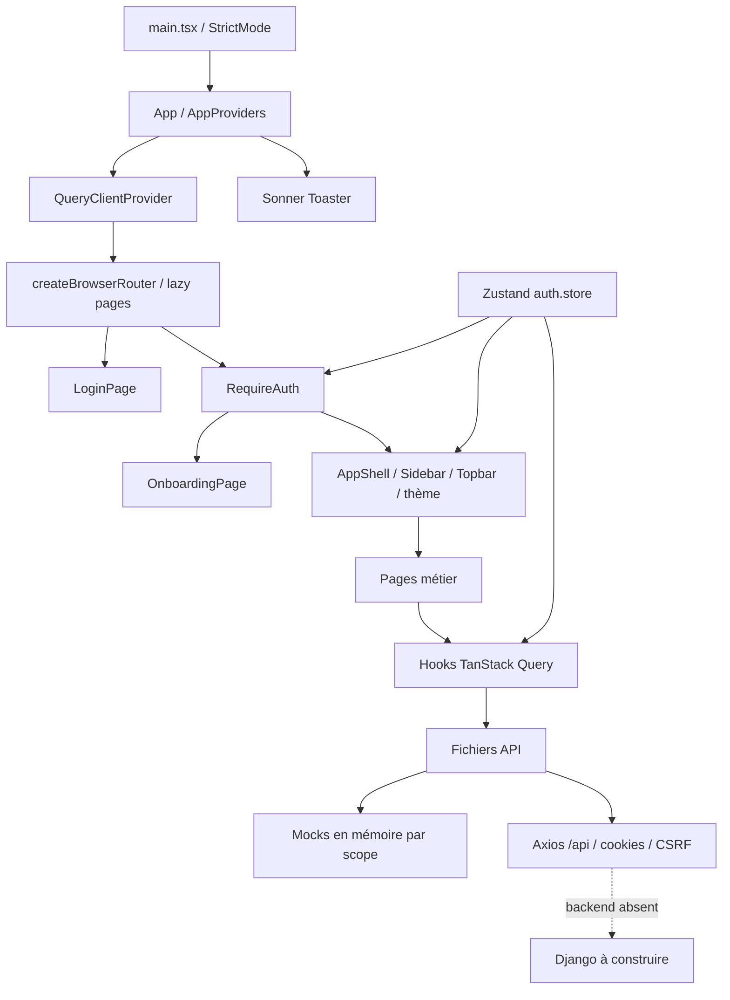

# SmartERP AI — audit du frontend

Audit du code présent le 27 septembre 2026. Périmètre : `smarterp-ai/src`, configuration, dépendances et tests existants. Aucun changement applicatif ni backend n'est réalisé par cette mission. Les inventaires ci-dessous proviennent des déclarations TypeScript et du routeur, puis sont complétés par l'analyse des parcours et mocks.

## Lire cet audit

| Statut | Signification |
|---|---|
| IMPLEMENTED | Code frontend présent et chemin d'exécution identifiable ; ne signifie pas backend opérationnel. |
| PARTIALLY IMPLEMENTED | Une partie du parcours existe, une autre reste locale, désactivée ou non raccordée. |
| FRONTEND-ONLY | État local, mock ou présentation sans persistance serveur. |
| BACKEND REQUIRED | Appel HTTP consommé/préparé, service Django absent de ce dépôt. |
| PROPOSED | Recommandation nouvelle, jamais présentée comme du code existant. |

Documents associés : [contrat HTTP](API_CONTRACT.md), [types et relations](DATA_MODEL.md), [permissions](RBAC_MATRIX.md), [architecture Django](BACKEND_BLUEPRINT.md), [ordre de réalisation](BACKEND_IMPLEMENTATION_ROADMAP.md). Les chemins source sont relatifs à `smarterp-ai/`. Les modèles Django candidats sont des propositions, pas une rétro-ingénierie d'une base existante.

## Architecture et démarrage réels

`index.html` → `src/main.tsx` (`createRoot`, `StrictMode`, CSS global) → `App.tsx` → `AppProviders` → `RouterProvider`. `AppProviders` installe seulement `QueryClientProvider` et le `Toaster` Sonner (haut droite). Il n'existe ni AuthProvider, ni ThemeProvider, ni client Django généré.

Stack déclarée dans `package.json` : React 19, TypeScript 6, Vite 8, React Router 7, TanStack Query 5, Axios, Zustand, React Hook Form, Zod, Tailwind 4, Recharts et Lucide. Les plages exactes se trouvent dans le manifeste et les versions résolues dans le lockfile ; cet audit ne recommande pas de mise à jour de dépendances.



`createBrowserRouter` charge les pages avec `lazy`. `/` et le joker redirigent vers `/login`. `/onboarding` est protégé mais hors shell. Les autres pages métier sont sous `RequireAuth` puis `AppShell`. La garde ne vérifie que `isAuthenticated` : elle ne restaure pas de session, ne vérifie pas l'onboarding et ne porte pas de permission par route. Le choix onboarding/dashboard est fait après connexion par `getPostLoginPath`.

## Authentification : état réel et limites

`auth.store.ts` conserve `user`, `company`, `isAuthenticated`, `setAuth`, `clearAuth`, en mémoire uniquement. Les champs complets `AuthUser`, `Company`, `LoginResponse` sont dans [DATA_MODEL](DATA_MODEL.md). L'identité sert à afficher le nom/rôle, construire les clés de cache et alimenter le profil ; les permissions optionnelles servent aussi à masquer certains liens. `enabledModules` est optionnel : son absence ne désactive pas les modules.

`POST /auth/login/` envoie email/password, valide la réponse Zod et convertit seulement `company.onboarding_completed` et `company.enabled_modules`. `company` peut être `null`. Aucun access token/refresh token n'est reçu, stocké ou renouvelé. Pas de Bearer interceptor, pas de refresh automatique, pas d'interceptor global 401. Axios utilise `withCredentials: true`, un timeout de 15 secondes et les noms Django `csrftoken` / `X-CSRFToken`.

**Point à vérifier avant intégration CSRF :** `withXSRFToken` calcule l'origine avec `new URL(config.url, window.location.origin)` sans incorporer `config.baseURL`. Les appels relatifs `/…` semblent donc provenir de l'origine React. Si React et l'API sont sur des origines différentes, le prédicat peut empêcher l'envoi du header attendu. Le cookie CSRF doit également être lisible dans l'origine adéquate. Aucun endpoint d'amorçage CSRF n'est appelé actuellement. Un proxy de même origine et des tests navigateur CSRF sont recommandés ; aucune correction faite ici.

Seul l'email mémorisé est conservé pour la connexion (`smarterp.remembered-email`). Les autres usages de localStorage concernent des favoris/filtres ; ce ne sont pas des sessions. Aucune persistance auth Zustand. Le rechargement redirige donc vers login, même avec un cookie serveur valide. `GET /me/` est utilisé par la page profil, après authentification locale, et attend déjà un `AuthUser` pour vérifier l'identifiant : il ne constitue pas un bootstrap de session. Pas d'appel logout ni de bouton de déconnexion effective dans la topbar.

Les mots de passe sont retirés des erreurs Axios exposées par login/profil ; les mutations sensibles ont une rétention réduite et sont réinitialisées. Ce traitement frontend ne prouve ni hachage serveur, ni 2FA réelle. Le profil mock utilise un code de démonstration, explicitement simulé.

L'onboarding poste un payload imbriqué `company/business/finance/inventory/invoicing/modules`. La réponse est ignorée (`Promise<void>`). Après succès, la société locale n'est mise à jour que si elle existait déjà : le cas `company: null` ne récupère pas l'identifiant d'une société nouvellement créée. **PARTIALLY IMPLEMENTED**.

## Shell, état et composants partagés

Sidebar fixe desktop de 232 px, panneau mobile commandé par la topbar, fermeture Escape et fermeture lors de navigation. Les groupes utilisent `details/summary`. Le shell propose un lien d'évitement. `moduleNavigation.ts` traduit les routes CRM, ventes, achats, stock, finance, documents et IA vers les clés de modules. Rapports, approbations et administration ne sont pas tous couverts par cette table. Une liste `enabledModules` présente bloque l'Outlet du module désactivé ; elle ne remplace pas une autorisation serveur.

La Sidebar applique un contrôle de permission explicite surtout aux nouvelles rubriques documents/IA/administration/modules/settings. Les rubriques plus anciennes ne bénéficient pas toutes du même filtrage. Les pages contrôlent ensuite leurs permissions/capabilities, souvent reçues dans leur propre réponse API. Le lien AI Control Center n'a pas le même contrôle que l'assistant. Voir la matrice RBAC pour les conséquences.

Le thème est appliqué par un effet de `AppShell` à `document.documentElement.dataset.theme`, selon `user.preferences.theme` ou `matchMedia`. Le profil peut le modifier. Langue, timezone et formats du profil ne sont pas appliqués de manière générale aux anciens écrans ; les libellés restent français, la monnaie fréquemment MAD. Les actions globales de recherche/création comportent encore des toasts de disponibilité future.

Zustand contient la session d'affichage, TanStack Query les réponses distantes, React Hook Form/Zod les formulaires, et `useState` les filtres, pagination locale, sélection, onglets et dialogues. Les mocks conservent leurs propres `Map` par `userId:companyId` ; ce scope limite les collisions de démonstration mais n'assure aucune isolation serveur.

`src/components/ui` contient boutons, champs, alertes, badges et dialogues. `BusinessPresentation.tsx`, `PurchasingPrimitives`, les composants de pagination, de confirmation et de citations sont réutilisés entre features. Les tableaux restent spécifiques au métier. `lib/money.ts` utilise des centimes BigInt pour les calculs de lignes, pas pour tous les calculs du projet ; les types API financiers restent majoritairement `number`. `lib/csv.ts` protège les cellules interprétables comme formules. `lib/format.ts` distingue dates seules et datetime.

## Query, erreurs et invalidations

Client global : staleTime 60 s, retry lecture 1, pas de refetch au focus ; mutations sans retry. De nombreux hooks métier remplacent cela par `retry: false`, `networkMode: 'always'`. `useBusinessScope.key(name)` donne `[name, userId, companyId]`, auquel s'ajoutent flag mock, identifiant et filtres selon la requête. Les hooks plus anciens ont leurs propres préfixes. Le registre en annexe reproduit les expressions exactes.

Les mutations invalident fréquemment plusieurs domaines (factures → paiements/trésorerie/rapports ; mouvements → stock/produits/dépôts). Une invalidation n'est pas une transaction métier et ne démontre pas que tous les mocks partagent une donnée canonique. Les clés incluent le contexte utilisateur/société, mais aucune procédure globale de changement de société/connexion avec purge systématique n'est fournie.

Les écrans récents séparent chargement, interdit 403, absent 404, erreur avec réessai, vide et recherche sans résultat. Les not-found peuvent provenir d'une classe locale ou d'Axios. Les formulaires utilisent des validations Zod et des messages généraux de mutation. Il n'existe pas de traitement global uniforme de `errors.field` provenant de DRF. Un 401 métier ne réinitialise pas automatiquement l'auth ; un conflit de rôle 409/412 possède un parcours spécifique, pas toutes les mutations.

## Stratégie mock et qualité des sources

Toutes les options `VITE_*_USE_MOCK` de `env.ts` sont activées sauf valeur littérale `false` ; auth et onboarding font des appels réels (interceptés par Playwright dans les tests). Les mocks sont importés dans les modules de production : le build observé contient des chunks `.mock`. Le mode API n'est donc pas une garantie d'absence de données de démonstration dans le bundle.

Les jeux de données ne sont pas tous normalisés entre générations d'écrans : Dashboard et AI Control Center ont leurs agrégats fixes ; clients/devis disposent de snapshots propres ; achats/factures/paiements et produits/stock utilisent davantage de fonctions communes. Les scores et projections de démo ne sont pas des résultats de modèle. Les dates `asOf` de septembre 2026 doivent être remplacées par une date serveur cohérente.

## Frontend gaps before backend integration

1. **Session** : pas de bootstrap, logout, renouvellement ni redirection globale sur expiration ; onboarding `company:null` incomplet.
2. **Contrats** : snake_case/camelCase et `Decimal` chaîne/nombre hétérogènes, plusieurs `.data` sans validation runtime.
3. **Pagination/KPI** : collections complètes et calculs navigateur ; devis suivent toutes les pages, paiements/fournisseurs sont déjà paginés côté API.
4. **RBAC** : catalogue de rôles mock incomplet face aux codes consommés ; permissions de session et permissions de réponse peuvent diverger ; capabilities parfois seules.
5. **Stock/achats** : achats transmettent noms de dépôt/produit et lignes sans FK produit explicite ; réception mock et livraison ne prouvent pas une écriture dans le journal canonique du stock.
6. **Finance** : vocabulaires `confirmed/completed`, `partial/partially_paid` et statuts de dashboard distincts ; tableaux CRM et KPI fixes ne garantissent pas cohérence avec le journal financier.
7. **Async** : upload/indexation/export/prévision attendent souvent un résultat immédiat ; aucun protocole Job générique ni polling systématique ; SSE soumis au timeout Axios de 15 s.
8. **Approbations** : pas d'API de création générique, ni d'état d'exécution séparé exposé ; changement de statut mock n'est pas une exécution métier réelle.
9. **Documents/configuration** : pièces jointes locales sans contrat d'upload propre à chaque facture/dépense ; plusieurs réglages n'influencent pas les calculs ; préférences limitées au thème dans le shell.
10. **Actions incomplètes** : contrôle IA ancien local, imports et exports selon feature, avoirs, annulations de commandes, rejets/modifications et analyses IA de certaines fiches sans endpoint. Les fiches détaillées et le contrat signalent les fonctions exactes.

## Backend requirements not represented yet in frontend

**PROPOSED** : bootstrap de session et CSRF/logout ; contexte de société active et membership ; identifiants stables de dépôt et d'utilisateur ; idempotency keys ; séquences transactionnelles ; historique de coût ; réservations et rapprochements ; statut durable des jobs ; exécution des approbations et reprises ; révocation des citations/documents ; contrôle de version généralisé ; filtres/pagination/agrégats serveur. Ces ajouts devront être intégrés ultérieurement au frontend dans une mission distincte.

## Validation exécutée

`npm.cmd run build` : **PASS**, TypeScript puis Vite, 3 023 modules transformés. Le message de timing des plugins Vite est informatif. `npm.cmd run lint` : **PASS**. Aucun code applicatif corrigé pour obtenir ces résultats pendant l'audit.

Les résultats détaillés des deux exécutions Playwright sont ajoutés en fin de document. Les tests API utilisent des interceptions navigateur, pas un serveur Django. Un test passant prouve le comportement face à son fixture, pas le contrat d'un backend déployé.

## Parcours fonctionnels, filtres et limites (K–O)

Les rubriques A–J de chaque dossier figurent dans le registre technique qui suit. Cette section complète **chaque module fonctionnel**, y compris les sous-modules regroupés dans `ai`, `admin`, `inventory` et `reports`. K = filtres, L = tri, M = pagination, N = états, O = besoin backend. « Ordre source » signifie qu'aucun tri utilisateur spécifique n'a été identifié ; le serveur doit alors fournir un ordre stable. Les tailles locales sont généralement 25/50/100 via les composants de pagination ; ne pas les confondre avec des paramètres HTTP envoyés.

### Authentication — /login

K/L/M : sans objet, formulaire email/password avec mémorisation optionnelle de l'email. N : validation Zod, pending, erreur réseau/credentials/compte désactivé, succès avec redirection. O : login réel et cookie, CSRF, sessions, bootstrap et logout absents ; rôle/permissions reçus, non calculés dans React. Le mot de passe oublié et les alternatives visuelles ne constituent pas un workflow backend implémenté. Statut **PARTIALLY IMPLEMENTED**.

### Onboarding — /onboarding

K/L/M : assistant à étapes, pas de liste paginée. N : erreurs de champs, navigation entre étapes, enregistrement pending/succès/échec. O : un POST atomique sauvegardant société, activité, finance, inventaire, numérotation et modules ; permissions de configuration et reprise idempotente. La réponse est ignorée ; le cas société initialement null doit être traité dans une évolution. Logo dans le payload n'est pas un contrat d'upload d'objet privé. **PARTIALLY IMPLEMENTED**.

### Dashboard — /dashboard

K : contrôles de période/présentation locaux ; GET `/dashboard/summary/` n'envoie aucun filtre. L/M : pas de pagination serveur, listes de synthèse déjà incluses. N : skeleton, erreur/réessai, rafraîchissement ; des liens/action cards dépendent de la navigation disponible. O : un selector de synthèse autorisée, date et devise cohérentes, revenus/marge/cash/créances/stock séparés. Les agrégats de démo proviennent du snapshot dashboard et ne sont pas recalculés depuis tous les nouveaux journaux. **FRONTEND-ONLY pour données démo / BACKEND REQUIRED pour synthèse**.

### AI Control Center — /ai/control-center

K : search, department, severity, status, type, days, groupBy ; normalisation accents et filtrage local. L : priorité de sévérité, regroupement. M : collection reçue complète. N : pending/error/retry, vide filtré, tiroir détail, localChanges et brouillons locaux. O : GET de pilotage existant, événements d'alerte sourcés et contrôles IA ; changements de statut/assignation et SuggestedAction ne possèdent pas une mutation HTTP dans cette feature. Ne pas confondre ce parcours local avec Approval Center récent. **PARTIALLY IMPLEMENTED**.

### Customers — /customers et /customers/:id

K : search, status, city, outstanding, overdue, salesperson, groupBy ; détail par onglets overview/sales/invoices/payments/documents/notes/activity. L : regroupements et ordre de collection, pas d'ordering transmis. M : liste locale 25 par défaut, kanban et sélection ; détail non paginé côté API. N : loading, 403, erreur/réessai, vide/recherche vide, 404 détail, sous-requêtes protégées. O : collection CustomersData complète actuellement, détail/summary/activity/insight séparés. `createCustomer`, `updateCustomer`, `importCustomers` sont préparés ; la page utilise des patches/created locaux et ne raccorde pas ces fonctions par un hook de mutation. Plusieurs actions de fiche sont locales ou désactivées en API. Persister contacts/notes/assignations et unifier métriques avec ventes/finance dans une mission ultérieure. **PARTIALLY IMPLEMENTED**.

### Quotes — /quotes, /quotes/new, /quotes/:id

K : QuoteFilters (search, status, customer, salesperson, dates et raccourcis ; signature exacte dans DATA_MODEL), favoris de vue ; champs de formulaire et sélection client/produit. L : QuoteSortKey reference/customerName/createdAt/expiresAt/salesperson/totalAmount/status, asc/desc. M : UI locale 25 ; API suit toutes les pages DRF via next avant filtrage/KPI. N : loading/denied/error/empty, 404, verrou d'action et erreurs de sauvegarde, validation ligne/date, sortie avec modifications selon éditeur. O : DTO snake_case dédié, send/duplicate/create/update, accept/convert préparés pour Django ; PDF désactivé faute d'endpoint. Le montant est recalculé avec utilitaires monétaires. **IMPLEMENTED UI, BACKEND REQUIRED**.

### Sales Orders — /sales et /sales/:id

K/L/M : liste reçue dans orders, sans filtre/pagination HTTP ; onglets et opérations de détail. N : lecture/loading/error/403/404, confirmation de mutation, indicateurs séparés commande/livraison/facture/paiement. O : list/detail/confirm/delivery/invoice ; confirmation, réservation, livraison partielle et facturation via services autorisés. Analyse IA locale de commande et annulation ne disposent pas d'une API complète consommée. `warehouse` reste un nom, la facture de commande reçoit un montant, et les sous-paiements utilisent confirmed. **PARTIALLY IMPLEMENTED**.

### Customer Invoices — /invoices, /invoices/new, /invoices/:id

K : search, quick, customerId, salesperson, workflow, payment, dateFrom/to, dueFrom/to, min/maxAmount, aging. L : date/montant/échéance selon sélecteur ; group status/customer/salesperson/month/due/aging. M : liste locale, 25/50/100 ; kanban affiche les résultats filtrés selon son parcours. N : 403/404, chargement/réessai/vide, formulaire dirty, pending et confirmations post/send/payment/remind. O : lecture enveloppée, aging séparé, lignes et capability par facture, calcul du remaining et overdue à partir de données cohérentes. `requestInvoiceInsight` lève une erreur en mode API : aucun endpoint IA inventé. Avoir/PDF/annulation ne sont pas livrés par un endpoint de cette feature. **PARTIALLY IMPLEMENTED**.

### Payments — /payments

K : search, direction, partnerType, partnerId, invoice, method, status, period, dateFrom/to, min/maxAmount ; valeurs converties dans params(). L : sort transmis (défaut date_desc), group direction/method/status/customer/supplier/month. M : serveur, page/page_size, count/totalCount ; export redemande les lignes et vérifie complétude. N : pending/refetch, refus, erreur, vide, validations de paiement et confirmation d'annulation. O : GET journal et summary séparé, POST création/annulation ; openInvoices/partners sont des options autorisées. Distinguer amount positif, direction et statut completed. Les exports demandant une page de la taille totale ne fonctionneront pas avec un cap serveur 100 sans nouveau parcours. **IMPLEMENTED UI, BACKEND REQUIRED**.

### Suppliers — /suppliers et /suppliers/:id

K : search/category/country/risk/status/buyer/city/quick/strategic ; fiche onglets et historique prix. L : sort transmis, défaut name ; regroupements buyer/category/country/risk/status. M : serveur pour liste avec count/totalCount/summary/facets ; détails non paginés. N : refus/404/erreur/chargement/vide, mutation create/edit/archive, sous-requêtes metrics/history/insight indépendantes. O : capacités d'édition/archivage, métriques et prix sourcés, liens achats/factures/paiements. Import/mailing ne deviennent pas réels via un bouton. Contrôle d'export complet similaire aux paiements. **IMPLEMENTED UI, BACKEND REQUIRED**.

### Purchase Orders — /purchases et /purchases/:id

K : search, supplier, buyer, status, receipt, dateFrom/to, expectedFrom/to, quick ; recherche/query params de liens de fiche. L : défaut date, options montant/attendu selon barre, group fournisseur/acheteur/statut/réception/mois. M : locale 25, liste/kanban ; GET renvoie toutes les orders. N : loading/forbidden/not-found/error/empty, confirmation send/confirm/receive/bill, éditeur avec calculs et validation. O : séparer order/receipt/billing, capabilities explicites, réception lignes partielles et création facture. PurchaseLine porte un productName mais pas de productId : pas de réception physique fiable sans résoudre ce contrat. **PARTIALLY IMPLEMENTED**.

### Supplier Invoices — /supplier-invoices et /supplier-invoices/:id

K : search, supplier, buyer, order, status, payment, dateFrom/to, aging, quick. L : défaut due, autres tris selon toolbar ; regroupements métier. M : locale 25 ; aging en sous-requête protégée finance. N : erreur/réessai/403/404/vide, create/edit/post/pay avec capabilities, incohérences de rapprochement affichées. O : workflow/paiement/retard indépendants, ordered/received/invoiced par ligne, fournisseur/référence externe, paiement via ledger commun. Pièces jointes ajoutées dans AttachmentPreview sont locales, pas persistées par une API de cette fiche. **PARTIALLY IMPLEMENTED**.

### Products — /products et /products/:id

K : search, type, category, supplier, status, health, margin, min/max price, quick ; favoris localStorage scoppés ; vues liste/kanban et regroupement. L : nom A–Z ou prix décroissant. M : locale 25. N : loading/403/404/empty/error, create/edit/archive/import pending ; sous-requêtes métriques/historique/IA selon droits. O : Product/StockProduct, services non stockables (null), SKU unique et calculs prix/marge, option fournisseur réelle. Import FormData préparé côté API mais mock indisponible ; coût moyen/stock doivent venir de selectors canoniques. **IMPLEMENTED UI avec imports/analyses dépendants du backend**.

### Inventory Dashboard — /inventory

K/L/M : synthèse et listes ciblées, pas de pagination serveur ; lecture summary, health, critical et recent indépendantes. N : état principal + états de sous-requêtes, permissions séparées analytics/movements, vide. O : quantités disponible/réservé/transit, valorisation, produits critiques et répartition dépôt/catégorie calculés au serveur. Santé de stock globale et par dépôt ne sont pas le même dénominateur. **IMPLEMENTED UI, BACKEND REQUIRED**.

### Stock Movements — /inventory/movements

K : search, product, warehouse, type, user, from/to ; product/warehouse/create peuvent être initialisés dans l'URL de navigation. L : ordre journal fourni, pas de tri HTTP. M : locale 25. N : error/empty/403, détail en mutation de lecture, création et validations quantité/date/disponible ; source/ref et before/delta/after visibles. O : journal immutable, mouvement inverse pour correction, attribution acteur serveur, verrous de stock et permissions sur dépôt. Export CSV local de lignes autorisées. **IMPLEMENTED UI, BACKEND REQUIRED**.

### Warehouses — /warehouses et /warehouses/:id

K : catalogue/recherche locale et onglets stock/mouvements/transferts/valorisation selon page ; détails sélectionnent le dépôt. L/M : ordre de collection et tableaux locaux, aucune pagination API. N : sous-requêtes stock/movements/valuation/transfers activées selon droits, 404/403/loading/error/empty, création dépôt. O : capacité avec unité explicite, agrégats par dépôt, historique des coûts réels. WarehouseValuation accepte encore une ancienne réponse tableau, transformée sans historique ; nouvelle forme byProduct/history/source préférée. **PARTIALLY IMPLEMENTED** pour valorisation historique comptable.

### Stock Transfers — /inventory/transfers

K : search, status, source, destination ; query params reference/source/create pour navigation. L : ordre source. M : locale 25. N : create/edit/detail/confirmation, états draft/ready/in_transit/completed/cancelled, capabilities ; transition PATCH uniquement si supportsStatusPatch. O : FK dépôts/produits, source!=destination, réservation/disponible et conservation transit ; POST complete reçoit aucun détail de quantités, donc finalisation entière actuelle. **IMPLEMENTED UI ; transfert partiel PROPOSED seulement**.

### Expenses — /expenses

K : search/status/category/employee/supplier/from/to. L : ordre source ; catégories KPI classées par total, différent du tri de la liste. M : locale 25, liste et kanban sur page visible. N : loading/403/empty/error, formulaire/tiroir, submit/approve pending ; refus direct désactivé. O : modèles Expense/Category, lien justificatif, workflow ; approved ne paie pas. KPI mensuel est calculé sur toutes dépenses approved/paid du mois, pas sur les seuls filtres de table. Paiement de dépense et rejet direct n'ont pas de fonction API dédiée. **PARTIALLY IMPLEMENTED**.

### Cash Flow — /finance/cash-flow

K : horizon de projection ; les lectures principales ne transmettent pas de période arbitraire. L/M : séries temporelles et échéances, sans pagination HTTP. N : chargement/403/error/empty, sous-requêtes forecast/upcoming, insight IA manuel et permissions de liens factures. O : compte/solde d'ouverture, flux confirmed/completed, créances/dettes, échéancier/scénario séparé du cash réel ; pas de double compte dépenses/payments. **IMPLEMENTED UI ; calcul serveur requis**.

### Reports Library — /reports

K : recherche/catégorie des cartes, dates/filtre/format du formulaire de génération. L/M : catalogue complet et récents, pas de pagination serveur. N : chargement/refus/vide, generation pending/error, fichier ready ou indisponible ; formats bornés par définition. O : douze définitions actuelles, huit CSV simulés générables, quatre cartes sans génération ; ReportRun immutable et stockage autorisé. Les IDs catalogue ne sont pas tous des ReportType. **PARTIALLY IMPLEMENTED**.

### Report Analytics — /reports/:type

K : dateFrom/dateTo/partner/owner/category/warehouse envoyés à l'API, options pertinentes selon type. L : local date ou montant ; M : local 25 sur rows reçu. N : type invalide, lecture/refus/erreur/vide, validation période, insight/export pending ; snapshot indique absence de reconstruction historique. O : onze handlers explicites (sales, profitability, customers, products, inventory, purchases, suppliers, invoices, payments, expenses, cash-flow), KPI et période précédente cohérents, droits sources. Analyse déterministe mock, confiance null ; certains rapports clients/produits sont des projections limitées, pas un moteur analytique complet. **PARTIALLY IMPLEMENTED**.

### Documents — /documents

K : recherche, catégorie, département, statut d'indexation ; L : ordre collection ; M : liste locale. N : upload progress, uploading/processing/indexed/index_error, refus/erreur/vide ; boutons selon canView/capabilities/permissions, upload/index/delete confirmations et erreurs. O : multipart réel, MIME/taille/ACL serveur et job de parsing/indexation. Le mock TXT produit des pages simples, PDF téléchargé reste sans OCR réel ; indexed n'est pas promis sur upload. **IMPLEMENTED UI, BACKEND REQUIRED**.

### Document Viewer / RAG — /documents/:id

K : page (dont paramètre page), zoom, action summary/risks/dates/payment_terms et question. L/M : pagination des pages du document, pas pagination de liste HTTP. N : 404/403, pages absentes/loading/error, index en erreur, politique RAG désactivée, analyse/question pending et citations vérifiables. O : DocumentDetail + DocumentPage[] et sources autorisées par page ; texte/image/thumb réels, RAG seulement sur chunks autorisés. Les réponses « verified » sont limitées par présence de citations correspondantes ; elles ne remplacent pas la vérification backend. **PARTIALLY IMPLEMENTED**.

### AI Assistant — /ai/assistant

K : sélection conversation et saisie ; L/M : conversations/messages inclus dans collection, aucun historique paginé API. N : canChat/policyReason, streaming, tool_running, error/interruption, done et bloc awaiting_approval ; questions conservées sur échec. O : POST SSE exact, persistance conversations, outils autorisés, sources revalidées ; UI de confirmation réutilise les demandes Approval Center existantes. Mock déterministe et flux simulé, pas Ollama connecté. Pas de suppression conversation ni d'outil SQL/mutation arbitraire. **PARTIALLY IMPLEMENTED**.

### Forecasting — /ai/forecasting

K : domain parmi six et horizon 30/60/90/180 transmis. L/M : séries chronologiques, pas pagination. N : ready/low_confidence/insufficient_data/disabled, drivers en sous-requête, recalculate avec confirmation ; lower/upper null n'affiche pas une bande inventée. O : séries/calibration/provenance serveurs et job de recalcul ; le client attend encore un ForecastResult immédiat. La majorité des domaines mock n'a pas d'historique projetable. **IMPLEMENTED UI, BACKEND REQUIRED**.

### AI Opportunities — /ai/opportunities

K : recherche/type/statut, critères de confiance selon page ; L : valeur/confiance selon contrôle ; M : locale 25. N : vide notamment quand policy recommendations=false, refus/erreur, assignation pending ; evidence et links autorisés. O : opportunités fraîches/sourcées, montant potentiel nullable, assignees autorisés et actif, POST assign ; dismissed existe dans le type mais pas comme mutation API. **PARTIALLY IMPLEMENTED**.

### Approvals — /approvals

K : onglet statut, search, type et request query param pour détail. L : ordre fourni ; M : locale 25. N : lecture/liste/détail/403/404/empty, commentaires, approve/reject confirmation/pending/error ; allowedApprovalTypes/capabilities/version. O : demande typée et décision concurrente sûre, séparation décision/exécution ; needs_changes affichable mais bouton sans endpoint. Le mock dépense modifie son domaine ; les autres exemples ne prouvent pas l'effet financier/stock réel. **PARTIALLY IMPLEMENTED**.

### Users — /admin/users

K : search, role, department, status, twoFactor, lastLogin ; role peut venir de l'URL. L : ordre source ; M : locale 25. N : denied/loading/error/empty, invite/create/edit/status selon capabilities et assignableRoleIds ; propre rôle protégé. O : GET users avec rôles/départements/options, POST create/invitation et PATCH ; email/2FA ne sont pas des champs librement modifiables. Mock currentUserId=1, pas toujours égal à l'identité d'un utilisateur arbitraire ; invitations ne transmettent aucun mail réel. **PARTIALLY IMPLEMENTED**.

### Roles — /admin/roles

K : sélection/recherche de rôle ou permission dans la matrice ; L/M : ordre catalogue et grille complète, pas pagination HTTP. N : système readonly, custom dirty, création/duplication, sauvegarde et 409/412 avec relecture explicite, useBlocker/beforeunload. O : catalogue complet, code/grantable, role.version et anti-escalade ; users liés et assignations. La duplication filtre grantable ; aucun DELETE role. Les rôles mocks ne reconfigurent pas tous les tableaux de permissions des autres features. **PARTIALLY IMPLEMENTED**.

### Audit Logs — /admin/audit-logs

K : search/dateFrom/dateTo/actor/module/action/entityType/result/ip (IP seulement si droit réseau). L : journal timestamp décroissant côté mock ; M : locale 25, export filtre transmis séparément. N : état de liste/détail/403/erreur/vide, restricted, diff expurgé, formats d'export annoncés. O : audit append-only scoppé et expurgé avant sérialisation ; réseau non autorisé omis même de la recherche/export. Les seeds contiennent volontairement des valeurs sentinelles sensibles pour tester la rédaction ; ce ne sont pas des secrets à conserver en production. **IMPLEMENTED UI, BACKEND REQUIRED**.

### Modules — /modules

K : recherche et catégorie/statut selon filtres ; L/M : grille complète, pas pagination API. N : active/inactive/premium_locked/coming_soon, tiroir descriptif, confirmations enable/disable et dépendances ; configure n'est pas une API générique. O : ModuleDefinition/CompanyModule et licence, auth.company.enabledModules actualisé après relecture ; ne pas supprimer les données. La démo comporte douze modules et bloque des changements incompatibles. **IMPLEMENTED UI, BACKEND REQUIRED**.

### Settings — /settings

K : section via query param, quinze sections ; L/M : sans objet. N : chargement/403/error, policy canView/canManage, lockedFields, dirty guard, confirmation sécurité/IA, version et messages d'échec, intégration incomplete. O : GET global + PATCH section renvoyant SettingsData, options et politiques serveur ; ai/status et intégration test selon contexte. Pas de sauvegarde logo réelle ni secrets exposés. Seuls certains réglages mock ont un effet global (nom société, politique IA) ; devise, arrondi, numérotation et stock ne reconfigurent pas automatiquement toutes les features. **PARTIALLY IMPLEMENTED**.

### Profile — /profile

K/L/M : onglets identité/sécurité/préférences/activité, sessions incluses dans /me ; sans liste serveur paginée. N : identité de réponse vérifiée, capabilities/options, dirty guard, mot de passe et challenge 2FA, révocation avec confirmation ; propre session peut déconnecter si serveur l'autorise. O : GET/PATCH me, POST password/2fa, DELETE session. Avatar local seulement ; email éditable uniquement si capacité. Le thème fonctionne dans le shell ; autres préférences de localisation partiellement appliquées. MFA de démo n'active pas une sécurité réelle et son secret/code ne doit jamais entrer dans l'audit/cache persistant. **PARTIALLY IMPLEMENTED**.

<!-- GENERATED_FRONTEND_INVENTORY -->

## Inventaire chiffre et routes reelles

25 features ; 383 fichiers src ; 46 entrees avec path ; 44 routes de page ; 42 composants de page distincts ; 143 sites Axios ; 82 codes de permission.

| Route | Page | Feature | Protegee | Permission lecture / controle | Statut |
|---|---|---|---|---|---|
| `/` | Navigate vers /login | router | non | sans objet | IMPLEMENTED |
| `/login` | [features/auth/pages/LoginPage.tsx](../src/features/auth/pages/LoginPage.tsx) | auth | non | public avec CSRF et limitation tentatives | PARTIALLY IMPLEMENTED — UI/API/mocks ; backend requis |
| `/onboarding` | [features/onboarding/pages/OnboardingPage.tsx](../src/features/onboarding/pages/OnboardingPage.tsx) | onboarding | RequireAuth | session ; PROPOSED companies.configure | PARTIALLY IMPLEMENTED — UI/API/mocks ; backend requis |
| `/modules` | [features/modules/pages/ModulesMarketplacePage.tsx](../src/features/modules/pages/ModulesMarketplacePage.tsx) | modules | RequireAuth | modules.manage | PARTIALLY IMPLEMENTED — UI/API/mocks ; backend requis |
| `/settings` | [features/settings/pages/CompanySettingsPage.tsx](../src/features/settings/pages/CompanySettingsPage.tsx) | settings | RequireAuth | settings.view | PARTIALLY IMPLEMENTED — UI/API/mocks ; backend requis |
| `/profile` | [features/profile/pages/UserProfilePage.tsx](../src/features/profile/pages/UserProfilePage.tsx) | profile | RequireAuth | utilisateur courant + capabilities | PARTIALLY IMPLEMENTED — UI/API/mocks ; backend requis |
| `/reports/:type` | [features/reports/pages/ReportAnalyticsPage.tsx](../src/features/reports/pages/ReportAnalyticsPage.tsx) | reports | RequireAuth | reports.view | PARTIALLY IMPLEMENTED — UI/API/mocks ; backend requis |
| `/documents` | [features/documents/pages/DocumentsPage.tsx](../src/features/documents/pages/DocumentsPage.tsx) | documents | RequireAuth | documents.view | PARTIALLY IMPLEMENTED — UI/API/mocks ; backend requis |
| `/documents/:id` | [features/documents/pages/DocumentDetailPage.tsx](../src/features/documents/pages/DocumentDetailPage.tsx) | documents | RequireAuth | documents.view | PARTIALLY IMPLEMENTED — UI/API/mocks ; backend requis |
| `/ai/assistant` | [features/ai/pages/AIAssistantPage.tsx](../src/features/ai/pages/AIAssistantPage.tsx) | ai | RequireAuth | ai.use / forecast.view / ai.opportunities.view selon ressource | PARTIALLY IMPLEMENTED — UI/API/mocks ; backend requis |
| `/ai/forecasting` | [features/ai/pages/AIForecastingPage.tsx](../src/features/ai/pages/AIForecastingPage.tsx) | ai | RequireAuth | ai.use / forecast.view / ai.opportunities.view selon ressource | PARTIALLY IMPLEMENTED — UI/API/mocks ; backend requis |
| `/ai/opportunities` | [features/ai/pages/AIOpportunitiesPage.tsx](../src/features/ai/pages/AIOpportunitiesPage.tsx) | ai | RequireAuth | ai.use / forecast.view / ai.opportunities.view selon ressource | PARTIALLY IMPLEMENTED — UI/API/mocks ; backend requis |
| `/approvals` | [features/approvals/pages/ApprovalCenterPage.tsx](../src/features/approvals/pages/ApprovalCenterPage.tsx) | approvals | RequireAuth | approvals.view | PARTIALLY IMPLEMENTED — UI/API/mocks ; backend requis |
| `/admin/users` | [features/admin/pages/UsersAdminPage.tsx](../src/features/admin/pages/UsersAdminPage.tsx) | admin | RequireAuth | users.manage / roles.manage / audit.view selon ressource | PARTIALLY IMPLEMENTED — UI/API/mocks ; backend requis |
| `/admin/roles` | [features/admin/pages/RolesPermissionsPage.tsx](../src/features/admin/pages/RolesPermissionsPage.tsx) | admin | RequireAuth | users.manage / roles.manage / audit.view selon ressource | PARTIALLY IMPLEMENTED — UI/API/mocks ; backend requis |
| `/admin/audit-logs` | [features/admin/pages/AuditLogsPage.tsx](../src/features/admin/pages/AuditLogsPage.tsx) | admin | RequireAuth | users.manage / roles.manage / audit.view selon ressource | PARTIALLY IMPLEMENTED — UI/API/mocks ; backend requis |
| `/purchases` | [features/purchases/pages/PurchaseOrdersPage.tsx](../src/features/purchases/pages/PurchaseOrdersPage.tsx) | purchases | RequireAuth | purchases.view | PARTIALLY IMPLEMENTED — UI/API/mocks ; backend requis |
| `/purchases/:id` | [features/purchases/pages/PurchaseOrderDetailPage.tsx](../src/features/purchases/pages/PurchaseOrderDetailPage.tsx) | purchases | RequireAuth | purchases.view | PARTIALLY IMPLEMENTED — UI/API/mocks ; backend requis |
| `/supplier-invoices` | [features/supplier-invoices/pages/SupplierInvoicesPage.tsx](../src/features/supplier-invoices/pages/SupplierInvoicesPage.tsx) | supplier-invoices | RequireAuth | supplier_invoices.view | PARTIALLY IMPLEMENTED — UI/API/mocks ; backend requis |
| `/supplier-invoices/:id` | [features/supplier-invoices/pages/SupplierInvoiceDetailPage.tsx](../src/features/supplier-invoices/pages/SupplierInvoiceDetailPage.tsx) | supplier-invoices | RequireAuth | supplier_invoices.view | PARTIALLY IMPLEMENTED — UI/API/mocks ; backend requis |
| `/products` | [features/products/pages/ProductsPage.tsx](../src/features/products/pages/ProductsPage.tsx) | products | RequireAuth | products.view | PARTIALLY IMPLEMENTED — UI/API/mocks ; backend requis |
| `/products/:id` | [features/products/pages/ProductDetailPage.tsx](../src/features/products/pages/ProductDetailPage.tsx) | products | RequireAuth | products.view | PARTIALLY IMPLEMENTED — UI/API/mocks ; backend requis |
| `/inventory` | [features/inventory/pages/InventoryDashboardPage.tsx](../src/features/inventory/pages/InventoryDashboardPage.tsx) | inventory | RequireAuth | inventory.view | PARTIALLY IMPLEMENTED — UI/API/mocks ; backend requis |
| `/inventory/movements` | [features/inventory/pages/StockMovementsPage.tsx](../src/features/inventory/pages/StockMovementsPage.tsx) | inventory | RequireAuth | inventory.view | PARTIALLY IMPLEMENTED — UI/API/mocks ; backend requis |
| `/inventory/transfers` | [features/inventory/pages/StockTransfersPage.tsx](../src/features/inventory/pages/StockTransfersPage.tsx) | inventory | RequireAuth | inventory.view | PARTIALLY IMPLEMENTED — UI/API/mocks ; backend requis |
| `/warehouses` | [features/warehouses/pages/WarehousesPage.tsx](../src/features/warehouses/pages/WarehousesPage.tsx) | warehouses | RequireAuth | warehouses.view | PARTIALLY IMPLEMENTED — UI/API/mocks ; backend requis |
| `/warehouses/:id` | [features/warehouses/pages/WarehouseDetailPage.tsx](../src/features/warehouses/pages/WarehouseDetailPage.tsx) | warehouses | RequireAuth | warehouses.view | PARTIALLY IMPLEMENTED — UI/API/mocks ; backend requis |
| `/expenses` | [features/expenses/pages/ExpensesPage.tsx](../src/features/expenses/pages/ExpensesPage.tsx) | expenses | RequireAuth | expenses.view | PARTIALLY IMPLEMENTED — UI/API/mocks ; backend requis |
| `/finance/cash-flow` | [features/finance/pages/CashFlowPage.tsx](../src/features/finance/pages/CashFlowPage.tsx) | finance | RequireAuth | finance.view / cashflow.view | PARTIALLY IMPLEMENTED — UI/API/mocks ; backend requis |
| `/reports` | [features/reports/pages/ReportsLibraryPage.tsx](../src/features/reports/pages/ReportsLibraryPage.tsx) | reports | RequireAuth | reports.view | PARTIALLY IMPLEMENTED — UI/API/mocks ; backend requis |
| `/payments` | [features/payments/pages/PaymentsPage.tsx](../src/features/payments/pages/PaymentsPage.tsx) | payments | RequireAuth | payments.view | PARTIALLY IMPLEMENTED — UI/API/mocks ; backend requis |
| `/suppliers` | [features/suppliers/pages/SuppliersPage.tsx](../src/features/suppliers/pages/SuppliersPage.tsx) | suppliers | RequireAuth | suppliers.view | PARTIALLY IMPLEMENTED — UI/API/mocks ; backend requis |
| `/suppliers/:id` | [features/suppliers/pages/SupplierDetailPage.tsx](../src/features/suppliers/pages/SupplierDetailPage.tsx) | suppliers | RequireAuth | suppliers.view | PARTIALLY IMPLEMENTED — UI/API/mocks ; backend requis |
| `/invoices` | [features/invoices/pages/InvoicesPage.tsx](../src/features/invoices/pages/InvoicesPage.tsx) | invoices | RequireAuth | invoices.view | PARTIALLY IMPLEMENTED — UI/API/mocks ; backend requis |
| `/invoices/new` | [features/invoices/pages/InvoiceDetailPage.tsx](../src/features/invoices/pages/InvoiceDetailPage.tsx) | invoices | RequireAuth | invoices.view | PARTIALLY IMPLEMENTED — UI/API/mocks ; backend requis |
| `/invoices/:id` | [features/invoices/pages/InvoiceDetailPage.tsx](../src/features/invoices/pages/InvoiceDetailPage.tsx) | invoices | RequireAuth | invoices.view | PARTIALLY IMPLEMENTED — UI/API/mocks ; backend requis |
| `/sales` | [features/sales/pages/SalesOrdersPage.tsx](../src/features/sales/pages/SalesOrdersPage.tsx) | sales | RequireAuth | sales.view | PARTIALLY IMPLEMENTED — UI/API/mocks ; backend requis |
| `/sales/:id` | [features/sales/pages/SalesOrderDetailPage.tsx](../src/features/sales/pages/SalesOrderDetailPage.tsx) | sales | RequireAuth | sales.view | PARTIALLY IMPLEMENTED — UI/API/mocks ; backend requis |
| `/quotes` | [features/quotes/pages/QuotesPage.tsx](../src/features/quotes/pages/QuotesPage.tsx) | quotes | RequireAuth | quotes.view | PARTIALLY IMPLEMENTED — UI/API/mocks ; backend requis |
| `/quotes/new` | [features/quotes/pages/QuoteEditorPage.tsx](../src/features/quotes/pages/QuoteEditorPage.tsx) | quotes | RequireAuth | quotes.view | PARTIALLY IMPLEMENTED — UI/API/mocks ; backend requis |
| `/quotes/:id` | [features/quotes/pages/QuoteEditorPage.tsx](../src/features/quotes/pages/QuoteEditorPage.tsx) | quotes | RequireAuth | quotes.view | PARTIALLY IMPLEMENTED — UI/API/mocks ; backend requis |
| `/customers` | [features/customers/pages/CustomersPage.tsx](../src/features/customers/pages/CustomersPage.tsx) | customers | RequireAuth | customers.view | PARTIALLY IMPLEMENTED — UI/API/mocks ; backend requis |
| `/customers/:id` | [features/customers/pages/CustomerDetailPage.tsx](../src/features/customers/pages/CustomerDetailPage.tsx) | customers | RequireAuth | customers.view | PARTIALLY IMPLEMENTED — UI/API/mocks ; backend requis |
| `/dashboard` | [features/dashboard/pages/DashboardPage.tsx](../src/features/dashboard/pages/DashboardPage.tsx) | dashboard | RequireAuth | aucun code explicite ; PROPOSED dashboard.view | PARTIALLY IMPLEMENTED — UI/API/mocks ; backend requis |
| `/ai/control-center` | [features/ai-control-center/pages/AIControlCenterPage.tsx](../src/features/ai-control-center/pages/AIControlCenterPage.tsx) | ai-control-center | RequireAuth | aucun code explicite ; PROPOSED ai.use | PARTIALLY IMPLEMENTED — UI/API/mocks ; backend requis |
| `*` | Navigate vers /login | router | non | sans objet | IMPLEMENTED |

## Registre technique par feature (A–J)

K–O et limites fonctionnelles sont detailles apres le registre. Les expressions de hooks sont extraites, pas reconstruites.

### Feature admin

- **A. Routes** : `/admin/users`, `/admin/roles`, `/admin/audit-logs`.
- **B. Pages** : [features/admin/pages/AuditLogsPage.tsx](../src/features/admin/pages/AuditLogsPage.tsx), [features/admin/pages/RolesPermissionsPage.tsx](../src/features/admin/pages/RolesPermissionsPage.tsx), [features/admin/pages/UsersAdminPage.tsx](../src/features/admin/pages/UsersAdminPage.tsx).
- **C. Components** : [features/admin/components/RoleEditor.tsx](../src/features/admin/components/RoleEditor.tsx), [features/admin/components/UserEditor.tsx](../src/features/admin/components/UserEditor.tsx).
- **D. Hooks** : [features/admin/hooks/useAdmin.ts](../src/features/admin/hooks/useAdmin.ts).
- **E. Types** : [features/admin/types/admin.types.ts](../src/features/admin/types/admin.types.ts).
- **F. Mock data** : [features/admin/data/admin.mock.ts](../src/features/admin/data/admin.mock.ts).
- **G. API file** : [features/admin/api/admin.api.ts](../src/features/admin/api/admin.api.ts).
- **H. Query keys** : `[...key('admin-users'), env.adminUseMock]` ; `[...key('admin-roles'), env.adminUseMock]` ; `[...key('admin-permissions'), env.adminUseMock]` ; `[...key('audit-logs'), env.adminUseMock]`.
- **I. Mutations** : `({ input, id, invite }: { input: UserInput; id?: number; invite?: boolean }) => id ? api.updateUser(scope, id, input) : invite ? api.inviteUser(scope, input) : api.createUser(scope, input)` ; `({ input, id }: { input: RoleInput; id?: number }) => id ? api.updateRole(scope, id, input) : api.createRole(scope, input)` ; `(id: number) => api.getAuditLogById(scope, id)` ; `({ params, format }: { params: AuditFilters; format: 'csv' &#124; 'pdf' &#124; 'xlsx' }) => api.exportAuditLogs(scope, params, format)`.
- **J. Permissions** : `forecast.view`, `ai.opportunities.view`, `approvals.view`, `users.manage`, `roles.manage`, `audit.view`, `modules.manage`, `settings.view`, `roles.assign`, `audit.export`, `reports.view`, `reports.generate`, `reports.export`, `forecast.recalculate`, `ai.tools.finance`, `ai.tools.inventory`, `approvals.approve`, `settings.manage`, `products.view`.

Invalidations : `invalidate(['admin-users', 'admin-roles', 'audit-logs'])` ; `invalidate(['admin-roles', 'admin-users', 'audit-logs'])`.

Validations/calculs : [features/admin/admin.utils.ts](../src/features/admin/admin.utils.ts).

### Feature ai

- **A. Routes** : `/ai/assistant`, `/ai/forecasting`, `/ai/opportunities`.
- **B. Pages** : [features/ai/pages/AIAssistantPage.tsx](../src/features/ai/pages/AIAssistantPage.tsx), [features/ai/pages/AIForecastingPage.tsx](../src/features/ai/pages/AIForecastingPage.tsx), [features/ai/pages/AIOpportunitiesPage.tsx](../src/features/ai/pages/AIOpportunitiesPage.tsx).
- **C. Components** : [features/ai/components/AIResponse.tsx](../src/features/ai/components/AIResponse.tsx).
- **D. Hooks** : [features/ai/hooks/useAIWorkspace.ts](../src/features/ai/hooks/useAIWorkspace.ts).
- **E. Types** : [features/ai/types/ai.types.ts](../src/features/ai/types/ai.types.ts).
- **F. Mock data** : [features/ai/data/ai.mock.ts](../src/features/ai/data/ai.mock.ts).
- **G. API file** : [features/ai/api/ai.api.ts](../src/features/ai/api/ai.api.ts).
- **H. Query keys** : `[...key('ai-conversations'), env.aiWorkspaceUseMock]` ; `[...key('forecast'), env.aiWorkspaceUseMock, domain, horizon]` ; `[...key('forecast-drivers'), env.aiWorkspaceUseMock, domain]` ; `[...key('ai-opportunities'), env.aiWorkspaceUseMock]`.
- **I. Mutations** : `() => api.createConversation(scope)` ; `async ({ conversationId, question }: { conversationId: string; question: string }) => { controller.current?.abort(); const abort = new AbortController(); controller.current = abort; setStream({ conversationId, blocks: [], status: 'streaming', tool: null }) try { return await api.streamAIChat(scope, conversationId, question, (event) => { if (abort.signal.aborted) return; if (event.type === 'status') setStream((s) => s?.conversationId === conversationId ? { ...s, status: event.status, tool: event.tool ?? s.tool } : s); if (event.type === 'block') setStream((s) => s?.conversationId === conversationId ? { ...s, blocks: [...s.blocks, event.block] } : s) }, abort.signal) } finally { if (controller.current === abort) controller.current = null } }` ; `(id: string) => api.getMessageSources(scope, id)` ; `() => api.recalculateForecast(scope, domain, horizon)` ; `(id: number) => api.getAIOpportunityById(scope, id)` ; `({ id, userId }: { id: number; userId: number }) => api.assignAIOpportunity(scope, id, userId)`.
- **J. Permissions** : `documents.view`, `ai.use`, `forecast.view`, `ai.opportunities.view`, `approvals.view`, `forecast.recalculate`, `ai.tools.finance`, `ai.tools.inventory`, `approvals.approve`.

Invalidations : `invalidate(['ai-conversations'])` ; `invalidate(['ai-conversations'])` ; `invalidate(['forecast', 'forecast-drivers'])` ; `invalidate(['ai-opportunities'])`.

### Feature ai-control-center

- **A. Routes** : `/ai/control-center`.
- **B. Pages** : [features/ai-control-center/pages/AIControlCenterPage.tsx](../src/features/ai-control-center/pages/AIControlCenterPage.tsx).
- **C. Components** : [features/ai-control-center/components/AlertDetailDrawer.tsx](../src/features/ai-control-center/components/AlertDetailDrawer.tsx), [features/ai-control-center/components/AlertsTable.tsx](../src/features/ai-control-center/components/AlertsTable.tsx), [features/ai-control-center/components/AnomalyHistory.tsx](../src/features/ai-control-center/components/AnomalyHistory.tsx), [features/ai-control-center/components/BusinessHealth.tsx](../src/features/ai-control-center/components/BusinessHealth.tsx), [features/ai-control-center/components/ForecastRisks.tsx](../src/features/ai-control-center/components/ForecastRisks.tsx), [features/ai-control-center/components/IntelligenceStats.tsx](../src/features/ai-control-center/components/IntelligenceStats.tsx), [features/ai-control-center/components/IntelligenceSummary.tsx](../src/features/ai-control-center/components/IntelligenceSummary.tsx), [features/ai-control-center/components/Opportunities.tsx](../src/features/ai-control-center/components/Opportunities.tsx), [features/ai-control-center/components/PageHeader.tsx](../src/features/ai-control-center/components/PageHeader.tsx), [features/ai-control-center/components/RecommendedActions.tsx](../src/features/ai-control-center/components/RecommendedActions.tsx), [features/ai-control-center/components/RiskMatrix.tsx](../src/features/ai-control-center/components/RiskMatrix.tsx).
- **D. Hooks** : [features/ai-control-center/hooks/useAIControlCenter.ts](../src/features/ai-control-center/hooks/useAIControlCenter.ts).
- **E. Types** : [features/ai-control-center/types/aiControlCenter.types.ts](../src/features/ai-control-center/types/aiControlCenter.types.ts).
- **F. Mock data** : [features/ai-control-center/data/aiControlCenter.mock.ts](../src/features/ai-control-center/data/aiControlCenter.mock.ts).
- **G. API file** : [features/ai-control-center/api/aiControlCenter.api.ts](../src/features/ai-control-center/api/aiControlCenter.api.ts).
- **H. Query keys** : `[ 'ai-control-center', userId, companyId, env.aiControlCenterUseMock, ]`.
- **I. Mutations** : aucun fichier/expression dans cette feature.
- **J. Permissions** : aucun fichier/expression dans cette feature.

Invalidations : aucune explicite.

### Feature approvals

- **A. Routes** : `/approvals`.
- **B. Pages** : [features/approvals/pages/ApprovalCenterPage.tsx](../src/features/approvals/pages/ApprovalCenterPage.tsx).
- **C. Components** : aucun fichier/expression dans cette feature.
- **D. Hooks** : [features/approvals/hooks/useApprovals.ts](../src/features/approvals/hooks/useApprovals.ts).
- **E. Types** : [features/approvals/types/approvals.types.ts](../src/features/approvals/types/approvals.types.ts).
- **F. Mock data** : [features/approvals/data/approvals.mock.ts](../src/features/approvals/data/approvals.mock.ts).
- **G. API file** : [features/approvals/api/approvals.api.ts](../src/features/approvals/api/approvals.api.ts).
- **H. Query keys** : `[...key('approvals'), env.approvalsUseMock]`.
- **I. Mutations** : `(id: number) => getApprovalById(scope, id)` ; `({ id, decision, data }: { id: number; decision: 'approve' &#124; 'reject'; data: ApprovalDecision }) => decision === 'approve' ? approveRequest(scope, id, data) : rejectRequest(scope, id, data)`.
- **J. Permissions** : `documents.view`, `ai.use`, `approvals.view`, `approvals.approve`.

Invalidations : `invalidate(['approvals', 'expenses', 'audit-logs', 'cash-flow', 'cash-forecast', 'report-analytics'])`.

### Feature auth

- **A. Routes** : `/login`.
- **B. Pages** : [features/auth/pages/LoginPage.tsx](../src/features/auth/pages/LoginPage.tsx).
- **C. Components** : [features/auth/components/AuthBrandPanel.tsx](../src/features/auth/components/AuthBrandPanel.tsx), [features/auth/components/AuthError.tsx](../src/features/auth/components/AuthError.tsx), [features/auth/components/BusinessIllustration.tsx](../src/features/auth/components/BusinessIllustration.tsx), [features/auth/components/LoginForm.tsx](../src/features/auth/components/LoginForm.tsx), [features/auth/components/PasswordInput.tsx](../src/features/auth/components/PasswordInput.tsx), [features/auth/components/RequireAuth.tsx](../src/features/auth/components/RequireAuth.tsx).
- **D. Hooks** : [features/auth/hooks/useLogin.ts](../src/features/auth/hooks/useLogin.ts), [features/auth/hooks/useRememberedEmail.ts](../src/features/auth/hooks/useRememberedEmail.ts).
- **E. Types** : [features/auth/types/auth.types.ts](../src/features/auth/types/auth.types.ts).
- **F. Mock data** : aucun fichier/expression dans cette feature.
- **G. API file** : [features/auth/api/auth.api.ts](../src/features/auth/api/auth.api.ts).
- **H. Query keys** : aucun fichier/expression dans cette feature.
- **I. Mutations** : `login`.
- **J. Permissions** : aucun fichier/expression dans cette feature.

Invalidations : aucune explicite.

Validations/calculs : [features/auth/schemas/login.schema.ts](../src/features/auth/schemas/login.schema.ts).

### Feature customers

- **A. Routes** : `/customers`, `/customers/:id`.
- **B. Pages** : [features/customers/pages/CustomerDetailPage.tsx](../src/features/customers/pages/CustomerDetailPage.tsx), [features/customers/pages/CustomersPage.tsx](../src/features/customers/pages/CustomersPage.tsx).
- **C. Components** : [features/customers/components/CustomerActivityTimeline.tsx](../src/features/customers/components/CustomerActivityTimeline.tsx), [features/customers/components/CustomerAIInsight.tsx](../src/features/customers/components/CustomerAIInsight.tsx), [features/customers/components/CustomerDialog.tsx](../src/features/customers/components/CustomerDialog.tsx), [features/customers/components/CustomerDocuments.tsx](../src/features/customers/components/CustomerDocuments.tsx), [features/customers/components/CustomerInvoicesTable.tsx](../src/features/customers/components/CustomerInvoicesTable.tsx), [features/customers/components/CustomerKanban.tsx](../src/features/customers/components/CustomerKanban.tsx), [features/customers/components/CustomerKPIGrid.tsx](../src/features/customers/components/CustomerKPIGrid.tsx), [features/customers/components/CustomerNotes.tsx](../src/features/customers/components/CustomerNotes.tsx), [features/customers/components/CustomerOverview.tsx](../src/features/customers/components/CustomerOverview.tsx), [features/customers/components/CustomerPaymentsTable.tsx](../src/features/customers/components/CustomerPaymentsTable.tsx), [features/customers/components/CustomerRecordHeader.tsx](../src/features/customers/components/CustomerRecordHeader.tsx), [features/customers/components/CustomerSalesTable.tsx](../src/features/customers/components/CustomerSalesTable.tsx), [features/customers/components/CustomerSelectionBar.tsx](../src/features/customers/components/CustomerSelectionBar.tsx), [features/customers/components/CustomersFilters.tsx](../src/features/customers/components/CustomersFilters.tsx), [features/customers/components/CustomerSmartButtons.tsx](../src/features/customers/components/CustomerSmartButtons.tsx), [features/customers/components/CustomersSummary.tsx](../src/features/customers/components/CustomersSummary.tsx), [features/customers/components/CustomersToolbar.tsx](../src/features/customers/components/CustomersToolbar.tsx), [features/customers/components/CustomerTable.tsx](../src/features/customers/components/CustomerTable.tsx), [features/customers/components/CustomerTabs.tsx](../src/features/customers/components/CustomerTabs.tsx).
- **D. Hooks** : [features/customers/hooks/useCustomerDetail.ts](../src/features/customers/hooks/useCustomerDetail.ts), [features/customers/hooks/useCustomers.ts](../src/features/customers/hooks/useCustomers.ts).
- **E. Types** : [features/customers/types/customers.types.ts](../src/features/customers/types/customers.types.ts).
- **F. Mock data** : [features/customers/data/customers.mock.ts](../src/features/customers/data/customers.mock.ts).
- **G. API file** : [features/customers/api/customers.api.ts](../src/features/customers/api/customers.api.ts).
- **H. Query keys** : `key` ; `[...key, 'summary']` ; `[...key, 'activity']` ; `[...key, 'ai']` ; `['customers', userId, companyId, env.customersUseMock]`.
- **I. Mutations** : aucun fichier/expression dans cette feature.
- **J. Permissions** : `ai.use`, `customers.edit`, `customers.view`, `customers.create`, `customers.export`, `sales.view`, `invoices.view`, `payments.view`.

Invalidations : aucune explicite.

### Feature dashboard

- **A. Routes** : `/dashboard`.
- **B. Pages** : [features/dashboard/pages/DashboardPage.tsx](../src/features/dashboard/pages/DashboardPage.tsx).
- **C. Components** : [features/dashboard/components/AttentionList.tsx](../src/features/dashboard/components/AttentionList.tsx), [features/dashboard/components/CashFlowChart.tsx](../src/features/dashboard/components/CashFlowChart.tsx), [features/dashboard/components/DashboardTables.tsx](../src/features/dashboard/components/DashboardTables.tsx), [features/dashboard/components/ExecutiveSummary.tsx](../src/features/dashboard/components/ExecutiveSummary.tsx), [features/dashboard/components/InventoryHealth.tsx](../src/features/dashboard/components/InventoryHealth.tsx), [features/dashboard/components/KpiCard.tsx](../src/features/dashboard/components/KpiCard.tsx), [features/dashboard/components/KpiGrid.tsx](../src/features/dashboard/components/KpiGrid.tsx), [features/dashboard/components/RevenueChart.tsx](../src/features/dashboard/components/RevenueChart.tsx).
- **D. Hooks** : [features/dashboard/hooks/useDashboard.ts](../src/features/dashboard/hooks/useDashboard.ts).
- **E. Types** : [features/dashboard/types/dashboard.types.ts](../src/features/dashboard/types/dashboard.types.ts).
- **F. Mock data** : [features/dashboard/data/dashboard.mock.ts](../src/features/dashboard/data/dashboard.mock.ts).
- **G. API file** : [features/dashboard/api/dashboard.api.ts](../src/features/dashboard/api/dashboard.api.ts).
- **H. Query keys** : `['dashboard', userId, companyId, env.dashboardUseMock]`.
- **I. Mutations** : aucun fichier/expression dans cette feature.
- **J. Permissions** : aucun fichier/expression dans cette feature.

Invalidations : aucune explicite.

### Feature documents

- **A. Routes** : `/documents`, `/documents/:id`.
- **B. Pages** : [features/documents/pages/DocumentDetailPage.tsx](../src/features/documents/pages/DocumentDetailPage.tsx), [features/documents/pages/DocumentsPage.tsx](../src/features/documents/pages/DocumentsPage.tsx).
- **C. Components** : [features/documents/components/DocumentComponents.tsx](../src/features/documents/components/DocumentComponents.tsx).
- **D. Hooks** : [features/documents/hooks/useDocuments.ts](../src/features/documents/hooks/useDocuments.ts).
- **E. Types** : [features/documents/types/documents.types.ts](../src/features/documents/types/documents.types.ts).
- **F. Mock data** : [features/documents/data/documents.mock.ts](../src/features/documents/data/documents.mock.ts).
- **G. API file** : [features/documents/api/documents.api.ts](../src/features/documents/api/documents.api.ts).
- **H. Query keys** : `[...key('documents'), env.documentsUseMock]` ; `[...key('document'), env.documentsUseMock, id]` ; `[...key('document-pages'), env.documentsUseMock, id]`.
- **I. Mutations** : `({ file, metadata, progress }: { file: File; metadata: DocumentMetadata; progress: (v: number) => void }) => api.uploadDocument(scope, file, metadata, progress)` ; `(id: number) => api.deleteDocument(scope, id)` ; `(id: number) => api.indexDocument(scope, id)` ; `(action: DocumentAction) => api.analyzeDocument(scope, id, action)` ; `(question: string) => api.queryDocument(scope, id, question)` ; `() => api.indexDocument(scope, id)`.
- **J. Permissions** : `documents.view`, `ai.use`, `documents.upload`, `documents.delete`, `documents.ai_analyze`.

Invalidations : `invalidate(['documents', 'document', 'document-pages'])` ; `invalidate(['documents', 'document', 'document-pages'])`.

Validations/calculs : [features/documents/documents.utils.ts](../src/features/documents/documents.utils.ts).

### Feature expenses

- **A. Routes** : `/expenses`.
- **B. Pages** : [features/expenses/pages/ExpensesPage.tsx](../src/features/expenses/pages/ExpensesPage.tsx).
- **C. Components** : [features/expenses/components/ExpenseForm.tsx](../src/features/expenses/components/ExpenseForm.tsx).
- **D. Hooks** : [features/expenses/hooks/useExpenses.ts](../src/features/expenses/hooks/useExpenses.ts).
- **E. Types** : [features/expenses/types/expenses.types.ts](../src/features/expenses/types/expenses.types.ts).
- **F. Mock data** : [features/expenses/data/expenses.mock.ts](../src/features/expenses/data/expenses.mock.ts).
- **G. API file** : [features/expenses/api/expenses.api.ts](../src/features/expenses/api/expenses.api.ts).
- **H. Query keys** : `[...key('expenses'), env.expensesUseMock]`.
- **I. Mutations** : `(v: ExpenseInput) => createExpense(scope, v)` ; `({ id, action }: { id: number; action: 'submit' &#124; 'approve' }) => action === 'submit' ? submitExpense(scope, id) : approveExpense(scope, id)`.
- **J. Permissions** : `expenses.view`, `expenses.create`, `expenses.approve`, `expenses.export`, `suppliers.view`.

Invalidations : `invalidate(['expenses', 'cash-flow', 'cash-forecast', 'cash-upcoming', 'reports', 'report-analytics', 'forecast', 'forecast-drivers', 'ai-opportunities', 'approvals', 'reports-recent'])`.

Validations/calculs : [features/expenses/schemas/expense.schema.ts](../src/features/expenses/schemas/expense.schema.ts).

### Feature finance

- **A. Routes** : `/finance/cash-flow`.
- **B. Pages** : [features/finance/pages/CashFlowPage.tsx](../src/features/finance/pages/CashFlowPage.tsx).
- **C. Components** : [features/finance/components/CashPanels.tsx](../src/features/finance/components/CashPanels.tsx).
- **D. Hooks** : [features/finance/hooks/useCashFlow.ts](../src/features/finance/hooks/useCashFlow.ts).
- **E. Types** : [features/finance/types/finance.types.ts](../src/features/finance/types/finance.types.ts).
- **F. Mock data** : [features/finance/data/finance.mock.ts](../src/features/finance/data/finance.mock.ts).
- **G. API file** : [features/finance/api/finance.api.ts](../src/features/finance/api/finance.api.ts).
- **H. Query keys** : `[...key('cash-flow'), env.financeUseMock]` ; `[...key('cash-forecast'), env.financeUseMock, horizon]` ; `[...key('cash-upcoming'), env.financeUseMock]`.
- **I. Mutations** : `() => api.getCashAIInsight(scope, horizon)`.
- **J. Permissions** : `ai.use`, `invoices.view`, `payments.view`, `expenses.view`, `finance.view`, `cashflow.view`, `supplier_invoices.view`.

Invalidations : aucune explicite.

### Feature inventory

- **A. Routes** : `/inventory`, `/inventory/movements`, `/inventory/transfers`.
- **B. Pages** : [features/inventory/pages/InventoryDashboardPage.tsx](../src/features/inventory/pages/InventoryDashboardPage.tsx), [features/inventory/pages/StockMovementsPage.tsx](../src/features/inventory/pages/StockMovementsPage.tsx), [features/inventory/pages/StockTransfersPage.tsx](../src/features/inventory/pages/StockTransfersPage.tsx).
- **C. Components** : [features/inventory/components/MovementEditor.tsx](../src/features/inventory/components/MovementEditor.tsx), [features/inventory/components/StockTables.tsx](../src/features/inventory/components/StockTables.tsx), [features/inventory/components/TransferEditor.tsx](../src/features/inventory/components/TransferEditor.tsx).
- **D. Hooks** : [features/inventory/hooks/useStockData.ts](../src/features/inventory/hooks/useStockData.ts).
- **E. Types** : [features/inventory/types/inventory.types.ts](../src/features/inventory/types/inventory.types.ts).
- **F. Mock data** : [features/inventory/data/inventory.mock.ts](../src/features/inventory/data/inventory.mock.ts).
- **G. API file** : [features/inventory/api/inventory.api.ts](../src/features/inventory/api/inventory.api.ts).
- **H. Query keys** : `[...key('inventory-summary'), env.inventoryUseMock]` ; `[...key('inventory-health'), env.inventoryUseMock]` ; `[...key('inventory-critical'), env.inventoryUseMock]` ; `[...key('inventory-recent'), env.inventoryUseMock]` ; `[...key('movements'), env.inventoryUseMock]` ; `[...key('transfers'), env.inventoryUseMock]`.
- **I. Mutations** : `(v: MovementInput) => api.createStockMovement(scope, v)` ; `(id: number) => api.getStockMovementById(scope, id)` ; `({ input, id }: { input: TransferInput; id?: number }) => id ? api.updateStockTransfer(scope, id, input) : api.createStockTransfer(scope, input)` ; `({ id, action }: { id: number; action: 'ready' &#124; 'in_transit' &#124; 'completed' &#124; 'cancelled' }) => action === 'completed' ? api.completeStockTransfer(scope, id) : api.updateStockTransfer(scope, id, { status: action })`.
- **J. Permissions** : `products.view`, `inventory.view`, `inventory.analytics.view`, `inventory.movements.view`, `warehouses.view`, `inventory.movements.create`, `inventory.export`, `inventory.transfers.view`, `inventory.transfers.create`, `inventory.transfers.approve`.

Invalidations : `invalidate(stockQueryNames)` ; `invalidate(stockQueryNames)` ; `invalidate(stockQueryNames)`.

Validations/calculs : [features/inventory/schemas/inventory.schema.ts](../src/features/inventory/schemas/inventory.schema.ts).

### Feature invoices

- **A. Routes** : `/invoices`, `/invoices/new`, `/invoices/:id`.
- **B. Pages** : [features/invoices/pages/InvoiceDetailPage.tsx](../src/features/invoices/pages/InvoiceDetailPage.tsx), [features/invoices/pages/InvoicesPage.tsx](../src/features/invoices/pages/InvoicesPage.tsx).
- **C. Components** : [features/invoices/components/AdvancedFilters.tsx](../src/features/invoices/components/AdvancedFilters.tsx), [features/invoices/components/InvoiceForm.tsx](../src/features/invoices/components/InvoiceForm.tsx), [features/invoices/components/InvoiceKanban.tsx](../src/features/invoices/components/InvoiceKanban.tsx), [features/invoices/components/InvoiceKPIGrid.tsx](../src/features/invoices/components/InvoiceKPIGrid.tsx), [features/invoices/components/InvoiceLines.tsx](../src/features/invoices/components/InvoiceLines.tsx), [features/invoices/components/InvoicePaymentPanel.tsx](../src/features/invoices/components/InvoicePaymentPanel.tsx), [features/invoices/components/InvoicePreview.tsx](../src/features/invoices/components/InvoicePreview.tsx), [features/invoices/components/InvoiceRelatedPanels.tsx](../src/features/invoices/components/InvoiceRelatedPanels.tsx), [features/invoices/components/InvoiceStatusBadge.tsx](../src/features/invoices/components/InvoiceStatusBadge.tsx), [features/invoices/components/InvoicesToolbar.tsx](../src/features/invoices/components/InvoicesToolbar.tsx), [features/invoices/components/InvoiceTable.tsx](../src/features/invoices/components/InvoiceTable.tsx), [features/invoices/components/InvoiceTotals.tsx](../src/features/invoices/components/InvoiceTotals.tsx).
- **D. Hooks** : [features/invoices/hooks/useInvoiceDetail.ts](../src/features/invoices/hooks/useInvoiceDetail.ts), [features/invoices/hooks/useInvoices.ts](../src/features/invoices/hooks/useInvoices.ts).
- **E. Types** : [features/invoices/types/invoices.types.ts](../src/features/invoices/types/invoices.types.ts).
- **F. Mock data** : [features/invoices/data/invoices.mock.ts](../src/features/invoices/data/invoices.mock.ts).
- **G. API file** : [features/invoices/api/invoices.api.ts](../src/features/invoices/api/invoices.api.ts).
- **H. Query keys** : `[...prefix, numericId ?? 'new']` ; `[name, userId, companyId]` ; `['invoices', userId, companyId]` ; `['invoice-aging', userId, companyId]` ; `['sales-order', userId, companyId]` ; `['sales-orders', userId, companyId]` ; `['payments', userId, companyId]` ; `['payments-summary', userId, companyId]` ; `['invoices', userId, companyId, env.invoicesUseMock]` ; `['invoices', userId, companyId, env.invoicesUseMock]` ; `['invoice-detail', userId, companyId]` ; `['invoice-aging', userId, companyId]`.
- **I. Mutations** : `(input: InvoiceInput) => numericId === undefined ? createInvoice(scope, input) : updateInvoice(scope, numericId, input)` ; `() => postInvoice(scope, numericId!)` ; `() => sendInvoice(scope, numericId!)` ; `(input: InvoicePaymentInput) => recordInvoicePayment(scope, numericId!, input)` ; `() => remindInvoice(scope, numericId!)` ; `() => requestInvoiceInsight(scope, numericId!)` ; `(id: number) => sendInvoice(scope, id)` ; `(id: number) => remindInvoice(scope, id)`.
- **J. Permissions** : `ai.use`, `customers.view`, `invoices.view`, `finance.view`, `invoices.send`, `invoices.create`, `invoices.edit`, `invoices.post`, `payments.create`, `invoices.remind`, `invoices.credit_note`.

Invalidations : `client.invalidateQueries({ queryKey: [name, userId, companyId] })` ; `client.invalidateQueries({ queryKey: ['invoices', userId, companyId] })` ; `client.invalidateQueries({ queryKey: ['invoice-aging', userId, companyId] })` ; `client.invalidateQueries({ queryKey: ['sales-order', userId, companyId] })` ; `client.invalidateQueries({ queryKey: ['sales-orders', userId, companyId] })` ; `client.invalidateQueries({ queryKey: ['payments', userId, companyId] })` ; `client.invalidateQueries({ queryKey: ['payments-summary', userId, companyId] })` ; `client.invalidateQueries({ queryKey })` ; `client.invalidateQueries({ queryKey: ['invoice-detail', userId, companyId] })` ; `client.invalidateQueries({ queryKey: ['invoice-aging', userId, companyId] })`.

Validations/calculs : [features/invoices/schemas/invoice.schema.ts](../src/features/invoices/schemas/invoice.schema.ts), [features/invoices/utils/invoiceCalculations.ts](../src/features/invoices/utils/invoiceCalculations.ts).

### Feature modules

- **A. Routes** : `/modules`.
- **B. Pages** : [features/modules/pages/ModulesMarketplacePage.tsx](../src/features/modules/pages/ModulesMarketplacePage.tsx).
- **C. Components** : [features/modules/components/ModuleCard.tsx](../src/features/modules/components/ModuleCard.tsx), [features/modules/components/ModuleCardGrid.tsx](../src/features/modules/components/ModuleCardGrid.tsx), [features/modules/components/ModuleConfigDrawer.tsx](../src/features/modules/components/ModuleConfigDrawer.tsx).
- **D. Hooks** : [features/modules/hooks/useModules.ts](../src/features/modules/hooks/useModules.ts).
- **E. Types** : [features/modules/types/modules.types.ts](../src/features/modules/types/modules.types.ts).
- **F. Mock data** : [features/modules/data/modules.mock.ts](../src/features/modules/data/modules.mock.ts).
- **G. API file** : [features/modules/api/modules.api.ts](../src/features/modules/api/modules.api.ts).
- **H. Query keys** : `[...key('modules'), env.modulesUseMock]`.
- **I. Mutations** : `({ key, enable }: { key: string; enable: boolean }) => enable ? enableModule(scope, companyId!, key) : disableModule(scope, companyId!, key)`.
- **J. Permissions** : `modules.manage`, `settings.view`.

Invalidations : `invalidate(['modules', 'company-settings', 'ai-status'])`.

### Feature onboarding

- **A. Routes** : `/onboarding`.
- **B. Pages** : [features/onboarding/pages/OnboardingPage.tsx](../src/features/onboarding/pages/OnboardingPage.tsx).
- **C. Components** : [features/onboarding/components/BusinessStep.tsx](../src/features/onboarding/components/BusinessStep.tsx), [features/onboarding/components/CompanyStep.tsx](../src/features/onboarding/components/CompanyStep.tsx), [features/onboarding/components/FinanceStep.tsx](../src/features/onboarding/components/FinanceStep.tsx), [features/onboarding/components/InventoryStep.tsx](../src/features/onboarding/components/InventoryStep.tsx), [features/onboarding/components/InvoicingStep.tsx](../src/features/onboarding/components/InvoicingStep.tsx), [features/onboarding/components/ModulesStep.tsx](../src/features/onboarding/components/ModulesStep.tsx), [features/onboarding/components/OnboardingStepper.tsx](../src/features/onboarding/components/OnboardingStepper.tsx), [features/onboarding/components/ReviewStep.tsx](../src/features/onboarding/components/ReviewStep.tsx).
- **D. Hooks** : [features/onboarding/hooks/useOnboarding.ts](../src/features/onboarding/hooks/useOnboarding.ts).
- **E. Types** : [features/onboarding/types/onboarding.types.ts](../src/features/onboarding/types/onboarding.types.ts).
- **F. Mock data** : aucun fichier/expression dans cette feature.
- **G. API file** : [features/onboarding/api/onboarding.api.ts](../src/features/onboarding/api/onboarding.api.ts).
- **H. Query keys** : aucun fichier/expression dans cette feature.
- **I. Mutations** : `saveOnboarding`.
- **J. Permissions** : aucun fichier/expression dans cette feature.

Invalidations : aucune explicite.

Validations/calculs : [features/onboarding/schemas/onboarding.schema.ts](../src/features/onboarding/schemas/onboarding.schema.ts).

### Feature payments

- **A. Routes** : `/payments`.
- **B. Pages** : [features/payments/pages/PaymentsPage.tsx](../src/features/payments/pages/PaymentsPage.tsx).
- **C. Components** : [features/payments/components/PaymentFilters.tsx](../src/features/payments/components/PaymentFilters.tsx), [features/payments/components/PaymentKPIGrid.tsx](../src/features/payments/components/PaymentKPIGrid.tsx), [features/payments/components/PaymentsToolbar.tsx](../src/features/payments/components/PaymentsToolbar.tsx), [features/payments/components/PaymentTable.tsx](../src/features/payments/components/PaymentTable.tsx), [features/payments/components/RecordPaymentModal.tsx](../src/features/payments/components/RecordPaymentModal.tsx).
- **D. Hooks** : [features/payments/hooks/usePayments.ts](../src/features/payments/hooks/usePayments.ts).
- **E. Types** : [features/payments/types/payments.types.ts](../src/features/payments/types/payments.types.ts).
- **F. Mock data** : [features/payments/data/payments.mock.ts](../src/features/payments/data/payments.mock.ts), [features/payments/data/supplierPayments.mock.ts](../src/features/payments/data/supplierPayments.mock.ts).
- **G. API file** : [features/payments/api/payments.api.ts](../src/features/payments/api/payments.api.ts).
- **H. Query keys** : `['payments', userId, companyId, env.paymentsUseMock, filters]` ; `['payments-summary', userId, companyId, env.paymentsUseMock, filters]` ; `[key, userId, companyId]`.
- **I. Mutations** : `(input: PaymentInput) => createPayment(scope, input)` ; `(id: number) => cancelPayment(scope, id)`.
- **J. Permissions** : `payments.view`, `payments.create`, `payments.export`, `payments.cancel`.

Invalidations : `client.invalidateQueries({ queryKey: [key, userId, companyId] })`.

Validations/calculs : [features/payments/payments.utils.ts](../src/features/payments/payments.utils.ts), [features/payments/schemas/payment.schema.ts](../src/features/payments/schemas/payment.schema.ts).

### Feature products

- **A. Routes** : `/products`, `/products/:id`.
- **B. Pages** : [features/products/pages/ProductDetailPage.tsx](../src/features/products/pages/ProductDetailPage.tsx), [features/products/pages/ProductsPage.tsx](../src/features/products/pages/ProductsPage.tsx).
- **C. Components** : [features/products/components/ProductComponents.tsx](../src/features/products/components/ProductComponents.tsx).
- **D. Hooks** : [features/products/hooks/useProducts.ts](../src/features/products/hooks/useProducts.ts).
- **E. Types** : [features/products/types/products.types.ts](../src/features/products/types/products.types.ts).
- **F. Mock data** : [features/products/data/productDetail.mock.ts](../src/features/products/data/productDetail.mock.ts), [features/products/data/products.mock.ts](../src/features/products/data/products.mock.ts).
- **G. API file** : [features/products/api/products.api.ts](../src/features/products/api/products.api.ts).
- **H. Query keys** : `[...key('products'), env.productsUseMock]` ; `[...key('product'), env.productsUseMock, id]` ; `[...key('product-metrics'), env.productsUseMock, id]` ; `[...key('product-history'), env.productsUseMock, id]`.
- **I. Mutations** : `({ input, id }: { input: ProductInput &#124; { status: 'archived' }; id?: number }) => id ? api.updateProduct(scope, id, input) : api.createProduct(scope, input as ProductInput)` ; `api.importProducts` ; `() => api.getProductAIInsight(scope, id)` ; `(input: ProductInput) => api.updateProduct(scope, id, input)`.
- **J. Permissions** : `ai.use`, `products.view`, `sales.view`, `suppliers.view`, `inventory.view`, `inventory.analytics.view`, `inventory.movements.view`, `warehouses.view`, `inventory.movements.create`, `inventory.export`, `inventory.transfers.view`, `inventory.transfers.create`, `inventory.transfers.approve`, `products.create`, `products.edit`, `products.export`, `warehouses.create`, `analytics.view`, `purchases.view`, `purchases.create`.

Invalidations : `invalidate(stockQueryNames)` ; `invalidate(stockQueryNames)` ; `invalidate(stockQueryNames)`.

Validations/calculs : [features/products/products.utils.ts](../src/features/products/products.utils.ts), [features/products/schemas/product.schema.ts](../src/features/products/schemas/product.schema.ts).

### Feature profile

- **A. Routes** : `/profile`.
- **B. Pages** : [features/profile/pages/UserProfilePage.tsx](../src/features/profile/pages/UserProfilePage.tsx).
- **C. Components** : [features/profile/components/ActiveSessions.tsx](../src/features/profile/components/ActiveSessions.tsx), [features/profile/components/PreferenceForm.tsx](../src/features/profile/components/PreferenceForm.tsx), [features/profile/components/ProfileForm.tsx](../src/features/profile/components/ProfileForm.tsx), [features/profile/components/RecentActivity.tsx](../src/features/profile/components/RecentActivity.tsx), [features/profile/components/SecurityPanel.tsx](../src/features/profile/components/SecurityPanel.tsx).
- **D. Hooks** : [features/profile/hooks/useUserProfile.ts](../src/features/profile/hooks/useUserProfile.ts).
- **E. Types** : [features/profile/types/profile.types.ts](../src/features/profile/types/profile.types.ts).
- **F. Mock data** : [features/profile/data/profile.mock.ts](../src/features/profile/data/profile.mock.ts).
- **G. API file** : [features/profile/api/profile.api.ts](../src/features/profile/api/profile.api.ts).
- **H. Query keys** : `[...key('me'), env.profileUseMock]`.
- **I. Mutations** : `(input: ProfileUpdate) => api.updateMe(scope, user!, input)` ; `(input: PasswordInput) => api.changePassword(scope, user!, input)` ; `(input: TwoFactorInput) => api.setup2FA(scope, user!, input)` ; `(id: string) => api.deleteSession(scope, user!, id)`.
- **J. Permissions** : aucun fichier/expression dans cette feature.

Invalidations : `invalidate(['me'])` ; `invalidate(['me'])` ; `invalidate(['me'])` ; `invalidate(['me'])`.

Validations/calculs : [features/profile/schemas/profile.schema.ts](../src/features/profile/schemas/profile.schema.ts).

### Feature purchases

- **A. Routes** : `/purchases`, `/purchases/:id`.
- **B. Pages** : [features/purchases/pages/PurchaseOrderDetailPage.tsx](../src/features/purchases/pages/PurchaseOrderDetailPage.tsx), [features/purchases/pages/PurchaseOrdersPage.tsx](../src/features/purchases/pages/PurchaseOrdersPage.tsx).
- **C. Components** : [features/purchases/components/PurchaseFilters.tsx](../src/features/purchases/components/PurchaseFilters.tsx), [features/purchases/components/PurchaseFormDialog.tsx](../src/features/purchases/components/PurchaseFormDialog.tsx), [features/purchases/components/PurchaseKanban.tsx](../src/features/purchases/components/PurchaseKanban.tsx), [features/purchases/components/PurchaseKPIGrid.tsx](../src/features/purchases/components/PurchaseKPIGrid.tsx), [features/purchases/components/PurchaseLineEditor.tsx](../src/features/purchases/components/PurchaseLineEditor.tsx), [features/purchases/components/PurchaseLineItems.tsx](../src/features/purchases/components/PurchaseLineItems.tsx), [features/purchases/components/PurchaseOrderTable.tsx](../src/features/purchases/components/PurchaseOrderTable.tsx), [features/purchases/components/PurchasesToolbar.tsx](../src/features/purchases/components/PurchasesToolbar.tsx), [features/purchases/components/PurchaseWorkflowStatusBar.tsx](../src/features/purchases/components/PurchaseWorkflowStatusBar.tsx), [features/purchases/components/PurchasingShared.tsx](../src/features/purchases/components/PurchasingShared.tsx), [features/purchases/components/ReceiptProgress.tsx](../src/features/purchases/components/ReceiptProgress.tsx), [features/purchases/components/ReceivePurchaseModal.tsx](../src/features/purchases/components/ReceivePurchaseModal.tsx).
- **D. Hooks** : [features/purchases/hooks/usePurchaseOrderDetail.ts](../src/features/purchases/hooks/usePurchaseOrderDetail.ts), [features/purchases/hooks/usePurchaseOrders.ts](../src/features/purchases/hooks/usePurchaseOrders.ts), [features/purchases/hooks/usePurchasingScope.ts](../src/features/purchases/hooks/usePurchasingScope.ts).
- **E. Types** : [features/purchases/types/purchases.types.ts](../src/features/purchases/types/purchases.types.ts).
- **F. Mock data** : [features/purchases/data/purchases.mock.ts](../src/features/purchases/data/purchases.mock.ts).
- **G. API file** : [features/purchases/api/purchases.api.ts](../src/features/purchases/api/purchases.api.ts).
- **H. Query keys** : `[...key('purchase-order-detail'), env.purchasesUseMock, numeric]` ; `[...key('purchase-orders'), env.purchasesUseMock]` ; `key(name)`.
- **I. Mutations** : `(input: PurchaseInput) => updatePurchaseOrder(scope, numeric, input)` ; `(action: 'send' &#124; 'confirm') => action === 'send' ? sendPurchaseOrder(scope, numeric) : confirmPurchaseOrder(scope, numeric)` ; `(input: ReceiptInput) => receivePurchaseOrder(scope, numeric, input)` ; `() => createSupplierInvoiceFromPurchase(scope, numeric)` ; `(input: PurchaseInput) => createPurchaseOrder(scope, input)` ; `({ id, action }: { id: number; action: 'send' &#124; 'confirm' }) => action === 'send' ? sendPurchaseOrder(scope, id) : confirmPurchaseOrder(scope, id)`.
- **J. Permissions** : `ai.use`, `payments.view`, `suppliers.view`, `finance.view`, `supplier_invoices.view`, `payments.create`, `purchases.view`, `purchases.create`, `purchases.confirm`, `suppliers.edit`, `purchases.edit`, `receipts.create`, `supplier_invoices.create`, `supplier_invoices.edit`.

Invalidations : `client.invalidateQueries({ queryKey: key(name) })`.

Validations/calculs : [features/purchases/purchases.utils.ts](../src/features/purchases/purchases.utils.ts), [features/purchases/schemas/purchase.schema.ts](../src/features/purchases/schemas/purchase.schema.ts).

### Feature quotes

- **A. Routes** : `/quotes`, `/quotes/new`, `/quotes/:id`.
- **B. Pages** : [features/quotes/pages/QuoteEditorPage.tsx](../src/features/quotes/pages/QuoteEditorPage.tsx), [features/quotes/pages/QuotesPage.tsx](../src/features/quotes/pages/QuotesPage.tsx).
- **C. Components** : [features/quotes/components/CustomerSelector.tsx](../src/features/quotes/components/CustomerSelector.tsx), [features/quotes/components/LineItemsEditor.tsx](../src/features/quotes/components/LineItemsEditor.tsx), [features/quotes/components/PdfPreviewDrawer.tsx](../src/features/quotes/components/PdfPreviewDrawer.tsx), [features/quotes/components/QuoteActions.tsx](../src/features/quotes/components/QuoteActions.tsx), [features/quotes/components/QuoteConfirmDialog.tsx](../src/features/quotes/components/QuoteConfirmDialog.tsx), [features/quotes/components/QuoteEditorHeader.tsx](../src/features/quotes/components/QuoteEditorHeader.tsx), [features/quotes/components/QuoteGeneralInformation.tsx](../src/features/quotes/components/QuoteGeneralInformation.tsx), [features/quotes/components/QuoteSendDialog.tsx](../src/features/quotes/components/QuoteSendDialog.tsx), [features/quotes/components/QuotesFilters.tsx](../src/features/quotes/components/QuotesFilters.tsx), [features/quotes/components/QuotesKanban.tsx](../src/features/quotes/components/QuotesKanban.tsx), [features/quotes/components/QuotesKPIGrid.tsx](../src/features/quotes/components/QuotesKPIGrid.tsx), [features/quotes/components/QuotesTable.tsx](../src/features/quotes/components/QuotesTable.tsx), [features/quotes/components/QuoteStatusBadge.tsx](../src/features/quotes/components/QuoteStatusBadge.tsx), [features/quotes/components/QuotesToolbar.tsx](../src/features/quotes/components/QuotesToolbar.tsx), [features/quotes/components/QuoteTabs.tsx](../src/features/quotes/components/QuoteTabs.tsx), [features/quotes/components/TotalsPanel.tsx](../src/features/quotes/components/TotalsPanel.tsx), [features/quotes/components/WorkflowStatusBar.tsx](../src/features/quotes/components/WorkflowStatusBar.tsx).
- **D. Hooks** : [features/quotes/hooks/useQuoteEditor.ts](../src/features/quotes/hooks/useQuoteEditor.ts), [features/quotes/hooks/useQuotes.ts](../src/features/quotes/hooks/useQuotes.ts).
- **E. Types** : [features/quotes/types/quotes.types.ts](../src/features/quotes/types/quotes.types.ts).
- **F. Mock data** : [features/quotes/data/quotes.mock.ts](../src/features/quotes/data/quotes.mock.ts).
- **G. API file** : [features/quotes/api/quotes.api.ts](../src/features/quotes/api/quotes.api.ts).
- **H. Query keys** : `[...prefix, numericId ?? 'new']` ; `listKey` ; `[...prefix, numericId ?? 'new']` ; `listKey` ; `listKey` ; `['quotes', userId, companyId, env.quotesUseMock]` ; `['quotes', userId, companyId, env.quotesUseMock]` ; `['quote-editor', userId, companyId, env.quotesUseMock]`.
- **I. Mutations** : `(input: QuoteInput) => numericId === undefined ? createQuote(scope, input) : updateQuote(scope, numericId, input)` ; `() => sendQuote(scope, numericId!)` ; `() => acceptQuote(numericId!)` ; `(target: QuoteConversionTarget) => convertQuote(numericId!, target)` ; `() => duplicateQuote(scope, numericId!)` ; `(id: number) => sendQuote(scope, id)` ; `(id: number) => duplicateQuote(scope, id)`.
- **J. Permissions** : `customers.view`, `quotes.send`, `quotes.create`, `quotes.export`, `quotes.accept`, `quotes.convert`, `quotes.view`, `quotes.edit`.

Invalidations : `client.invalidateQueries({ queryKey: listKey })` ; `client.invalidateQueries({ queryKey })` ; `client.invalidateQueries({ queryKey: listKey })` ; `client.invalidateQueries({ queryKey: listKey })` ; `client.invalidateQueries({ queryKey })` ; `client.invalidateQueries({ queryKey: ['quote-editor', userId, companyId, env.quotesUseMock] })`.

Validations/calculs : [features/quotes/quotes.utils.ts](../src/features/quotes/quotes.utils.ts), [features/quotes/schemas/quote.schema.ts](../src/features/quotes/schemas/quote.schema.ts), [features/quotes/utils/quoteCalculations.ts](../src/features/quotes/utils/quoteCalculations.ts).

### Feature reports

- **A. Routes** : `/reports/:type`, `/reports`.
- **B. Pages** : [features/reports/pages/ReportAnalyticsPage.tsx](../src/features/reports/pages/ReportAnalyticsPage.tsx), [features/reports/pages/ReportsLibraryPage.tsx](../src/features/reports/pages/ReportsLibraryPage.tsx).
- **C. Components** : [features/reports/components/GenerateReportModal.tsx](../src/features/reports/components/GenerateReportModal.tsx).
- **D. Hooks** : [features/reports/hooks/useReportAnalytics.ts](../src/features/reports/hooks/useReportAnalytics.ts), [features/reports/hooks/useReports.ts](../src/features/reports/hooks/useReports.ts).
- **E. Types** : [features/reports/types/analytics.types.ts](../src/features/reports/types/analytics.types.ts), [features/reports/types/reports.types.ts](../src/features/reports/types/reports.types.ts).
- **F. Mock data** : [features/reports/data/analytics.mock.ts](../src/features/reports/data/analytics.mock.ts), [features/reports/data/reports.mock.ts](../src/features/reports/data/reports.mock.ts).
- **G. API file** : [features/reports/api/reports.api.ts](../src/features/reports/api/reports.api.ts).
- **H. Query keys** : `[...key('report-analytics'), env.reportsUseMock, type, params]` ; `[...key('reports'), env.reportsUseMock]` ; `[...key('reports-recent'), env.reportsUseMock]`.
- **I. Mutations** : `() => generateReportAIAnalysis(scope, type, params)` ; `(format: 'csv' &#124; 'pdf' &#124; 'xlsx') => exportReport(scope, type, params, format)` ; `(v: ReportInput) => generateReport(scope, v)`.
- **J. Permissions** : `ai.use`, `reports.view`, `reports.generate`, `reports.export`.

Invalidations : `invalidate(['reports', 'reports-recent'])`.

### Feature sales

- **A. Routes** : `/sales`, `/sales/:id`.
- **B. Pages** : [features/sales/pages/SalesOrderDetailPage.tsx](../src/features/sales/pages/SalesOrderDetailPage.tsx), [features/sales/pages/SalesOrdersPage.tsx](../src/features/sales/pages/SalesOrdersPage.tsx).
- **C. Components** : [features/sales/components/SalesOrderActionDialog.tsx](../src/features/sales/components/SalesOrderActionDialog.tsx), [features/sales/components/SalesOrderActivityTimeline.tsx](../src/features/sales/components/SalesOrderActivityTimeline.tsx), [features/sales/components/SalesOrderAIInsight.tsx](../src/features/sales/components/SalesOrderAIInsight.tsx), [features/sales/components/SalesOrderDeliveryPanel.tsx](../src/features/sales/components/SalesOrderDeliveryPanel.tsx), [features/sales/components/SalesOrderFinancialSummary.tsx](../src/features/sales/components/SalesOrderFinancialSummary.tsx), [features/sales/components/SalesOrderLineItems.tsx](../src/features/sales/components/SalesOrderLineItems.tsx), [features/sales/components/SalesOrderPaymentPanel.tsx](../src/features/sales/components/SalesOrderPaymentPanel.tsx), [features/sales/components/SalesOrderSmartButtons.tsx](../src/features/sales/components/SalesOrderSmartButtons.tsx), [features/sales/components/SalesOrderWorkflow.tsx](../src/features/sales/components/SalesOrderWorkflow.tsx).
- **D. Hooks** : [features/sales/hooks/useSalesOrderDetail.ts](../src/features/sales/hooks/useSalesOrderDetail.ts), [features/sales/hooks/useSalesOrders.ts](../src/features/sales/hooks/useSalesOrders.ts).
- **E. Types** : [features/sales/types/sales.types.ts](../src/features/sales/types/sales.types.ts).
- **F. Mock data** : [features/sales/data/sales.mock.ts](../src/features/sales/data/sales.mock.ts).
- **G. API file** : [features/sales/api/sales.api.ts](../src/features/sales/api/sales.api.ts).
- **H. Query keys** : `key` ; `[name, userId, companyId]` ; `key` ; `listKey` ; `['sales-orders', userId, companyId, env.salesUseMock]`.
- **I. Mutations** : `() => confirmSalesOrder(scope, orderId)` ; `(input: SalesDeliveryInput) => createSalesOrderDelivery(orderId, input)` ; `(input: SalesInvoiceInput) => createSalesOrderInvoice(orderId, input)` ; `() => requestSalesOrderInsight(scope, orderId)`.
- **J. Permissions** : `ai.use`, `sales.view`, `invoices.create`, `sales.margin.view`, `sales.edit`, `delivery.create`.

Invalidations : `client.invalidateQueries({ queryKey: [name, userId, companyId] })` ; `client.invalidateQueries({ queryKey: key })` ; `client.invalidateQueries({ queryKey: listKey })`.

Validations/calculs : [features/sales/sales.utils.ts](../src/features/sales/sales.utils.ts).

### Feature settings

- **A. Routes** : `/settings`.
- **B. Pages** : [features/settings/pages/CompanySettingsPage.tsx](../src/features/settings/pages/CompanySettingsPage.tsx).
- **C. Components** : [features/settings/components/AISettingsPanel.tsx](../src/features/settings/components/AISettingsPanel.tsx), [features/settings/components/IntegrationCards.tsx](../src/features/settings/components/IntegrationCards.tsx), [features/settings/components/SettingsForm.tsx](../src/features/settings/components/SettingsForm.tsx), [features/settings/components/SettingsSectionRouter.tsx](../src/features/settings/components/SettingsSectionRouter.tsx), [features/settings/components/SettingsSidebar.tsx](../src/features/settings/components/SettingsSidebar.tsx).
- **D. Hooks** : [features/settings/hooks/useCompanySettings.ts](../src/features/settings/hooks/useCompanySettings.ts).
- **E. Types** : [features/settings/types/settings.types.ts](../src/features/settings/types/settings.types.ts).
- **F. Mock data** : [features/settings/data/aiPolicy.mock.ts](../src/features/settings/data/aiPolicy.mock.ts), [features/settings/data/settings.mock.ts](../src/features/settings/data/settings.mock.ts).
- **G. API file** : [features/settings/api/settings.api.ts](../src/features/settings/api/settings.api.ts).
- **H. Query keys** : `[...key('company-settings'), env.settingsUseMock]` ; `[...key('ai-status'), env.settingsUseMock]`.
- **I. Mutations** : `({ input, version }: { input: SettingsPayload; version: number }) => api.updateSettingsSection(scope, company, input, version)` ; `(id: string) => api.testIntegration(scope, company, id)`.
- **J. Permissions** : `users.manage`, `settings.view`, `settings.manage`.

Invalidations : `invalidate(['company-settings', 'ai-status', 'documents', 'document', 'ai-conversations', 'forecast', 'ai-opportunities'])`.

Validations/calculs : [features/settings/schemas/settings.schema.ts](../src/features/settings/schemas/settings.schema.ts).

### Feature supplier-invoices

- **A. Routes** : `/supplier-invoices`, `/supplier-invoices/:id`.
- **B. Pages** : [features/supplier-invoices/pages/SupplierInvoiceDetailPage.tsx](../src/features/supplier-invoices/pages/SupplierInvoiceDetailPage.tsx), [features/supplier-invoices/pages/SupplierInvoicesPage.tsx](../src/features/supplier-invoices/pages/SupplierInvoicesPage.tsx).
- **C. Components** : [features/supplier-invoices/components/AttachmentPreview.tsx](../src/features/supplier-invoices/components/AttachmentPreview.tsx), [features/supplier-invoices/components/PayableAging.tsx](../src/features/supplier-invoices/components/PayableAging.tsx), [features/supplier-invoices/components/SupplierInvoiceAIInsight.tsx](../src/features/supplier-invoices/components/SupplierInvoiceAIInsight.tsx), [features/supplier-invoices/components/SupplierInvoiceFilters.tsx](../src/features/supplier-invoices/components/SupplierInvoiceFilters.tsx), [features/supplier-invoices/components/SupplierInvoiceForm.tsx](../src/features/supplier-invoices/components/SupplierInvoiceForm.tsx), [features/supplier-invoices/components/SupplierInvoiceKPIGrid.tsx](../src/features/supplier-invoices/components/SupplierInvoiceKPIGrid.tsx), [features/supplier-invoices/components/SupplierInvoiceLines.tsx](../src/features/supplier-invoices/components/SupplierInvoiceLines.tsx), [features/supplier-invoices/components/SupplierInvoiceTable.tsx](../src/features/supplier-invoices/components/SupplierInvoiceTable.tsx), [features/supplier-invoices/components/SupplierInvoiceWorkflow.tsx](../src/features/supplier-invoices/components/SupplierInvoiceWorkflow.tsx).
- **D. Hooks** : [features/supplier-invoices/hooks/useSupplierInvoiceDetail.ts](../src/features/supplier-invoices/hooks/useSupplierInvoiceDetail.ts), [features/supplier-invoices/hooks/useSupplierInvoices.ts](../src/features/supplier-invoices/hooks/useSupplierInvoices.ts).
- **E. Types** : [features/supplier-invoices/types/supplierInvoices.types.ts](../src/features/supplier-invoices/types/supplierInvoices.types.ts).
- **F. Mock data** : [features/supplier-invoices/data/supplierInvoices.mock.ts](../src/features/supplier-invoices/data/supplierInvoices.mock.ts).
- **G. API file** : [features/supplier-invoices/api/supplierInvoices.api.ts](../src/features/supplier-invoices/api/supplierInvoices.api.ts).
- **H. Query keys** : `[...key('supplier-invoice-detail'), env.supplierInvoicesUseMock, numeric]` ; `[...key('supplier-invoices'), env.supplierInvoicesUseMock]`.
- **I. Mutations** : `(input: SupplierInvoiceInput) => updateSupplierInvoice(scope, numeric, input)` ; `() => postSupplierInvoice(scope, numeric)` ; `(input: PaymentInput) => recordSupplierInvoicePayment(scope, numeric, input)` ; `(input: SupplierInvoiceInput) => createSupplierInvoice(scope, input)`.
- **J. Permissions** : `ai.use`, `payments.view`, `suppliers.view`, `finance.view`, `supplier_invoices.view`, `payments.create`, `purchases.view`, `supplier_invoices.create`, `supplier_invoices.edit`.

Invalidations : aucune explicite.

Validations/calculs : [features/supplier-invoices/schemas/supplierInvoice.schema.ts](../src/features/supplier-invoices/schemas/supplierInvoice.schema.ts), [features/supplier-invoices/supplierInvoices.utils.ts](../src/features/supplier-invoices/supplierInvoices.utils.ts).

### Feature suppliers

- **A. Routes** : `/suppliers`, `/suppliers/:id`.
- **B. Pages** : [features/suppliers/pages/SupplierDetailPage.tsx](../src/features/suppliers/pages/SupplierDetailPage.tsx), [features/suppliers/pages/SuppliersPage.tsx](../src/features/suppliers/pages/SuppliersPage.tsx).
- **C. Components** : [features/suppliers/components/PriceHistoryChart.tsx](../src/features/suppliers/components/PriceHistoryChart.tsx), [features/suppliers/components/SupplierDialog.tsx](../src/features/suppliers/components/SupplierDialog.tsx), [features/suppliers/components/SupplierFilters.tsx](../src/features/suppliers/components/SupplierFilters.tsx), [features/suppliers/components/SupplierKanban.tsx](../src/features/suppliers/components/SupplierKanban.tsx), [features/suppliers/components/SupplierKPIGrid.tsx](../src/features/suppliers/components/SupplierKPIGrid.tsx), [features/suppliers/components/SupplierRecordHeader.tsx](../src/features/suppliers/components/SupplierRecordHeader.tsx), [features/suppliers/components/SuppliersToolbar.tsx](../src/features/suppliers/components/SuppliersToolbar.tsx), [features/suppliers/components/SupplierTable.tsx](../src/features/suppliers/components/SupplierTable.tsx).
- **D. Hooks** : [features/suppliers/hooks/useSupplierDetail.ts](../src/features/suppliers/hooks/useSupplierDetail.ts), [features/suppliers/hooks/useSuppliers.ts](../src/features/suppliers/hooks/useSuppliers.ts).
- **E. Types** : [features/suppliers/types/supplierDetail.types.ts](../src/features/suppliers/types/supplierDetail.types.ts), [features/suppliers/types/suppliers.types.ts](../src/features/suppliers/types/suppliers.types.ts).
- **F. Mock data** : [features/suppliers/data/supplierDetail.mock.ts](../src/features/suppliers/data/supplierDetail.mock.ts), [features/suppliers/data/suppliers.mock.ts](../src/features/suppliers/data/suppliers.mock.ts).
- **G. API file** : [features/suppliers/api/suppliers.api.ts](../src/features/suppliers/api/suppliers.api.ts).
- **H. Query keys** : `[...key('supplier-detail'), env.suppliersUseMock, numeric]` ; `[...key('supplier-metrics'), env.suppliersUseMock, numeric]` ; `[...key('supplier-price-history'), env.suppliersUseMock, numeric]` ; `['suppliers', userId, companyId, env.suppliersUseMock, filters]` ; `[key, userId, companyId]`.
- **I. Mutations** : `() => getSupplierAIInsight(scope, numeric)` ; `(input: SupplierInput) => updateSupplier(scope, numeric, input)` ; `({ id, input }: { id?: number; input: SupplierInput }) => id === undefined ? createSupplier(scope, input) : updateSupplier(scope, id, input)` ; `(id: number) => updateSupplier(scope, id, { status: 'archived' })`.
- **J. Permissions** : `ai.use`, `payments.view`, `suppliers.view`, `supplier_invoices.view`, `purchases.view`, `purchases.create`, `suppliers.edit`, `supplier_invoices.create`, `suppliers.create`, `suppliers.export`.

Invalidations : `client.invalidateQueries({ queryKey: [key, userId, companyId] })`.

Validations/calculs : [features/suppliers/suppliers.utils.ts](../src/features/suppliers/suppliers.utils.ts).

### Feature warehouses

- **A. Routes** : `/warehouses`, `/warehouses/:id`.
- **B. Pages** : [features/warehouses/pages/WarehouseDetailPage.tsx](../src/features/warehouses/pages/WarehouseDetailPage.tsx), [features/warehouses/pages/WarehousesPage.tsx](../src/features/warehouses/pages/WarehousesPage.tsx).
- **C. Components** : [features/warehouses/components/WarehouseComponents.tsx](../src/features/warehouses/components/WarehouseComponents.tsx).
- **D. Hooks** : [features/warehouses/hooks/useWarehouses.ts](../src/features/warehouses/hooks/useWarehouses.ts).
- **E. Types** : [features/warehouses/types/warehouses.types.ts](../src/features/warehouses/types/warehouses.types.ts).
- **F. Mock data** : [features/warehouses/data/warehouseDetail.mock.ts](../src/features/warehouses/data/warehouseDetail.mock.ts), [features/warehouses/data/warehouses.mock.ts](../src/features/warehouses/data/warehouses.mock.ts).
- **G. API file** : [features/warehouses/api/warehouses.api.ts](../src/features/warehouses/api/warehouses.api.ts).
- **H. Query keys** : `[...key('warehouses'), env.warehousesUseMock]` ; `[...key('warehouse'), env.warehousesUseMock, id]` ; `[...key('warehouse-inventory'), env.warehousesUseMock, id]` ; `[...key('warehouse-movements'), env.warehousesUseMock, id]` ; `[...key('warehouse-valuation'), env.warehousesUseMock, id]` ; `[...key('transfers'), env.inventoryUseMock]`.
- **I. Mutations** : `(v: WarehouseInput) => api.createWarehouse(scope, v)`.
- **J. Permissions** : `products.view`, `inventory.view`, `inventory.movements.view`, `warehouses.view`, `inventory.movements.create`, `inventory.export`, `inventory.transfers.view`, `inventory.transfers.create`, `warehouses.create`.

Invalidations : `invalidate(stockQueryNames)`.


## Variables frontend extraites

| Variable | Default / interpretation |
|---|---|
| `VITE_ADMIN_USE_MOCK` | true sauf valeur litterale false |
| `VITE_AI_CONTROL_CENTER_USE_MOCK` | true sauf valeur litterale false |
| `VITE_AI_WORKSPACE_USE_MOCK` | true sauf valeur litterale false |
| `VITE_API_BASE_URL` | http://localhost:8000/api, trim et retrait slash final |
| `VITE_APPROVALS_USE_MOCK` | true sauf valeur litterale false |
| `VITE_CUSTOMERS_USE_MOCK` | true sauf valeur litterale false |
| `VITE_DASHBOARD_USE_MOCK` | true sauf valeur litterale false |
| `VITE_DOCUMENTS_USE_MOCK` | true sauf valeur litterale false |
| `VITE_EXPENSES_USE_MOCK` | true sauf valeur litterale false |
| `VITE_FINANCE_USE_MOCK` | true sauf valeur litterale false |
| `VITE_INVENTORY_USE_MOCK` | true sauf valeur litterale false |
| `VITE_INVOICES_USE_MOCK` | true sauf valeur litterale false |
| `VITE_MODULES_USE_MOCK` | true sauf valeur litterale false |
| `VITE_PAYMENTS_USE_MOCK` | true sauf valeur litterale false |
| `VITE_PRODUCTS_USE_MOCK` | true sauf valeur litterale false |
| `VITE_PROFILE_USE_MOCK` | true sauf valeur litterale false |
| `VITE_PURCHASES_USE_MOCK` | true sauf valeur litterale false |
| `VITE_QUOTES_USE_MOCK` | true sauf valeur litterale false |
| `VITE_REPORTS_USE_MOCK` | true sauf valeur litterale false |
| `VITE_SALES_USE_MOCK` | true sauf valeur litterale false |
| `VITE_SETTINGS_USE_MOCK` | true sauf valeur litterale false |
| `VITE_SUPPLIERS_USE_MOCK` | true sauf valeur litterale false |
| `VITE_SUPPLIER_INVOICES_USE_MOCK` | true sauf valeur litterale false |
| `VITE_WAREHOUSES_USE_MOCK` | true sauf valeur litterale false |

Flags sans valeur de securite. Aucun secret backend ne doit porter le prefixe VITE_.

## Arborescence complete de src

```text
src/app/providers.tsx
src/app/queryClient.ts
src/app/router.tsx
src/App.tsx
src/assets/hero.png
src/assets/react.svg
src/assets/vite.svg
src/components/layout/AppShell.tsx
src/components/layout/BrandLogo.tsx
src/components/layout/FeaturePlaceholder.tsx
src/components/layout/moduleNavigation.ts
src/components/layout/RouteLoading.tsx
src/components/layout/Sidebar.tsx
src/components/layout/theme.css
src/components/layout/Topbar.tsx
src/components/ui/Alert.tsx
src/components/ui/Badge.tsx
src/components/ui/business.css
src/components/ui/BusinessPresentation.tsx
src/components/ui/Button.tsx
src/components/ui/Checkbox.tsx
src/components/ui/CollectionPagination.tsx
src/components/ui/Dialog.tsx
src/components/ui/Input.tsx
src/components/ui/operations.css
src/components/ui/Spinner.tsx
src/config/env.ts
src/features/admin/admin.utils.ts
src/features/admin/api/admin.api.ts
src/features/admin/components/RoleEditor.tsx
src/features/admin/components/UserEditor.tsx
src/features/admin/data/admin.mock.ts
src/features/admin/hooks/useAdmin.ts
src/features/admin/pages/AuditLogsPage.tsx
src/features/admin/pages/RolesPermissionsPage.tsx
src/features/admin/pages/UsersAdminPage.tsx
src/features/admin/types/admin.types.ts
src/features/ai/api/ai.api.ts
src/features/ai/components/AIResponse.tsx
src/features/ai/data/ai.mock.ts
src/features/ai/hooks/useAIWorkspace.ts
src/features/ai/intelligence.css
src/features/ai/pages/AIAssistantPage.tsx
src/features/ai/pages/AIForecastingPage.tsx
src/features/ai/pages/AIOpportunitiesPage.tsx
src/features/ai/stream.ts
src/features/ai/types/ai.types.ts
src/features/ai-control-center/ai-control-center.css
src/features/ai-control-center/api/aiControlCenter.api.ts
src/features/ai-control-center/components/AlertDetailDrawer.tsx
src/features/ai-control-center/components/AlertsTable.tsx
src/features/ai-control-center/components/AnomalyHistory.tsx
src/features/ai-control-center/components/BusinessHealth.tsx
src/features/ai-control-center/components/ForecastRisks.tsx
src/features/ai-control-center/components/IntelligenceStats.tsx
src/features/ai-control-center/components/IntelligenceSummary.tsx
src/features/ai-control-center/components/Opportunities.tsx
src/features/ai-control-center/components/PageHeader.tsx
src/features/ai-control-center/components/RecommendedActions.tsx
src/features/ai-control-center/components/RiskMatrix.tsx
src/features/ai-control-center/data/aiControlCenter.mock.ts
src/features/ai-control-center/hooks/useAIControlCenter.ts
src/features/ai-control-center/pages/AIControlCenterPage.tsx
src/features/ai-control-center/types/aiControlCenter.types.ts
src/features/approvals/api/approvals.api.ts
src/features/approvals/data/approvals.mock.ts
src/features/approvals/hooks/useApprovals.ts
src/features/approvals/pages/ApprovalCenterPage.tsx
src/features/approvals/types/approvals.types.ts
src/features/auth/api/auth.api.ts
src/features/auth/components/AuthBrandPanel.tsx
src/features/auth/components/AuthError.tsx
src/features/auth/components/BusinessIllustration.tsx
src/features/auth/components/LoginForm.tsx
src/features/auth/components/PasswordInput.tsx
src/features/auth/components/RequireAuth.tsx
src/features/auth/hooks/useLogin.ts
src/features/auth/hooks/useRememberedEmail.ts
src/features/auth/pages/LoginPage.tsx
src/features/auth/schemas/login.schema.ts
src/features/auth/types/auth.types.ts
src/features/customers/api/customers.api.ts
src/features/customers/components/CustomerActivityTimeline.tsx
src/features/customers/components/CustomerAIInsight.tsx
src/features/customers/components/CustomerDialog.tsx
src/features/customers/components/CustomerDocuments.tsx
src/features/customers/components/CustomerInvoicesTable.tsx
src/features/customers/components/CustomerKanban.tsx
src/features/customers/components/CustomerKPIGrid.tsx
src/features/customers/components/CustomerNotes.tsx
src/features/customers/components/CustomerOverview.tsx
src/features/customers/components/CustomerPaymentsTable.tsx
src/features/customers/components/CustomerRecordHeader.tsx
src/features/customers/components/CustomerSalesTable.tsx
src/features/customers/components/CustomerSelectionBar.tsx
src/features/customers/components/CustomersFilters.tsx
src/features/customers/components/CustomerSmartButtons.tsx
src/features/customers/components/CustomersSummary.tsx
src/features/customers/components/CustomersToolbar.tsx
src/features/customers/components/CustomerTable.tsx
src/features/customers/components/CustomerTabs.tsx
src/features/customers/customers.css
src/features/customers/data/customers.mock.ts
src/features/customers/hooks/useCustomerDetail.ts
src/features/customers/hooks/useCustomers.ts
src/features/customers/pages/CustomerDetailPage.tsx
src/features/customers/pages/CustomersPage.tsx
src/features/customers/types/customers.types.ts
src/features/dashboard/api/dashboard.api.ts
src/features/dashboard/components/AttentionList.tsx
src/features/dashboard/components/CashFlowChart.tsx
src/features/dashboard/components/DashboardTables.tsx
src/features/dashboard/components/ExecutiveSummary.tsx
src/features/dashboard/components/InventoryHealth.tsx
src/features/dashboard/components/KpiCard.tsx
src/features/dashboard/components/KpiGrid.tsx
src/features/dashboard/components/RevenueChart.tsx
src/features/dashboard/data/dashboard.mock.ts
src/features/dashboard/hooks/useDashboard.ts
src/features/dashboard/pages/DashboardPage.tsx
src/features/dashboard/types/dashboard.types.ts
src/features/documents/api/documents.api.ts
src/features/documents/components/DocumentComponents.tsx
src/features/documents/data/documents.mock.ts
src/features/documents/documents.utils.ts
src/features/documents/hooks/useDocuments.ts
src/features/documents/pages/DocumentDetailPage.tsx
src/features/documents/pages/DocumentsPage.tsx
src/features/documents/types/documents.types.ts
src/features/expenses/api/expenses.api.ts
src/features/expenses/components/ExpenseForm.tsx
src/features/expenses/data/expenses.mock.ts
src/features/expenses/hooks/useExpenses.ts
src/features/expenses/pages/ExpensesPage.tsx
src/features/expenses/schemas/expense.schema.ts
src/features/expenses/types/expenses.types.ts
src/features/finance/api/finance.api.ts
src/features/finance/components/CashPanels.tsx
src/features/finance/data/finance.mock.ts
src/features/finance/hooks/useCashFlow.ts
src/features/finance/pages/CashFlowPage.tsx
src/features/finance/types/finance.types.ts
src/features/inventory/api/inventory.api.ts
src/features/inventory/components/MovementEditor.tsx
src/features/inventory/components/StockTables.tsx
src/features/inventory/components/TransferEditor.tsx
src/features/inventory/data/inventory.mock.ts
src/features/inventory/hooks/useStockData.ts
src/features/inventory/pages/InventoryDashboardPage.tsx
src/features/inventory/pages/StockMovementsPage.tsx
src/features/inventory/pages/StockTransfersPage.tsx
src/features/inventory/schemas/inventory.schema.ts
src/features/inventory/types/inventory.types.ts
src/features/invoices/api/invoices.api.ts
src/features/invoices/components/AdvancedFilters.tsx
src/features/invoices/components/InvoiceForm.tsx
src/features/invoices/components/InvoiceKanban.tsx
src/features/invoices/components/InvoiceKPIGrid.tsx
src/features/invoices/components/InvoiceLines.tsx
src/features/invoices/components/InvoicePaymentPanel.tsx
src/features/invoices/components/InvoicePreview.tsx
src/features/invoices/components/InvoiceRelatedPanels.tsx
src/features/invoices/components/InvoiceStatusBadge.tsx
src/features/invoices/components/InvoicesToolbar.tsx
src/features/invoices/components/InvoiceTable.tsx
src/features/invoices/components/InvoiceTotals.tsx
src/features/invoices/data/invoices.mock.ts
src/features/invoices/hooks/useInvoiceDetail.ts
src/features/invoices/hooks/useInvoices.ts
src/features/invoices/invoices.css
src/features/invoices/pages/InvoiceDetailPage.tsx
src/features/invoices/pages/InvoicesPage.tsx
src/features/invoices/README.md
src/features/invoices/schemas/invoice.schema.ts
src/features/invoices/types/invoices.types.ts
src/features/invoices/utils/invoiceCalculations.ts
src/features/modules/api/modules.api.ts
src/features/modules/components/ModuleCard.tsx
src/features/modules/components/ModuleCardGrid.tsx
src/features/modules/components/ModuleConfigDrawer.tsx
src/features/modules/data/modules.mock.ts
src/features/modules/hooks/useModules.ts
src/features/modules/pages/ModulesMarketplacePage.tsx
src/features/modules/types/modules.types.ts
src/features/onboarding/api/onboarding.api.ts
src/features/onboarding/components/BusinessStep.tsx
src/features/onboarding/components/CompanyStep.tsx
src/features/onboarding/components/FinanceStep.tsx
src/features/onboarding/components/InventoryStep.tsx
src/features/onboarding/components/InvoicingStep.tsx
src/features/onboarding/components/ModulesStep.tsx
src/features/onboarding/components/OnboardingStepper.tsx
src/features/onboarding/components/ReviewStep.tsx
src/features/onboarding/hooks/useOnboarding.ts
src/features/onboarding/pages/OnboardingPage.tsx
src/features/onboarding/schemas/onboarding.schema.ts
src/features/onboarding/types/onboarding.types.ts
src/features/payments/api/payments.api.ts
src/features/payments/components/PaymentFilters.tsx
src/features/payments/components/PaymentKPIGrid.tsx
src/features/payments/components/PaymentsToolbar.tsx
src/features/payments/components/PaymentTable.tsx
src/features/payments/components/RecordPaymentModal.tsx
src/features/payments/data/payments.mock.ts
src/features/payments/data/supplierPayments.mock.ts
src/features/payments/hooks/usePayments.ts
src/features/payments/pages/PaymentsPage.tsx
src/features/payments/payments.utils.ts
src/features/payments/README.md
src/features/payments/schemas/payment.schema.ts
src/features/payments/types/payments.types.ts
src/features/products/api/products.api.ts
src/features/products/components/ProductComponents.tsx
src/features/products/data/productDetail.mock.ts
src/features/products/data/products.mock.ts
src/features/products/hooks/useProducts.ts
src/features/products/pages/ProductDetailPage.tsx
src/features/products/pages/ProductsPage.tsx
src/features/products/products.utils.ts
src/features/products/schemas/product.schema.ts
src/features/products/types/products.types.ts
src/features/profile/api/profile.api.ts
src/features/profile/components/ActiveSessions.tsx
src/features/profile/components/PreferenceForm.tsx
src/features/profile/components/ProfileForm.tsx
src/features/profile/components/RecentActivity.tsx
src/features/profile/components/SecurityPanel.tsx
src/features/profile/data/profile.mock.ts
src/features/profile/hooks/useUserProfile.ts
src/features/profile/pages/UserProfilePage.tsx
src/features/profile/schemas/profile.schema.ts
src/features/profile/types/profile.types.ts
src/features/purchases/api/purchases.api.ts
src/features/purchases/components/PurchaseFilters.tsx
src/features/purchases/components/PurchaseFormDialog.tsx
src/features/purchases/components/PurchaseKanban.tsx
src/features/purchases/components/PurchaseKPIGrid.tsx
src/features/purchases/components/PurchaseLineEditor.tsx
src/features/purchases/components/PurchaseLineItems.tsx
src/features/purchases/components/PurchaseOrderTable.tsx
src/features/purchases/components/PurchasesToolbar.tsx
src/features/purchases/components/PurchaseWorkflowStatusBar.tsx
src/features/purchases/components/PurchasingShared.tsx
src/features/purchases/components/ReceiptProgress.tsx
src/features/purchases/components/ReceivePurchaseModal.tsx
src/features/purchases/data/purchases.mock.ts
src/features/purchases/hooks/usePurchaseOrderDetail.ts
src/features/purchases/hooks/usePurchaseOrders.ts
src/features/purchases/hooks/usePurchasingScope.ts
src/features/purchases/pages/PurchaseOrderDetailPage.tsx
src/features/purchases/pages/PurchaseOrdersPage.tsx
src/features/purchases/purchases.utils.ts
src/features/purchases/purchasing.css
src/features/purchases/README.md
src/features/purchases/schemas/purchase.schema.ts
src/features/purchases/types/purchases.types.ts
src/features/quotes/api/quotes.api.ts
src/features/quotes/components/CustomerSelector.tsx
src/features/quotes/components/LineItemsEditor.tsx
src/features/quotes/components/PdfPreviewDrawer.tsx
src/features/quotes/components/QuoteActions.tsx
src/features/quotes/components/QuoteConfirmDialog.tsx
src/features/quotes/components/QuoteEditorHeader.tsx
src/features/quotes/components/QuoteGeneralInformation.tsx
src/features/quotes/components/QuoteSendDialog.tsx
src/features/quotes/components/QuotesFilters.tsx
src/features/quotes/components/QuotesKanban.tsx
src/features/quotes/components/QuotesKPIGrid.tsx
src/features/quotes/components/QuotesTable.tsx
src/features/quotes/components/QuoteStatusBadge.tsx
src/features/quotes/components/QuotesToolbar.tsx
src/features/quotes/components/QuoteTabs.tsx
src/features/quotes/components/TotalsPanel.tsx
src/features/quotes/components/WorkflowStatusBar.tsx
src/features/quotes/data/quotes.mock.ts
src/features/quotes/hooks/useQuoteEditor.ts
src/features/quotes/hooks/useQuotes.ts
src/features/quotes/pages/QuoteEditorPage.tsx
src/features/quotes/pages/QuotesPage.tsx
src/features/quotes/quote-editor.css
src/features/quotes/quotes.css
src/features/quotes/quotes.utils.ts
src/features/quotes/README.md
src/features/quotes/schemas/quote.schema.ts
src/features/quotes/types/quotes.types.ts
src/features/quotes/utils/quoteCalculations.ts
src/features/reports/api/reports.api.ts
src/features/reports/components/GenerateReportModal.tsx
src/features/reports/data/analytics.mock.ts
src/features/reports/data/reports.mock.ts
src/features/reports/hooks/useReportAnalytics.ts
src/features/reports/hooks/useReports.ts
src/features/reports/pages/ReportAnalyticsPage.tsx
src/features/reports/pages/ReportsLibraryPage.tsx
src/features/reports/types/analytics.types.ts
src/features/reports/types/reports.types.ts
src/features/sales/api/sales.api.ts
src/features/sales/components/SalesOrderActionDialog.tsx
src/features/sales/components/SalesOrderActivityTimeline.tsx
src/features/sales/components/SalesOrderAIInsight.tsx
src/features/sales/components/SalesOrderDeliveryPanel.tsx
src/features/sales/components/SalesOrderFinancialSummary.tsx
src/features/sales/components/SalesOrderLineItems.tsx
src/features/sales/components/SalesOrderPaymentPanel.tsx
src/features/sales/components/SalesOrderSmartButtons.tsx
src/features/sales/components/SalesOrderWorkflow.tsx
src/features/sales/data/sales.mock.ts
src/features/sales/hooks/useSalesOrderDetail.ts
src/features/sales/hooks/useSalesOrders.ts
src/features/sales/pages/SalesOrderDetailPage.tsx
src/features/sales/pages/SalesOrdersPage.tsx
src/features/sales/README.md
src/features/sales/sales.css
src/features/sales/sales.utils.ts
src/features/sales/types/sales.types.ts
src/features/settings/api/settings.api.ts
src/features/settings/components/AISettingsPanel.tsx
src/features/settings/components/IntegrationCards.tsx
src/features/settings/components/SettingsForm.tsx
src/features/settings/components/SettingsSectionRouter.tsx
src/features/settings/components/SettingsSidebar.tsx
src/features/settings/configuration.css
src/features/settings/data/aiPolicy.mock.ts
src/features/settings/data/settings.mock.ts
src/features/settings/hooks/useCompanySettings.ts
src/features/settings/pages/CompanySettingsPage.tsx
src/features/settings/schemas/settings.schema.ts
src/features/settings/types/settings.types.ts
src/features/supplier-invoices/api/supplierInvoices.api.ts
src/features/supplier-invoices/components/AttachmentPreview.tsx
src/features/supplier-invoices/components/PayableAging.tsx
src/features/supplier-invoices/components/SupplierInvoiceAIInsight.tsx
src/features/supplier-invoices/components/SupplierInvoiceFilters.tsx
src/features/supplier-invoices/components/SupplierInvoiceForm.tsx
src/features/supplier-invoices/components/SupplierInvoiceKPIGrid.tsx
src/features/supplier-invoices/components/SupplierInvoiceLines.tsx
src/features/supplier-invoices/components/SupplierInvoiceTable.tsx
src/features/supplier-invoices/components/SupplierInvoiceWorkflow.tsx
src/features/supplier-invoices/data/supplierInvoices.mock.ts
src/features/supplier-invoices/hooks/useSupplierInvoiceDetail.ts
src/features/supplier-invoices/hooks/useSupplierInvoices.ts
src/features/supplier-invoices/pages/SupplierInvoiceDetailPage.tsx
src/features/supplier-invoices/pages/SupplierInvoicesPage.tsx
src/features/supplier-invoices/schemas/supplierInvoice.schema.ts
src/features/supplier-invoices/supplierInvoices.utils.ts
src/features/supplier-invoices/types/supplierInvoices.types.ts
src/features/suppliers/api/suppliers.api.ts
src/features/suppliers/components/PriceHistoryChart.tsx
src/features/suppliers/components/SupplierDialog.tsx
src/features/suppliers/components/SupplierFilters.tsx
src/features/suppliers/components/SupplierKanban.tsx
src/features/suppliers/components/SupplierKPIGrid.tsx
src/features/suppliers/components/SupplierRecordHeader.tsx
src/features/suppliers/components/SuppliersToolbar.tsx
src/features/suppliers/components/SupplierTable.tsx
src/features/suppliers/data/supplierDetail.mock.ts
src/features/suppliers/data/suppliers.mock.ts
src/features/suppliers/hooks/useSupplierDetail.ts
src/features/suppliers/hooks/useSuppliers.ts
src/features/suppliers/pages/SupplierDetailPage.tsx
src/features/suppliers/pages/SuppliersPage.tsx
src/features/suppliers/README.md
src/features/suppliers/suppliers.utils.ts
src/features/suppliers/types/supplierDetail.types.ts
src/features/suppliers/types/suppliers.types.ts
src/features/warehouses/api/warehouses.api.ts
src/features/warehouses/components/WarehouseComponents.tsx
src/features/warehouses/data/warehouseDetail.mock.ts
src/features/warehouses/data/warehouses.mock.ts
src/features/warehouses/hooks/useWarehouses.ts
src/features/warehouses/pages/WarehouseDetailPage.tsx
src/features/warehouses/pages/WarehousesPage.tsx
src/features/warehouses/types/warehouses.types.ts
src/hooks/useBusinessScope.ts
src/index.css
src/lib/axios.ts
src/lib/cn.ts
src/lib/csv.ts
src/lib/format.ts
src/lib/money.ts
src/main.tsx
src/store/auth.store.ts
src/vite-env.d.ts
```

